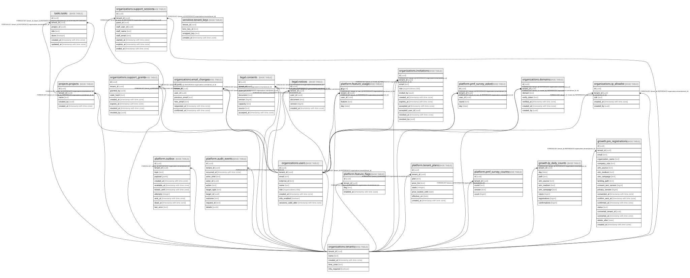

# app

## Tables

| Name                                                                | Columns | Comment                                                                                                                                                                                                                     | Type       |
| ------------------------------------------------------------------- | ------- | --------------------------------------------------------------------------------------------------------------------------------------------------------------------------------------------------------------------------- | ---------- |
| [projects.projects](projects.projects.md)                           | 5       | プロジェクト。タスクのまとまり。docs/domain/projects                                                                                                                                                                        | BASE TABLE |
| [tasks.tasks](tasks.tasks.md)                                       | 7       | タスク。プロジェクトの中のやること。docs/domain/tasks                                                                                                                                                                       | BASE TABLE |
| [organizations.tenants](organizations.tenants.md)                   | 5       | 組織(テナント)。tenant_id がこのシステムでの会社の単位。docs/domain/organizations                                                                                                                                           | BASE TABLE |
| [organizations.users](organizations.users.md)                       | 9       | 組織の中の人とロール(admin / member / viewer)。いまは1人=1組織。docs/domain/organizations                                                                                                                                   | BASE TABLE |
| [platform.outbox](platform.outbox.md)                               | 11      | 送信待ち(アウトボックス)。業務の変更と同じトランザクションで積み、送り出しが後で送る。アプリは書くだけ。docs/adr/0006-outbox.md                                                                                             | BASE TABLE |
| [platform.audit_events](platform.audit_events.md)                   | 11      | 監査ログ(誰が・いつ・何をしたか)。足すだけで直せない・消せない(トリガー)。値は入れない。docs/specs/0003-audit-log.md・ADR 0013                                                                                              | BASE TABLE |
| [organizations.support_grants](organizations.support_grants.md)     | 8       | サポートへの許可(管理者が期限つきで出す)。番号は持たない。社員は support_find_grant 関数で番号のハッシュから探す。docs/specs/0004-support-access.md                                                                         | BASE TABLE |
| [organizations.support_sessions](organizations.support_sessions.md) | 9       | 社員の代理ログインの入室(閲覧者・最長1時間)。認可の関所が毎回、終わっていない・期限内・許可が生きているかを確かめる                                                                                                         | BASE TABLE |
| [organizations.email_changes](organizations.email_changes.md)       | 7       | 本人のメールアドレスの変更の申し込み。生きているのは本人の最新・未確認・24時間以内の1件。docs/specs/0006-account-security.md                                                                                                | BASE TABLE |
| [legal.consents](legal.consents.md)                                 | 8       | 利用規約・プライバシーポリシーへの同意の記録(足すだけ。アプリは読む・足すだけ)。版の一覧は @app/shared の LEGAL_VERSIONS。docs/specs/0009-legal-consent.md                                                                  | BASE TABLE |
| [legal.notices](legal.notices.md)                                   | 6       | 規約の変更のお知らせのメールを送ると決めた記録(運営のコマンド legal-notify が足す)。周知の証拠と、2回送らない守り。docs/runbooks/legal-notice.md                                                                            | BASE TABLE |
| [platform.feature_flags](platform.feature_flags.md)                 | 4       | 組織ごとの機能フラグ(行がある = その組織に機能を入れた)。定義は @app/shared の FEATURE_FLAGS。アプリは読むだけで、入れる・切るのは運営のコマンド feature-flag。docs/specs/0012-feature-flags-and-usage.md                   | BASE TABLE |
| [platform.feature_usage](platform.feature_usage.md)                 | 5       | 利用の記録(この人がこの日にこの機能を使った。1日1人1機能1行)。中身・時刻・URL・IP は持たない。アプリは読む・足すだけ。400日で運営のコマンド usage-purge が消す。docs/specs/0012-feature-flags-and-usage.md                  | BASE TABLE |
| [sensitive.tenant_keys](sensitive.tenant_keys.md)                   | 4       | 組織ごとのデータ鍵(要配慮個人情報を暗号化する鍵。KMS で包んだ物だけ)。読めるのはロール app_sensitive だけ(app_rw はスキーマに入れない)。行を消すとその組織の要配慮の暗号文は読めない。docs/adr/0029-sensitive-data-tier1.md | BASE TABLE |
| [organizations.invitations](organizations.invitations.md)           | 11      | 管理者が出した招待(docs/specs/0027-invitations.md・ADR 0040)。リンクの札は持たない(招待の ID とサーバーの秘密の署名)。受けるのは auth_accept_invitation 関数だけ(1回きり)                                                   | BASE TABLE |
| [platform.tenant_plans](platform.tenant_plans.md)                   | 8       | 組織の契約のプラン(docs/specs/0047-plans.md・ADR 0058)。足すだけ。いまの行は effective_on が今日までで一番新しい行。書くのは運営のコマンド plan・create-tenant だけ。金額は持たない                                         | BASE TABLE |
| [platform.pmf_survey_asked](platform.pmf_survey_asked.md)           | 5       | 「無くなったら困るか」をこの回(四半期)に答え終えた人の印(1人1回にするため)。**答えは持たない**。アプリは読む・足すだけ。400日で運営のコマンド pmf-survey-purge が消す。docs/specs/0046-pmf-survey.md                        | BASE TABLE |
| [platform.pmf_survey_counts](platform.pmf_survey_counts.md)         | 5       | 「無くなったら困るか」の答えの数(組織・回・答えごと)。**人の ID も時刻も持たない**(だれが何と答えたかを結びつけない)。アプリは読む・足す・数を増やすだけ。docs/specs/0046-pmf-survey.md                                     | BASE TABLE |
| [growth.lp_daily_counts](growth.lp_daily_counts.md)                 | 9       | 公開の LP の日ごと・ページ・来た所(UTM)ごとの見た数・登録・確認(個人の行は持たない。3年で消す)。docs/domain/growth                                                                                                          | BASE TABLE |
| [growth.pre_registrations](growth.pre_registrations.md)             | 19      | 公開の LP の事前登録(運営の組織の持ち物)。確認待ち → 確認済み → 組織にした。消す日を過ぎたら pre-registrations-purge が消す。docs/domain/growth                                                                             | BASE TABLE |

## Stored procedures and functions

| Name                                 | ReturnType | Arguments                                                        | Type     |
| ------------------------------------ | ---------- | ---------------------------------------------------------------- | -------- |
| public.app_current_tenant            | uuid       |                                                                  | FUNCTION |
| public.auth_find_user_by_email       | record     | p_email text                                                     | FUNCTION |
| public.auth_find_user_by_external_id | record     | p_external_id text                                               | FUNCTION |
| public.outbox_claim                  | outbox     | p_limit integer, p_lease_seconds integer                         | FUNCTION |
| public.outbox_mark_sent              | void       | p_id uuid                                                        | FUNCTION |
| public.outbox_mark_failed            | void       | p_id uuid, p_error text, p_retry_seconds integer, p_dead boolean | FUNCTION |
| public.auth_link_external_id         | record     | p_email text, p_external_id text                                 | FUNCTION |
| platform.audit_events_append_only    | trigger    |                                                                  | FUNCTION |
| public.support_find_grant            | record     | p_code_hash text                                                 | FUNCTION |
| public.auth_email_in_use             | bool       | p_email text, p_user_id uuid                                     | FUNCTION |
| public.legal_notice_tenants          | uuid       |                                                                  | FUNCTION |
| public.operator_tenant_ids           | uuid       |                                                                  | FUNCTION |
| public.auth_accept_invitation        | record     | p_id uuid, p_user_id uuid, p_name text                           | FUNCTION |

## Enums

| Name               | Values                |
| ------------------ | --------------------- |
| organizations.role | admin, member, viewer |

## Relations

---

> Generated by [tbls](https://github.com/k1LoW/tbls)
