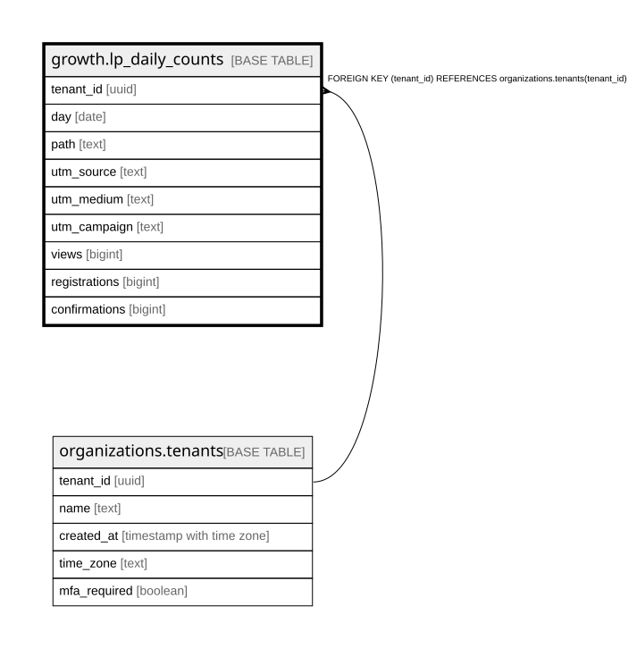

# growth.lp_daily_counts

## Description

公開の LP の日ごと・ページ・来た所(UTM)ごとの見た数・登録・確認(個人の行は持たない。3年で消す)。docs/domain/growth

## Columns

| Name          | Type    | Default | Nullable | Children | Parents                                           | Comment |
| ------------- | ------- | ------- | -------- | -------- | ------------------------------------------------- | ------- |
| tenant_id     | uuid    |         | false    |          | [organizations.tenants](organizations.tenants.md) |         |
| day           | date    |         | false    |          |                                                   |         |
| path          | text    |         | false    |          |                                                   |         |
| utm_source    | text    |         | false    |          |                                                   |         |
| utm_medium    | text    |         | false    |          |                                                   |         |
| utm_campaign  | text    |         | false    |          |                                                   |         |
| views         | integer | 0       | false    |          |                                                   |         |
| registrations | integer | 0       | false    |          |                                                   |         |
| confirmations | integer | 0       | false    |          |                                                   |         |

## Constraints

| Name                                           | Type        | Definition                                                               |
| ---------------------------------------------- | ----------- | ------------------------------------------------------------------------ |
| lp_daily_counts_tenant_id_tenants_tenant_id_fk | FOREIGN KEY | FOREIGN KEY (tenant_id) REFERENCES organizations.tenants(tenant_id)      |
| lp_daily_counts_pkey                           | PRIMARY KEY | PRIMARY KEY (tenant_id, day, path, utm_source, utm_medium, utm_campaign) |

## Indexes

| Name                 | Definition                                                                                                                                  |
| -------------------- | ------------------------------------------------------------------------------------------------------------------------------------------- |
| lp_daily_counts_pkey | CREATE UNIQUE INDEX lp_daily_counts_pkey ON growth.lp_daily_counts USING btree (tenant_id, day, path, utm_source, utm_medium, utm_campaign) |

## Relations

---

> Generated by [tbls](https://github.com/k1LoW/tbls)
