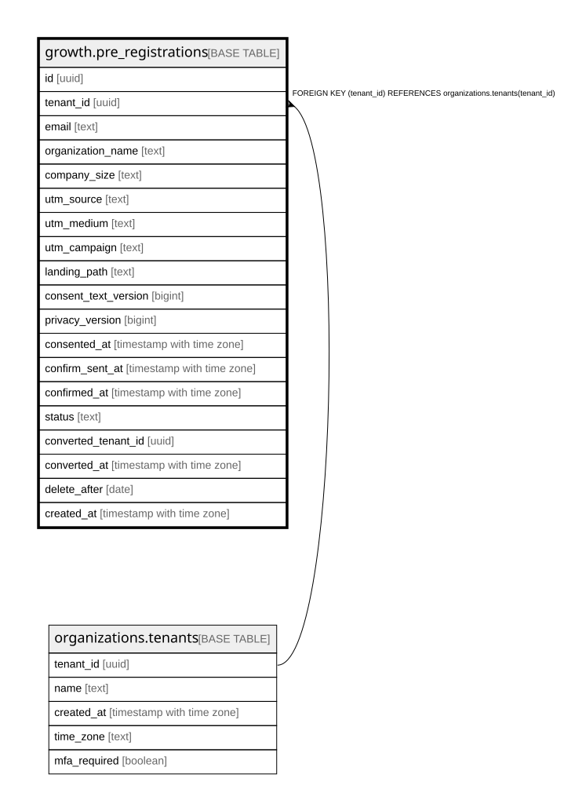

# growth.pre_registrations

## Description

公開の LP の事前登録(運営の組織の持ち物)。確認待ち → 確認済み → 組織にした。消す日を過ぎたら pre-registrations-purge が消す。docs/domain/growth

## Columns

| Name                 | Type                     | Default         | Nullable | Children | Parents                                           | Comment                                                                                     |
| -------------------- | ------------------------ | --------------- | -------- | -------- | ------------------------------------------------- | ------------------------------------------------------------------------------------------- |
| id                   | uuid                     |                 | false    |          |                                                   |                                                                                             |
| tenant_id            | uuid                     |                 | false    |          | [organizations.tenants](organizations.tenants.md) |                                                                                             |
| email                | text                     |                 | false    |          |                                                   |                                                                                             |
| organization_name    | text                     |                 | false    |          |                                                   |                                                                                             |
| company_size         | text                     | ''::text        | false    |          |                                                   |                                                                                             |
| utm_source           | text                     | ''::text        | false    |          |                                                   |                                                                                             |
| utm_medium           | text                     | ''::text        | false    |          |                                                   |                                                                                             |
| utm_campaign         | text                     | ''::text        | false    |          |                                                   |                                                                                             |
| landing_path         | text                     | '/'::text       | false    |          |                                                   |                                                                                             |
| consent_text_version | bigint                   |                 | false    |          |                                                   |                                                                                             |
| privacy_version      | bigint                   |                 | true     |          |                                                   |                                                                                             |
| consented_at         | timestamp with time zone | now()           | false    |          |                                                   |                                                                                             |
| confirm_sent_at      | timestamp with time zone | now()           | false    |          |                                                   | 確認のメールを積んだ時刻(同じアドレスへは24時間に1通。確認のリンクの署名はこの時刻から作る) |
| confirmed_at         | timestamp with time zone |                 | true     |          |                                                   |                                                                                             |
| status               | text                     | 'pending'::text | false    |          |                                                   |                                                                                             |
| converted_tenant_id  | uuid                     |                 | true     |          |                                                   |                                                                                             |
| converted_at         | timestamp with time zone |                 | true     |          |                                                   |                                                                                             |
| delete_after         | date                     |                 | false    |          |                                                   | この日を過ぎたら消す(確認待ち7日・確認済みは登録から1年・組織にしてから30日)                |
| created_at           | timestamp with time zone | now()           | false    |          |                                                   |                                                                                             |

## Constraints

| Name                                             | Type        | Definition                                                          |
| ------------------------------------------------ | ----------- | ------------------------------------------------------------------- |
| pre_registrations_tenant_id_tenants_tenant_id_fk | FOREIGN KEY | FOREIGN KEY (tenant_id) REFERENCES organizations.tenants(tenant_id) |
| pre_registrations_pkey                           | PRIMARY KEY | PRIMARY KEY (id)                                                    |
| pre_registrations_email_key                      | UNIQUE      | UNIQUE (tenant_id, email)                                           |

## Indexes

| Name                               | Definition                                                                                                        |
| ---------------------------------- | ----------------------------------------------------------------------------------------------------------------- |
| pre_registrations_pkey             | CREATE UNIQUE INDEX pre_registrations_pkey ON growth.pre_registrations USING btree (id)                           |
| pre_registrations_email_key        | CREATE UNIQUE INDEX pre_registrations_email_key ON growth.pre_registrations USING btree (tenant_id, email)        |
| pre_registrations_delete_after_idx | CREATE INDEX pre_registrations_delete_after_idx ON growth.pre_registrations USING btree (tenant_id, delete_after) |
| pre_registrations_status_idx       | CREATE INDEX pre_registrations_status_idx ON growth.pre_registrations USING btree (tenant_id, status, created_at) |

## Relations

---

> Generated by [tbls](https://github.com/k1LoW/tbls)
