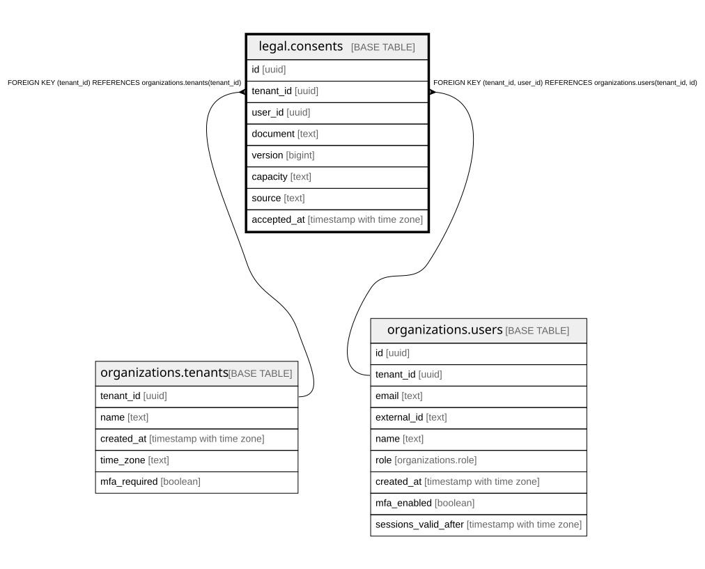

# legal.consents

## Description

利用規約・プライバシーポリシーへの同意の記録(足すだけ。アプリは読む・足すだけ)。版の一覧は @app/shared の LEGAL_VERSIONS。docs/specs/0008-legal-consent.md

## Columns

| Name        | Type                     | Default | Nullable | Children | Parents                                                                                         | Comment                                                                |
| ----------- | ------------------------ | ------- | -------- | -------- | ----------------------------------------------------------------------------------------------- | ---------------------------------------------------------------------- |
| id          | uuid                     |         | false    |          |                                                                                                 |                                                                        |
| tenant_id   | uuid                     |         | false    |          | [organizations.tenants](organizations.tenants.md) [organizations.users](organizations.users.md) |                                                                        |
| user_id     | uuid                     |         | false    |          | [organizations.users](organizations.users.md)                                                   |                                                                        |
| document    | text                     |         | false    |          |                                                                                                 | terms / privacy                                                        |
| version     | bigint                   |         | false    |          |                                                                                                 | 文書ごとの版(1, 2, 3 …)                                                |
| capacity    | text                     |         | false    |          |                                                                                                 | organization(利用規約を管理者が。契約者として)/ individual(本人として) |
| source      | text                     |         | false    |          |                                                                                                 | どの画面から(sign_up = 登録 / acceptance = 同意の画面)                 |
| accepted_at | timestamp with time zone | now()   | false    |          |                                                                                                 | 同意した時刻(同じ版への2回目は記録しない)                              |

## Constraints

| Name                                    | Type        | Definition                                                                     |
| --------------------------------------- | ----------- | ------------------------------------------------------------------------------ |
| consents_tenant_id_tenants_tenant_id_fk | FOREIGN KEY | FOREIGN KEY (tenant_id) REFERENCES organizations.tenants(tenant_id)            |
| consents_user_fkey                      | FOREIGN KEY | FOREIGN KEY (tenant_id, user_id) REFERENCES organizations.users(tenant_id, id) |
| consents_pkey                           | PRIMARY KEY | PRIMARY KEY (id)                                                               |
| consents_user_version_key               | UNIQUE      | UNIQUE (tenant_id, user_id, document, version)                                 |

## Indexes

| Name                      | Definition                                                                                                          |
| ------------------------- | ------------------------------------------------------------------------------------------------------------------- |
| consents_pkey             | CREATE UNIQUE INDEX consents_pkey ON legal.consents USING btree (id)                                                |
| consents_user_version_key | CREATE UNIQUE INDEX consents_user_version_key ON legal.consents USING btree (tenant_id, user_id, document, version) |

## Relations

---

> Generated by [tbls](https://github.com/k1LoW/tbls)
