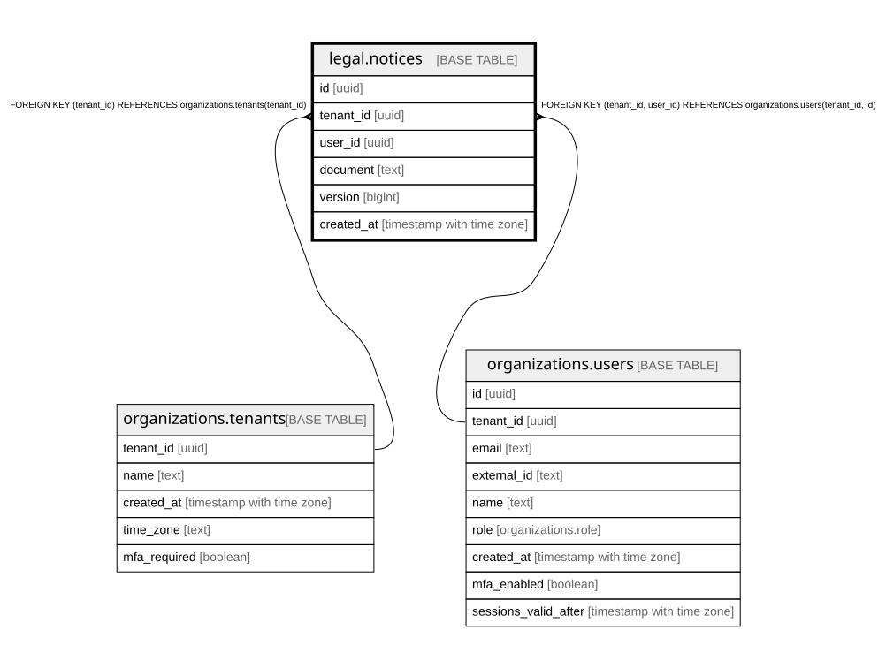

# legal.notices

## Description

規約の変更のお知らせのメールを送ると決めた記録(運営のコマンド legal-notify が足す)。周知の証拠と、2回送らない守り。docs/runbooks/legal-notice.md

## Columns

| Name       | Type                     | Default | Nullable | Children | Parents                                                                                         | Comment                                                             |
| ---------- | ------------------------ | ------- | -------- | -------- | ----------------------------------------------------------------------------------------------- | ------------------------------------------------------------------- |
| id         | uuid                     |         | false    |          |                                                                                                 |                                                                     |
| tenant_id  | uuid                     |         | false    |          | [organizations.tenants](organizations.tenants.md) [organizations.users](organizations.users.md) |                                                                     |
| user_id    | uuid                     |         | false    |          | [organizations.users](organizations.users.md)                                                   |                                                                     |
| document   | text                     |         | false    |          |                                                                                                 |                                                                     |
| version    | bigint                   |         | false    |          |                                                                                                 |                                                                     |
| created_at | timestamp with time zone | now()   | false    |          |                                                                                                 | 送ると決めた時刻(Postfix に渡した時刻は platform.outbox の sent_at) |

## Constraints

| Name                                   | Type        | Definition                                                                     |
| -------------------------------------- | ----------- | ------------------------------------------------------------------------------ |
| notices_tenant_id_tenants_tenant_id_fk | FOREIGN KEY | FOREIGN KEY (tenant_id) REFERENCES organizations.tenants(tenant_id)            |
| notices_user_fkey                      | FOREIGN KEY | FOREIGN KEY (tenant_id, user_id) REFERENCES organizations.users(tenant_id, id) |
| notices_pkey                           | PRIMARY KEY | PRIMARY KEY (id)                                                               |
| notices_user_version_key               | UNIQUE      | UNIQUE (tenant_id, user_id, document, version)                                 |

## Indexes

| Name                     | Definition                                                                                                        |
| ------------------------ | ----------------------------------------------------------------------------------------------------------------- |
| notices_pkey             | CREATE UNIQUE INDEX notices_pkey ON legal.notices USING btree (id)                                                |
| notices_user_version_key | CREATE UNIQUE INDEX notices_user_version_key ON legal.notices USING btree (tenant_id, user_id, document, version) |

## Relations

---

> Generated by [tbls](https://github.com/k1LoW/tbls)
