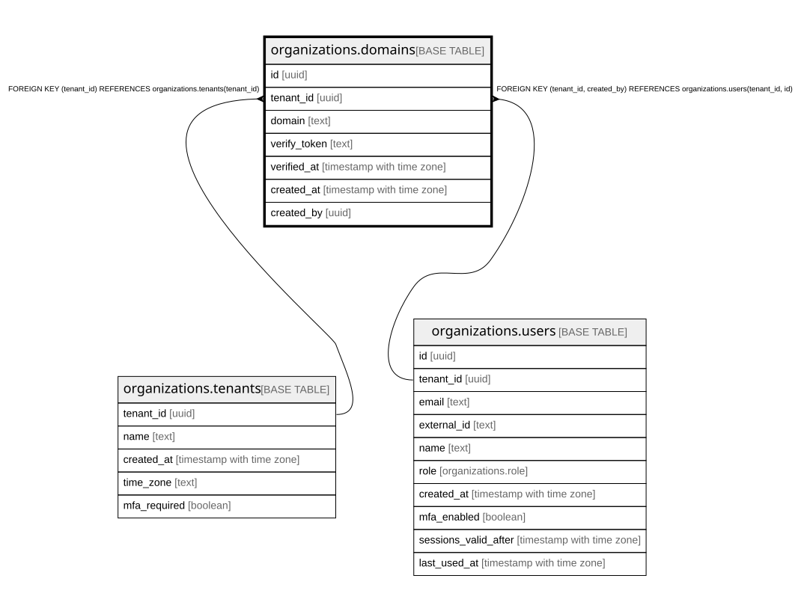

# organizations.domains

## Description

組織が登録した会社のドメイン(docs/specs/0056-sso-scim-ip-audit-export.md・ADR 0067)。DNS の TXT で確かめた物だけを SSO に使う。確かめたドメインは全体で1つの組織だけ(domains_verified_domain_key)

## Columns

| Name         | Type                     | Default | Nullable | Children | Parents                                                                                         | Comment                                                                                   |
| ------------ | ------------------------ | ------- | -------- | -------- | ----------------------------------------------------------------------------------------------- | ----------------------------------------------------------------------------------------- |
| id           | uuid                     |         | false    |          |                                                                                                 |                                                                                           |
| tenant_id    | uuid                     |         | false    |          | [organizations.tenants](organizations.tenants.md) [organizations.users](organizations.users.md) |                                                                                           |
| domain       | text                     |         | false    |          |                                                                                                 |                                                                                           |
| verify_token | text                     |         | false    |          |                                                                                                 | DNS の TXT(_sfs-verify.\<ドメイン\>)に置く確かめの文字。公開の DNS に出るので秘密ではない |
| verified_at  | timestamp with time zone |         | true     |          |                                                                                                 | DNS で確かめた時刻(アプリが書けるのはこの列だけ)                                          |
| created_at   | timestamp with time zone | now()   | false    |          |                                                                                                 |                                                                                           |
| created_by   | uuid                     |         | false    |          | [organizations.users](organizations.users.md)                                                   |                                                                                           |

## Constraints

| Name                                   | Type        | Definition                                                                        |
| -------------------------------------- | ----------- | --------------------------------------------------------------------------------- |
| domains_tenant_id_tenants_tenant_id_fk | FOREIGN KEY | FOREIGN KEY (tenant_id) REFERENCES organizations.tenants(tenant_id)               |
| domains_created_by_fkey                | FOREIGN KEY | FOREIGN KEY (tenant_id, created_by) REFERENCES organizations.users(tenant_id, id) |
| domains_pkey                           | PRIMARY KEY | PRIMARY KEY (id)                                                                  |
| domains_tenant_id_id_key               | UNIQUE      | UNIQUE (tenant_id, id)                                                            |

## Indexes

| Name                        | Definition                                                                                                                    |
| --------------------------- | ----------------------------------------------------------------------------------------------------------------------------- |
| domains_pkey                | CREATE UNIQUE INDEX domains_pkey ON organizations.domains USING btree (id)                                                    |
| domains_tenant_id_id_key    | CREATE UNIQUE INDEX domains_tenant_id_id_key ON organizations.domains USING btree (tenant_id, id)                             |
| domains_tenant_domain_key   | CREATE UNIQUE INDEX domains_tenant_domain_key ON organizations.domains USING btree (tenant_id, domain)                        |
| domains_verified_domain_key | CREATE UNIQUE INDEX domains_verified_domain_key ON organizations.domains USING btree (domain) WHERE (verified_at IS NOT NULL) |

## Relations

---

> Generated by [tbls](https://github.com/k1LoW/tbls)
