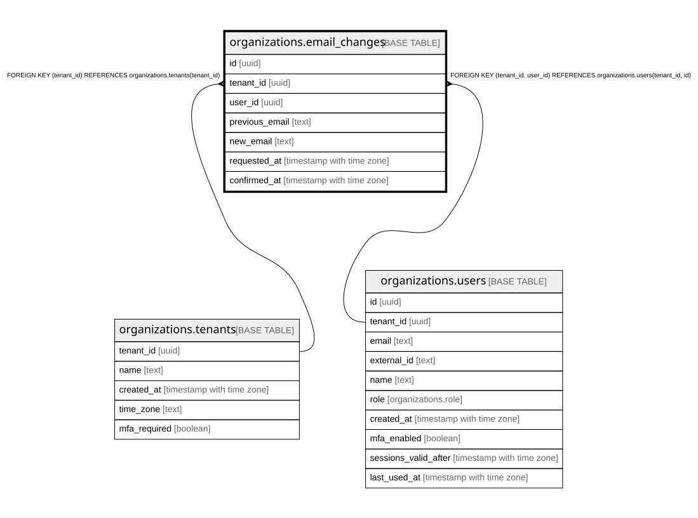

# organizations.email_changes

## Description

本人のメールアドレスの変更の申し込み。生きているのは本人の最新・未確認・24時間以内の1件。docs/specs/0006-account-security.md

## Columns

| Name           | Type                     | Default | Nullable | Children | Parents                                                                                         | Comment                                                    |
| -------------- | ------------------------ | ------- | -------- | -------- | ----------------------------------------------------------------------------------------------- | ---------------------------------------------------------- |
| id             | uuid                     |         | false    |          |                                                                                                 |                                                            |
| tenant_id      | uuid                     |         | false    |          | [organizations.tenants](organizations.tenants.md) [organizations.users](organizations.users.md) |                                                            |
| user_id        | uuid                     |         | false    |          | [organizations.users](organizations.users.md)                                                   |                                                            |
| previous_email | text                     |         | false    |          |                                                                                                 | 申し込んだときのアドレス(変わったら、ここへお知らせを送る) |
| new_email      | text                     |         | false    |          |                                                                                                 |                                                            |
| requested_at   | timestamp with time zone | now()   | false    |          |                                                                                                 |                                                            |
| confirmed_at   | timestamp with time zone |         | true     |          |                                                                                                 | 確認コードで変わった時刻                                   |

## Constraints

| Name                                         | Type        | Definition                                                                     |
| -------------------------------------------- | ----------- | ------------------------------------------------------------------------------ |
| email_changes_tenant_id_tenants_tenant_id_fk | FOREIGN KEY | FOREIGN KEY (tenant_id) REFERENCES organizations.tenants(tenant_id)            |
| email_changes_user_fkey                      | FOREIGN KEY | FOREIGN KEY (tenant_id, user_id) REFERENCES organizations.users(tenant_id, id) |
| email_changes_pkey                           | PRIMARY KEY | PRIMARY KEY (id)                                                               |

## Indexes

| Name                   | Definition                                                                                                                        |
| ---------------------- | --------------------------------------------------------------------------------------------------------------------------------- |
| email_changes_pkey     | CREATE UNIQUE INDEX email_changes_pkey ON organizations.email_changes USING btree (id)                                            |
| email_changes_user_idx | CREATE INDEX email_changes_user_idx ON organizations.email_changes USING btree (tenant_id, user_id, requested_at DESC NULLS LAST) |

## Relations

---

> Generated by [tbls](https://github.com/k1LoW/tbls)
