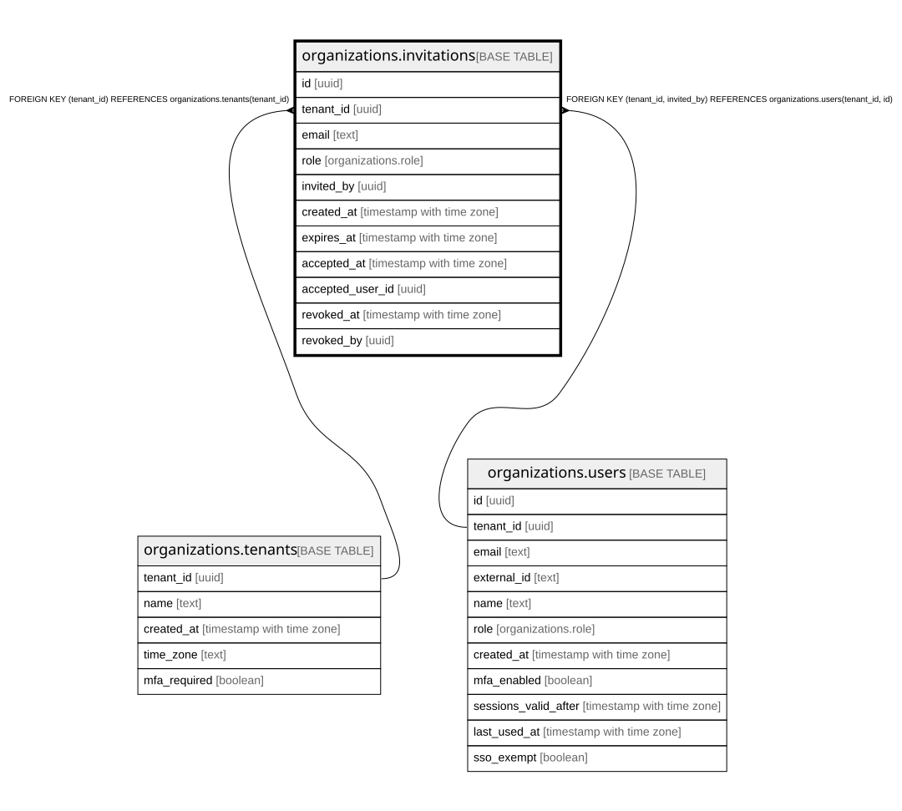

# organizations.invitations

## Description

管理者が出した招待(docs/specs/0027-invitations.md・ADR 0040)。リンクの札は持たない(招待の ID とサーバーの秘密の署名)。受けるのは auth_accept_invitation 関数だけ(1回きり)

## Columns

| Name             | Type                     | Default | Nullable | Children | Parents                                                                                         | Comment                                  |
| ---------------- | ------------------------ | ------- | -------- | -------- | ----------------------------------------------------------------------------------------------- | ---------------------------------------- |
| id               | uuid                     |         | false    |          |                                                                                                 |                                          |
| tenant_id        | uuid                     |         | false    |          | [organizations.tenants](organizations.tenants.md) [organizations.users](organizations.users.md) |                                          |
| email            | text                     |         | false    |          |                                                                                                 |                                          |
| role             | organizations.role       |         | false    |          |                                                                                                 |                                          |
| invited_by       | uuid                     |         | false    |          | [organizations.users](organizations.users.md)                                                   |                                          |
| created_at       | timestamp with time zone | now()   | false    |          |                                                                                                 |                                          |
| expires_at       | timestamp with time zone |         | false    |          |                                                                                                 | リンクの期限(作ってから7日)              |
| accepted_at      | timestamp with time zone |         | true     |          |                                                                                                 | 受けた時刻(入ったら、もう使えない)       |
| accepted_user_id | uuid                     |         | true     |          |                                                                                                 | 受けてできた users の行                  |
| revoked_at       | timestamp with time zone |         | true     |          |                                                                                                 | 取り消した時刻(リンクはすぐ使えなくなる) |
| revoked_by       | uuid                     |         | true     |          |                                                                                                 |                                          |

## Constraints

| Name                                       | Type        | Definition                                                                        |
| ------------------------------------------ | ----------- | --------------------------------------------------------------------------------- |
| invitations_tenant_id_tenants_tenant_id_fk | FOREIGN KEY | FOREIGN KEY (tenant_id) REFERENCES organizations.tenants(tenant_id)               |
| invitations_invited_by_fkey                | FOREIGN KEY | FOREIGN KEY (tenant_id, invited_by) REFERENCES organizations.users(tenant_id, id) |
| invitations_pkey                           | PRIMARY KEY | PRIMARY KEY (id)                                                                  |
| invitations_tenant_id_id_key               | UNIQUE      | UNIQUE (tenant_id, id)                                                            |

## Indexes

| Name                         | Definition                                                                                                                             |
| ---------------------------- | -------------------------------------------------------------------------------------------------------------------------------------- |
| invitations_pkey             | CREATE UNIQUE INDEX invitations_pkey ON organizations.invitations USING btree (id)                                                     |
| invitations_tenant_id_id_key | CREATE UNIQUE INDEX invitations_tenant_id_id_key ON organizations.invitations USING btree (tenant_id, id)                              |
| invitations_list_idx         | CREATE INDEX invitations_list_idx ON organizations.invitations USING btree (tenant_id, created_at DESC NULLS LAST, id DESC NULLS LAST) |
| invitations_email_idx        | CREATE INDEX invitations_email_idx ON organizations.invitations USING btree (tenant_id, email)                                         |

## Relations

---

> Generated by [tbls](https://github.com/k1LoW/tbls)
