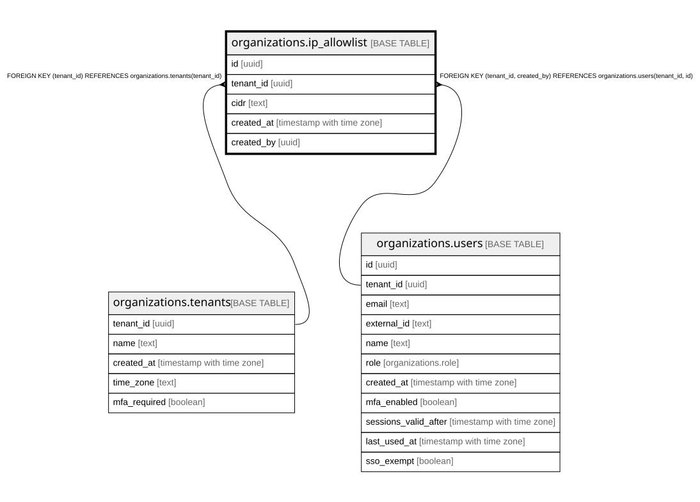

# organizations.ip_allowlist

## Description

組織に入れる IP の範囲(docs/specs/0056-sso-scim-ip-audit-export.md)。空なら制限しない。管理者が一覧ごと入れ替える(20 まで)。プランの機能 ip-allowlist が入っているときだけ効く

## Columns

| Name       | Type                     | Default | Nullable | Children | Parents                                                                                         | Comment                                       |
| ---------- | ------------------------ | ------- | -------- | -------- | ----------------------------------------------------------------------------------------------- | --------------------------------------------- |
| id         | uuid                     |         | false    |          |                                                                                                 |                                               |
| tenant_id  | uuid                     |         | false    |          | [organizations.tenants](organizations.tenants.md) [organizations.users](organizations.users.md) |                                               |
| cidr       | text                     |         | false    |          |                                                                                                 | IP の範囲(203.0.113.0/24・2001:db8::/32 の形) |
| created_at | timestamp with time zone | now()   | false    |          |                                                                                                 |                                               |
| created_by | uuid                     |         | false    |          | [organizations.users](organizations.users.md)                                                   |                                               |

## Constraints

| Name                                        | Type        | Definition                                                                        |
| ------------------------------------------- | ----------- | --------------------------------------------------------------------------------- |
| ip_allowlist_tenant_id_tenants_tenant_id_fk | FOREIGN KEY | FOREIGN KEY (tenant_id) REFERENCES organizations.tenants(tenant_id)               |
| ip_allowlist_created_by_fkey                | FOREIGN KEY | FOREIGN KEY (tenant_id, created_by) REFERENCES organizations.users(tenant_id, id) |
| ip_allowlist_pkey                           | PRIMARY KEY | PRIMARY KEY (id)                                                                  |

## Indexes

| Name                    | Definition                                                                                 |
| ----------------------- | ------------------------------------------------------------------------------------------ |
| ip_allowlist_pkey       | CREATE UNIQUE INDEX ip_allowlist_pkey ON organizations.ip_allowlist USING btree (id)       |
| ip_allowlist_tenant_idx | CREATE INDEX ip_allowlist_tenant_idx ON organizations.ip_allowlist USING btree (tenant_id) |

## Relations

---

> Generated by [tbls](https://github.com/k1LoW/tbls)
