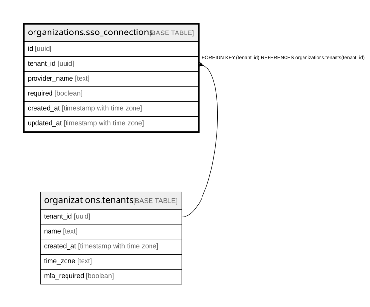

# organizations.sso_connections

## Description

組織につないだ SAML の IdP(docs/specs/0056-sso-scim-ip-audit-export.md・ADR 0067)。1組織に1つ・1つの IdP は1つの組織だけ。行を足す・消すのは運営のコマンド sso-connect(表の持ち主)。アプリは必須の入切だけ

## Columns

| Name          | Type                     | Default | Nullable | Children | Parents                                           | Comment                                                                                             |
| ------------- | ------------------------ | ------- | -------- | -------- | ------------------------------------------------- | --------------------------------------------------------------------------------------------------- |
| id            | uuid                     |         | false    |          |                                                   |                                                                                                     |
| tenant_id     | uuid                     |         | false    |          | [organizations.tenants](organizations.tenants.md) |                                                                                                     |
| provider_name | text                     |         | false    |          |                                                   | Cognito の IdP の名前(org-\<組織の ID の後ろ 20 桁\>)。SSO で戻ってきた人の組織は、この名前で決まる |
| required      | boolean                  | false   | false    |          |                                                   | SSO を必須にしているか(管理者が入切。緊急用の管理者が1人以上要る)                                   |
| created_at    | timestamp with time zone | now()   | false    |          |                                                   |                                                                                                     |
| updated_at    | timestamp with time zone |         | true     |          |                                                   |                                                                                                     |

## Constraints

| Name                                           | Type        | Definition                                                          |
| ---------------------------------------------- | ----------- | ------------------------------------------------------------------- |
| sso_connections_tenant_id_tenants_tenant_id_fk | FOREIGN KEY | FOREIGN KEY (tenant_id) REFERENCES organizations.tenants(tenant_id) |
| sso_connections_pkey                           | PRIMARY KEY | PRIMARY KEY (id)                                                    |

## Indexes

| Name                         | Definition                                                                                                    |
| ---------------------------- | ------------------------------------------------------------------------------------------------------------- |
| sso_connections_pkey         | CREATE UNIQUE INDEX sso_connections_pkey ON organizations.sso_connections USING btree (id)                    |
| sso_connections_tenant_key   | CREATE UNIQUE INDEX sso_connections_tenant_key ON organizations.sso_connections USING btree (tenant_id)       |
| sso_connections_provider_key | CREATE UNIQUE INDEX sso_connections_provider_key ON organizations.sso_connections USING btree (provider_name) |

## Relations

---

> Generated by [tbls](https://github.com/k1LoW/tbls)
