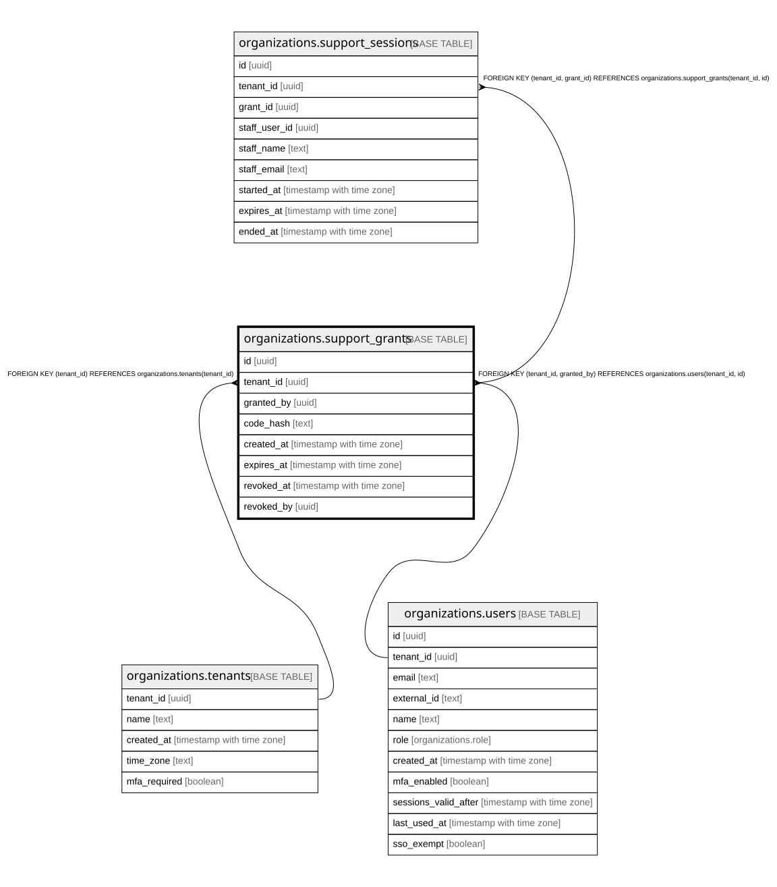

# organizations.support_grants

## Description

サポートへの許可(管理者が期限つきで出す)。番号は持たない。社員は support_find_grant 関数で番号のハッシュから探す。docs/specs/0004-support-access.md

## Columns

| Name       | Type                     | Default | Nullable | Children                                                            | Parents                                                                                         | Comment                                                    |
| ---------- | ------------------------ | ------- | -------- | ------------------------------------------------------------------- | ----------------------------------------------------------------------------------------------- | ---------------------------------------------------------- |
| id         | uuid                     |         | false    | [organizations.support_sessions](organizations.support_sessions.md) |                                                                                                 |                                                            |
| tenant_id  | uuid                     |         | false    | [organizations.support_sessions](organizations.support_sessions.md) | [organizations.tenants](organizations.tenants.md) [organizations.users](organizations.users.md) |                                                            |
| granted_by | uuid                     |         | false    |                                                                     | [organizations.users](organizations.users.md)                                                   |                                                            |
| code_hash  | text                     |         | false    |                                                                     |                                                                                                 | サポート番号の SHA-256(番号そのものは保存しない)           |
| created_at | timestamp with time zone | now()   | false    |                                                                     |                                                                                                 |                                                            |
| expires_at | timestamp with time zone |         | false    |                                                                     |                                                                                                 |                                                            |
| revoked_at | timestamp with time zone |         | true     |                                                                     |                                                                                                 | 取り消した時刻(入っている社員も次のリクエストから入れない) |
| revoked_by | uuid                     |         | true     |                                                                     |                                                                                                 |                                                            |

## Constraints

| Name                                          | Type        | Definition                                                                        |
| --------------------------------------------- | ----------- | --------------------------------------------------------------------------------- |
| support_grants_tenant_id_tenants_tenant_id_fk | FOREIGN KEY | FOREIGN KEY (tenant_id) REFERENCES organizations.tenants(tenant_id)               |
| support_grants_granted_by_fkey                | FOREIGN KEY | FOREIGN KEY (tenant_id, granted_by) REFERENCES organizations.users(tenant_id, id) |
| support_grants_pkey                           | PRIMARY KEY | PRIMARY KEY (id)                                                                  |
| support_grants_tenant_id_id_key               | UNIQUE      | UNIQUE (tenant_id, id)                                                            |

## Indexes

| Name                            | Definition                                                                                                      |
| ------------------------------- | --------------------------------------------------------------------------------------------------------------- |
| support_grants_pkey             | CREATE UNIQUE INDEX support_grants_pkey ON organizations.support_grants USING btree (id)                        |
| support_grants_tenant_id_id_key | CREATE UNIQUE INDEX support_grants_tenant_id_id_key ON organizations.support_grants USING btree (tenant_id, id) |
| support_grants_code_hash_key    | CREATE UNIQUE INDEX support_grants_code_hash_key ON organizations.support_grants USING btree (code_hash)        |

## Relations

---

> Generated by [tbls](https://github.com/k1LoW/tbls)
