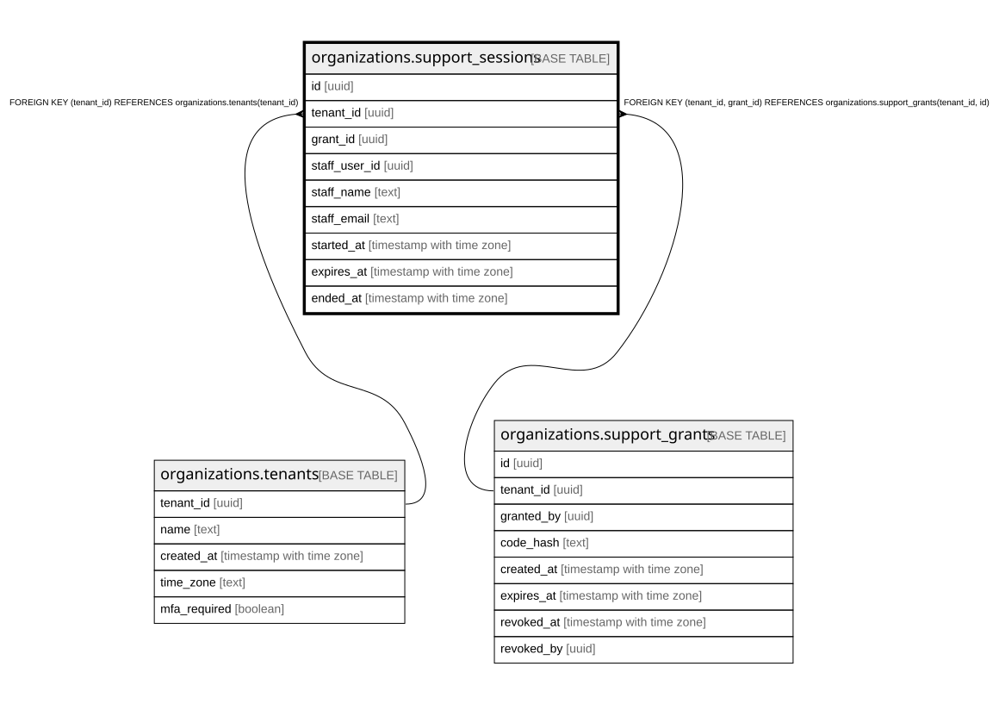

# organizations.support_sessions

## Description

社員の代理ログインの入室(閲覧者・最長1時間)。認可の関所が毎回、終わっていない・期限内・許可が生きているかを確かめる

## Columns

| Name          | Type                     | Default | Nullable | Children | Parents                                                                                                           | Comment                                                |
| ------------- | ------------------------ | ------- | -------- | -------- | ----------------------------------------------------------------------------------------------------------------- | ------------------------------------------------------ |
| id            | uuid                     |         | false    |          |                                                                                                                   |                                                        |
| tenant_id     | uuid                     |         | false    |          | [organizations.tenants](organizations.tenants.md) [organizations.support_grants](organizations.support_grants.md) |                                                        |
| grant_id      | uuid                     |         | false    |          | [organizations.support_grants](organizations.support_grants.md)                                                   |                                                        |
| staff_user_id | uuid                     |         | false    |          |                                                                                                                   | 社員(運営の組織の users。別の組織なので外部キーは無い) |
| staff_name    | text                     |         | false    |          |                                                                                                                   |                                                        |
| staff_email   | text                     |         | false    |          |                                                                                                                   |                                                        |
| started_at    | timestamp with time zone | now()   | false    |          |                                                                                                                   |                                                        |
| expires_at    | timestamp with time zone |         | false    |          |                                                                                                                   |                                                        |
| ended_at      | timestamp with time zone |         | true     |          |                                                                                                                   | 終えた時刻(自分で終えた・ログアウト・許可の取り消し)   |

## Constraints

| Name                                            | Type        | Definition                                                                               |
| ----------------------------------------------- | ----------- | ---------------------------------------------------------------------------------------- |
| support_sessions_tenant_id_tenants_tenant_id_fk | FOREIGN KEY | FOREIGN KEY (tenant_id) REFERENCES organizations.tenants(tenant_id)                      |
| support_sessions_grant_fkey                     | FOREIGN KEY | FOREIGN KEY (tenant_id, grant_id) REFERENCES organizations.support_grants(tenant_id, id) |
| support_sessions_pkey                           | PRIMARY KEY | PRIMARY KEY (id)                                                                         |

## Indexes

| Name                  | Definition                                                                                   |
| --------------------- | -------------------------------------------------------------------------------------------- |
| support_sessions_pkey | CREATE UNIQUE INDEX support_sessions_pkey ON organizations.support_sessions USING btree (id) |

## Relations

---

> Generated by [tbls](https://github.com/k1LoW/tbls)
