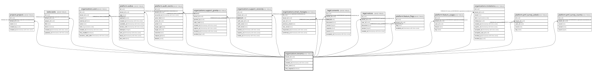

# organizations.tenants

## Description

組織(テナント)。tenant_id がこのシステムでの会社の単位。docs/domain/organizations

## Columns

| Name         | Type                     | Default            | Nullable | Children                                                                                                                                                                                                                                                                                                                                                                                                        | Parents | Comment                                                                                  |
| ------------ | ------------------------ | ------------------ | -------- | --------------------------------------------------------------------------------------------------------------------------------------------------------------------------------------------------------------------------------------------------------------------------------------------------------------------------------------------------------------------------------------------------------------- | ------- | ---------------------------------------------------------------------------------------- |
| tenant_id    | uuid                     |                    | false    | [projects.projects](projects.projects.md) [tasks.tasks](tasks.tasks.md) [organizations.users](organizations.users.md) [platform.outbox](platform.outbox.md) [platform.audit_events](platform.audit_events.md) [organizations.support_grants](organizations.support_grants.md) [organizations.support_sessions](organizations.support_sessions.md) [organizations.email_changes](organizations.email_changes.md) |         |                                                                                          |
| name         | text                     |                    | false    |                                                                                                                                                                                                                                                                                                                                                                                                                 |         |                                                                                          |
| created_at   | timestamp with time zone | now()              | false    |                                                                                                                                                                                                                                                                                                                                                                                                                 |         |                                                                                          |
| time_zone    | text                     | 'Asia/Tokyo'::text | false    |                                                                                                                                                                                                                                                                                                                                                                                                                 |         | 時刻を見せる時間帯・「1日」の区切り(IANA の名前。ADR 0005)                               |
| mfa_required | boolean                  | false              | false    |                                                                                                                                                                                                                                                                                                                                                                                                                 |         | 全員に二段階認証を必須にするか(管理者が入れ・切る。運営の組織は最初から true で切れない) |

## Constraints

| Name         | Type        | Definition              |
| ------------ | ----------- | ----------------------- |
| tenants_pkey | PRIMARY KEY | PRIMARY KEY (tenant_id) |

## Indexes

| Name         | Definition                                                                        |
| ------------ | --------------------------------------------------------------------------------- |
| tenants_pkey | CREATE UNIQUE INDEX tenants_pkey ON organizations.tenants USING btree (tenant_id) |

## Relations

---

> Generated by [tbls](https://github.com/k1LoW/tbls)
