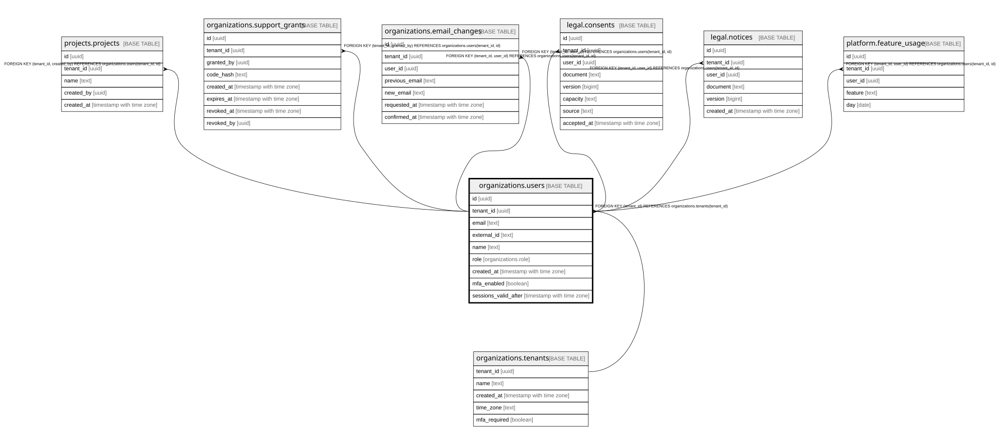

# organizations.users

## Description

組織の中の人とロール(admin / member / viewer)。いまは1人=1組織。docs/domain/organizations

## Columns

| Name                 | Type                     | Default | Nullable | Children                                                                                                                                                                | Parents                                           | Comment                                                                                      |
| -------------------- | ------------------------ | ------- | -------- | ----------------------------------------------------------------------------------------------------------------------------------------------------------------------- | ------------------------------------------------- | -------------------------------------------------------------------------------------------- |
| id                   | uuid                     |         | false    | [projects.projects](projects.projects.md) [organizations.support_grants](organizations.support_grants.md) [organizations.email_changes](organizations.email_changes.md) |                                                   |                                                                                              |
| tenant_id            | uuid                     |         | false    | [projects.projects](projects.projects.md) [organizations.support_grants](organizations.support_grants.md) [organizations.email_changes](organizations.email_changes.md) | [organizations.tenants](organizations.tenants.md) |                                                                                              |
| email                | text                     |         | false    |                                                                                                                                                                         |                                                   |                                                                                              |
| external_id          | text                     |         | true     |                                                                                                                                                                         |                                                   | 認証の製品(Cognito)側の ID(sub)                                                              |
| name                 | text                     |         | false    |                                                                                                                                                                         |                                                   |                                                                                              |
| role                 | organizations.role       |         | false    |                                                                                                                                                                         |                                                   | admin / member / viewer                                                                      |
| created_at           | timestamp with time zone | now()   | false    |                                                                                                                                                                         |                                                   |                                                                                              |
| mfa_enabled          | boolean                  | false   | false    |                                                                                                                                                                         |                                                   | 二段階認証が有効か(正は Cognito。ログインと確かめ直しのたびに写し直す)                       |
| sessions_valid_after | timestamp with time zone |         | true     |                                                                                                                                                                         |                                                   | これより前にログインしたセッションは使えない(パスワードなどを変えて、ほかの端末を切った時刻) |

## Constraints

| Name                                 | Type        | Definition                                                          |
| ------------------------------------ | ----------- | ------------------------------------------------------------------- |
| users_tenant_id_tenants_tenant_id_fk | FOREIGN KEY | FOREIGN KEY (tenant_id) REFERENCES organizations.tenants(tenant_id) |
| users_pkey                           | PRIMARY KEY | PRIMARY KEY (id)                                                    |
| users_tenant_id_id_key               | UNIQUE      | UNIQUE (tenant_id, id)                                              |

## Indexes

| Name                   | Definition                                                                                    |
| ---------------------- | --------------------------------------------------------------------------------------------- |
| users_pkey             | CREATE UNIQUE INDEX users_pkey ON organizations.users USING btree (id)                        |
| users_tenant_id_id_key | CREATE UNIQUE INDEX users_tenant_id_id_key ON organizations.users USING btree (tenant_id, id) |
| users_email_key        | CREATE UNIQUE INDEX users_email_key ON organizations.users USING btree (email)                |
| users_external_id_key  | CREATE UNIQUE INDEX users_external_id_key ON organizations.users USING btree (external_id)    |

## Relations

---

> Generated by [tbls](https://github.com/k1LoW/tbls)
