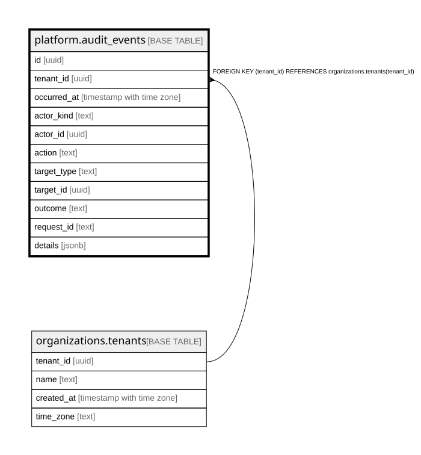

# platform.audit_events

## Description

監査ログ(誰が・いつ・何をしたか)。足すだけで直せない・消せない(トリガー)。値は入れない。docs/specs/0003-audit-log.md・ADR 0013

## Columns

| Name        | Type                     | Default     | Nullable | Children | Parents                                           | Comment                                                          |
| ----------- | ------------------------ | ----------- | -------- | -------- | ------------------------------------------------- | ---------------------------------------------------------------- |
| id          | uuid                     |             | false    |          |                                                   |                                                                  |
| tenant_id   | uuid                     |             | false    |          | [organizations.tenants](organizations.tenants.md) |                                                                  |
| occurred_at | timestamp with time zone | now()       | false    |          |                                                   |                                                                  |
| actor_kind  | text                     |             | false    |          |                                                   | user = 自社の人 / support = 代理ログインの社員 / system = 仕組み |
| actor_id    | uuid                     |             | true     |          |                                                   |                                                                  |
| action      | text                     |             | false    |          |                                                   | 何をしたか(対象.動作。apps/api/src/audit/actions.ts)             |
| target_type | text                     |             | true     |          |                                                   |                                                                  |
| target_id   | uuid                     |             | true     |          |                                                   |                                                                  |
| outcome     | text                     |             | false    |          |                                                   | allowed = できた / denied = 権限が無くて断った                   |
| request_id  | text                     |             | true     |          |                                                   |                                                                  |
| details     | jsonb                    | '{}'::jsonb | false    |          |                                                   | 直した項目の名前など(値は入れない)                               |

## Constraints

| Name                                        | Type        | Definition                                                                        |
| ------------------------------------------- | ----------- | --------------------------------------------------------------------------------- |
| audit_events_actor_kind_check               | CHECK       | CHECK ((actor_kind = ANY (ARRAY['user'::text, 'support'::text, 'system'::text]))) |
| audit_events_outcome_check                  | CHECK       | CHECK ((outcome = ANY (ARRAY['allowed'::text, 'denied'::text])))                  |
| audit_events_tenant_id_tenants_tenant_id_fk | FOREIGN KEY | FOREIGN KEY (tenant_id) REFERENCES organizations.tenants(tenant_id)               |
| audit_events_pkey                           | PRIMARY KEY | PRIMARY KEY (id)                                                                  |

## Indexes

| Name                       | Definition                                                                                                   |
| -------------------------- | ------------------------------------------------------------------------------------------------------------ |
| audit_events_pkey          | CREATE UNIQUE INDEX audit_events_pkey ON platform.audit_events USING btree (id)                              |
| audit_events_tenant_id_idx | CREATE INDEX audit_events_tenant_id_idx ON platform.audit_events USING btree (tenant_id, id DESC NULLS LAST) |

## Triggers

| Name                     | Definition                                                                                                                                               |
| ------------------------ | -------------------------------------------------------------------------------------------------------------------------------------------------------- |
| audit_events_no_update   | CREATE TRIGGER audit_events_no_update BEFORE UPDATE ON platform.audit_events FOR EACH ROW EXECUTE FUNCTION platform.audit_events_append_only()           |
| audit_events_no_delete   | CREATE TRIGGER audit_events_no_delete BEFORE DELETE ON platform.audit_events FOR EACH ROW EXECUTE FUNCTION platform.audit_events_append_only()           |
| audit_events_no_truncate | CREATE TRIGGER audit_events_no_truncate BEFORE TRUNCATE ON platform.audit_events FOR EACH STATEMENT EXECUTE FUNCTION platform.audit_events_append_only() |

## Relations

---

> Generated by [tbls](https://github.com/k1LoW/tbls)
