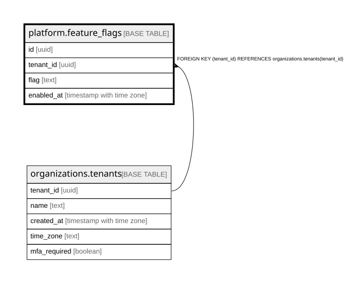

# platform.feature_flags

## Description

組織ごとの機能フラグ(行がある = その組織に機能を入れた)。定義は @app/shared の FEATURE_FLAGS。アプリは読むだけで、入れる・切るのは運営のコマンド feature-flag。docs/specs/0012-feature-flags-and-usage.md

## Columns

| Name       | Type                     | Default | Nullable | Children | Parents                                           | Comment                                                         |
| ---------- | ------------------------ | ------- | -------- | -------- | ------------------------------------------------- | --------------------------------------------------------------- |
| id         | uuid                     |         | false    |          |                                                   |                                                                 |
| tenant_id  | uuid                     |         | false    |          | [organizations.tenants](organizations.tenants.md) |                                                                 |
| flag       | text                     |         | false    |          |                                                   | 機能の名前(FEATURE_FLAGS の name。一度使った名前は使い回さない) |
| enabled_at | timestamp with time zone | now()   | false    |          |                                                   | 入れた時刻                                                      |

## Constraints

| Name                                         | Type        | Definition                                                          |
| -------------------------------------------- | ----------- | ------------------------------------------------------------------- |
| feature_flags_tenant_id_tenants_tenant_id_fk | FOREIGN KEY | FOREIGN KEY (tenant_id) REFERENCES organizations.tenants(tenant_id) |
| feature_flags_pkey                           | PRIMARY KEY | PRIMARY KEY (id)                                                    |
| feature_flags_tenant_flag_key                | UNIQUE      | UNIQUE (tenant_id, flag)                                            |

## Indexes

| Name                          | Definition                                                                                                |
| ----------------------------- | --------------------------------------------------------------------------------------------------------- |
| feature_flags_pkey            | CREATE UNIQUE INDEX feature_flags_pkey ON platform.feature_flags USING btree (id)                         |
| feature_flags_tenant_flag_key | CREATE UNIQUE INDEX feature_flags_tenant_flag_key ON platform.feature_flags USING btree (tenant_id, flag) |

## Relations

---

> Generated by [tbls](https://github.com/k1LoW/tbls)
