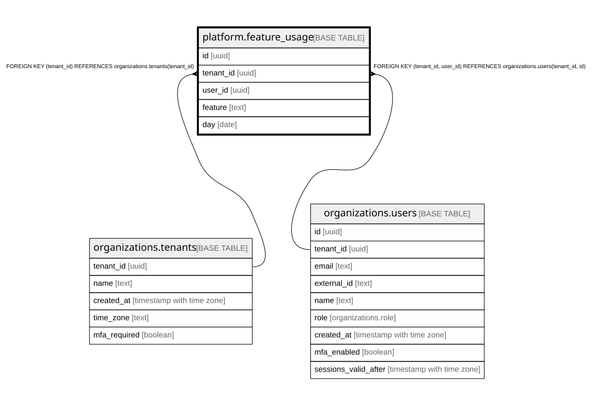

# platform.feature_usage

## Description

利用の記録(この人がこの日にこの機能を使った。1日1人1機能1行)。中身・時刻・URL・IP は持たない。アプリは読む・足すだけ。400日で運営のコマンド usage-purge が消す。docs/specs/0012-feature-flags-and-usage.md

## Columns

| Name      | Type | Default | Nullable | Children | Parents                                                                                         | Comment                           |
| --------- | ---- | ------- | -------- | -------- | ----------------------------------------------------------------------------------------------- | --------------------------------- |
| id        | uuid |         | false    |          |                                                                                                 |                                   |
| tenant_id | uuid |         | false    |          | [organizations.tenants](organizations.tenants.md) [organizations.users](organizations.users.md) |                                   |
| user_id   | uuid |         | false    |          | [organizations.users](organizations.users.md)                                                   |                                   |
| feature   | text |         | false    |          |                                                                                                 | 機能の名前(FEATURE_FLAGS の name) |
| day       | date |         | false    |          |                                                                                                 | 使った日(組織の時間帯での日付)    |

## Constraints

| Name                                         | Type        | Definition                                                                     |
| -------------------------------------------- | ----------- | ------------------------------------------------------------------------------ |
| feature_usage_tenant_id_tenants_tenant_id_fk | FOREIGN KEY | FOREIGN KEY (tenant_id) REFERENCES organizations.tenants(tenant_id)            |
| feature_usage_user_fkey                      | FOREIGN KEY | FOREIGN KEY (tenant_id, user_id) REFERENCES organizations.users(tenant_id, id) |
| feature_usage_pkey                           | PRIMARY KEY | PRIMARY KEY (id)                                                               |
| feature_usage_once_a_day_key                 | UNIQUE      | UNIQUE (tenant_id, user_id, feature, day)                                      |

## Indexes

| Name                          | Definition                                                                                                                |
| ----------------------------- | ------------------------------------------------------------------------------------------------------------------------- |
| feature_usage_pkey            | CREATE UNIQUE INDEX feature_usage_pkey ON platform.feature_usage USING btree (id)                                         |
| feature_usage_once_a_day_key  | CREATE UNIQUE INDEX feature_usage_once_a_day_key ON platform.feature_usage USING btree (tenant_id, user_id, feature, day) |
| feature_usage_feature_day_idx | CREATE INDEX feature_usage_feature_day_idx ON platform.feature_usage USING btree (tenant_id, feature, day)                |

## Relations

---

> Generated by [tbls](https://github.com/k1LoW/tbls)
