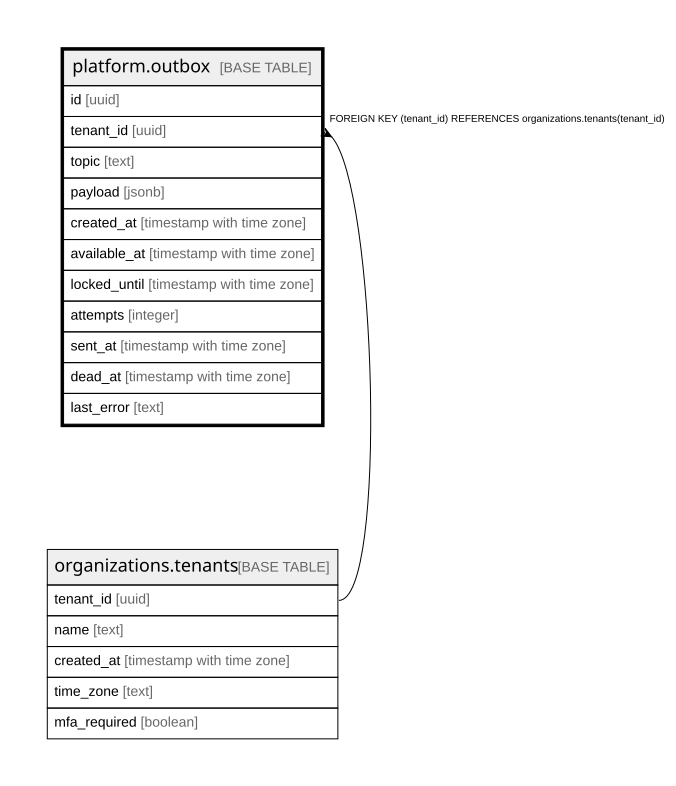

# platform.outbox

## Description

送信待ち(アウトボックス)。業務の変更と同じトランザクションで積み、送り出しが後で送る。アプリは書くだけ。docs/adr/0006-outbox.md

## Columns

| Name         | Type                     | Default | Nullable | Children | Parents                                           | Comment                                         |
| ------------ | ------------------------ | ------- | -------- | -------- | ------------------------------------------------- | ----------------------------------------------- |
| id           | uuid                     |         | false    |          |                                                   |                                                 |
| tenant_id    | uuid                     |         | false    |          | [organizations.tenants](organizations.tenants.md) |                                                 |
| topic        | text                     |         | false    |          |                                                   | 何が起きたか(領域.出来事。src/outbox/topics.ts) |
| payload      | jsonb                    |         | false    |          |                                                   |                                                 |
| created_at   | timestamp with time zone | now()   | false    |          |                                                   |                                                 |
| available_at | timestamp with time zone | now()   | false    |          |                                                   |                                                 |
| locked_until | timestamp with time zone |         | true     |          |                                                   | 送り出しが借りている期限                        |
| attempts     | integer                  | 0       | false    |          |                                                   |                                                 |
| sent_at      | timestamp with time zone |         | true     |          |                                                   |                                                 |
| dead_at      | timestamp with time zone |         | true     |          |                                                   | あきらめた時刻(人が見て直す)                    |
| last_error   | text                     |         | true     |          |                                                   |                                                 |

## Constraints

| Name                                  | Type        | Definition                                                          |
| ------------------------------------- | ----------- | ------------------------------------------------------------------- |
| outbox_tenant_id_tenants_tenant_id_fk | FOREIGN KEY | FOREIGN KEY (tenant_id) REFERENCES organizations.tenants(tenant_id) |
| outbox_pkey                           | PRIMARY KEY | PRIMARY KEY (id)                                                    |

## Indexes

| Name               | Definition                                                                                                                    |
| ------------------ | ----------------------------------------------------------------------------------------------------------------------------- |
| outbox_pkey        | CREATE UNIQUE INDEX outbox_pkey ON platform.outbox USING btree (id)                                                           |
| outbox_pending_idx | CREATE INDEX outbox_pending_idx ON platform.outbox USING btree (available_at) WHERE ((sent_at IS NULL) AND (dead_at IS NULL)) |

## Relations

---

> Generated by [tbls](https://github.com/k1LoW/tbls)
