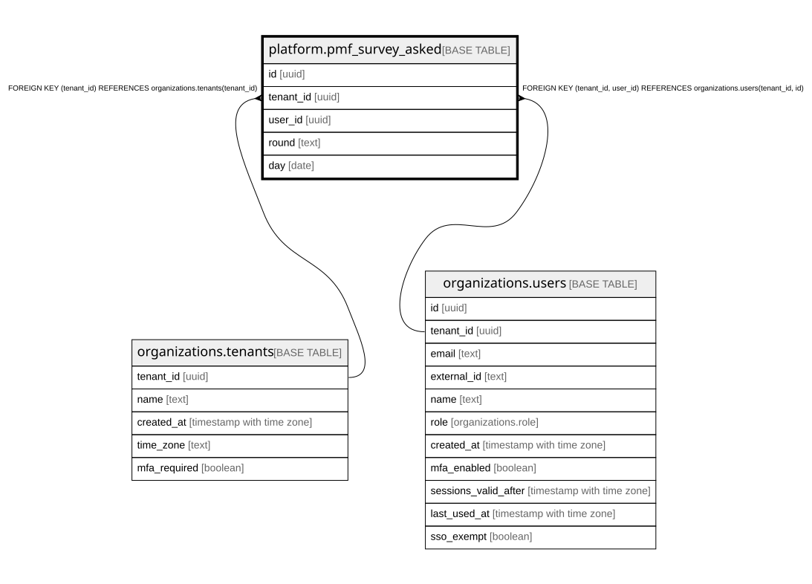

# platform.pmf_survey_asked

## Description

「無くなったら困るか」をこの回(四半期)に答え終えた人の印(1人1回にするため)。**答えは持たない**。アプリは読む・足すだけ。400日で運営のコマンド pmf-survey-purge が消す。docs/specs/0046-pmf-survey.md

## Columns

| Name      | Type | Default | Nullable | Children | Parents                                                                                         | Comment                                         |
| --------- | ---- | ------- | -------- | -------- | ----------------------------------------------------------------------------------------------- | ----------------------------------------------- |
| id        | uuid |         | false    |          |                                                                                                 |                                                 |
| tenant_id | uuid |         | false    |          | [organizations.tenants](organizations.tenants.md) [organizations.users](organizations.users.md) |                                                 |
| user_id   | uuid |         | false    |          | [organizations.users](organizations.users.md)                                                   |                                                 |
| round     | text |         | false    |          |                                                                                                 | 聞いた回(「2026-Q4」の形。組織の時間帯の四半期) |
| day       | date |         | false    |          |                                                                                                 | 答えた日(組織の時間帯での日付)                  |

## Constraints

| Name                                            | Type        | Definition                                                                     |
| ----------------------------------------------- | ----------- | ------------------------------------------------------------------------------ |
| pmf_survey_asked_tenant_id_tenants_tenant_id_fk | FOREIGN KEY | FOREIGN KEY (tenant_id) REFERENCES organizations.tenants(tenant_id)            |
| pmf_survey_asked_user_fkey                      | FOREIGN KEY | FOREIGN KEY (tenant_id, user_id) REFERENCES organizations.users(tenant_id, id) |
| pmf_survey_asked_pkey                           | PRIMARY KEY | PRIMARY KEY (id)                                                               |
| pmf_survey_asked_once_key                       | UNIQUE      | UNIQUE (tenant_id, user_id, round)                                             |

## Indexes

| Name                      | Definition                                                                                                         |
| ------------------------- | ------------------------------------------------------------------------------------------------------------------ |
| pmf_survey_asked_pkey     | CREATE UNIQUE INDEX pmf_survey_asked_pkey ON platform.pmf_survey_asked USING btree (id)                            |
| pmf_survey_asked_once_key | CREATE UNIQUE INDEX pmf_survey_asked_once_key ON platform.pmf_survey_asked USING btree (tenant_id, user_id, round) |

## Relations

---

> Generated by [tbls](https://github.com/k1LoW/tbls)
