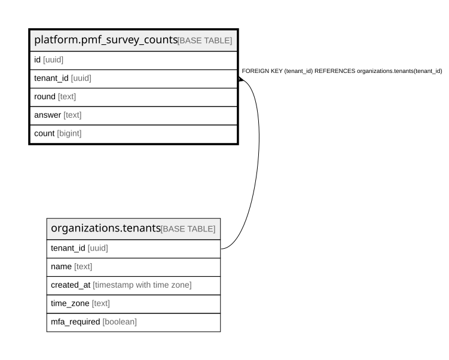

# platform.pmf_survey_counts

## Description

「無くなったら困るか」の答えの数(組織・回・答えごと)。**人の ID も時刻も持たない**(だれが何と答えたかを結びつけない)。アプリは読む・足す・数を増やすだけ。docs/specs/0046-pmf-survey.md

## Columns

| Name      | Type   | Default | Nullable | Children | Parents                                           | Comment                                       |
| --------- | ------ | ------- | -------- | -------- | ------------------------------------------------- | --------------------------------------------- |
| id        | uuid   |         | false    |          |                                                   |                                               |
| tenant_id | uuid   |         | false    |          | [organizations.tenants](organizations.tenants.md) |                                               |
| round     | text   |         | false    |          |                                                   |                                               |
| answer    | text   |         | false    |          |                                                   | 答えの種類(@app/shared の PMF_SURVEY_ANSWERS) |
| count     | bigint |         | false    |          |                                                   | その答えの数                                  |

## Constraints

| Name                                             | Type        | Definition                                                          |
| ------------------------------------------------ | ----------- | ------------------------------------------------------------------- |
| pmf_survey_counts_tenant_id_tenants_tenant_id_fk | FOREIGN KEY | FOREIGN KEY (tenant_id) REFERENCES organizations.tenants(tenant_id) |
| pmf_survey_counts_pkey                           | PRIMARY KEY | PRIMARY KEY (id)                                                    |
| pmf_survey_counts_answer_key                     | UNIQUE      | UNIQUE (tenant_id, round, answer)                                   |

## Indexes

| Name                         | Definition                                                                                                            |
| ---------------------------- | --------------------------------------------------------------------------------------------------------------------- |
| pmf_survey_counts_pkey       | CREATE UNIQUE INDEX pmf_survey_counts_pkey ON platform.pmf_survey_counts USING btree (id)                             |
| pmf_survey_counts_answer_key | CREATE UNIQUE INDEX pmf_survey_counts_answer_key ON platform.pmf_survey_counts USING btree (tenant_id, round, answer) |

## Relations

---

> Generated by [tbls](https://github.com/k1LoW/tbls)
