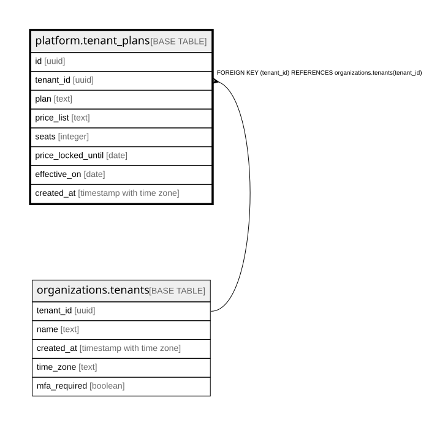

# platform.tenant_plans

## Description

組織の契約のプラン(docs/specs/0047-plans.md・ADR 0058)。足すだけ。いまの行は effective_on が今日までで一番新しい行。書くのは運営のコマンド plan・create-tenant だけ。金額は持たない

## Columns

| Name               | Type                     | Default | Nullable | Children | Parents                                           | Comment                                           |
| ------------------ | ------------------------ | ------- | -------- | -------- | ------------------------------------------------- | ------------------------------------------------- |
| id                 | uuid                     |         | false    |          |                                                   |                                                   |
| tenant_id          | uuid                     |         | false    |          | [organizations.tenants](organizations.tenants.md) |                                                   |
| plan               | text                     |         | false    |          |                                                   | @app/shared の PLANS の id                        |
| price_list         | text                     |         | false    |          |                                                   | どの版の価格表で契約しているか(PRICE_LISTS の id) |
| seats              | integer                  |         | true     |          |                                                   | 人数の上限(NULL は上限なし)                       |
| price_locked_until | date                     |         | true     |          |                                                   | 据え置き(この価格表のまま)の期限                  |
| effective_on       | date                     |         | false    |          |                                                   | 効き始めの日(組織の時間帯)                        |
| created_at         | timestamp with time zone | now()   | false    |          |                                                   |                                                   |

## Constraints

| Name                                        | Type        | Definition                                                          |
| ------------------------------------------- | ----------- | ------------------------------------------------------------------- |
| tenant_plans_seats_positive                 | CHECK       | CHECK (((seats IS NULL) OR (seats > 0)))                            |
| tenant_plans_tenant_id_tenants_tenant_id_fk | FOREIGN KEY | FOREIGN KEY (tenant_id) REFERENCES organizations.tenants(tenant_id) |
| tenant_plans_pkey                           | PRIMARY KEY | PRIMARY KEY (id)                                                    |

## Indexes

| Name                     | Definition                                                                                                                                       |
| ------------------------ | ------------------------------------------------------------------------------------------------------------------------------------------------ |
| tenant_plans_pkey        | CREATE UNIQUE INDEX tenant_plans_pkey ON platform.tenant_plans USING btree (id)                                                                  |
| tenant_plans_current_idx | CREATE INDEX tenant_plans_current_idx ON platform.tenant_plans USING btree (tenant_id, effective_on DESC NULLS LAST, created_at DESC NULLS LAST) |

## Relations

---

> Generated by [tbls](https://github.com/k1LoW/tbls)
