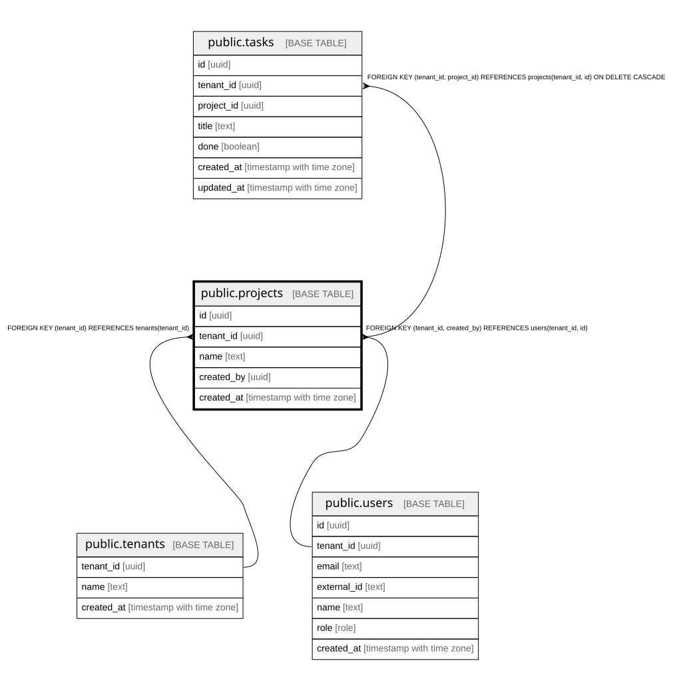

# public.projects

## Description

プロジェクト。タスクのまとまり。docs/domain/projects

## Columns

| Name       | Type                     | Default | Nullable | Children                        | Parents                                                             | Comment                    |
| ---------- | ------------------------ | ------- | -------- | ------------------------------- | ------------------------------------------------------------------- | -------------------------- |
| id         | uuid                     |         | false    | [public.tasks](public.tasks.md) |                                                                     |                            |
| tenant_id  | uuid                     |         | false    | [public.tasks](public.tasks.md) | [public.tenants](public.tenants.md) [public.users](public.users.md) |                            |
| name       | text                     |         | false    |                                 |                                                                     |                            |
| created_by | uuid                     |         | false    |                                 | [public.users](public.users.md)                                     | 作った人(同じ組織の users) |
| created_at | timestamp with time zone | now()   | false    |                                 |                                                                     |                            |

## Constraints

| Name                                    | Type        | Definition                                                          |
| --------------------------------------- | ----------- | ------------------------------------------------------------------- |
| projects_pkey                           | PRIMARY KEY | PRIMARY KEY (id)                                                    |
| projects_tenant_id_id_key               | UNIQUE      | UNIQUE (tenant_id, id)                                              |
| projects_tenant_id_tenants_tenant_id_fk | FOREIGN KEY | FOREIGN KEY (tenant_id) REFERENCES tenants(tenant_id)               |
| projects_created_by_fkey                | FOREIGN KEY | FOREIGN KEY (tenant_id, created_by) REFERENCES users(tenant_id, id) |

## Indexes

| Name                      | Definition                                                                                   |
| ------------------------- | -------------------------------------------------------------------------------------------- |
| projects_pkey             | CREATE UNIQUE INDEX projects_pkey ON public.projects USING btree (id)                        |
| projects_tenant_id_id_key | CREATE UNIQUE INDEX projects_tenant_id_id_key ON public.projects USING btree (tenant_id, id) |

## Relations

---

> Generated by [tbls](https://github.com/k1LoW/tbls)
