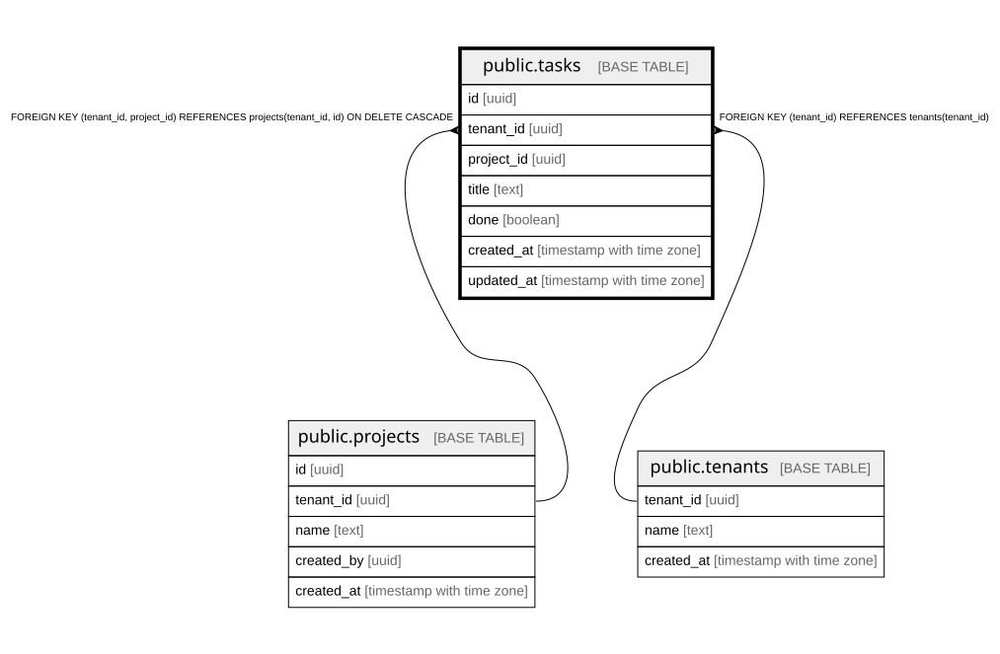

# public.tasks

## Description

タスク。プロジェクトの中のやること。docs/domain/tasks

## Columns

| Name       | Type                     | Default | Nullable | Children | Parents                                                                   | Comment    |
| ---------- | ------------------------ | ------- | -------- | -------- | ------------------------------------------------------------------------- | ---------- |
| id         | uuid                     |         | false    |          |                                                                           |            |
| tenant_id  | uuid                     |         | false    |          | [public.projects](public.projects.md) [public.tenants](public.tenants.md) |            |
| project_id | uuid                     |         | false    |          | [public.projects](public.projects.md)                                     |            |
| title      | text                     |         | false    |          |                                                                           |            |
| done       | boolean                  | false   | false    |          |                                                                           | 完了したか |
| created_at | timestamp with time zone | now()   | false    |          |                                                                           |            |
| updated_at | timestamp with time zone | now()   | false    |          |                                                                           |            |

## Constraints

| Name                                 | Type        | Definition                                                                               |
| ------------------------------------ | ----------- | ---------------------------------------------------------------------------------------- |
| tasks_project_fkey                   | FOREIGN KEY | FOREIGN KEY (tenant_id, project_id) REFERENCES projects(tenant_id, id) ON DELETE CASCADE |
| tasks_pkey                           | PRIMARY KEY | PRIMARY KEY (id)                                                                         |
| tasks_tenant_id_tenants_tenant_id_fk | FOREIGN KEY | FOREIGN KEY (tenant_id) REFERENCES tenants(tenant_id)                                    |

## Indexes

| Name                           | Definition                                                                                      |
| ------------------------------ | ----------------------------------------------------------------------------------------------- |
| tasks_pkey                     | CREATE UNIQUE INDEX tasks_pkey ON public.tasks USING btree (id)                                 |
| tasks_tenant_id_project_id_idx | CREATE INDEX tasks_tenant_id_project_id_idx ON public.tasks USING btree (tenant_id, project_id) |

## Relations

---

> Generated by [tbls](https://github.com/k1LoW/tbls)
