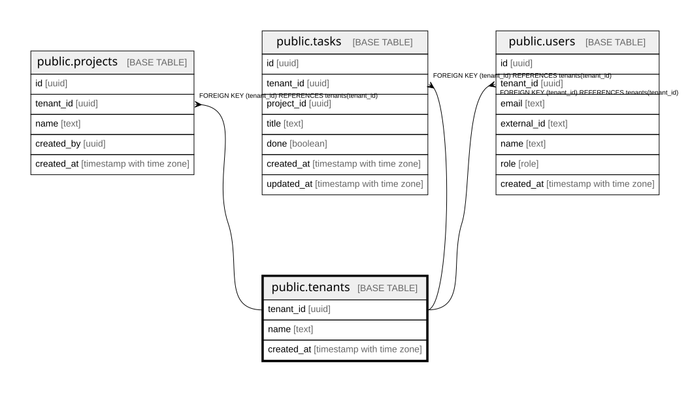

# public.tenants

## Description

組織(テナント)。tenant_id がこのシステムでの会社の単位。docs/domain/organizations

## Columns

| Name       | Type                     | Default | Nullable | Children                                                                                              | Parents | Comment |
| ---------- | ------------------------ | ------- | -------- | ----------------------------------------------------------------------------------------------------- | ------- | ------- |
| tenant_id  | uuid                     |         | false    | [public.projects](public.projects.md) [public.tasks](public.tasks.md) [public.users](public.users.md) |         |         |
| name       | text                     |         | false    |                                                                                                       |         |         |
| created_at | timestamp with time zone | now()   | false    |                                                                                                       |         |         |

## Constraints

| Name         | Type        | Definition              |
| ------------ | ----------- | ----------------------- |
| tenants_pkey | PRIMARY KEY | PRIMARY KEY (tenant_id) |

## Indexes

| Name         | Definition                                                                 |
| ------------ | -------------------------------------------------------------------------- |
| tenants_pkey | CREATE UNIQUE INDEX tenants_pkey ON public.tenants USING btree (tenant_id) |

## Relations

---

> Generated by [tbls](https://github.com/k1LoW/tbls)
