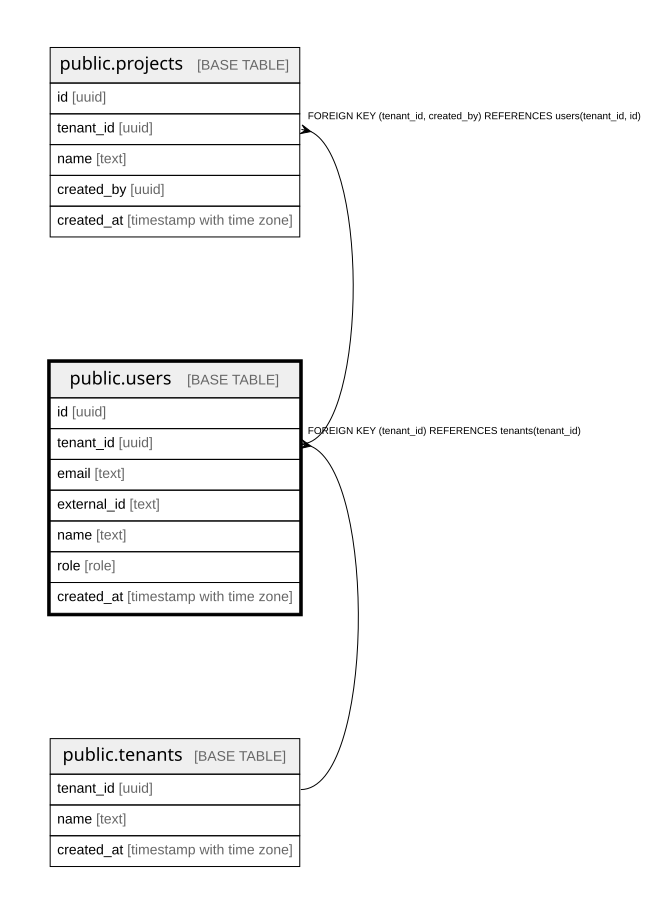

# public.users

## Description

組織の中の人とロール(admin / member / viewer)。いまは1人=1組織。docs/domain/organizations

## Columns

| Name        | Type                     | Default | Nullable | Children                              | Parents                             | Comment                         |
| ----------- | ------------------------ | ------- | -------- | ------------------------------------- | ----------------------------------- | ------------------------------- |
| id          | uuid                     |         | false    | [public.projects](public.projects.md) |                                     |                                 |
| tenant_id   | uuid                     |         | false    | [public.projects](public.projects.md) | [public.tenants](public.tenants.md) |                                 |
| email       | text                     |         | false    |                                       |                                     |                                 |
| external_id | text                     |         | true     |                                       |                                     | 認証の製品(Cognito)側の ID(sub) |
| name        | text                     |         | false    |                                       |                                     |                                 |
| role        | role                     |         | false    |                                       |                                     | admin / member / viewer         |
| created_at  | timestamp with time zone | now()   | false    |                                       |                                     |                                 |

## Constraints

| Name                                 | Type        | Definition                                            |
| ------------------------------------ | ----------- | ----------------------------------------------------- |
| users_tenant_id_tenants_tenant_id_fk | FOREIGN KEY | FOREIGN KEY (tenant_id) REFERENCES tenants(tenant_id) |
| users_pkey                           | PRIMARY KEY | PRIMARY KEY (id)                                      |
| users_tenant_id_id_key               | UNIQUE      | UNIQUE (tenant_id, id)                                |

## Indexes

| Name                   | Definition                                                                             |
| ---------------------- | -------------------------------------------------------------------------------------- |
| users_pkey             | CREATE UNIQUE INDEX users_pkey ON public.users USING btree (id)                        |
| users_tenant_id_id_key | CREATE UNIQUE INDEX users_tenant_id_id_key ON public.users USING btree (tenant_id, id) |
| users_email_key        | CREATE UNIQUE INDEX users_email_key ON public.users USING btree (email)                |
| users_external_id_key  | CREATE UNIQUE INDEX users_external_id_key ON public.users USING btree (external_id)    |

## Relations

---

> Generated by [tbls](https://github.com/k1LoW/tbls)
