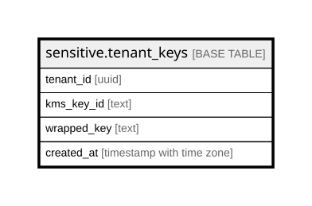

# sensitive.tenant_keys

## Description

組織ごとのデータ鍵(要配慮個人情報を暗号化する鍵。KMS で包んだ物だけ)。読めるのはロール app_sensitive だけ(app_rw はスキーマに入れない)。行を消すとその組織の要配慮の暗号文は読めない。docs/adr/0029-sensitive-data-tier1.md

## Columns

| Name        | Type                     | Default | Nullable | Children | Parents | Comment                             |
| ----------- | ------------------------ | ------- | -------- | -------- | ------- | ----------------------------------- |
| tenant_id   | uuid                     |         | false    |          |         |                                     |
| kms_key_id  | text                     |         | false    |          |         | 包んだ KMS の鍵の ARN(手元は local) |
| wrapped_key | text                     |         | false    |          |         | KMS で包んだデータ鍵(base64)        |
| created_at  | timestamp with time zone | now()   | false    |          |         |                                     |

## Constraints

| Name             | Type        | Definition              |
| ---------------- | ----------- | ----------------------- |
| tenant_keys_pkey | PRIMARY KEY | PRIMARY KEY (tenant_id) |

## Indexes

| Name             | Definition                                                                            |
| ---------------- | ------------------------------------------------------------------------------------- |
| tenant_keys_pkey | CREATE UNIQUE INDEX tenant_keys_pkey ON sensitive.tenant_keys USING btree (tenant_id) |

## Relations

---

> Generated by [tbls](https://github.com/k1LoW/tbls)
