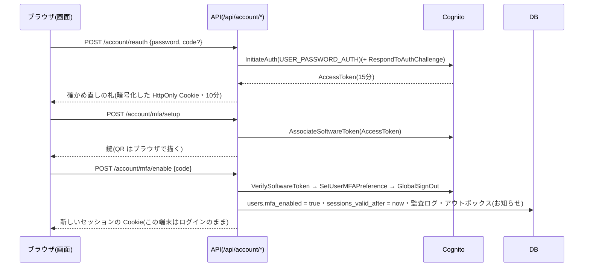

# 設計: アカウントの安全(ログインの有効期間・二段階認証の設定・メールアドレスとパスワードの変更・組織の二段階認証の必須化)

> **AI 用の設計書。省略せずに網羅的に書く(正はこちら)。** 人はこれを開かず、PR の本文の「人向けのまとめ」を見る([guides/human-review.md](../guides/human-review.md))。
> 仕様: [docs/specs/0006-account-security.md](../specs/0006-account-security.md)
> 状態: 承認済み(未確定事項は全部答え済み。@attumkwg 2026-10-20「はい、全部おすすめで良いです」。U-7 は変更を反映)
> 観点の順は [review-viewpoints.md](../review-viewpoints.md)。当てはまらない節も消さずに「該当なし(理由)」と書く。

## 0. 全体像

まず、ログインの有効期間を「ログインから8時間」から **「無操作1時間+ログインから最長12時間」** に変える(本人の決定 2026-10-20・ADR 0017)。Cookie にログインした時刻を入れ、使っている間は Cookie を出し直して期限を延ばす。サーバー側のセッション保存は作らない。

その上で、ログインした本人が、画面「アカウント」で二段階認証(TOTP)の有効・無効・メールアドレス・パスワードを変えられるようにし、組織の管理者が「この組織は全員に二段階認証を必須」にできるようにする。変える前に**パスワード(と二段階認証のコード)を確かめ直し**、そこで得た Cognito のアクセストークンで Cognito の「本人の操作」の API を呼ぶ。変えたら他の端末のログインを切り、本人に知らせ、監査ログに残す。



## 作業の前に読んだ物(ガイド)

- 仕様: `docs/specs/0006-account-security.md`
- 観点: `docs/review-viewpoints.md`(共通の8つ+このプロダクト特有の8つ)
- 用語集・領域の説明: `docs/domain/glossary.md`・`docs/domain/organizations/README.md`(守るルール 3「メールは全体で一意」・4「ロールは毎回 DB から」・6「社員は代理だけ・閲覧者に固定」)
- ADR: `0007`(トークンはサーバーの中だけ)・`0009`(自前のログイン画面・偽物の Cognito と契約テスト・Lite)・`0014`(代理ログイン)・`0013`(監査ログ)・`0006`(アウトボックス)・`0008`(メール)・`0001`(共有の表と RLS)・`0002`(デザインシステム)
- 既存のコード:
  - `apps/api/src/auth/providers.ts` … Cognito を SDK なしの fetch(JSON 1.1)で呼ぶ。`#call` が 4xx を `CognitoError(type)`・流量の上限を 429・5xx を 503 に直す。**ID トークンを確かめたら捨て、アクセストークンは使っていない**
  - `apps/api/src/auth/session.ts` … セッションは署名つき Cookie(`人.組織.期限`・代理なら5つ)。サーバー側の保存は無い(「強制ログアウト」は次の一歩と書いてある)。既定の期限 8時間(`SESSION_TTL_SECONDS`)
  - `apps/api/src/auth/pending-mfa.ts` … ログインの途中の札は**署名だけ**の HttpOnly Cookie(3分・SameSite=Strict・`__Host-`)。中身は Cognito の Session(不透明)とメール
  - `apps/api/src/auth/routes.ts` … ログインの失敗は全部同じ 401。`toAuthError` が Cognito の例外を画面の失敗に直す。ログインで監査ログ `auth.login` を手で残す
  - `apps/api/src/authz/middleware.ts` … 関所。`findRole` で毎回ロールを DB から引く。代理は閲覧者に固定・入室を毎回確かめる。書き込みの API は成功で監査ログ・403 で「拒否」
  - `apps/api/src/authz/policy.ts` … `PERMISSIONS` と `ROUTE_RULES`。無い API は拒否
  - `apps/api/src/audit/actions.ts`・`capture.ts` … 書き込みの API → 名前。details に値は入れない(PATCH の項目名だけ)
  - `apps/api/src/outbox/topics.ts`・`handlers.ts` … 出来事の中身は ID だけ。宛先は送る直前に DB から読む
  - `apps/api/src/domains/organizations/schema.ts` … `tenants`(名前・時間帯)・`users`(メールは全体で一意・`external_id` も一意)
  - `apps/api/src/offboarding` … `TENANT_TABLES`
  - `packages/fake-cognito/src/fake.ts` … すでに `AssociateSoftwareToken`・`VerifySoftwareToken`・`SetUserMFAPreference` を持つ(契約テストが二段階認証の人を作るため)。アクセストークンは発行して覚えているが、期限も取り消しも無い
  - `packages/fake-cognito/contract/cognito.contract.test.ts` … 本物(stg・週1回と手動)と偽物(PR ごと)に同じテスト
  - `infra/terraform/envs/*/cognito.tf` … `mfa_configuration = "OPTIONAL"`・TOTP 有効・`username_attributes = ["email"]`・`attributes_require_verification_before_update = ["email"]`・アクセストークン 15分・`user_pool_tier = "LITE"`
  - `apps/web/src/pages/LoginPage.tsx`・`pages/auth/fields.tsx`・`use-submit.ts` … 段を画面の中で進める形。`CodeField`・`PasswordField`
  - `apps/web/src/pages/SettingsPage.tsx` … 管理者の設定(カードを並べる)
  - `packages/ui` … `Button`・`Card`・`TextField`・`Checkbox`・`ConfirmDialog`・`Alert`・`Badge`・`Toast` など。**QR の部品は無い**

## 1. 設計方針

- **Cognito の「本人の操作」の API を、確かめ直しで得たアクセストークンで呼ぶ。** `AssociateSoftwareToken` には管理者版が無く、アクセストークン(かログインの途中の Session)が要る。`ChangePassword`・`UpdateUserAttributes`・`VerifyUserAttribute` も本人版はアクセストークンで動き、IAM も SigV4 も要らない(いまの fetch の作りのまま)。管理者版(`Admin*`)にすると API に IAM の権限と SigV4 の署名(SDK)が要り、「API の鍵1本で誰のメールでも変えられる」形になるので採らない。
- **確かめ直し(再認証)の札**: パスワード(+有効ならコード)が通ったら、アクセストークンを **AES-256-GCM で暗号化した HttpOnly Cookie**(`__Host-reauth`・10分・SameSite=Strict)に入れる。鍵は `SESSION_SECRET` から HKDF で別に作る(セッションの署名の鍵とは別物)。札は利用者の ID に結びつけ、セッションの本人と違えば使わない。変更を終えたら `GlobalSignOut` でアクセストークンそのものを無効にし、Cookie を消す。→ ADR 0007 の「トークンはサーバーの中だけ」の例外になるので **ADR 0016(提案)** と **U-1**。
- **パスワードの変更と二段階認証を外すのは1回のリクエスト**で済む(いまのパスワード+コードを一緒に送り、API の中で確かめ直し → 変更 → GlobalSignOut)。札を持ち越すのは、2回に分かれる「二段階認証の設定(鍵 → コード)」と「メールアドレスの変更(申し込み → 確認コード)」だけ。
- **ログインの有効期間(本人の決定・ADR 0017)**: Cookie の中身を `人.組織.期限.ログインした時刻`(代理は `…入室の ID.見ている組織` を後ろに足して6つ)にする。期限 = min(いま+1時間, ログインした時刻+12時間)。関所が認可を通したリクエストで、前に出してから1分以上たっていれば Cookie を出し直す(期限を延ばす)。サーバー側のセッション保存(DB・Valkey・リフレッシュトークン)は作らない。詳しくは 6. の「ログインの有効期間」。
- **他の端末のログインを切る**: Cookie だけのセッションのまま、`users.sessions_valid_after` を足す。関所はもともと毎回 `users` を引いている(ロール)ので、同じ1回の問い合わせで「この Cookie の**ログインした時刻**はそれより前か」を見る。→ **U-2**
- **二段階認証が有効かの写し**: `users.mfa_enabled` を DB に持つ(関所が毎回 Cognito に聞くのは遅い・Cognito の流量の上限に当たる)。正は Cognito。**ログインのたび**(コードを聞かれたか)と**確かめ直しのたび**(`GetUser` の `UserMFASettingList`)に写しを直すので、運営が Cognito 側で外しても次のログインでそろう。
- **組織の必須**: `tenants.mfa_required`。関所が「必須の組織で・本人が未設定」なら、決めた API 以外を 403 `mfa_setup_required` にする(画面で回すだけにしない)。
- 置き場所:
  - `apps/api/src/auth/account-routes.ts`(新)… `/api/account/*`。Cognito を呼ぶので auth に置く(危険度「高」)
  - `apps/api/src/auth/reauth.ts`(新)… 確かめ直しの札(暗号化 Cookie)
  - `apps/api/src/auth/providers.ts` … `CognitoClient` に本人の操作のメソッドを足す
  - `apps/api/src/domains/organizations/` … `users`・`tenants` の列・`email_changes` の表・必須の設定の API(`mfa-requirement-routes.ts`)・お知らせのメールの本文(`notifications.ts`)
  - `apps/api/src/authz/middleware.ts`・`policy.ts` … 必須の関所・代理では使えない権限
  - `packages/fake-cognito` … 足りない API と契約テスト
  - `apps/web/src/pages/AccountPage.tsx`(新)・`SettingsPage.tsx` に1枚・`routes/_app/account.tsx`(新)・`_app.tsx` の回し先
  - `packages/ui/src/components/QrCode.tsx`(新)
- 新しい依存: **`uqr`**(QR を SVG にする。MIT・依存なし・ブラウザでもサーバーでも動く)を `packages/ui` に。外の QR のサービスに鍵を送らないため、手元で描く。
- infra は変えない(本人の操作の API に IAM は要らない。プールの設定はいまので足りる)。

## 2. データモデル

移行は1本(`apps/api/drizzle/0009_account_security.sql`。危険度「高」・`/db-migration` の手順・squawk)。**足すだけ**(拡張の段だけ。縮小は無い)。

| 表 | 列 | 型 | 既定 | 意味 |
|---|---|---|---|---|
| `organizations.tenants` | `mfa_required` | `boolean not null` | `false` | この組織は全員に二段階認証を必須にする |
| `organizations.users` | `mfa_enabled` | `boolean not null` | `false` | 二段階認証が有効か(Cognito の写し。ログインと確かめ直しのたびに直す) |
| `organizations.users` | `sessions_valid_after` | `timestamptz null` | なし | これより前に作られたセッションの Cookie は使えない(他の端末を切る) |

- 定数の既定つきの `ADD COLUMN` は Postgres 11 以降で表を書き直さない(ロックは一瞬)。`lock_timeout` / `statement_timeout` は既存の移行と同じ形。
- 時刻は `timestamptz`(ADR 0005。`instant()` の列)。

新しい表 `organizations.email_changes`(メールアドレスの変更の申し込み):

| 列 | 型 | 意味 |
|---|---|---|
| `id` | `uuid` PK | |
| `tenant_id` | `uuid not null` → `tenants` | RLS の分け目 |
| `user_id` | `uuid not null`(`(tenant_id, user_id)` → `users`) | 本人 |
| `previous_email` | `text not null` | 申し込んだときのアドレス(お知らせの宛先) |
| `new_email` | `text not null` | 新しいアドレス(小文字にそろえる) |
| `requested_at` | `timestamptz not null default now()` | |
| `confirmed_at` | `timestamptz null` | 確認コードで変わった時刻 |

- 索引: `(tenant_id, user_id, requested_at desc)`(本人の最新の申し込みを引く)。新しい表なので `drizzle/concurrent/` は要らない。
- RLS: 既存の表と同じ「自社の行だけ」のポリシー(`0001_rls.sql` の型)。`rls.int.test.ts` に1行。
- 生きている申し込み = 本人の**最新**の行で、`confirmed_at` が空で、`requested_at` から24時間以内(Cognito の属性の確認コードの期限に合わせる)。新しく申し込むと古い行は使われない(消さない。記録として残す)。
- 解約で消す一覧(`TENANT_TABLES`)に足す(`users` より前)。書き出し(`exportOrganization`)にも足す(組織のデータ)。
- 個人データ: メールアドレスを2つ持つ。`users.email` と同じ扱い(ログに出さない・組織の外に出さない)。
- メールの一意(守るルール 3): `users.email` の一意の索引はそのまま。変えるときに最後の守りとして効く(6. 業務ルール)。

`users` の表の説明書(`docs/db/organizations.users.md`)・`tenants`(`docs/db/organizations.tenants.md`)・新しい表の説明書は、実装の PR で `/update-domain-docs` が直す。

Cookie の形(DB ではないが、データの形として):

| 種類 | いま | これから |
|---|---|---|
| ふつう | `人.組織.期限` | `人.組織.期限.ログインした時刻` |
| 代理 | `人.本来の組織.期限.入室の ID.見ている組織` | `人.本来の組織.期限.ログインした時刻.入室の ID.見ている組織` |

- 時刻はどれも UNIX 秒。署名は今と同じ(`hono/cookie` の署名つき Cookie・`SESSION_SECRET`)。
- 古い形(3つ・5つ)は読まない → 出したときに全員が1回ログインし直す(本番はまだ無いので可。本人の決定)。
- 二段階認証の途中の札(`pending-mfa.ts`・3分)と、確かめ直しの札(`reauth.ts`・10分)は形を変えない。

## 3. API

すべて `packages/shared` に Zod の取り決めを足す(**足すだけ**。`api-compat` が見張る)。失敗の本文は既存の `{ code, message }`。

### 本人のアカウント(`/api/account/*`。Cognito のときだけある・代理の最中は 403)

| API | 入力 | 出力 | 失敗 |
|---|---|---|---|
| `GET /api/account` | — | `{ email, mfaEnabled, pendingEmail: string \| null, organizationRequiresMfa }` | 401・403(代理) |
| `POST /api/account/reauth` | `{ password, code? }`(`code` は数字6桁。有効な人は必須) | `200 { ok: true }` + 札の Cookie | 400 `reauth_failed`(パスワードかコードが違う。どちらかは言わない)・400 `mfa_code_required`・429 |
| `POST /api/account/password` | `{ currentPassword, newPassword, code? }` | `204` + 新しいセッションの Cookie | 400 `reauth_failed`・400 `invalid_password`(決まり)・429 |
| `POST /api/account/email` | `{ newEmail }`(札が要る) | `202 { next: "confirm" }` | 400 `reauth_required`(札が無い・切れた)・400 `bad_request`(いまと同じアドレス)・429 |
| `POST /api/account/email/confirm` | `{ code }`(札が要る) | `204` + 新しいセッションの Cookie | 400 `reauth_required`・400 `invalid_code`・409 `email_unavailable`(使われている)・429 |
| `POST /api/account/mfa/setup` | —(札が要る) | `200 { secret, otpauthUri }` | 400 `reauth_required`・409 `mfa_already_enabled` |
| `POST /api/account/mfa/enable` | `{ code }`(札が要る) | `204` + 新しいセッションの Cookie | 400 `reauth_required`・400 `invalid_code` |
| `POST /api/account/mfa/disable` | `{ password, code }` | `204` + 新しいセッションの Cookie | 400 `reauth_failed`・403 `mfa_required_by_organization`・409 `mfa_not_enabled` |

- `reauth_required`・`reauth_failed` は 401 にしない。画面の `api.ts` は 401 で「ログイン画面へ」回すが、これはログインが切れたのではないため(11. 決めたこと)。
- `otpauthUri` = `otpauth://totp/<発行者>:<メール>?secret=<鍵>&issuer=<発行者>&algorithm=SHA1&digits=6&period=30`。発行者は `@app/shared` の `PRODUCT_NAME`(既定 `Tasks`。メールの差出人の名前と同じ)。
- 応答は全部 `Cache-Control: no-store`(`app.ts` の既定がもう付ける)。鍵・アクセストークン・パスワード・コードはログに出さない。
- `MeSchema` に `mfa: { enabled: boolean; required: boolean; setupRequired: boolean }` を**任意の項目として足す**(画面の `_app.tsx` が回し先を決める)。開発用ログインでは `setupRequired` は常に false。

### 組織の必須(`organizations` の領域)

| API | 入力 | 出力 | 失敗 |
|---|---|---|---|
| `GET /api/organization/mfa-requirement` | — | `{ required, usersWithoutMfa }`(人数だけ。名前は出さない) | 403(管理者でない) |
| `POST /api/organization/mfa-requirement` | — | `204`(必須にした) | 403・409 `mfa_not_enabled`(本人が未設定) |
| `DELETE /api/organization/mfa-requirement` | — | `204`(必須を切った) | 403・409 `support_org_requires_mfa`(運営の組織) |

- 入れる・切るを PUT 1つでなく POST / DELETE に分けた理由: 監査ログの名前で「入れた」「切った」が分かる(details に値を入れない決まりのまま)。

### 権限の表(`matrix.yaml`)と `policy.ts`

- 権限 `account:manage`(admin・member・viewer)を足す。**代理の最中は使えない権限**として、`policy.ts` に `NOT_DURING_SUPPORT = new Set(["account:manage"])` を置き、関所が代理なら 403 にする(閲覧者に固定しても通ってしまうため)。
- 権限 `mfa_requirement:manage`(admin)を足す(代理は閲覧者なので 403)。
- `matrix.yaml` の行は仕様の表のとおり。`/api/account/*` は `only_in: cognito`。必須の設定は②で全ロール+未ログインを叩く(`POST` は管理者が未設定なので 409。表には `admin: 409` と書き、成功は結合テストで)。

### 監査ログ(`actions.ts` に名前。一度使った名前は変えない)

| API | 名前 | 対象 |
|---|---|---|
| `POST /api/account/reauth` | `account.reauth` | `user`(param なし。行為者が本人) |
| `POST /api/account/password` | `account.password_change` | `user` |
| `POST /api/account/email` | `account.email_change_request` | `user` |
| `POST /api/account/email/confirm` | `account.email_change` | `user` |
| `POST /api/account/mfa/setup` | `account.mfa_setup` | `user` |
| `POST /api/account/mfa/enable` | `account.mfa_enable` | `user` |
| `POST /api/account/mfa/disable` | `account.mfa_disable` | `user` |
| `POST /api/organization/mfa-requirement` | `organization.mfa_require` | `organization` |
| `DELETE /api/organization/mfa-requirement` | `organization.mfa_unrequire` | `organization` |

- 画面の文(`apps/web/src/messages.ts` の `AUDIT_ACTION_LABELS`)にも足す。
- 確かめ直しの失敗(パスワード違い)は 400 なので監査ログに残らない。アプリのログ(警告・理由の名前だけ)に残す。必須の組織で止められた 403 は、書き込みの API なら関所が「拒否」で残す。

設定(`apps/api/src/config.ts`): `SESSION_TTL_SECONDS`(既定8時間)を消し、`SESSION_IDLE_SECONDS`(既定 3600)と `SESSION_MAX_SECONDS`(既定 43200)を足す。どちらも正の整数・`IDLE ≤ MAX` を起動時に確かめる。infra は `SESSION_TTL_SECONDS` を渡していないので、Terraform の変更は無い。新しい API は無い。

## 4. 状態遷移

ログイン(Cookie):

```
ログインした ──(1時間以内に操作)──→ ログイン中(期限を延ばす)──(1時間なにもしない)──→ 切れた
ログイン中 ──(ログインから12時間)──→ 切れた
ログイン中 ──(パスワード・メール・二段階認証を変えた別の端末)──→ 切れた(U-2)
ログイン中 ──(ログアウト)──→ 切れた
```

- 切れたら戻せない(ログインし直す)。

利用者の二段階認証:

```
未設定 ──(確かめ直し → 鍵 → 正しいコード)──→ 有効
有効   ──(パスワード+コード。組織が必須なら不可)──→ 未設定
有効   ──(運営が手順書で外す。Cognito 側)──→ 未設定(次のログインで写しがそろう)
```

- 鍵を出しただけ(コードを入れていない)は「未設定」のまま。もう一度「設定する」と新しい鍵になる(古い鍵は使えない。Cognito の `AssociateSoftwareToken` の振る舞い)。

メールアドレスの変更の申し込み: `申し込み中`(24時間)→ `変わった`(`confirmed_at`)/ 期限切れ / 新しい申し込みで上書き。戻せない(変わった後に戻すには、もう一度変更する)。

組織の必須: `任意` ⇄ `必須`(管理者がいつでも切り替えられる。切り替えはすぐ効く)。

必須の組織での利用者: `未設定` の間は「設定待ち」(決めた API だけ通る)→ 設定すると、ふつうに使える。

## 5. システム間連携

Cognito(本人の操作の API。全部 fetch の JSON 1.1・IAM なし):

| 操作 | 呼ぶ API | 使う所 | 気をつけること |
|---|---|---|---|
| 確かめ直し | `InitiateAuth`(USER_PASSWORD_AUTH)→ 有効なら `RespondToAuthChallenge`(SOFTWARE_TOKEN_MFA) | reauth・password・mfa/disable | 1回のリクエストで両方呼ぶ(途中の Session は API の中だけ)。ログインと同じく続けて間違えると Cognito が一時的に止める |
| 状態を読む | `GetUser`(AccessToken) | reauth の後 | `UserMFASettingList` に `SOFTWARE_TOKEN_MFA` があるかで写しを直す |
| 鍵を作る | `AssociateSoftwareToken`(AccessToken) | mfa/setup | `SecretCode`(base32)。呼ぶたびに新しい鍵 |
| コードを確かめる | `VerifySoftwareToken`(AccessToken・UserCode・FriendlyDeviceName) | mfa/enable | 違えば `EnableSoftwareTokenMFAException`(偽物も同じ) |
| 有効・無効 | `SetUserMFAPreference`(SoftwareTokenMfaSettings `{Enabled, PreferredMfa}`) | mfa/enable・mfa/disable | |
| パスワード | `ChangePassword`(AccessToken・PreviousPassword・ProposedPassword) | password | 決まり違いは `InvalidPasswordException` |
| メールの申し込み | `UpdateUserAttributes`(`email`) | email | プールの `attributes_require_verification_before_update = ["email"]` により、**確認するまで古いメールのまま**。確認コードは Cognito が新しいアドレスへ送る(本番は SES・手元は偽物 → Mailpit)。使われているアドレスなら `AliasExistsException` の可能性(→ 同じ答えを返す) |
| メールの確認 | `VerifyUserAttribute`(`email`・Code) | email/confirm | |
| トークンを無効に | `GlobalSignOut`(AccessToken) | 変更を終えたとき | Cognito のトークンを全部無効にする(アプリのセッションは自前の Cookie なので影響しない) |

- **本物の振る舞いで分かっていない所**(偽物を作る前に契約テストで確かめる。実装の PR の最初に書く):
  1. 使われているメールへの `UpdateUserAttributes` が、申し込みの時点で `AliasExistsException` になるか、確認の時点か
  2. 確認する前の新しいメールでログインできないこと(古いメールでは入れること)
  3. `GlobalSignOut` の後、そのアクセストークンで `GetUser` が `NotAuthorizedException` になること
  4. `AssociateSoftwareToken` を2回呼ぶと、前の鍵のコードが `VerifySoftwareToken` で通らないこと
  5. `ChangePassword` で前のパスワードが違うと `NotAuthorizedException` になること
- 偽物の Cognito(`packages/fake-cognito/src/fake.ts`)に足す: `GetUser`・`ChangePassword`・`UpdateUserAttributes`(確認コードを新しいアドレスへ。文面は `cognito-settings.json` と同じ)・`VerifyUserAttribute`(確認したらメール=ログインの名前を替える)・`GlobalSignOut`(その人のアクセストークンを全部消す)。アクセストークンに期限(15分。プールのクライアントと同じ)を付ける。`AssociateSoftwareToken` は呼ぶたびに鍵を替える(いまもそう)。ci-8 のセッションが `fake.ts` を `actions/` に分けているので、**その PR がマージされてから**、分けた形に足す。
- 契約テスト(`packages/fake-cognito/contract/cognito.contract.test.ts`)に、上の 1〜5 と、各 API の成功の形を足す。偽物には PR ごと、stg の本物には `cognito-contract.yml`(週1回・手動)で。本物で落ちたら偽物と設計を直す。

アウトボックス(出来事の中身は ID だけ。`outbox/topics.ts` に足す):

| 出来事 | 中身 | 宛先 | 本文(要旨) |
|---|---|---|---|
| `organizations.password_changed` | `{ userId }` | 本人のいまのアドレス | パスワードが変わりました。心当たりが無ければ、すぐにパスワードを再設定し、管理者に連絡 |
| `organizations.email_changed` | `{ emailChangeId }` | **古いアドレス**(`email_changes.previous_email`) | メールアドレスが ○○ に変わりました(新しいアドレスは一部を伏せる `a***@e***`)。心当たりが無ければ管理者に連絡 |
| `organizations.mfa_enabled` | `{ userId }` | 本人 | 二段階認証を有効にしました |
| `organizations.mfa_disabled` | `{ userId }` | 本人 | 二段階認証を外しました。心当たりが無ければ… |

- どれを送るかは **U-6**。本文は `domains/organizations/notifications.ts`、送るのは `outbox/handlers.ts`(既存の型)。Message-ID は出来事ごとに固定(2回届いても同じ)。
- 組織の必須を入れたときに、未設定の人へ知らせるメールは送らない(次のログインで画面が回す)。

Sentry: 新しい物は無い。Cognito で変わったのに DB の更新に失敗した(下の 6 の「食い違い」)ときは `logger.error` で残す → Sentry に届く。

## 6. 業務ルール

確かめ直し:

- パスワードは毎回 Cognito で確かめる(API は持たない)。有効な人はコードも要る(コードが無ければ 400 `mfa_code_required`。画面は最初から欄を出す)。
- 札は10分・本人に結びつく・**変更を1回終えたら消す**(`GlobalSignOut` も呼ぶ)。札の期限(10分)はアクセストークンの期限(15分)より短い。
- 「パスワードかコードが違う」はどちらかを言わない(ログインと同じ)。

二段階認証:

- 鍵は `AssociateSoftwareToken` のたびに新しい。画面は QR と、手で入れる鍵(4文字ずつ空白で区切る)を出す。
- 有効にするときのコードは前後30秒まで通る(Cognito と偽物が同じ)。
- 外せないとき: 組織が必須(403)。まだ有効でない(409)。
- 必須の組織で、写しが「未設定」なら「設定待ち」。設定待ちで通る API: `GET /api/me`・`GET /api/account`・`POST /api/account/reauth`・`POST /api/account/mfa/setup`・`POST /api/account/mfa/enable`・`POST /api/auth/logout`(公開)。ほかは 403 `mfa_setup_required`。**→ U-5**

メールアドレス:

- 小文字にそろえる。いまと同じなら 400。長さは既存の `Email`(254 文字まで)。
- 確認の時点で、`users` の中にそのアドレスの行が(自分以外に)あれば 409 `email_unavailable` を返し、Cognito の確認を呼ばない(申し込みの時点では同じ答えを返し、使われているかを言わない)。この確かめは組織をまたぐので、DB の SECURITY DEFINER の関数 `auth_email_in_use(email, user_id) returns boolean` を足す(`auth_find_user_by_email` と同じ形。真偽しか返さない)。
- 順番: `email_in_use` を確かめる → `VerifyUserAttribute` → 同じトランザクションで `users.email` を替え・`email_changes.confirmed_at`・`sessions_valid_after`・アウトボックス・監査ログ。DB の一意の索引に当たった(確かめと確認の間に誰かが同じアドレスで足された)ら、Cognito はもう替わっているので `logger.error`(Sentry)を残し、手順書で直す(Cognito のメールを戻すか、`users` を直す)。起きるのは数ミリ秒の間に同じアドレスの行が足されたときだけ。
- 結びつけ(`external_id`)は変えない(sub は替わらない)。次のログインは sub で引くので、`users.email` が古いままでも入れる(食い違いの害は表示だけ)。

パスワード:

- 決まりは `cognito-settings.json`(画面は `passwordProblems` で先に知らせる・最後は Cognito)。いまと同じパスワードも Cognito に任せる(本物は受け付ける)。

ログインの有効期間(本人の決定・ADR 0017):

- 期限 = min(最後に出し直した時刻 + `SESSION_IDLE_SECONDS`, ログインした時刻 + `SESSION_MAX_SECONDS`)。Cookie の Max-Age も同じ残りにする(ブラウザも消す)。
- 読むとき(`readSession`): 期限を過ぎた・ログインした時刻 + `SESSION_MAX_SECONDS` を過ぎた・ログインした時刻が未来(時計のずれ1分を超える)なら「無い」(= 401)。設定の最長を縮めたときも、ログインした時刻から数え直すのですぐ効く。
- 延ばす(出し直す)のは、**関所が認可を通したリクエスト**だけ(公開の API・401・代理の終わりでは延ばさない)。前に出した時刻(期限 − `SESSION_IDLE_SECONDS`。12時間で頭打ちのときは延ばす必要が無いので出さない)から **60秒以上**たっていれば出し直す。毎回出すと、同時のリクエストのたびに Set-Cookie が飛ぶだけで得が無い。無操作の長さは最大で1分ずれる(59〜60分で切れる)。
- 権限が無くて 403 になったリクエストも「操作」として延ばす(使っている人であることに変わりはない)。ハンドラーが自分でセッションを出し直した(パスワードの変更・代理への切り替えなど)ときは、関所は重ねて出さない。
- **画面の読み込み(SSR)でも延ばす**: SSR は API に Cookie を渡して読むが、API が返す Set-Cookie をブラウザに返していない(`apps/web/src/api.ts`)。SSR の API の応答の Set-Cookie のうち、セッションの Cookie(`__Host-sid` / `sid`)だけを、画面の応答に写す(TanStack Start の応答のヘッダー)。ほかの Cookie は写さない。
- 代理ログイン: Cookie の期限は同じ決まり(ログインした時刻は社員がふつうにログインした時刻を引き継ぐ。代理に入っても12時間は延びない)。代理そのものの最長1時間・許可の期限・取り消しは、いままでどおり関所が DB で確かめる。代理を終えたら、ログインした時刻を引き継いだまま本来の組織の Cookie に戻す。
- 二段階認証のコードを待つ間(3分)は Cookie のセッションが無い。コードが通った時刻がログインした時刻。
- 画面: 401 を受けたら、いままでどおりログイン画面へ(戻り先つき)。「時間が経ったのでログアウトしました」の文を出す(`AUTH_NOTICES` に1つ足す。401 の理由は API が言わないので、「ログインが切れました」という1つの文)。
- 画面が裏で定期的に API を呼ぶ物は無い(`refetchInterval`・`setInterval` を調べた)。足すときは、無操作の数え方が壊れる(開いておくだけで延びる)ので、延ばさない印を付けて呼ぶこと(このとき作る)。
- `session.ts` の先頭の「次の一歩: サーバー側のセッション保存」のコメントは、「作らない(本人の決定 2026-10-20・ADR 0017)。要るのは、端末を選んで切る・管理者が人を強制ログアウトさせる、が要るようになったとき」に書き直す。README の「わざとやっていないこと」の同じ行も直す。

他の端末を切る(**U-2**):

- パスワード・メールアドレス・二段階認証(有効・無効)を変えたら `users.sessions_valid_after = now()`。この端末には新しいセッションの Cookie を出し直す。
- 関所は「Cookie の**ログインした時刻** < `sessions_valid_after`」なら 401(Cookie を消す)。秒の単位で比べる。
- 変えた端末に出し直す Cookie は、**ログインした時刻をいまにする**(パスワード(とコード)を入れ直したので、ログインし直したのと同じに扱う。12時間もそこから数える)。
- 代理の Cookie(社員)も同じ(社員の `users` の行で見る)。

組織の必須:

- 入れられるのは管理者で、**本人の写しが有効**のときだけ(409 `mfa_not_enabled`)。切るのはいつでも。
- 入れる前に画面が `usersWithoutMfa` を見せて確かめる(`ConfirmDialog`)。
- 入れた・切ったはすぐ効く(関所が毎回読む)。
- 開発用ログイン(`AUTH_MODE=dev`)では、保存はできるが関所は回さない(設定する道が無いので)。

代理の社員:

- `/api/account/*` は 403(`NOT_DURING_SUPPORT`)。必須の設定は閲覧者なので 403。
- 必須の組織に入るには、社員の写しが有効であること(`POST /api/support/sessions` が 403 `mfa_required_for_support`)。**→ U-7**
- **運営の組織(`SUPPORT_TENANT_ID`)は最初から必須**(U-7 の変更):
  - 種データ(`apps/api/src/db/seed.ts`)の運営の組織を `mfa_required = true` で作る。本番の手順書(`docs/runbooks/support-access.md` の運営の組織を作る SQL)も `mfa_required` を `true` で入れる形に直す。
  - 運営の組織では必須を**切れない**(`DELETE /api/organization/mfa-requirement` が 409 `support_org_requires_mfa`)。切れると、運営の管理者1人の操作で社員の守りが外れ、U-7 の「設定済みの社員だけ」が形だけになるため。
  - これで、社員は運営の組織にログインした時点で二段階認証を求められる(設定待ちの関所)。お客さんの組織が必須でなくても、代理に入れるのは設定済みの社員だけになる。`mfa_required_for_support` の確かめは、運営の組織の必須が何かの理由で外れていたときの二重の守りとして残す。
  - 開発用ログイン(`AUTH_MODE=dev`)では関所を回さないので、種データの `support@ops.test` はいままでどおり使える。Cognito の E2E で社員を使うときは、偽物の Cognito で社員の二段階認証を先に有効にしておく(E2E の下ごしらえ)。
- 代理の最中は「設定待ち」の関所を当てない(入るときに確かめたので)。社員の本来の組織が必須なら、代理に入る前のふつうのログインの間に関所が効く。

回復(認証アプリを無くした・**U-3**):

- アプリの中に回復の道は作らない。本人はまず組織の管理者に連絡 → 管理者が運営に依頼 → 運営が手順書 `docs/runbooks/mfa-reset.md`(新)で、**依頼した管理者が組織の管理者であることと、本人であることの確かめ**(管理者からの依頼を監査ログ・運営の記録に残す)をしてから、`aws cognito-idp admin-set-user-mfa-preference --software-token-mfa-settings Enabled=false,PreferredMfa=false`(本番の書き込みなので、手順書のコマンドを人が打つ)。次のログインで写しが「未設定」にそろい、必須の組織なら設定の画面へ回る。
- 管理者が1人だけで、その人が無くしたとき: 運営が、契約者として登録されている連絡先で本人を確かめる(手順書に書く。確かめ方は U-3 の問い)。

## 7. 要求との対応

| 受け入れ条件(仕様) | 設計のどこ | テスト |
|---|---|---|
| 1時間なにもしなければ、次の操作で切れる(401・ログイン画面へ戻り先つき) | 2.(Cookie の形)・6.(ログインの有効期間) | `test/unit/session.test.ts`(時計を差し替え: 59分は読める・61分は無い)・`test/integration/session-lifetime.int.test.ts`(時刻をずらして署名した Cookie で `GET /api/me` が 401) |
| 使っている間は延びる(画面の読み込みも) | 6.(延ばす・SSR の Set-Cookie を写す) | session-lifetime.int(1分以上たった Cookie で叩くと Set-Cookie の期限が延びる・1分未満なら出さない・公開の API では出さない)・`apps/web/e2e/session.spec.ts`(画面の読み込みの応答にセッションの Set-Cookie がある) |
| 使い続けても12時間で切れる | 6.(期限の頭打ち・読むときの確かめ) | session.test(ログインから12時間を過ぎたら、期限が残っていても無い・頭打ちのときは出し直さない)・session-lifetime.int(12時間前のログインの Cookie で 401) |
| 代理ログイン中も同じ(代理の最長1時間は別に効く) | 6.(代理ログイン) | session.test(6つの形)・`test/integration/support-access.int.test.ts`(代理で延びる・ログインした時刻を引き継ぐ・代理を終えても12時間は延びない) |
| 二段階認証のコードを待つ間は変わらない・コードを入れた時刻がログインした時刻 | 6.・`pending-mfa.ts` は変えない | `test/integration/cognito-login.int.test.ts`(コードの後の Cookie のログインした時刻) |
| 出したとき1回だけログインし直し | 2.(古い形は読まない) | session.test(3つ・5つの形は無い) |
| 「二段階認証を設定する」→ 確かめ直し → QR と手で入れる鍵が出る | 3. API(reauth・mfa/setup)・1.(QrCode) | `test/integration/account-security.int.test.ts`(鍵と otpauthUri の形)・`e2e/account-security.spec.ts`(QR と鍵が出る) |
| 6桁のコードで有効 → 次のログインでコードを聞かれる | 3. API(mfa/enable)・5.(Verify → SetUserMFAPreference) | 結合(有効 → `POST /api/auth/login` が `next: "mfa"`)・E2E(有効化 → ログアウト → ログインでコード) |
| コードが違えば有効にならない・鍵はやり直すまで同じ | 6.(二段階認証) | 結合(違うコード → 400 `invalid_code` → 同じ鍵の正しいコードで通る) |
| パスワード+いまのコードで外せる・必須なら外せない | 3. API(mfa/disable)・6. | 結合(外す・コード無し 400・必須の組織で 403) |
| 有効・外したが監査ログに残る | 3.(監査ログ) | `test/unit/audit-coverage.test.ts`・結合(`audit_events` に `account.mfa_enable` / `account.mfa_disable`) |
| 確かめ直し+新しいアドレス → 新しいアドレスに確認コード | 3. API(email)・5.(UpdateUserAttributes) | 結合(偽物の `lastCode(new)`)・契約(本物で届く) |
| 確認コードで変わる・確認までは古いアドレスのまま | 3. API(email/confirm)・5.・6.(メールアドレス) | 結合(確認前は古いメールでログイン可・確認後は新しいメールで)・契約(2) |
| 古いアドレスに「変わりました」 | 5.(アウトボックス `organizations.email_changed`) | `test/integration/mail.int.test.ts`(Mailpit に古いアドレス宛てが届く) |
| 使われているアドレスでも申し込みでは言わない・確認後に「変えられません」 | 6.(メールアドレス)・`auth_email_in_use` | 結合(申し込みは 202・確認で 409・Cognito の確認を呼ばない) |
| 申し込んだ・変えたが監査ログに | 3.(監査ログ) | audit-coverage・結合 |
| いまのパスワード(+コード)と新しいパスワードで変わる | 3. API(password)・5.(ChangePassword) | 結合(新しいパスワードでログインできる) |
| いまのパスワードが違えば変わらない | 3.(`reauth_failed`) | 結合(400・パスワードは変わっていない) |
| パスワードのお知らせ・監査ログ | 5.(`organizations.password_changed`) | mail.int・audit-coverage |
| 変えた画面はログインのまま・ほかの端末は切れる | 2.(`sessions_valid_after`)・6.(他の端末を切る) | 結合(2つの Cookie を作り、片方で変える → もう片方は 401・変えた方は 200)・`test/unit/session.test.ts`(ログインした時刻との比べ方) |
| 管理者が必須を入れる・切る(確かめてから) | 3.(組織の必須)・8.(画面) | 結合(POST / DELETE・`usersWithoutMfa`)・`authz-matrix.int.test.ts` |
| 自分が有効なときだけ入れられる | 6.(組織の必須) | 結合(未設定の管理者は 409) |
| 必須の組織の未設定の人は設定へ回される・ほかの API は 403 | 6.(設定待ち)・関所 | 結合(`GET /api/projects` が 403 `mfa_setup_required`・決めた API は通る)・E2E(ログイン → 設定の画面へ) |
| 入れた・切ったが監査ログに | 3.(監査ログ) | audit-coverage・結合 |
| メンバー・閲覧者は必須の設定を見る・変えられない | 3.(権限の表) | `authz-matrix.int.test.ts` |
| 代理の社員は必須もアカウントも変えられない | 3.(`NOT_DURING_SUPPORT`)・6.(代理の社員) | `test/integration/support-access.int.test.ts`(代理で `/api/account/*` と必須の設定が 403)・`test/unit/support.test.ts`・E2E(代理で「変えられません」) |
| 必須の組織には有効な社員しか入れない | 6.(代理の社員) | support-access.int(未設定の社員は 403・有効なら入れる) |
| 運営の組織は最初から必須で、切れない(U-7 の変更) | 6.(代理の社員) | 結合(種データの運営の組織が `mfa_required = true`・運営の組織の管理者の DELETE が 409・未設定の社員はログイン後に設定待ち)・`e2e/account-security.spec.ts`(未設定の社員はログイン後に設定の画面へ) |
| 他社は別の組織の必須を触れない | 3.(パスに組織が無い・セッションだけ) | `authz-matrix.int.test.ts`(他社の admin は自社の値しか見えない)・`tenant-isolation.int.test.ts` |
| 未ログインは 401 | 3.(権限の表) | `authz-matrix.int.test.ts`・`default-deny.test.ts` |
| 開発用ログインではアカウントの API が無い・必須でも回されない | 1.・6. | `test/unit/authz-coverage.test.ts`(`only_in: cognito`)・結合(dev で `/api/account` が 404・必須でも 200) |

## 8. 非機能

性能:

- 関所の問い合わせは増やさない。`findRole` を「ロール・`mfa_enabled`・`sessions_valid_after`・組織の `mfa_required`」を1回で引く形にする(`users` と `tenants` の主キーの結合)。
- `usersWithoutMfa` は自社の `users` の数え上げ(1組織の人数は小さい。索引は要らない)。
- Cookie の出し直しは1分に1回まで(署名は HMAC 1回。DB は使わない)。
- Cognito の呼び出しは確かめ直しで2〜3回(InitiateAuth・RespondToAuthChallenge・GetUser)。どれも5秒で切れる(既存の `timeoutMs`)。

セキュリティ(仕様の STRIDE への対策の置き場所):

| 仕様の行 | 置き場所 |
|---|---|
| 盗んだ Cookie でメールを変える | 確かめ直し(`reauth.ts`)・確認コードは新しいアドレス・古いアドレスへのお知らせ・確認まで古いまま(プールの設定) |
| 盗んだ Cookie で二段階認証を外す・付け替える | mfa/disable はパスワード+コード・setup は確かめ直しが要る・お知らせ |
| 確かめ直しの総当たり | Cognito の一時停止・WAF・ログ(`what: "reauth", reason`)・札は1回きり |
| 回復を装う | 手順書(U-3)・アプリに回復の道を作らない |
| 別の人を変える | パスに人の ID が無い・アクセストークンの本人 |
| 否認 | 監査ログ・お知らせ |
| アドレスが使われているかを探る | 申し込みは同じ答え・確認の後だけ 409 |
| 開いたままの画面・盗んだ Cookie を長く使う | 無操作1時間・最長12時間(Cookie のログインした時刻・署名) |
| Cookie の時刻を書き換えて延ばす | 署名(いまと同じ)。ログインした時刻が未来なら無い |
| 鍵の漏れ | ログに出さない(`logger.test.ts` と結合テストのログの検査に鍵・アクセストークンを足す)・QR は `uqr` で手元で描く・`no-store` |
| 他社の必須 | セッションだけで組織が決まる |
| 必須で全員を締め出す | 自分が有効な管理者だけ・設定待ちでも設定とログアウトは通る |
| 確認コードのメールの大量送信 | 確かめ直しが要る・Cognito の送信の上限・監査ログ |
| 代理での変更 | `NOT_DURING_SUPPORT` |
| 必須のすり抜け | 関所(API で止める) |

- 確かめ直しの札の暗号: AES-256-GCM・12バイトのランダムな nonce・鍵は `HKDF-SHA256(SESSION_SECRET, info="reauth-v1")`。中身 `{ userId, accessToken, exp, failures }`。復号に失敗・期限切れ・本人違いは「札が無い」と同じ。`SESSION_SECRET` を入れ替えると札も全部切れる(セッションと同じ)。
- CSRF: `/api/*` はもう `hono/csrf`(Origin を見る)。札は SameSite=Strict。
- Semgrep: 既存の「ログに丸ごと・トークン」の規則で足りるか実装で確かめ、足りなければ `accessToken`・`secret`・`SecretCode` をログに渡すのを止める規則を足す。

運用:

- 手順書を足す: `docs/runbooks/mfa-reset.md`(回復。U-3)。`docs/runbooks/cognito-login.md` に「メールの食い違いを直す」(6. の極めてまれな場合)。
- ログ: 確かめ直しの失敗(警告・理由の名前だけ)・Cognito で変わったのに DB が失敗(error → Sentry)。
- アラーム: 足さない(既存の 5xx・Sentry で足りる)。

費用: 増えない(Cognito の本人の API は無料・MAU は変わらない・メールは数通/人)。

## 9. このプロダクト特有

| 観点 | この変更では |
|---|---|
| テナント分離 | 組織はセッションからだけ。新しい API にパスの組織 ID は無い。新しい表 `email_changes` に `tenant_id` と RLS。組織をまたぐ「アドレスが使われているか」は SECURITY DEFINER の関数1つ(真偽だけ返す) |
| 権限の表 | `/api/account/*` 8行(`only_in: cognito`)・`/api/organization/mfa-requirement` 3行。`account:manage`(全員・代理は不可)・`mfa_requirement:manage`(管理者) |
| 監査ログ | 9つの名前を `actions.ts` に。関所が自動で残す。画面の文にも |
| 解約で消す一覧 | `organizations.email_changes` を `TENANT_TABLES` と書き出しに。`users`・`tenants` の列は表ごと消えるので足す物なし |
| サポートの代理ログイン | 代理の最中は `/api/account/*` と必須の設定が 403。必須の組織には有効な社員だけ。代理の Cookie もログインした時刻を引き継ぎ、無操作1時間・最長12時間が効く |
| 一覧のページングと索引 | 一覧の API は無い(`usersWithoutMfa` は数だけ)。`email_changes` は本人の最新を引く索引 |
| ログの個人情報 | パスワード・コード・鍵・アクセストークン・新旧のメールを出さない。ログは `{ userId }`・理由の名前だけ |
| 画面の部品 | `@app/ui` の部品だけ。QR は `packages/ui` に `QrCode` を足す(画面のアプリに直接ライブラリを入れない) |

画面(`apps/web`):

- `routes/_app/account.tsx` → `pages/AccountPage.tsx`。カード3枚(メールアドレス・パスワード・二段階認証)。段は画面の中で進める(`LoginPage` と同じ形。メールやコードを URL に載せない)。
  - 二段階認証: 「設定する」→ 確かめ直し(パスワード+(有効なら)コード)→ QR・鍵・コードの欄 → 有効。外す: パスワード+コード(`ConfirmDialog`)。
  - メール: 確かめ直し → 新しいアドレス → 確認コード(送り直しは「もう一度申し込む」)。申し込み中なら「○○ に確認コードを送りました」を出す(`pendingEmail`)。
  - パスワード: いまのパスワード・(有効なら)コード・新しいパスワード(決まりの説明は `PASSWORD_RULES_TEXT`)。
  - 代理の最中: 「代理ログイン中は変えられません」だけ。開発用ログイン: 「開発用ログインでは使えません」だけ。
- `_app.tsx` の `beforeLoad`: `me.mfa?.setupRequired` で、`/account` 以外なら `/account?setup=required` へ。画面の上に「この組織では二段階認証が必須です」(`Alert`)。
- `api.ts` / `errors.ts`: 403 `mfa_setup_required` を受けたら `/account?setup=required` へ。
- `AppHeader`: 自分の名前の所に「アカウント」へのリンク。
- `SettingsPage`: 「二段階認証」のカード(管理者だけ。状態・未設定の人数・入れる/切る)。本人が未設定なら「先に自分の二段階認証を設定してください」と「アカウント」へのリンク。
- 文(`messages.ts`): 失敗の `code` ごとの文・お知らせ・監査ログの名前。

## 10. 観点ごとの扱い

| 観点 | 扱い | 理由 |
|---|---|---|
| 設計方針 | 最重要 | アクセストークンを暗号化した Cookie で持つ(ADR 0007 の例外・ADR 0016 の提案・U-1)。ログインの有効期間は本人が決めた(ADR 0017)ので、そこは事実を読むだけ |
| データモデル | 採用 | 列3つと表1つを足すだけ(拡張だけ)。squawk・`rls.int`・`offboarding.int` が見る |
| API | 採用 | 11本を足す(足すだけ・`api-compat`)。失敗の `code` の使い分け(400 と 401)を事実として読む |
| 状態遷移 | 軽く確認 | 未設定 ⇄ 有効・任意 ⇄ 必須の2つずつ。戻せる |
| システム間連携 | 最重要 | Cognito の本物の振る舞いで未確認の所がある(5. の 1〜5・契約テストで確かめる)。お知らせのメール(外へ送る・U-6) |
| 業務ルール | 最重要 | 他の端末を切る(U-2)・回復(U-3)・必須の範囲(U-4)・猶予なし(U-5)・代理の社員(U-7) |
| 要求との対応 | 機械で検証 | 7. の表の全行にテストがある(実装の PR で作る) |
| 非機能 | 採用 | STRIDE の対策の置き場所(8.)。性能は関所の問い合わせを増やさない |
| テナント分離 | 機械で検証 | `rls.int`・`tenant-isolation.int`・Semgrep の自社ルール |
| 権限の表 | 機械で検証 | `authz-coverage`・`default-deny`・`authz-matrix.int` |
| 監査ログ | 機械で検証 | `audit-coverage`・`audit.int` |
| 解約で消す一覧 | 機械で検証 | `offboarding.int` |
| サポートの代理ログイン | 採用 | 新しい「代理では使えない権限」の仕組み(`NOT_DURING_SUPPORT`)。`support-access.int` が見る |
| ログの個人情報 | 機械で検証 | `logger.test.ts`・結合テストのログの検査(鍵・トークンを足す)・Semgrep |
| 画面の部品 | 軽く確認 | `QrCode` を `packages/ui` に足す。ほかは既存の部品 |

## 11. 決めたこと(AI が決めた。人に聞かなかった)

- **本人の操作の API(アクセストークン)を使い、管理者版(`Admin*`)は使わない** — 鍵を作る `AssociateSoftwareToken` に管理者版が無い。管理者版は API に IAM と SigV4 が要り、API の鍵1本で誰でも変えられる形になる。
- **パスワードの変更と二段階認証を外すのは1回のリクエスト** — 札を持ち越す時間を減らす。画面は `me.mfa.enabled` を知っているので、最初からコードの欄を出せる。
- **二段階認証の写しを DB に持つ(`users.mfa_enabled`)** — 関所が毎回 Cognito に聞くのは遅く、流量の上限に当たる。ログインと確かめ直しのたびに Cognito に合わせ直すので、ずれても次のログインでそろう。
- **他の端末を切るのは `users.sessions_valid_after` と Cookie のログインした時刻で比べる** — ログインの有効期間のためにログインした時刻を Cookie に入れるので、それをそのまま使う(期限から逆算しない)。関所はもう `users` を引いているので問い合わせは増えない。
- **Cookie の出し直しは、認可を通したリクエストで、前から60秒以上たったときだけ** — 毎回だと同時のリクエストのたびに Set-Cookie が飛ぶ。無操作の長さのずれは最大1分で、本人の「1時間」に収まる。
- **画面の読み込み(SSR)の Set-Cookie は、セッションの Cookie だけを写す** — 写さないと、画面を開き直すだけの人が延びずに切れる。ほかの Cookie(二段階認証の途中・確かめ直し)は SSR では作られないので写さない。
- **設定は `SESSION_IDLE_SECONDS` と `SESSION_MAX_SECONDS` の2つにし、`SESSION_TTL_SECONDS` は消す** — 意味が変わる値を同じ名前で残すと取り違える。infra は渡していない。
- **運営の組織では必須を切れない(409)** — U-7 の変更「運営の組織は最初から必須」を、初期の状態だけでなく保つため。運営の管理者1人の操作で社員全員の守りが外れないように。戻すときはコードの変更(人のレビュー)を通す。
- **代理に入っても12時間は延びない(ログインした時刻を引き継ぐ)** — 代理は社員のふつうのログインの上に乗る物なので。
- **メールの変更の申し込みは表(`email_changes`)に持つ** — 古いアドレスへのお知らせの宛先を、出来事の中身に個人情報を入れずに(ID だけで)読めるようにするため(`outbox/topics.ts` の決まり)。監査ログの details に値を入れない決まりも守れる。
- **使われているアドレスは、確認コードの後だけ「変えられません」と言う** — そのアドレスの持ち主にしか分からないので、列挙にならない。申し込みの時点の `AliasExistsException` も同じ答えにする。
- **必須の入れ・切りは POST / DELETE の2つに分ける** — 監査ログの名前で向きが分かる(details に値を入れない決まりのまま)。
- **必須を入れられるのは、自分が有効な管理者だけ** — 入れた本人が締め出されるのを防ぐ。
- **必須の組織で、二段階認証を外すのは不可** — 必須の意味が無くなるため。
- **代理の最中は `/api/account/*` を止める仕組みを `policy.ts` の1か所に置く** — 権限の判断は policy.ts だけ(既存の決まり)。閲覧者のロールでは通ってしまうので、ロールとは別の印が要る。
- **開発用ログインではアカウントの API を出さず、必須でも回さない** — 開発用ログインに Cognito が無く、設定する道が無い。
- **`reauth_required`・`reauth_failed` は 401 でなく 400** — 画面は 401 でログイン画面へ回すため。ログインが切れたのとは違う。
- **QR は `uqr` で、`packages/ui` の `QrCode` に閉じる** — 依存が無く小さい・ブラウザで描くので鍵を外に出さない・画面の部品は `@app/ui` だけの決まり。
- **発行者(認証アプリに出る名前)は `@app/shared` の `PRODUCT_NAME`(既定 `Tasks`)** — メールの差出人の名前と同じ。雛形を使う人が1か所で替えられる。
- **札は10分** — アクセストークン(15分)より短く、画面で QR を読んでコードを入れるのに足りる長さ。
- **お知らせの本文の新しいアドレスは一部を伏せる** — 古いアドレスがもう他人の手にある場合に、新しいアドレスを教えない(Cognito の `a***@e***` と同じ形)。
- **偽物の Cognito への追加は、ci-8 の分割(`actions/`)がマージされてから** — 同じファイルを2つのセッションで触らない。
- **infra は変えない** — 本人の操作の API に IAM は要らず、プールの設定(TOTP・確認まで古いメール・15分)はもう足りている。
- **実装は2つの PR(どちらも危険度「高」)。先に「ログインの有効期間」を小さく出す** — Cookie の形を変える所(`session.ts`・関所・設定・SSR の写し)だけで閉じていて、仮決めが無い(本人が決めた)ので先にマージできる。アカウントの安全の PR は、その「ログインした時刻」の上に `sessions_valid_after` を載せる。2つ目の PR は、コミットを「Cognito と偽物と契約テスト / API と DB / 画面 / E2E」に分ける。どちらも ci-8 の auth・authz の PR(`session.ts`・`config.ts`・関所に触る)がマージされてから、最新の main から始める。

## 12. 未確定事項(AI の仮決め。人の承認と分けて追う)

> 答え: 本人が 2026-10-20 に「はい、全部おすすめで良いです」(PR #31 の「人に判断してほしい所」のおすすめどおり。親のセッションでの会話)。U-7 だけ「運営の組織は最初から必須」を足した → 13. 作り直しの記録。

| 番号 | 工程 | 種類 | 仮決め(設計した事実) | なぜそうしたか | 人が判断する問い | 状態 |
|---|---|---|---|---|---|---|
| U-1 | 設計 | 戻せないリスク | 確かめ直しで得た Cognito のアクセストークン(15分)を、**暗号化(AES-256-GCM)した HttpOnly Cookie**(10分・SameSite=Strict)に入れてブラウザに持たせる。終わったら GlobalSignOut で無効にする(ADR 0016 の提案) | 二段階認証の設定とメールの確認は2回のリクエストに分かれ、間でトークンが要る。DB に持つと表・RLS・掃除が増える。ブラウザの JS からは読めず、鍵が無ければ中身も見えない | ADR 0007 の「トークンはサーバーの中だけ」の例外として、暗号化した Cookie で持つ形でよいか(いいえなら DB に10分だけ持つ形にする) | 承認(@attumkwg 2026-10-20) |
| U-2 | 設計 | 利用者の挙動 | パスワード・メールアドレス・二段階認証のどれかを変えたら、**ほかの端末・ブラウザのログインは全部切れる**(変えた画面はそのまま) | 盗まれた Cookie が残らないようにするため。いまはサーバー側のセッション保存が無く、選んで切ることはできない | 変えたら他の端末を全部ログアウトさせてよいか | 承認(@attumkwg 2026-10-20) |
| U-3 | 設計 | 事業判断 | 認証アプリを無くしたときの回復は、**アプリの中に作らない**。組織の管理者からの依頼で、運営が手順書(`mfa-reset.md`)で本人を確かめてから Cognito で外す。管理者が1人だけでその人が無くしたら、契約の連絡先で確かめる | Cognito(Lite)に予備のコードが無い。アプリに「管理者が外す」を作ると、API に IAM の権限が要り、管理者の乗っ取り = 全員の二段階認証を外せる、になる | 回復を運営の手作業(管理者の依頼+本人の確かめ)にしてよいか。問い合わせが増えたら「管理者が外す画面」を作るか | 承認(@attumkwg 2026-10-20) |
| U-4 | 要求 | 事業判断 | 組織の必須は**全員に効く1つのスイッチ**だけ。ロールごと(管理者だけ必須)と、製品全体の決まり(どの組織でも管理者は必須)は作らない。既定は「任意」 | 依頼の範囲が「組織の管理者が必須にする」。ロールごとは画面と関所が複雑になる | 既定「任意」・全員に効くスイッチ1つでよいか。それとも、どの組織でも管理者は必須にするか | 承認(@attumkwg 2026-10-20) |
| U-5 | 設計 | 利用者の挙動 | 必須を入れたら**猶予なし**。未設定の人は、次の操作から設定の画面へ回され、設定するまで他の API は 403。お知らせのメールも送らない | 「猶予の期限」を持つと、期限の表示・期限切れの扱いが増える。設定はその場で数分で終わる | 猶予なし(すぐ効く)でよいか。それとも「○日後から必須」を選べるようにするか | 承認(@attumkwg 2026-10-20) |
| U-6 | 設計 | 戻せないリスク | 本人へのお知らせのメールを4種類送る: パスワードが変わった・メールアドレスが変わった(**古いアドレスへ**。新しいアドレスは一部を伏せる)・二段階認証を有効にした・外した | 乗っ取りに本人が気づける唯一の道。どれも本人の操作の結果で、回数は少ない | この4種類を送ってよいか(足す・減らすものはあるか) | 承認(@attumkwg 2026-10-20) |
| U-7 | 設計 | 事業判断 | 必須の組織に代理で入れるのは、**二段階認証を有効にしている社員だけ**(未設定なら 403)。運営の組織そのものを必須にするのは手順書で勧めるだけ | お客さんが必須にしたのに、社員の弱いアカウントから見られる穴を作らない | 必須の組織には有効な社員しか入れない、でよいか。運営の組織は最初から必須にするか | 変更(@attumkwg 2026-10-20: 必須の組織に入れるのは設定済みの社員だけ、は承認。加えて運営の組織は最初から必須にする(シードと手順書の初期設定で必須の状態にする)) |

## 13. 作り直しの記録

| 日付 | きっかけ | 入った工程 | 直した物 | 作り直した下流 |
|---|---|---|---|---|
| 2026-10-20 | U-7 への答え「変更」(運営の組織は最初から必須にする) | 設計 | 12. の U-7 の状態・6.(代理の社員)・11.(運営の組織では必須を切れない) | 仕様 0006(受け入れ条件・決めたこと)・7.(テスト)。実装はまだ |
| 2026-10-20 | 本人の決定で範囲を足した(ログインの有効期間を「無操作1時間+最長12時間」に・サーバー側の保存は作らない) | 要求 | 仕様 0006(受け入れ条件・STRIDE・やらないこと・決めたこと)・ADR 0017 | 設計書(0・1・2・4・6・7・8・9・10・11)。「他の端末を切る」の比べ方を、期限からの逆算からログインした時刻に変えた。実装はまだ |
