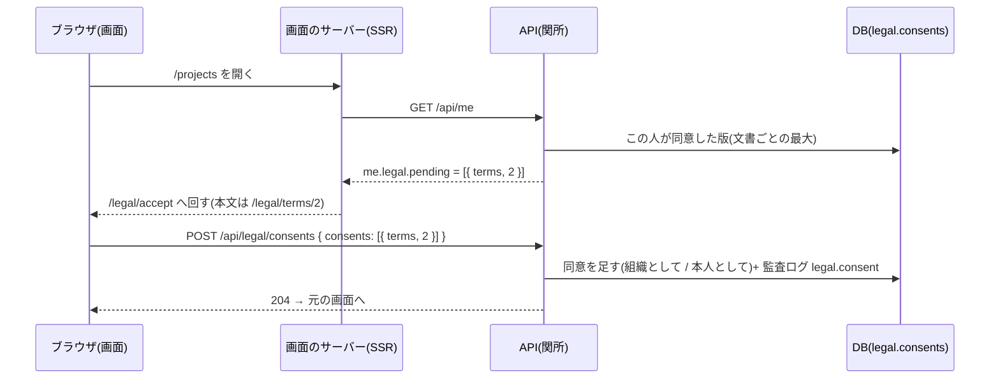

# 設計: 利用規約・プライバシーポリシーの版と同意

> **AI 用の設計書。省略せずに網羅的に書く(正はこちら)。** 人はこれを開かず、PR の本文の「人向けのまとめ」を見る([guides/human-review.md](../guides/human-review.md))。
> 仕様: [docs/specs/0008-legal-consent.md](../specs/0008-legal-consent.md)
> 状態: 下書き(未確定事項 U-1〜U-7 は人の答え待ち)
> 観点の順は [review-viewpoints.md](../review-viewpoints.md)。当てはまらない節も消さずに「該当なし(理由)」と書く。

## 0. 全体像

利用規約とプライバシーポリシーを**版つき**で持つ。本文はリポジトリの Markdown(画面のサービスが出す)、版の一覧(公開・効力の日時・要約・同意し直しが要るか・本文のハッシュ)は `@app/shared` のコード。同意は新しい領域 `legal` の**足すだけの表**に記録し、組織の監査ログにも残す。認可の関所が、二段階認証の「設定待ち」と同じ形で「同意し直しが要る版に同意していない人」を同意の画面と最低限の API だけに絞る(403 `terms_acceptance_required`)。前もって画面の帯とお知らせのメール(運営のコマンド → アウトボックス)で知らせる。



## 作業の前に読んだ物(ガイド)

- 仕様: `docs/specs/0008-legal-consent.md`
- 観点: `docs/review-viewpoints.md`(共通の8つ+このプロダクト特有の8つ)
- 用語集・領域の説明: `docs/domain/organizations/README.md`(守るルール 1「組織はセッションからだけ」・6「社員は代理だけ・閲覧者に固定」・9「設定待ち」。**組織と利用者を作る流れは未実装**で、利用者の行は運営・種データが作る。登録(Cognito)は、その行にメールで結びつくだけ)
- ADR: `0001`(共有の表と RLS)・`0003`(SSR は API と別のサービス)・`0004`(領域ごとに分ける)・`0005`(時刻は UTC)・`0006`(アウトボックス)・`0008`(メールは Postfix)・`0013`(監査ログ。足すだけ・値を持たない)・`0014`(代理ログイン)・`0015`(解約)
- 手本: `docs/specs/0006-account-security.md`・`docs/designs/0006-account-security.md`(二段階認証の「設定待ち」の関所 = 同じ作り)
- `docs/guides/mail.md`(メールを足す手順)・`docs/guides/data-retention.md`(契約・規約の「データの保存と削除」の元になる表)
- 法令の一次資料(仕様の「法令」): 法務省のパンフレットと説明資料(定型約款)・個人情報保護委員会のガイドライン(通則編)。**e-Gov 法令検索はメンテナンス中で、条文は読めなかった**(U-7)
- 既存のコード:
  - `apps/api/src/authz/middleware.ts` … 関所。`roleOf` が `findAccess` で毎回ロール・二段階認証の写し・組織の必須を引き、`c.var.mfaEnforced && 必須 && 未設定` なら `ALLOWED_DURING_MFA_SETUP` 以外を 403 `mfa_setup_required`。代理は `NOT_DURING_SUPPORT` で止める
  - `apps/api/src/authz/policy.ts` … `PERMISSIONS`・`ROUTE_RULES`・`NOT_DURING_SUPPORT`・`OUTSIDE_TRANSACTION`・`ALLOWED_DURING_MFA_SETUP`
  - `apps/api/src/domains/organizations/routes.ts` … `GET /api/me`。`mfa: { enabled, required, setupRequired }` を返し、画面の `_app.tsx` が `/account` へ回す
  - `apps/api/src/auth/cognito-routes.ts` … `POST /api/auth/confirm-sign-up` は公開・確認コードを Cognito で確かめるだけ。DB に触らない
  - `apps/api/src/auth/lookup.ts` … `auth_find_user_by_email`(SECURITY DEFINER。組織が決まる前に「このメールは誰か」)
  - `apps/api/src/audit/actions.ts` … 書き込みの API → 名前。`MANUAL_AUDIT_ACTIONS`(関所の外で手で残す物)
  - `apps/api/src/outbox/topics.ts`・`handlers.ts` … 出来事の中身は ID だけ。宛先は送る直前に DB から
  - `apps/api/src/offboarding/delete-tenant.ts` … `TENANT_TABLES`(子から親の順)・`cli.ts` の「試し → `--execute --confirm-name`」の型
  - `apps/api/src/domains/dependencies.ts` … `organizations: []`・`projects: ["organizations"]`・`tasks: [...]`
  - `apps/api/scripts/build.mjs` … API は esbuild で1つの JS にまとめる(Markdown を読むには設定が要る)
  - `apps/web/vite.config.ts` … 画面は Vite。`import.meta.glob(..., { query: "?raw" })` で Markdown を文字列として取り込める(手元でも本番のビルドでも)
  - `apps/web/src/routes/_app.tsx` … `me.mfa?.setupRequired` で `/account` へ回す。`use-action.ts` は 403 `mfa_setup_required` で `/account` へ
  - `packages/ui` … `Heading`(h1・h2 だけ)・`List`・`Muted`・`Stack`・`Card`・`Alert`・`Checkbox`・`Link`・`Button`。**段落の部品と h3 は無い**
  - `packages/shared/src/schemas.ts` … `MeSchema`・`ExportData`(足すだけ)

## 1. 設計方針

- **本文は画面のサービスが出す Markdown、版の一覧は `@app/shared` のコード、同意の記録は DB**(ADR 0019)。
  - 本文: `apps/web/src/legal/<文書>/v<版>.md`。画面の SSR が `import.meta.glob` で取り込み、`@app/ui` の部品で描く(HTML として差し込まない)。API は本文を持たない(API のビルドに Markdown の読み込みを足さずに済む・本文の配信は画面の仕事)。
  - 版の一覧: `packages/shared/src/legal.ts` の `LEGAL_VERSIONS`。画面(本文の画面・登録・帯)と API(関所・同意の検証)が同じ一覧を見る。**足すのは PR**(人が差分と日付を見る)。
  - 記録: 新しい領域 `legal`(Postgres のスキーマ `legal`)の表 `consents`(同意)と `notices`(お知らせを送った)。どちらも足すだけ。
- **関所は「設定待ち」と同じ形**: `roleOf` の中で、文書ごとに「同意した最大の版」を1回の問い合わせで引き、`@app/shared` の `legalStatus()` で「いま同意が要る版(pending)」と「次の版(upcoming)」を出す。pending があれば、決めた API 以外を 403 `terms_acceptance_required`。結果は `c.var.legalStatus` に置き、`GET /api/me` が返す(問い合わせを増やさない)。
- **同意し直しが要るか(`reconsent`)は版ごとに人が決める**(PR で)。キットは「何を重要な変更とするか」の既定の案だけを手引きに書く(U-1)。
- **組織としてか本人としてか(`capacity`)は API がロールで決める**: 利用規約を管理者が同意 → `organization`(契約者として。本人としても数える)。それ以外 → `individual`。本文で選ばせない(U-3)。
- **お知らせのメールは運営のコマンド**(`legal-notify`。試し → `--execute`)。API にしない(全員に送る操作を API の鍵1本でできないように。解約のコマンドと同じ考え)。送った記録(`legal.notices`)が周知の証拠と、2回送らない守りを兼ねる。
- **登録の同意は確認コードが通った後に記録する**(メールの持ち主だと分かってから)。
- 置き場所:
  - `packages/shared/src/legal.ts`(新)… 文書の種類・版の一覧・`legalStatus()`・取り決め(Zod)
  - `apps/api/src/domains/legal/`(新)… `schema.ts`・`repository.ts`・`routes.ts`(`POST /api/legal/consents`)・`notifications.ts`(お知らせのメール)・`notify.ts`(コマンドの中身)・`index.ts`
  - `apps/api/src/domains/dependencies.ts` … `legal: ["organizations"]`
  - `apps/api/src/authz/middleware.ts`・`policy.ts` … 関所(危険度「高」)
  - `apps/api/src/auth/cognito-routes.ts` … 登録の確認のあとに同意を記録(危険度「高」)
  - `apps/api/drizzle/0010_legal_consent.sql`(新・危険度「高」)
  - `apps/api/src/cli.ts` … `legal-notify`
  - `apps/web/src/legal/`(新)… 本文の Markdown(見出しだけ)と、Markdown を部品に直す小さな関数
  - `apps/web/src/routes/legal/$document/`(新・公開。`index.tsx` = いまの版・`$version.tsx` = 版を選ぶ)・`routes/_app/legal/accept.tsx`(新)・`pages/LegalDocumentPage.tsx`・`pages/LegalAcceptPage.tsx`・`pages/AppHeader.tsx`(帯)・`pages/SignUpPage.tsx`(チェック)
- 新しい依存: **無い**(Markdown の描画は、見出し・段落・箇条だけを読む小さな関数を自前で書く。ライブラリは画面の JS の大きさの上限に当たる)。`packages/ui` に段落の部品 `Text` を足す(画面ごとの CSS を書かない決まりのため)。
- infra は変えない(メールは既存の Postfix・コマンドは既存のイメージの `cli.js`)。

## 2. データモデル

移行は1本(`apps/api/drizzle/0010_legal_consent.sql`。危険度「高」・`/db-migration` の手順・squawk)。**新しいスキーマと表を足すだけ**(拡張の段だけ。縮小は無い)。

スキーマ `legal`(領域 `legal`。ADR 0004)。

表 `legal.consents`(同意の記録。足すだけ):

| 列 | 型 | 意味 |
|---|---|---|
| `id` | `uuid` PK(v7) | |
| `tenant_id` | `uuid not null` → `organizations.tenants` | RLS の分け目 |
| `user_id` | `uuid not null`(`(tenant_id, user_id)` → `organizations.users`) | 同意した人 |
| `document` | `text not null` | `terms` / `privacy`(`@app/shared` の `LEGAL_DOCUMENTS`。種類を足すとき移行が要らないよう enum にしない。アプリが Zod で確かめる) |
| `version` | `bigint not null` | 版(1から。squawk の決まりで bigint) |
| `capacity` | `text not null` | `organization`(組織として。利用規約の管理者)/ `individual`(本人として) |
| `source` | `text not null` | どの画面から: `sign_up`(登録)/ `acceptance`(同意の画面・帯から前もって) |
| `accepted_at` | `timestamptz not null default now()` | 同意した時刻(ADR 0005) |

- 一意: `(tenant_id, user_id, document, version)`。同じ版への2回目は `ON CONFLICT DO NOTHING`(最初の記録を残す)。管理者が先に本人として同意し、後で組織として同意し直すことは無い(ロールで決まるので。ロールが変わった後の同意は新しい版から)。
- 索引: 一意の索引が関所の問い合わせ(`tenant_id, user_id` で絞って `document` ごとの最大の `version`)に使える。新しい表なので `drizzle/concurrent/` は要らない。
- 権限: `app_rw` には `SELECT, INSERT` だけ(**直す・消すは無い**。足すだけ)。消すのは解約のコマンド(表の持ち主)だけ。監査ログのようなトリガーは足さない(持ち主しか消せない権限で足りる・解約で消す道を増やさない。11. 決めたこと)。
- RLS: 既存の表と同じ「自社の行だけ」(`tenant_isolation`)。`rls.int.test.ts` に1行。

表 `legal.notices`(お知らせのメールを送ると決めた記録。足すだけ):

| 列 | 型 | 意味 |
|---|---|---|
| `id` | `uuid` PK(v7) | アウトボックスの出来事の中身(ID だけ) |
| `tenant_id` | `uuid not null` → `organizations.tenants` | |
| `user_id` | `uuid not null`(→ `organizations.users`) | 宛先の人(アドレスは送る直前に読む) |
| `document` | `text not null` | |
| `version` | `integer not null` | |
| `created_at` | `timestamptz not null default now()` | 送ると決めた時刻(実際に Postfix に渡した時刻はアウトボックスの `sent_at`) |

- 一意: `(tenant_id, user_id, document, version)`。コマンドを2回流しても、同じ人に同じ版は1回だけ。
- 権限: `app_rw` に `SELECT`(送るときに読む)。足すのはコマンド(表の持ち主)だけ。RLS は同じ。

組織の一覧を引く関数(コマンド用): `public.legal_notice_tenants()` → `setof uuid`。SECURITY DEFINER・持ち主は `app_auth`(0001 の型)。`app_auth` に `organizations.tenants` の `tenant_id` だけを読む権限とポリシーを足す。**実行できるのは移行の持ち主(コマンドの接続)だけ**(`app_rw` には渡さない)。行そのもの(名前など)は返さない。

- 解約で消す一覧(`TENANT_TABLES`)に `legal.notices`・`legal.consents` を足す(`organizations.users` より前)。書き出し(`ExportData`)に `legalConsents`(文書・版・組織としてか・画面・時刻・人の ID)を足す(足すだけの項目)。お知らせの記録は書き出さない(運営の記録)。
- 個人データ: 「誰が・いつ同意したか」は個人に結びつく(人の ID と時刻)。メール・名前・IP は持たない。列の分類表(PR #4「列の分類表」)がマージされたら、2つの表の列を分類に足す(実装の PR に書く)。
- 表の説明書(`docs/db/legal.consents.md`・`docs/db/legal.notices.md`)は実装の PR で `pnpm docs:db`。領域の説明 `docs/domain/legal/README.md` も実装の PR で(`/update-domain-docs`)。

版の一覧(DB ではないが、データの形として。`packages/shared/src/legal.ts`):

| 項目 | 型 | 意味 |
|---|---|---|
| `document` | `"terms" \| "privacy"` | |
| `version` | 正の整数 | 文書ごとに 1, 2, 3 …(抜けなし) |
| `publishedAt` | 時刻(ISO 8601・時差つき) | この時刻から画面に出る・帯が出る・お知らせを送れる |
| `effectiveAt` | 時刻 | この時刻から効く。`reconsent` なら関所が止め始める |
| `summary` | 文字列 | 変更の要約(帯・同意の画面・メール・履歴に出る) |
| `reconsent` | 真偽 | 同意し直しが要るか(U-1) |
| `sha256` | 16進の64文字 | 本文の Markdown の SHA-256。合わなければ単体テストが落ちる(公開した版の本文を変えない) |

- 決まり(単体テストで確かめる): 版は 1 から抜けなく続く・`effectiveAt ≥ publishedAt`・**2つ目からは `effectiveAt − publishedAt ≥ 30日`**(`LEGAL_NOTICE_DAYS`。U-2)・版ごとに本文のファイルがあり、ハッシュが合う・本文のファイルに一覧に無い版が無い・1つ目の版は `reconsent: true`(最初は全員に同意してもらう)。
- キットの最初の版: 利用規約 1・プライバシーポリシー 1(公開と効力 2026-10-22 00:00 +09:00・同意し直しが要る・本文は見出しだけ)。

## 3. API

すべて `packages/shared` に Zod の取り決めを足す(**足すだけ**。`api-compat` が見張る)。失敗の本文は既存の `{ code, message }`。

| API | 入力 | 出力 | 失敗 |
|---|---|---|---|
| `POST /api/legal/consents` | `{ consents: [{ document, version }] }`(1〜文書の数。同じ文書は1つ) | `204` | 400 `bad_request`(一覧に無い・公開前・古い版・同じ文書が2つ)・401・403(代理) |
| `GET /api/me`(変更) | — | 足す: `legal?: { pending: [{ document, version }], upcoming: [{ document, version, effectiveAt, summary, reconsent, accepted }] }` | 変わらない |
| `POST /api/auth/confirm-sign-up`(変更・公開) | 足す: `consents?: [{ document, version }]` | 変わらない(`{ next: "login" }`) | 変わらない(同意の記録の失敗で登録を失敗にしない) |

- 同意してよい版 = 公開済み(`publishedAt ≤ いま`)で、その文書の**いまの版(効いている最新)か、それより後の版**。古い版(後の版が効いている)に同意することはできない(400)。
- `capacity` はロールで決まる(本文で送らない)。`source` は API ごとに決まる(`/api/legal/consents` は `acceptance`・登録の確認は `sign_up`)。
- `legal` は代理の社員・運営の組織の人には返さない(関所の対象外なので)。
- 本文と版の一覧の API は**作らない**(画面のサーバーが `@app/shared` と Markdown から出す)。
- 応答は `Cache-Control: no-store`(`app.ts` の既定)。

### 権限の表(`matrix.yaml`)と `policy.ts`

- 権限 `legal:accept`(admin・member・viewer)を足し、`NOT_DURING_SUPPORT` に入れる(代理の社員はお客さんの代わりに同意できない)。
- `matrix.yaml` に1行: `POST /api/legal/consents` → admin 204・member 204・viewer 204・anonymous 401(本文は「いまの版」を送る。②のテストは、版を足してもそのまま通るよう `{currentTerms}` のような置き換えを足すか、`expect` を 204 にそろえるため「いまの版」を返す小さな関数をテストに置く)。
- 同意が要る間に通る API(`ALLOWED_DURING_TERMS_ACCEPTANCE`): `GET /api/me`・`POST /api/legal/consents`。ログアウト(公開)は関所を通らない。
- **2つの「待ち」の両方にかかる人**のために、関所は「どちらかの一覧にある API」をどちらの待ちでも通す(同意の画面で同意する → 二段階認証の設定、の順に進める。片方の一覧だけ見ると、同意の API が二段階認証の待ちで止まり、行き詰まる)。止めるときの理由は同意の方を先に返す(画面も同意を先に出す)。

### 監査ログ(`actions.ts` に名前。一度使った名前は変えない)

| API | 名前 | 対象 |
|---|---|---|
| `POST /api/legal/consents` | `legal.consent` | `user`(param なし。行為者が本人) |
| 登録の確認(関所の外・手で残す) | `legal.consent`(`MANUAL_AUDIT_ACTIONS.signUpConsent`) | `user` |

- details は決まり(ADR 0013)どおり、検証を通った本文の項目の名前だけ(`consents`)。どの版かは `legal.consents` の行と requestId でつながる。
- 画面の文(`apps/web/src/messages.ts` の `AUDIT_ACTION_LABELS`)に「規約などに同意」を足す。
- 403 `terms_acceptance_required` で止めた書き込みは、関所が「拒否」として残す(既存の動き)。

## 4. 状態遷移

利用者と文書の1つの版:

```
(版が公開前)──(publishedAt)──→ 予告中 ──(effectiveAt)──→ 効いている ──(次の版が効く)──→ 古い版
予告中:     同意していない ──(帯から同意)──→ 同意した
効いている(reconsent): 同意していない = 同意待ち(関所が止める) ──(同意の画面で同意)──→ 同意した
効いている(reconsent でない): 何もしない(同意の記録も要らない)
```

- 同意は**戻せない**(撤回の操作は作らない。B2B で使うのをやめるのは解約。仕様の「やらないこと」)。
- 後の版に同意すれば、前の版の「同意待ち」も解ける(文書ごとに「同意した最大の版 ≥ 要る版」で見る)。
- 版の一覧から版を消す・日付を前にずらすことは、決まりとしてしない(公開済みの版の `sha256` は単体テストが見る。日付は人のレビュー)。

お知らせ: `送ると決めた`(`legal.notices` の行と出来事)→ `渡した`(アウトボックスの `sent_at`)/ `やり直し中` / `dead`。

## 5. システム間連携

アウトボックス(出来事の中身は ID だけ。`outbox/topics.ts` に足す):

| 出来事 | 中身 | 宛先 | 本文(要旨) |
|---|---|---|---|
| `legal.change_notified` | `{ noticeId }` | 本人のいまのアドレス(`users.email`。送る直前に読む) | 件名「<文書の名前>を <効力の日> に変更します」。本文: 変更の要約・効力の日・本文へのリンク(`<APP_URL>/legal/<文書>/<版>`)・同意し直しが要るなら「効力の日のあと、最初に使うときに同意をお願いします(前もって同意もできます)」 |

- 本文は `domains/legal/notifications.ts`、送るのは `outbox/handlers.ts`(既存の型)。Message-ID はお知らせの ID ごとに固定(2回届いても同じ)。
- 送らない場合(`{ skip }`): 人がもういない・お知らせの行が無い(解約で消えた)。

コマンド `legal-notify`(`apps/api/src/cli.ts`。手順は `docs/runbooks/legal-notice.md`(新)):

```
node dist/cli.js legal-notify <文書> <版>             … 試し(送る人数を組織ごとに数えるだけ)
node dist/cli.js legal-notify <文書> <版> --execute   … 送る(お知らせの行と出来事を足す)
```

- 版が一覧に無い・公開前・もう効いている(予告にならない)ときは止める(終了コード 1)。
- `legal_notice_tenants()` で組織の一覧を引き、運営の組織(`SUPPORT_TENANT_ID`)は飛ばす。組織ごとに1つのトランザクション(`withTenant`)で、その組織の全員に `INSERT … ON CONFLICT DO NOTHING RETURNING id` → 足せた行だけ出来事を積む。途中で止まっても、流し直せば残りだけ送る。
- 送る人は組織の**全員**(管理者だけにしない。U-6)。

Cognito: 変わらない(登録・確認は今までどおり。同意の記録は確認が通った後に DB にだけ書く)。

Sentry: 新しい物は無い。登録の確認のあとの同意の記録が失敗したら `logger.error`(→ Sentry)を残し、登録は成功のまま返す(同意は関所が次のログインで取り直す)。

## 6. 業務ルール

同意が要るか(`legalStatus(accepted, now, versions)`。`@app/shared` の純粋な関数):

- 文書ごとに「要る版」= `effectiveAt ≤ now` で `reconsent: true` の版のうち最新。無ければ要らない。
- 「同意した版」= その人の記録の、文書ごとの最大の `version`(どの `capacity` でも)。
- `同意した版 < 要る版` なら pending。
- upcoming = `publishedAt ≤ now < effectiveAt` の版(文書ごとに全部)。`accepted` = 同意した版 ≥ その版。
- 時刻の比べは UTC の瞬間(ADR 0005)。版の一覧は時差つきで書く。

関所(`roleOf` の中・ふつうの人だけ):

- 対象外: 代理の社員(代理の最中)・運営の組織(`c.var.supportTenantId === session.tenantId`)。この人たちは問い合わせもしない。
- 1回の問い合わせ: `select document, max(version) from legal.consents where tenant_id = $1 and user_id = $2 group by document`。
- pending があり、API が `ALLOWED_DURING_TERMS_ACCEPTANCE ∪ ALLOWED_DURING_MFA_SETUP` に無ければ 403 `terms_acceptance_required`(「この画面を使うには、規約などへの同意が必要です」)。
- 開発用ログインでも同じに効く(二段階認証と違い、同意する道が画面にあるので)。
- 結果は `c.var.legalStatus` に置く(`GET /api/me` が返す)。

同意する(`POST /api/legal/consents`):

- 本文の版がどれも「同意してよい版」でなければ 400(1つでも違えば全部を記録しない)。同じ文書が2つでも 400。
- `capacity`: 文書が `terms` でロールが `admin` なら `organization`、それ以外は `individual`(U-3)。
- 記録は同じトランザクション(関所の `c.var.tx`)。2回目は何もしない(204)。

登録の確認(`POST /api/auth/confirm-sign-up`):

- Cognito の確認が通った後で、本文に `consents` があれば、`auth_find_user_by_email` でその人を引き、いれば `withTenant` で同意を足す(`source: sign_up`・`capacity` はロールで)。監査ログ `legal.consent` を手で残す(行為者 = その人)。
- いない・同意してよい版でない物は飛ばす(ログに理由の名前だけ)。いるかいないかは答えに出さない。
- 同意の記録が失敗しても登録は成功のまま(Cognito はもう確認済み。同意は次のログインで関所が取り直す)。
- 登録の画面のチェックは、その時の**いまの版**(効いている最新)の2つ。次の版が予告中でも、登録の画面では出さない(ログイン後の帯で出る)。

同意しない人(U-4):

- 同意の画面に「同意しない場合は、ログアウトしてください。契約については組織の管理者に相談してください」とログアウトのボタン。ほかに何もできない(書き出しも)。
- 組織の管理者が利用規約に同意しなくても、メンバーは本人として同意すれば使える(組織としての同意の有無で人を止めない。契約は運営と管理者の間で扱う)。

お知らせ(U-2・U-6):

- 帯: upcoming のうち、まだ同意していない版ごとに1行。`reconsent` なら「前もって同意する」(同意の画面へ)。効力の日が来たら帯は消える(`reconsent` なら同意の画面に変わる)。
- 帯は閉じられない(予告の期間だけ出る。閉じた状態を持つと、表か Cookie が要る)。
- メール: 運営が、公開の後(効力の日の30日以上前)に `legal-notify` を流す。手順書に「いつ・誰が・何を確かめてから」を書く。

本文の描画(画面):

- 読むのは `#`(ページの見出し。版の画面では使わず、文書の名前を h1 にする)・`##`(h2)・空行で区切った段落・`- ` の箇条だけ。ほかの書き方(表・リンク・強調)は文字のまま出す(HTML として差し込まない)。
- ひな形の本文は見出しだけ+「(ここに書く)」の段落。

## 7. 要求との対応

| 受け入れ条件(仕様) | 設計のどこ | テスト |
|---|---|---|
| 文書ごとに版・公開・効力・要約・同意し直しが要るか | 2.(版の一覧)・1. | `packages/shared/src/legal.test.ts`(一覧の決まり: 抜けなし・日付の順) |
| 本文は Markdown・公開した版の本文を変えると CI が落ちる | 2.(`sha256`) | `apps/web/src/legal/documents.test.ts`(ファイルがある・ハッシュが合う・一覧に無いファイルが無い) |
| 2つ目からは30日以上あける | 2.(`LEGAL_NOTICE_DAYS`) | `legal.test.ts`(29日の版で落ちる関数のテスト+実際の一覧が通る) |
| ひな形は見出しだけ | 6.(本文の描画) | `documents.test.ts`(見出しと「(ここに書く)」だけ) |
| いまの版の本文・版・効力の日が読める(未ログインでも) | 1.・8.(画面) | `apps/web/e2e/legal.spec.ts`(未ログインで `/legal/terms`) |
| 前の版・次の版も読める・履歴が並ぶ・公開前は出ない | 2.・6. | `legal.test.ts`(`publishedVersions` が公開前を出さない)・`apps/web/src/legal/markdown.test.ts`(描画)・E2E `legal.spec.ts`(履歴・無い版は 404) |
| 登録の画面にリンクとチェック・チェックしないと進めない | 9.(画面) | E2E `cognito-auth.spec.ts`(Cognito の組。リンクがある・チェックするまで「登録する」が押せない) |
| 確認コードの後に、見せた版への同意を記録 | 3.・6.(登録の確認) | `test/integration/legal-consent.int.test.ts`(偽物の Cognito で登録 → 確認 → `legal.consents` に `sign_up`) |
| 確認コードが違う・アプリにいない人は記録しない・答えは同じ | 6.(登録の確認) | legal-consent.int(違うコード → 記録なし・いない人 → 200 で記録なし) |
| 同意し直しが要る版が効いたら同意の画面へ・ほかの API は 403 | 6.(関所) | legal-consent.int(版の一覧を差し替えたアプリで `GET /api/projects` が 403 `terms_acceptance_required`・`GET /api/me` は 200 で pending)・`apps/web/src/use-action.test.ts`(403 で同意の画面へ)・E2E `legal.spec.ts`(同意していない種データの人 → 同意の画面・API も 403) |
| 同意の画面に版・効力の日・要約・リンク・同意して元の画面へ | 9.(画面) | `apps/web/src/legal/accept.test.ts`(並べる版・組織として)・E2E `legal.spec.ts`(チェックするまで押せない・同意する → 元の画面) |
| 同意しない人はログアウトだけ | 6.(同意しない人) | E2E(ログアウトのボタンがある)・legal-consent.int(書き出しも 403) |
| 管理者の利用規約は組織として・メンバーと閲覧者は本人として | 6.(capacity) | legal-consent.int(admin → `organization`・member → `individual`・privacy は admin でも `individual`) |
| 消せない記録・監査ログ | 2.(権限)・3.(監査ログ) | `rls.int.test.ts`(`app_rw` で UPDATE / DELETE が拒否される)・`audit-coverage.test.ts`・legal-consent.int(`legal.consent`) |
| 同じ版に2回同意しても記録は1つ | 2.(一意) | legal-consent.int |
| 予告中の版があれば帯 | 6.(お知らせ)・9. | `legal.test.ts`(upcoming)・legal-consent.int(`me.legal.upcoming`)・E2E `legal.spec.ts`(予告が無いときは帯が出ない。予告中の版は E2E の一覧を差し替えられないので単体と結合で) |
| 帯から前もって同意 → 効力の日に止まらない | 6. | legal-consent.int(予告中の版に同意 → 時計を進めた一覧で pending なし) |
| お知らせのメール(試し → 送る・全員に1通・2回送らない・記録) | 5.(コマンド) | `test/integration/legal-notify.int.test.ts`(試しは数えるだけ・送ると行と出来事・2回目は0件・運営の組織は飛ばす・受け手が宛先と本文と Message-ID を組み立てる)・`rls.int.test.ts`(アプリはお知らせを足せない・組織の一覧の関数を呼べない) |
| 同意し直しが要らない版は知らせるだけ | 6. | `legal.test.ts`(reconsent でない版は pending にならない) |
| 代理の社員は回されない・代わりに同意できない | 6.(対象外)・3.(`NOT_DURING_SUPPORT`) | `support-access.int.test.ts`(代理で `POST /api/legal/consents` が 403・pending の組織でも代理は 200) |
| 運営の組織は回されない | 6.(対象外) | legal-consent.int(運営の組織の人は pending でも 200) |
| 開発用ログインでも同じ | 6. | legal-consent.int は開発用ログインで書く |
| 他社の記録を見る・作れない | 2.(RLS)・3.(パスに組織が無い) | `rls.int.test.ts`・`tenant-isolation.int.test.ts`・`authz-matrix.int.test.ts` |
| 未ログインは 401・本文は読める | 3.・8. | `authz-matrix.int.test.ts`・E2E |

## 8. 非機能

性能:

- 関所の問い合わせが1回増える(ふつうの人の、ログインが要る全部のリクエスト)。一意の索引 `(tenant_id, user_id, document, version)` の先頭で絞り、1人あたり数行の集計。`performance.int.test.ts` の上限の中に収まるかを実装で確かめる。
- 版の一覧の計算はメモリの中(数十行)。
- お知らせのコマンドは組織ごとに1トランザクション。1組織の人数は小さい(数十〜数百)。出来事はアウトボックスがゆっくり送る。

セキュリティ(仕様の STRIDE への対策の置き場所):

| 仕様の行 | 置き場所 |
|---|---|
| 他人のメールで登録して同意したことにする | 6.(確認コードの後だけ記録) |
| 代理の社員が代わりに同意 | `NOT_DURING_SUPPORT` |
| 記録の書き換え・削除 | 2.(`app_rw` は SELECT・INSERT だけ) |
| 公開した版の本文の書き換え | 2.(`sha256`・単体テスト) |
| 無い版・公開前・古い版への同意 | 6.(同意してよい版) |
| 否認 | 2.・3.(記録・監査ログ・お知らせの記録) |
| 他社の記録 | RLS・パスに組織が無い |
| 効力の日に全員が止まる | 6.(帯・前もって同意・30日) |
| メールを何度も送る | 5.(コマンドだけ・一意) |
| 同意せずに API を叩く | 6.(関所) |
| メンバーが組織として同意 | 6.(capacity はロールで) |

- 本文の描画は文字として出す(`dangerouslySetInnerHTML` を使わない)。本文はリポジトリの物なので外から入らないが、決まりとして。
- 本文の画面は公開(未ログイン)。`noindex` は画面のサーバーの既定のまま(PR #6 の作業)。

運用:

- 手引きを足す: `docs/guides/legal-documents.md`(版を足す手順・何を同意し直しにするかの既定の案・ハッシュの出し方・日付の決め方・法令の要点と出典)。
- 手順書を足す: `docs/runbooks/legal-notice.md`(お知らせのメールを送る。試し → 人数を確かめる → 送る。送った後に Mailpit / SES の数を見る)。
- `docs/guides/data-retention.md` の表に「同意の記録・お知らせの記録」を足す(解約で消える。U-5)。
- ログ: 登録の確認の後の同意の記録の失敗(error)・飛ばした理由(info)。同意の中身(版)はログに出さない(人の ID だけ)。
- アラーム: 足さない。

費用: メールが1版あたり利用者の数だけ(SES は 1,000通 約15円)。DB の行は1人1版1行。

## 9. このプロダクト特有

| 観点 | この変更では |
|---|---|
| テナント分離 | 組織はセッションからだけ。新しい表2つに `tenant_id` と RLS。組織をまたぐのは、コマンド専用の関数 `legal_notice_tenants()`(ID だけ・アプリからは呼べない)と、登録の確認での `auth_find_user_by_email`(既存) |
| 権限の表 | `POST /api/legal/consents` 1行。`legal:accept`(全員・代理は不可) |
| 監査ログ | `legal.consent` を `actions.ts` に(関所が自動で)。登録の確認は手で。画面の文にも |
| 解約で消す一覧 | `legal.notices`・`legal.consents` を `TENANT_TABLES` に。同意の記録は書き出しに |
| サポートの代理ログイン | 代理の最中は同意の API が 403・関所の対象外(問い合わせもしない) |
| 一覧のページングと索引 | 一覧の API は無い。関所の問い合わせは一意の索引の先頭で絞る |
| ログの個人情報 | メール・名前を出さない。`{ userId }`・理由の名前だけ |
| 画面の部品 | `@app/ui` の部品だけ。段落の部品 `Text` を `packages/ui` に足す |

画面(`apps/web`):

- `routes/legal/$document/index.tsx`(いまの版)・`routes/legal/$document/$version.tsx`(版を選ぶ。無い文書・無い版・公開前は 404)→ `pages/LegalDocumentPage.tsx`。上に文書の名前(h1)・版・効力の日(`format.ts`。組織の時間帯が無いので日本時間の日付)・「次の版があります(○月○日から)」・本文・下に履歴(版・効力の日・要約・リンク)。ログイン無しで読める(`_app` の外)。
- `routes/_app/legal/accept.tsx` → `pages/LegalAcceptPage.tsx`。pending と、まだ同意していない reconsent の upcoming を並べる(文書ごとに版・効力の日・要約・本文へのリンク(新しいタブ))。チェック「上の内容に同意します」(管理者で利用規約を含むなら「組織を代表して同意します」)→「同意する」(`useAction`)→ 元の画面(`returnTo`)へ。下に「同意しない場合」とログアウト。
- `_app.tsx` の `beforeLoad`: `me.legal?.pending.length` で、`/legal/accept` 以外なら `/legal/accept?returnTo=…` へ(二段階認証の設定待ちより先)。
- `use-action.ts` / `api.ts`: 403 `terms_acceptance_required` を受けたら `/legal/accept` へ。
- `AppHeader`: `me.legal?.upcoming` のまだ同意していない版ごとに帯(`Alert`)。フッターに「利用規約」「プライバシーポリシー」へのリンク。
- `SignUpPage`: 最初の段に `Checkbox`「利用規約とプライバシーポリシーに同意します」+ 2つのリンク(新しいタブ)。チェックしないとボタンが押せない。確認の段で `consents`(その時のいまの版)を送る。
- 文(`messages.ts`): `terms_acceptance_required`・監査ログの名前・文書の名前。

## 10. 観点ごとの扱い

| 観点 | 扱い | 理由 |
|---|---|---|
| 設計方針 | 最重要 | 本文をリポジトリ・版をコード・記録を DB に分ける(ADR 0019)。同意し直しの基準(U-1)は人の判断 |
| データモデル | 採用 | 新しいスキーマと表2つを足すだけ。足すだけの権限(SELECT・INSERT)。squawk・`rls.int`・`offboarding.int` が見る。記録を解約で消すか(U-5) |
| API | 採用 | 1本を足す・2本に任意の項目を足す(足すだけ・`api-compat`) |
| 状態遷移 | 軽く確認 | 予告中 → 効いている → 古い版。同意は戻せない |
| システム間連携 | 最重要 | 全員へのお知らせのメール(外へ送る・U-6)。予告の日数(U-2) |
| 業務ルール | 最重要 | 何を同意し直しにするか(U-1)・会社と個人(U-3)・同意しない人(U-4) |
| 要求との対応 | 機械で検証 | 7. の表の全行にテストがある(実装の PR で作る) |
| 非機能 | 採用 | 関所の問い合わせが1回増える(性能のテストで確かめる)。STRIDE の置き場所は 8. |
| テナント分離 | 機械で検証 | `rls.int`・`tenant-isolation.int`。コマンド専用の関数は ID だけ |
| 権限の表 | 機械で検証 | `authz-coverage`・`default-deny`・`authz-matrix.int` |
| 監査ログ | 機械で検証 | `audit-coverage`・`audit.int` |
| 解約で消す一覧 | 機械で検証 | `offboarding.int` |
| サポートの代理ログイン | 採用 | 関所の対象外と `NOT_DURING_SUPPORT`。`support-access.int` が見る |
| ログの個人情報 | 機械で検証 | `logger.test.ts`・Semgrep |
| 画面の部品 | 軽く確認 | `Text` を `packages/ui` に足す。ほかは既存の部品 |
| 法令(このプロダクト特有に足す候補) | 最重要 | 条文を e-Gov で確かめられていない(U-7)。法務の確認が要る |

## 11. 決めたこと(AI が決めた。人に聞かなかった)

- **本文は画面のサービスの Markdown、版の一覧は `@app/shared` のコード、記録は DB** — 本文の差分を PR で人が見られる(依頼のとおり)。API のビルド(esbuild で1つの JS)に Markdown の読み込みを足さずに済む。画面と API が同じ一覧を見るので、ずれない。DB に版を持つと、版を足すのに移行か管理画面が要る。
- **版は文書ごとの整数(1, 2, 3 …)** — 「後の版への同意は前の版を含む」を大小で比べられる。日付の文字列にすると、効力の日と取り違える。
- **公開した版の本文は `sha256` で固定し、単体テストで確かめる** — 「その版にはそう書いてあった」を後から変えられないように(否認・改ざん)。直すときは新しい版として出す。
- **同意の記録の権限は `SELECT, INSERT` だけ。トリガーは足さない** — 足すだけを DB の権限で守れる。監査ログのようなトリガーは、解約で消す道を別に作る必要がある(持ち主しか消せないので、解約のコマンドはそのまま消せる)。
- **同じ版への2回目は何もしない(最初の記録を残す)** — 同意した時刻は最初の時刻が正しい。
- **`document`・`capacity`・`source` は text(enum にしない)** — 文書の種類・画面を足すときに移行が要らない。値はアプリが Zod で確かめる。
- **関所の結果を `c.var.legalStatus` に置き、`GET /api/me` が返す** — 問い合わせを増やさない。画面は `me` だけで回し先と帯を決められる。
- **2つの待ち(同意・二段階認証)は「どちらかの一覧にある API」を通す。止める理由は同意が先** — 片方の一覧だけだと、両方にかかった人が行き詰まる(同意の API が二段階認証の待ちで止まる)。同意 → 設定の順で画面が回す。
- **運営の組織の人は関所の対象外** — 社員は運営そのもので、お客さんとの規約の当事者ではない。代理ログインの対象外(依頼)とそろえる。
- **開発用ログインでも関所を回す** — 二段階認証と違い、同意する道が画面にある。手元で同意の流れを確かめられる。
- **種データの人には、いまの版の同意を入れておく(1人だけ入れない)** — 入れないと、手元と E2E の全員が最初に同意の画面に回され、ほかの E2E が全部止まる。同意の画面の E2E 用に、同意していない人を1人足す(`newcomer@acme.test`・メンバー)。
- **テストの組織(`createTenantFixture`)にも、いまの版の同意を入れる** — 既存の結合テストを壊さない。同意していない人が要るテストは、自分で記録を消した組織を作る(作り方を選べる引数)。
- **版の一覧をアプリに渡せるようにする(既定は `LEGAL_VERSIONS`)** — 「効力の日が来た」「予告中」を、時計を止めずに結合テストで作るため。本番は既定のまま。
- **登録の同意は確認コードの後に記録し、失敗しても登録は成功にする** — メールの持ち主だと分かってから記録する(なりすましの同意を防ぐ)。登録の答えを変えると、いるかいないかが漏れる。取りこぼしても次のログインで関所が取り直す。
- **登録の画面の同意は、その時のいまの版だけ** — 予告中の版はログイン後の帯で出る。登録の画面を複雑にしない。
- **お知らせのメールはコマンド。API にしない** — 全員に送る操作を API の鍵1本でできないように(解約のコマンドと同じ考え)。送る日は人が決める(手順書)。
- **お知らせの記録の表(`legal.notices`)を持つ** — 2回送らない守り(一意)と、周知した証拠を兼ねる。出来事の中身を ID だけにできる。
- **組織の一覧はコマンド専用の SECURITY DEFINER の関数で引く(ID だけ)** — 表は FORCE RLS なので、持ち主の接続でも組織の文脈が無いと見えない。`auth_find_user_by_email` と同じ型で、穴を1つの関数に閉じ込める。アプリ(`app_rw`)には渡さない。
- **帯は閉じられない** — 閉じた状態を持つには表か Cookie が要る。予告の期間だけなので、出し続ける。
- **Markdown は見出し・段落・箇条だけを自前で読む** — ライブラリは画面の JS の大きさに響く。規約は見出しと段落と箇条で足りる。HTML として差し込まないので安全。
- **段落の部品 `Text` を `packages/ui` に足す** — 画面ごとの CSS を書かない決まり。`Muted` は薄い色なので本文に合わない。
- **書き出しに同意の記録を入れ、お知らせの記録は入れない** — 同意はお客さんの組織のデータ。お知らせは運営の記録。
- **`.dockerignore` に規約の本文だけの例外を足す** — `**/*.md` を外しているので、そのままでは本番の画面のイメージに本文が入らない(E2E で見つかった)。
- **`Checkbox` に `strikeWhenSelected` を足す(既定は今までどおり線を入れる)** — 同意のチェックに線が入ると「取り消した」に見える。
- **組織の領域に `listUserIds`・`findTimeZone` を足す** — お知らせのコマンド(組織の全員)とメールの日時(組織の時間帯)に要る。ほかの領域の表は `index.ts` を通して読む決まり。
- **E2E の Cognito の補助は、Origin を `E2E_BASE_URL` から作る** — ポートを変えた別の組でも流せるように(既定の 8080 のままなら今までと同じ)。
- **実装は1つの PR(危険度「高」)** — 関所・移行・登録の確認が互いに頼り合い、分けると途中の状態(記録はあるが関所が無い)がマージされる。コミットを「共有の一覧 / DB と API / 関所 / コマンドとメール / 画面 / E2E」に分ける。

## 12. 未確定事項(AI の仮決め。人の承認と分けて追う)

| 番号 | 工程 | 種類 | 仮決め(設計した事実) | なぜそうしたか | 人が判断する問い | 状態 |
|---|---|---|---|---|---|---|
| U-1 | 要求 | 他チームとの契約や制約 | 「同意し直し」(`reconsent: true`)にするのは: 料金・支払い・責任の範囲・解約の条件など**利用者に不利になりうる変更**と、プライバシーポリシーの**利用目的を広げる・第三者への提供を足す**変更。誤字・連絡先・利用者に有利な変更は知らせるだけ。決めるのは版を足す PR を見る人(手引きに既定の案として書く) | 不利な変更は事前の周知が要り、合理性が争いになりやすい(民法 548条の4・法務省の資料)。利用目的の範囲を超える扱いは本人の同意が要る(個人情報保護法 18条1項)。同意し直しにすれば、合理性の争いを避けられる | この基準を既定の案にしてよいか(法務の確認を経てから使う、と手引きに書く) | 仮決め |
| U-2 | 設計 | 他チームとの契約や制約 | 2つ目からの版は**公開から効力まで30日以上**(CI が止める)。知らせは画面の帯(公開から効力まで)と、運営が流すメール(全員に1通) | 法律に日数は無い(「事前に」「適切な方法で」)。30日は、請求の締めをまたいでも利用者が考えて解約を選べる長さとして置いた | 30日でよいか。同意し直しの要らない軽い変更も同じ日数にするか(短くするなら何日か) | 仮決め |
| U-3 | 設計 | 事業判断 | 利用規約は、**管理者の同意を「組織(契約者)として」**記録し、メンバーと閲覧者は「本人として」。プライバシーポリシーは全員が本人として。関所は**全員に本人の同意**を求める(組織としての同意の有無で人を止めない) | B2B の契約者は組織。でも使う1人1人に規約を見せて記録しておくと、P マーク・ISMS の説明が楽。組織の同意で全員を止めると、管理者の不在で全員が止まる | この分け方でよいか。メンバーと閲覧者にも利用規約への同意を求めるか(求めないなら、プライバシーポリシーだけにする) | 仮決め |
| U-4 | 設計 | 利用者の挙動 | 同意しない人は**ログアウトしかできない**(書き出しもできない)。同意の画面に「契約については組織の管理者に相談してください」。解約は今までどおり管理者から運営へ | 同意していない規約のもとで使わせない。書き出しは管理者の権限で、同意の前に許すと関所の例外が増える | 同意しない人に、書き出し(管理者)だけは許すか。いいえなら「同意 → 書き出し → 解約」の順を手順書に書く | 仮決め |
| U-5 | 設計 | 戻せないリスク | 同意の記録とお知らせの記録は、**解約で組織のほかのデータと一緒に消す**(30日の書き出しの後)。書き出しには同意の記録を入れる | 解約した組織の個人に結びつく記録を持ち続けない(`data-retention.md` の決まりにそろえる)。争いに備えるなら、お客さんが書き出しで持てる | 解約で消してよいか。争いに備えて運営が別に残す期間(例: 契約の終わりから○年)が要るか | 仮決め |
| U-6 | 設計 | 戻せないリスク | 予告のメールを、**組織の全員**(管理者だけでなく)に1通ずつ送る。件名「<文書>を <効力の日> に変更します」・要約・効力の日・本文へのリンク | 同意し直しは全員に求めるので、全員が前もって知れるように。外へ送るので戻せない | 全員に送ってよいか(管理者だけにするか)。文面の要旨はこれでよいか | 仮決め |
| U-7 | ナレッジ | 他チームとの契約や制約 | 法令は、法務省の資料(定型約款)と個人情報保護委員会のガイドライン(通則編)で確かめた。**e-Gov がメンテナンス中で、民法 548条の2〜4 と個人情報保護法の条文そのものは読めていない**。特に 548条の4第2項〜第4項(周知の方法・効力の日までに周知しないと効かない場合)は資料の要旨だけ | 分からない所を推測で埋めない(依頼) | 法務(か本人)が条文で、仕様の「法令」の節と手引きの要点を確かめるか。確かめるまで、このキットを使う人には「法務の確認が要る」と手引きの頭に書く | 仮決め |

## 13. 作り直しの記録

| 日付 | きっかけ | 入った工程 | 直した物 | 作り直した下流 |
|---|---|---|---|---|
| 2026-10-22 | 実装して分かったこと | 設計 | 2.(`version` は bigint。squawk の prefer-bigint)・1. と 9.(本文の画面のファイルの置き方)・7.(テストの置き場所を実物に合わせた)・11.(下の4つを足した) | 実装の PR と同時に直した |
