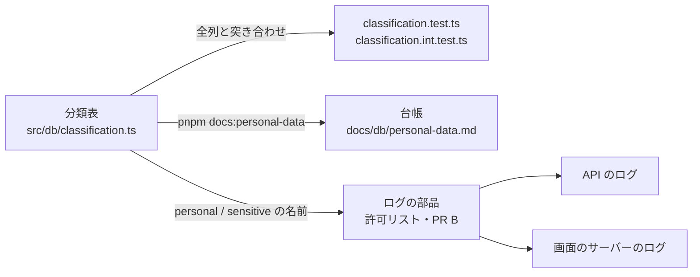

# 設計: 個人情報を、置き場所とログで最初から守る

> **AI 用の設計書。省略せずに網羅的に書く(正はこちら)。** 人はこれを開かず、PR の本文の「人向けのまとめ」を見る([guides/human-review.md](../guides/human-review.md))。
> 仕様: [docs/specs/0008-personal-data.md](../specs/0008-personal-data.md)
> 状態: 下書き
> 観点の順は [review-viewpoints.md](../review-viewpoints.md)。当てはまらない節も消さずに「該当なし(理由)」と書く。

## 0. 全体像

DB の全部の列に区分を付けた**分類表**を土台にする(PR A)。その上で、ログを「伏せる名前の一覧」から「**出してよい名前の一覧**(許可リスト)」に変え、分類表の個人情報の名前は深さを問わず伏せる(PR B)。要配慮個人情報は、専用のスキーマができるまで足せない。



## 作業の前に読んだ物(ガイド)

- `apps/api/test/unit/audit-coverage.test.ts`: 網羅を強制する型(足し忘れ・もう無い物の両方で落とす)。分類表のテストも同じ形にした
- `docs/adr/0006-outbox.md`・`0013-audit-log.md`: 出来事の中身と監査ログの `details` は「ID と名前だけ・値は入れない」。分類表で機械に確かめさせる
- `packages/error-reporting/src/scrub.ts`: Sentry へは許可リスト(`pickReportLine`)と失敗の文の伏せ字(`scrubMessage`)。CloudWatch 側を同じ考え方にそろえる(PR B)
- `apps/api/src/logger.ts`: redact は `password`・`token`・`idToken`・`email`・`authorization`・`cookie` の1段下まで(PR B で直す)
- `docs/guides/data-retention.md`: 置き場所と期間の表。個人情報の台帳と並べて、契約とプライバシーポリシーの元になる
- `scripts/check-guards.mjs`: 危険度「高」の一覧と4か所(ask・labeler・CODEOWNERS・Bash のフック)を突き合わせる
- `.tbls.yml`・`scripts/docs-db.mjs`: `docs/db/` は tbls が DB から作る(Docker が要る・CI に無い)

## 1. 設計方針

- **分類表が正**。台帳・ログの伏せる名前・レビューの観点は、分類表から作る・読む。
- **網羅はテストで強制**(監査ログの名前と同じ型)。drizzle の定義と、本物の DB(移行の SQL だけで足した物も)の両方と突き合わせる。
- **要配慮個人情報は分けて置く**。置き場所の決まり(スキーマ `sensitive` だけ)を先にテストにし、分ける仕組み(ロール・鍵・暗号化)は使うときに作る(ADR 0018)。
- 新しい依存は足さない。分類表は依存の無い TypeScript の値(画面のサーバーやスクリプトからも読める)。

## 2. データモデル

表・列は変えない(移行なし)。足すのは分類の値だけ。

### 分類表 `apps/api/src/db/classification.ts`

```ts
COLUMN_CLASSIFICATION: Record<"スキーマ.表.列", { class, purpose, keys? }>
```

| 区分 | 意味 | ログ | 監査ログの details・出来事の中身 | Sentry |
|---|---|---|---|---|
| `public` | 決まった選択肢・真偽(ロール・状態・時間帯) | 出してよい(PR B の許可リストに入れたものだけ) | 置いてよい | 決めた項目だけ |
| `internal` | 仕組みの値(ID・ハッシュ・時刻・回数) | 出してよい(同上) | 置いてよい | 決めた項目だけ |
| `personal` | 個人情報・お客さんが入れた自由な文 | **出さない**(深さを問わず伏せる) | **置けない**(テスト) | 出さない |
| `sensitive` | 要配慮個人情報 | **出さない** | **置けない** | 出さない |

- jsonb の列は `keys` に中身のキーごとの区分を書く。`platform.audit_events.details` はパスの ID の名前・`fields`・`route`・`counts`、`platform.outbox.payload` は `src/outbox/topics.ts` の全部のキー。
- いまの分類(72 列)のうち `personal` は10列: `users.email`・`users.name`・`tenants.name`・`support_sessions.staff_name`・`staff_email`・`email_changes.previous_email`・`new_email`・`projects.name`・`tasks.title`・`outbox.last_error`。`sensitive` は0列。
- `outbox.last_error` は生の失敗の文(SMTP の「550 <アドレス>」など)が入るので、いまは `personal`。PR B で書く前に値を伏せるようにしたら `internal` に下げる。

### 台帳 `docs/db/personal-data.md`

- `apps/api/scripts/personal-data-ledger.ts` が分類表から作る(`pnpm docs:personal-data`。`pnpm docs:db` の続きでも作る)。DB も Docker も要らない。
- 先頭に `personal` / `sensitive` の列だけの表(プライバシーポリシー・開示の依頼・漏えいの範囲に答える用)、続けて全部の列。
- tbls の `columnComments` には入れない: tbls は DB から作るので CI で確かめられない(Docker が要る)。台帳は単体テストで「分類表から作り直した物と同じ」を確かめる。

### 解約で消す一覧・書き出し

該当なし(表を足さない)。

## 3. API

該当なし(API を足さない・変えない)。API を足す手順(`add-api-endpoint`)に「返す値とログの項目の区分を確かめる」を足した。

## 4. 状態遷移

該当なし。

## 5. システム間連携

- Sentry: 変えない(すでに許可リスト)。
- ログ(CloudWatch)・送信待ちの失敗の文・メールの中継のログ: PR B。

## 6. 業務ルール

- 全部の列に区分と目的(一言)。足し忘れ・もう無い列の分類は単体テストで落ちる。
- 本物の DB にある列(`drizzle` のスキーマを除く)も全部分類されている(結合テスト)。移行の SQL だけで表を足しても捕まえる。
- jsonb の列は `keys` が必須。jsonb でない列に `keys` は書かない。
- `sensitive` の列(と `sensitive` のキーを持つ jsonb の列)は、スキーマ `sensitive` の表だけ。
- 監査ログの `details` と出来事の中身に、`personal` / `sensitive` のキーは置けない。
- 出来事の中身のキー・API のパスの ID の名前を足したら、分類表の `keys` にも足す。
- 迷ったら重い方に倒す: 人が入れる自由な文(名前・題名)は `personal`。

## 7. 要求との対応

| 受け入れ条件(仕様) | 設計のどこ | テスト |
|---|---|---|
| 全部の列に区分と目的がある | 2. 分類表 | `classification.test.ts`「全部の列に分類がある」「区分は4つのどれかで、目的が書いてある」 |
| 足し忘れ・もう無い列で落ちる | 6. | `classification.test.ts`「全部の列に分類がある」「もう無い列の分類が残っていない」・`classification.int.test.ts` |
| jsonb の中身のキーも分類。足し忘れで落ちる | 2. keys | `classification.test.ts`「jsonb の列は中身のキーも」「出来事の中身のキー」「API のパスの ID の名前」 |
| details と payload に personal / sensitive を置けない | 6. | `classification.test.ts`「どちらにも personal / sensitive のキーは置けない」 |
| sensitive はスキーマ sensitive だけ | 6.・ADR 0018 | `classification.test.ts`「sensitive の列は、スキーマ sensitive の表にしか無い」「確かめ方の確かめ」 |
| 分ける段が ADR にある | ADR 0018 | (文書) |
| 台帳が docs/db にあり、食い違うと落ちる | 2. 台帳 | `classification.test.ts`「分類表から作り直した物と同じ」 |
| 手順(db-migration・add-api-endpoint・review-pr) | `.claude/skills/` | (文書) |
| 分類表・ログの部品が危険度「高」 | `.claude/hooks/protected-paths.json` と4か所 | `pnpm guards` |
| (B)ログの許可リスト以下 | PR B で書く | PR B で書く |

## 8. 非機能

- 性能: 該当なし(テストと文書だけ。実行時のコードは変えない)。
- セキュリティ: 仕様の STRIDE の「改ざん」は、分類表を危険度「高」に入れ、`classification.test.ts` も一覧に入れた(テストを弱めて通すのを止める)。
- 運用: 台帳は作るファイル。手で直すとテストが落ちる。
- 費用: 0。

## 9. このプロダクト特有

| 観点 | この変更では |
|---|---|
| テナント分離 | 変えない |
| 権限の表 | 変えない |
| 監査ログ | `details` のキーを分類し、個人情報のキーを置けないようにした |
| 解約で消す一覧 | 変えない |
| サポートの代理ログイン | 社員の名前・メール(`support_sessions`)を `personal` にした |
| ログの個人情報 | 分類表が土台。ログの部品は PR B |
| 列の分類(`personal` / `sensitive`) | この PR で入れる |
| 画面の部品 | 変えない |

## 10. 観点ごとの扱い

| 観点 | 扱い | 理由 |
|---|---|---|
| 設計方針 | 採用 | 監査ログの網羅と同じ型。新しい依存なし |
| データモデル | 最重要 | 区分の付け方が、ログに出す・出さないと、プライバシーポリシーの元になる(U-1) |
| API | 低優先 | 変えない |
| 状態遷移 | 低優先 | 無い |
| システム間連携 | 軽く確認 | PR A では変えない |
| 業務ルール | 機械で検証 | 全部テストにした |
| 要求との対応 | 機械で検証 | 7. の表 |
| 非機能 | 軽く確認 | 実行時のコードを変えない |
| 列の分類 | 最重要 | U-1 |

## 11. 決めたこと(AI が決めた。人に聞かなかった)

- 区分は4つ(`public` / `internal` / `personal` / `sensitive`)。秘密(トークン・パスワード)は DB に置かない決まりなので、区分を増やさなかった — 秘密の写し(`support_grants.code_hash`)はハッシュなので `internal`。ログには PR B の許可リストで出ない
- 台帳は tbls ではなく分類表から作る — tbls は Docker と DB が要り CI で確かめられない。分類表からなら単体テストで食い違いを止められる
- 結合テストで本物の DB の列とも突き合わせる — drizzle に書かずに移行の SQL だけで表を足すと、単体テストでは見えない
- 分類表と台帳を作るスクリプトは依存の無い TypeScript — 画面のサーバーやスクリプトからも読めるように
- `classification.test.ts` も危険度「高」の一覧に入れた — 分類表を守っても、テストを弱めれば通ってしまう
- `outbox.last_error` はいま `personal` — 生の失敗の文に宛先が入る(点検で見つけた)。PR B で伏せたら `internal` に下げる
- 段1〜3の実装はしない(ADR 0018 は「提案」) — 要配慮の列はまだ無い。決まり(置き場所のテスト)だけ先に入れれば、混ざって入ることは無い

## 12. 未確定事項(AI の仮決め。人の承認と分けて追う)

| 番号 | 工程 | 種類 | 仮決め(設計した事実) | なぜそうしたか | 人が判断する問い | 状態 |
|---|---|---|---|---|---|---|
| U-1 | 設計 | 他チームとの契約や制約 | お客さんが入れる自由な文(組織・プロジェクトの名前・タスクの題名)を `personal` に、ID(`users.id`・Cognito の `external_id`)を `internal` にした | 自由な文には人の名前や病名が入りうるので、重い方に倒した。ID は社内では人と照合できる(法の上は個人情報に当たりうる)が、ログで「誰が困ったか」を追うのに要るので、ログに出してよい側に置いた | プライバシーポリシー・利用規約の「取得する情報」と、この分け方でよいか(ID をログに残すことを書くか) | 仮決め |
| U-2 | 設計 | 戻せないリスク | 要配慮個人情報は、スキーマ `sensitive` ができるまで1列も足せない(ADR 0018 は「提案」のまま) | 混ざって入ると、後から分けても、バックアップとログには残る(戻せない) | 要配慮を扱う機能が来たら、先に段1を作る順でよいか。ADR 0018 を「採用」にしてよいか | 仮決め |

## 13. 作り直しの記録

| 日付 | きっかけ | 入った工程 | 直した物 | 作り直した下流 |
|---|---|---|---|---|
