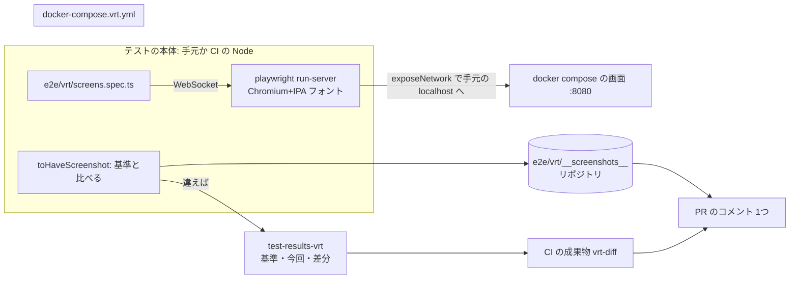

# 設計: 画面を見える化する(PR ごとのスクショ・見た目の回帰テスト・部品の一覧)

> **AI 用の設計書。省略せずに網羅的に書く(正はこちら)。** 人はこれを開かず、PR の本文の「人向けのまとめ」を見る([guides/human-review.md](../guides/human-review.md))。
> 仕様: [docs/specs/0011-visual-regression.md](../specs/0011-visual-regression.md)
> 状態: 下書き(未確定事項 U-1 が仮決め。承認は PR で)
> 観点の順は [review-viewpoints.md](../review-viewpoints.md)。当てはまらない節も消さずに「該当なし(理由)」と書く。

## 0. 全体像

主な画面(8画面+部品の一覧のダイアログ)を、パソコンの幅とスマホの幅で撮り、リポジトリに置いた基準の画像と `toHaveScreenshot` で比べる。ブラウザは Playwright の公式イメージの Docker の中で動かし(ADR 0024)、手元と CI で同じ画像にする。
CI の新しいワークフロー `vrt.yml` が比べた結果と画面の画像を PR のコメント1つにまとめる。部品(`packages/ui`)を並べた `/design-system` を足し、これも撮る。

## 作業の前に読んだ物(ガイド)

- `apps/web/CLAUDE.md`・`docs/design-system.md`: 画面は `@app/ui` の部品だけ・`style`/`className` を書かない(Semgrep)。幅 320px で横にはみ出さない。部品の見本は「まだ入れていない。入れるなら手元で動かすだけ」
- `apps/web/playwright.config.ts`: 叩く先は `E2E_BASE_URL`(既定 `http://localhost:8080`)。`screenshot: "on"` で撮るが比べていない。Cognito の組は `E2E_AUTH` で切り替え。スマホの組は幅 320px(reflow の確かめ用)
- `.github/workflows/ci.yml` の `e2e`: `docker compose up --build -d` → 画面と API の返事を待つ → `pnpm test:e2e`。成果物 `playwright-report` は7日
- `.github/workflows/labeler.yml`・`pr-work.yml`・`preview.yml`: `pull_request_target` を使わない。フォークでは書き込まない。PR の本文などは env で渡す(式を `run` に直接書かない)
- `apps/api/src/db/seed.ts`: 種データは「すでにあれば飛ばす」。ID は固定。**E2E は Acme にプロジェクトやタスクを足すが、Globex には書き込まない**(開発用ログインのとき)。作った日は種データを入れた日
- `apps/web/src/format.ts`: 日付は `2026/10/24` の形(`toLocaleDateString("ja-JP")`)
- `apps/web/src/report-error.ts`: `APP_ENV` をサーバーとブラウザの両方で読む `reportingConfig()`(`createIsomorphicFn`)
- Playwright の公式イメージ `mcr.microsoft.com/playwright:v1.64.0-noble`: Node 24・Chromium 1248・IPA ゴシック・文泉驛・Noto の絵文字が入っている。npm の `playwright` は入っていない(`npx -y playwright@1.64.0` で取る)。手元(Windows・Docker Desktop)で `run-server` と `exposeNetwork: "<loopback>"` を試し、`localhost:8080` の画面が日本語のフォントで撮れることを確かめた
- `renovate.json`: `docker:pinDigests`。compose のイメージは標準の docker-compose の仕組みが上げる

## 1. 設計方針

- **ブラウザだけを Docker の中で動かす**(ADR 0024 の C)。テストの本体・依存・書き方はふつうの E2E と同じ。手元の OS に関わらず、描くのはいつも同じイメージの Chromium とフォント。
- **画面へは Playwright の `exposeNetwork: "<loopback>"`** でつなぐ。コンテナの中のブラウザが開く `localhost:8080` は、テストの本体(手元・CI)の `localhost:8080` に通される。画面の URL(オリジン)・Cookie・`APP_URL` はふつうの E2E と同じになり、compose の網に入れなくてよい。
- **基準の画像はリポジトリ**(ADR 0024 のア)。`apps/web/e2e/vrt/__screenshots__/<desktop|mobile>/<画面>.png`。画面を変えた PR は基準も変え、人が PR の差分(GitHub が前後を並べる)で見る。
- **VRT はふつうの E2E と分ける**: 設定 `playwright.vrt.config.ts`・コマンド `pnpm vrt`・ワークフロー `vrt.yml`。ふつうの E2E はブラウザの Docker が無くても今までどおり動き、VRT の揺れで E2E の結果が読みにくくならない。CI では別のジョブなので、種データだけの DB で撮れる(E2E が足したデータが写らない)。
- **撮るのは見るだけ**: 書き込まない。ログインの後ろの画面は Globex の管理者(E2E が書き込まない組織)で撮る。日付は塗る。
- **PR のコメントは2つのジョブに分ける**: PR のコードを動かすジョブ(`vrt`)は読む権限だけで、コメントの本文を作って成果物にする。コメントを書くジョブ(`comment`)は PR のコードを checkout も実行もせず、本文を受け取って貼るだけ。フォークの PR では `comment` を動かさない。
- **部品の一覧は画面の中の1ページ**(`/design-system`)。部品の見本の道具(Storybook)は入れない(依存・ビルド・CI が1つ増える割に、ここで要るのは「見る」と「撮る」だけ)。本番では 404。

## 2. データモデル

該当なし(DB を触らない)。

## 3. API

該当なし(API を足さない・変えない)。画面の URL が1つ増える:

| URL | ログイン | 本番(`APP_ENV=prod`) | それ以外 | 読む物 |
|---|---|---|---|---|
| `/design-system` | 要らない | 404(`notFound()`。ふつうの「ページが見つかりません」) | 部品の一覧 | 何も読まない(固定の見本) |

`head`: `pageHead({ title: "部品の一覧", description, path: "/design-system" })`(ログイン無しで開ける画面なので、`apps/web/CLAUDE.md` の決まりどおり説明と `og:url` も出す)。検索の決まりは今までどおり全部 noindex。

## 4. 状態遷移

該当なし(状態を持たない)。部品の一覧ページの中の入力・選択・チェックは、そのページの中だけの状態(保存しない)。

## 5. システム間連携

### 5.1 ブラウザの Docker(`docker-compose.vrt.yml`)

| 項目 | 値 | 理由 |
|---|---|---|
| プロジェクトの名前 | `software-factory-starter-vrt` | アプリの compose(`software-factory-starter`)と別。上げ下げが互いに影響しない |
| イメージ | `mcr.microsoft.com/playwright:v1.64.0-noble@sha256:06a9…` | 版とダイジェストを固定(同じフォント・同じ Chromium)。Renovate が上げる |
| `platform` | `linux/amd64` | Apple の CPU の Mac でも CI と同じ画像にする(arm64 は描き方がわずかに違う) |
| 起動 | `npx -y playwright@1.64.0 run-server --port 3100 --host 0.0.0.0` | テストの本体と同じ版のサーバー(版が違うとつながらない) |
| ポート | `127.0.0.1:3100:3100` | 手元の外から叩かせない |
| 利用者 | `pwuser`(root で動かさない)・`init: true` | Playwright の Docker の使い方どおり |
| 見張り | 3100 に TCP でつながるか(Node の1行)。`docker compose … up -d --wait` で待てる | |

Playwright の版は3か所(`apps/web/package.json` の `@playwright/test`・イメージのタグ・起動のコマンド)にある。**ずれると単体テスト(`e2e/vrt/versions.test.ts`)が落ちる**。Renovate は `playwright` の名前の付く物を1本の PR にまとめ、起動のコマンドの版も上げる(`renovate.json` の customManagers)。

### 5.2 設定(`apps/web/playwright.vrt.config.ts`)

- `testDir: ./e2e/vrt`・`testMatch: *.spec.ts`(同じ所の単体テストを拾わない)
- `snapshotPathTemplate: {testDir}/__screenshots__/{projectName}/{arg}{ext}`
- `use.connectOptions: { wsEndpoint: VRT_WS_ENDPOINT ?? ws://127.0.0.1:3100/, exposeNetwork: "<loopback>" }`
- `use.baseURL: E2E_BASE_URL ?? http://localhost:8080`(ふつうの E2E と同じ)・`locale: ja-JP`・`timezoneId: Asia/Tokyo`
- 組: `desktop`(Desktop Chrome・1280×720)/ `mobile`(Pixel 7 の設定に幅 390×844。いまのスマホでいちばん多い幅。320px のはみ出しはふつうの E2E が見る)
- `expect.toHaveScreenshot`: `animations: "disabled"`・`caret: "hide"`・`scale: "css"`(スマホも 1 倍の画素で保存。画像を小さく)・`maxDiffPixels: 0`(同じイメージで撮るので、違いは本当に違う)
- `retries: 0`(揺れを再試行で隠さない)・`updateSnapshots: "none"`(基準が無い画面は落とす。作るのは `pnpm vrt:update` だけ)
- 出力: `test-results-vrt/`(違ったときの基準・今回・差分)・`playwright-report-vrt/`(CI のとき)

### 5.3 撮る画面(`apps/web/e2e/vrt/screens.ts`)

| ID | 画面 | URL | 誰で | 待つもの |
|---|---|---|---|---|
| `login` | ログイン | `/login` | ログイン前 | 見出し「ログイン」 |
| `legal-terms` | 利用規約 | `/legal/terms` | ログイン前 | 見出し「利用規約」 |
| `not-found` | 見つからない | `/no-such` | ログイン前 | 見出し「ページが見つかりません」 |
| `design-system` | 部品の一覧 | `/design-system` | ログイン前 | 見出し「部品の一覧」 |
| `design-system-dialog` | 部品の一覧(確認のダイアログ) | `/design-system` で「消す」を押す | ログイン前 | ダイアログ |
| `projects` | プロジェクトの一覧 | `/` | `admin@globex.test` | 見出し「プロジェクト」 |
| `tasks` | タスク | `/projects/<Globex の計画>` | `admin@globex.test` | 見出し「Globex の秘密の計画」 |
| `settings` | 設定 | `/settings` | `admin@globex.test` | 見出し「設定」 |
| `support-access` | サポートへの許可 | `/support-access` | `admin@globex.test` | 見出し「サポートへの許可」 |

撮らない画面: 監査ログ(ログインのたびに行と時刻が増える)・アカウント(開発用ログインでは1行の断りだけ。Cognito のときだけ中身が出る)・登録とパスワードの再設定(Cognito のときだけ。開発用ログインではログインの画面へ回る)・サポート(運営の人。二段階認証が必須)・同意の画面(同意すると戻れない)。

塗る所(`mask`): `2026/10/24` の形の文字(作った日)。どの画面でも灰色に塗る(既定の桃色は目立ちすぎる)。

撮り方: 画面ごとに `page.goto` → 待つもの → `toHaveScreenshot("<ID>.png", { fullPage: true, mask })`。

### 5.4 CI(`.github/workflows/vrt.yml`)

- きっかけ: `pull_request`(opened・synchronize・reopened・labeled)と `merge_group`。`labeled` は付けたラベルが `vrt:update` のときだけ流す(labeler の `risk:*` で流し直さない)
- `permissions: contents: read`(全体)。`concurrency` は PR ごと・新しい push で前を止める
- ジョブ `vrt`(読むだけ・20分):
  1. checkout(`persist-credentials: false`)→ pnpm・Node・`pnpm install --frozen-lockfile`
  2. `docker compose -f docker-compose.vrt.yml up -d --wait`(ブラウザ)と `docker compose up --build -d`(アプリ。E2E と同じ待ち方)
  3. ラベル `vrt:update` があれば `pnpm vrt:update`、無ければ `pnpm vrt`。終わり方を覚えて先へ進む
  4. `node apps/web/e2e/vrt/report-cli.ts` がコメントの本文(`vrt-report/comment.md`)を作る
  5. 成果物: `vrt-report`(本文)・`vrt-diff`(違ったときの画像と HTML のレポート。14日)・`vrt-baseline`(ラベルのときの撮り直した基準。14日)
  6. 3 が失敗、またはラベルのときに基準が変わったら、ジョブを落とす(コミットするまで赤)
- ジョブ `comment`(`needs: vrt`・`pull-requests: write` だけ・5分): 同じリポジトリの PR のときだけ。checkout しない。`vrt-report` を取り、`<!-- vrt-report -->` の印のある自分のコメントがあれば書き換え、無ければ足す(`gh api`)
- 値は env で渡す(`run` に式を直接書かない)。zizmor・actionlint が CI で見る

### 5.5 コメントの本文(`apps/web/e2e/vrt/report.ts`)

1. 印 `<!-- vrt-report -->` と見出し「📸 画面(見た目の比べ)」
2. 結果の1行: ✅ 基準と同じ(N 枚)/ ❌ M 枚が基準と違う(画面の名前と組の一覧・成果物 `vrt-diff` のある実行へのリンク・受け入れる方法)/ 🔁 ラベルで撮り直した(変わった画像の一覧・取り込む1行 `gh run download <実行> -n vrt-baseline -D apps/web/e2e/vrt/__screenshots__`)
3. 画面の表(`
` に畳む): 画面 × パソコン・スマホ。画像は **PR の先頭の commit の基準の画像**(`https://github.com/<repo>/raw/<sha>/apps/web/e2e/vrt/__screenshots__/…`)。違ったときは「コミット済みの基準」と書く

違いの見つけ方: `test-results-vrt/` の `*-actual.png`(今回)を探し、同じ所に `*-expected.png` があれば「違う」、無ければ「基準が無い(新しい画面)」。組はフォルダの名前の末尾(`-desktop` / `-mobile`)。

## 6. 業務ルール

- 基準の画像を変えてよいのは、画面を変える PR だけ。変えたら PR の「📸 スクショ」に、どの画面をなぜ変えたかを1行書く
- 基準の画像を作り直すのは `pnpm vrt:update`(手元)か、ラベル `vrt:update`(CI)だけ。手で画像を描き直さない
- 撮り直すときは種データだけの DB で(手元で E2E を流した後なら `docker compose down -v && docker compose up --build -d`)。Globex に書き込む E2E を足したら、VRT の画面を見直す
- 写してよいのは種データと固定の文だけ。新しい画面を撮るときは、種データ以外の値・日々変わる値が写らないか見る(塗るなら `mask`)
- 撮る画面を足す: `screens.ts` に1行 → `pnpm vrt:update` → 画像をコミット。消すときは画像も消す

## 7. 要求との対応

| 受け入れ条件(仕様) | 設計のどこ | テスト |
|---|---|---|
| PR に主な画面のスクショ(パソコン・スマホ)が並ぶ | 5.4・5.5 | `e2e/vrt/report.test.ts`「全部同じ…画面の表」・CI の `comment` ジョブ(この PR で確かめる) |
| コメントは1つで書き換える | 5.4 の `comment` | CI(この PR の push で確かめる) |
| 種データと固定の文だけ・日付は塗る | 5.3・6 | `e2e/vrt/screens.spec.ts`(種データの人だけ・`mask`)・基準の画像を目で確かめた |
| フォークではコメントしない | 5.4 の `comment` の `if` | zizmor・actionlint(CI) |
| 違えば CI が落ちる | 5.2(`maxDiffPixels: 0`・`updateSnapshots: none`)・5.4 の 6 | 手元で基準の1枚を別の画面の画像に差し替え、落ちること・差分の3枚とコメントの本文が出ることを確かめた |
| 違ったときに3枚の画像を開ける | 5.4 の 5・5.5 | `report.test.ts`「違う画面…」 |
| 手元と CI で同じ画像 | 5.1・ADR 0024 | 手元(Windows)で続けて3回撮って同じ・手元で撮った基準で CI が通る(この PR) |
| 基準は明示したときだけ変わる | 5.2・5.4 の 3 と 6 | `report.test.ts`「ラベルで撮り直した…」 |
| ふつうの E2E は今までどおり | 1・5.2(別の設定) | `playwright.config.ts` の `testIgnore`・CI の `e2e` |
| `/design-system` に部品が種類ごとに並ぶ | 3・`pages/DesignSystemPage.tsx` | E2E `design-system.spec.ts` |
| 部品の一覧も VRT の対象(ダイアログも) | 5.3 | `screens.spec.ts` の `design-system`・`design-system-dialog` |
| 本番では 404 | 3 | `src/design-system.test.ts` |
| 部品の一覧も axe・320px | 3 | E2E `design-system.spec.ts`(パソコンとスマホの組) |

## 8. 非機能

- 性能: VRT のジョブは CI で約6〜8分(アプリのビルドと起動が大半。撮るのは 18 枚で1分ほど)。ふつうの E2E と並んで流れるので、PR の待ち時間はほぼ増えない。画面の JS は部品の一覧ページの分だけ増える(画面ごとに分けて読むので、ほかの画面には載らない。`pnpm --filter @app/web size` で見る)
- セキュリティ: 仕様の STRIDE のとおり。ブラウザのコンテナは `127.0.0.1` だけで待ち受ける。`npx` で取る `playwright` は版を固定
- 運用: 揺れ(何も変えていないのに落ちる)が出たら、まず差分の画像を見る。揺れる所は `mask`、だめなら画面ごとに許す画素を足す(`docs/guides/vrt.md`)
- 費用: 公開のリポジトリの GitHub Actions は無料。非公開で使うなら、PR ごとに約8分ぶん増える。基準の画像でリポジトリが約1.5MB 増える(18 枚)

## 9. このプロダクト特有

| 観点 | この変更では |
|---|---|
| テナント分離 | 該当なし(API・DB を触らない)。VRT は Globex の管理者で撮るだけ |
| 権限の表 | 該当なし(API を足さない) |
| 監査ログ | 該当なし(書き込みを足さない) |
| 解約で消す一覧 | 該当なし(表を足さない) |
| サポートの代理ログイン | 該当なし |
| ログの個人情報 | 該当なし(ログを足さない) |
| 列の分類(`personal` / `sensitive`) | 該当なし |
| 画面の部品 | `/design-system` は `@app/ui` の部品だけで描く(`style`・`className` を書かない)。部品そのものは変えない |

## 10. 観点ごとの扱い

| 観点 | 扱い | 理由 |
|---|---|---|
| 設計方針 | 最重要 | 撮る場所(Docker の中のブラウザ)と基準の置き場所は、後から変えると基準を全部撮り直す(ADR 0024) |
| データモデル | 低優先 | DB を触らない |
| API | 低優先 | API を触らない |
| 状態遷移 | 低優先 | 状態を持たない |
| システム間連携 | 採用 | CI のワークフロー(危険度「高」)。書き込みの権限を PR のコードに渡さない形 |
| 業務ルール | 軽く確認 | 基準を変える手順と、写してよい物 |
| 要求との対応 | 機械で検証 | 7 の表のとおり |
| 非機能 | 軽く確認 | CI の時間とリポジトリの重さ |
| 画面の部品 | 採用 | 部品の一覧ページが部品の決まり(`docs/design-system.md`)を守るか |

## 11. 決めたこと(AI が決めた。人に聞かなかった)

- ブラウザだけを Docker で動かす(テストの本体は Docker の外)— 手元の `node_modules` は Windows 用で、コンテナで使えない。丸ごとコンテナで流すと入れ直しの仕組みが要る。Playwright の `run-server` と `exposeNetwork` で、手元の Windows から試して日本語のフォントで撮れた
- 画面へは compose の網ではなく `exposeNetwork` でつなぐ — 画面の URL を E2E と同じ `localhost:8080` にでき、Cookie・`APP_URL`・転送先の URL が変わらない
- Mac でも `linux/amd64` で動かす — Apple の CPU の版のイメージは描き方がわずかに違い、基準が2つ要る。遅くなるが同じ画像になる方を取った
- スマホの幅は 390px — いまのスマホでいちばん多い幅で、人が見て分かりやすい。いちばん狭い 320px のはみ出しは、ふつうの E2E(`expectAccessible`)が見ている
- 許す画素は 0 — 同じイメージで撮るので、違いは本当に違う。揺れが出たら画面ごとに足す
- ログインの後ろの画面は Globex の管理者で撮る — E2E は Acme に書き込むので、手元で E2E の後に撮ると Acme の一覧が変わる
- 監査ログ・アカウント・登録・パスワードの再設定・サポート・同意の画面は撮らない — 5.3 の理由
- 基準の画像の更新は手元のコマンドとラベルの2つ。CI は push しない — GitHub の鍵(`GITHUB_TOKEN`)で push した commit では CI が動かず、確かめていない物がマージに回る。GitHub App の鍵を作るのは人の設定が要る
- PR のコメントは1つを書き換える — push のたびに増えると読めない
- 画像はコメントに `
` で畳み、PR の先頭の commit の基準の画像を指す — 画像を別の場所に上げずに済み(書き込みの権限が要らない)、PR の差分で前後も見られる
- 部品の一覧ページは画面の中の1ページ・本番では 404・ログイン無し — Storybook は依存とビルドが増える。本番の利用者には要らない。プレビュー・stg では人が見られる方が役に立つ
- VRT は `ci.yml` に足さず `vrt.yml` に分ける — ラベルを付けたときにも流すため(`ci.yml` はラベルで流し直さない)。ブランチ保護の必須の検査に入れるかは人の設定(`docs/getting-started.md`)
- 成果物は14日 — E2E(7日)より長く。PR が週をまたいでも差分を見られる

## 12. 未確定事項(AI の仮決め。人の承認と分けて追う)

> 4つに当たる判断だけ。状態の書き方は [guides/human-review.md](../guides/human-review.md) の 2。`pnpm decisions` がここを読む。**`仮決め` が残る PR はマージしない。**

| 番号 | 工程 | 種類 | 仮決め(設計した事実) | なぜそうしたか | 人が判断する問い | 状態 |
|---|---|---|---|---|---|---|
| U-1 | 設計 | 戻せないリスク | 基準の画像(主な画面のスクショ 18 枚)を公開のリポジトリに置き、PR のコメントにも貼る。写るのは種データ(架空の2社・`.test` のメール)と固定の文だけ | PR の差分で前後の画像を見られ、仕組みが一番小さい。一度入れた画像は git の履歴から消しにくいが、写るのは架空のデータだけ | 主な画面のスクショを、公開のリポジトリ(履歴に残る)と PR のコメントに載せてよいか | 仮決め |

## 13. 作り直しの記録

> `/rework` が書く。誤りが入った工程と、作り直した下流。

| 日付 | きっかけ | 入った工程 | 直した物 | 作り直した下流 |
|---|---|---|---|---|
