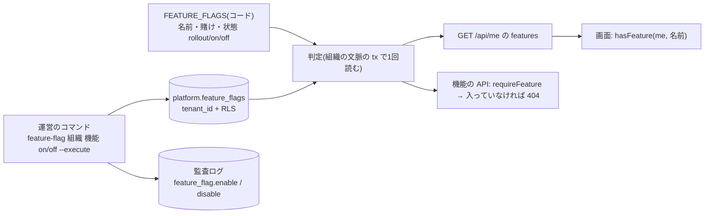

# 設計: 組織ごとの機能フラグと、利用の記録(A/B テストの土台)

> **AI 用の設計書。省略せずに網羅的に書く(正はこちら)。** 人はこれを開かず、PR の本文の「人向けのまとめ」を見る([guides/human-review.md](../guides/human-review.md))。
> 仕様: [docs/specs/0012-feature-flags-and-usage.md](../specs/0012-feature-flags-and-usage.md)・ADR: [0025](../adr/0025-feature-flags-and-usage-records.md)
> 状態: 下書き(PR ① 機能フラグ。利用の記録は PR ② でこの設計書に書き足す)
> 観点の順は [review-viewpoints.md](../review-viewpoints.md)。当てはまらない節も消さずに「該当なし(理由)」と書く。

## 0. 全体像

賭けの `rollout`(一部の組織に出す)に使う**組織ごとの機能フラグ**を入れる。フラグの**定義はコード**(`@app/shared` の `FEATURE_FLAGS`。名前・賭け・説明・状態)、**組織ごとの「入れた」は DB**(`platform.feature_flags`。`tenant_id`+RLS)。切り替えるのは運営のコマンドだけ(試し → `--execute`。監査ログに残す)。API は `GET /api/me` に入っている機能の名前を足し、画面はそれで出し分ける。機能の API は入っていなければ 404。



PR ② では、この上に「どの組織の・誰が・どの機能を・どの日に使ったか」の記録(`platform.feature_usage`)と、数だけを出す集計のコマンドを足す(この設計書に書き足す)。

## 作業の前に読んだ物(ガイド)

- 仕様: `docs/specs/0012-feature-flags-and-usage.md`
- 考え方: `docs/guides/bets-and-assets.md`(段階 `psf` → `rollout` → `adopted` → `retired`。`rollout` は「機能フラグで一部に出す・使う割合と継続を見る」)・`docs/concepts/stages.md`(PMF の前は「機能フラグ・段階的な公開」は雑でいい側。だから小さく作る)
- ADR: `0001`(共有の表と RLS)・`0004`(領域ごとに分ける。共通の仕組みは `platform`)・`0013`(監査ログ。足すだけ・値を持たない)・`0014`(代理ログイン)・`0015`(解約)・`0018`(個人情報の分類)・`0019`(ログの許可リスト)・`0021`(キットのカタログ。「機能フラグで消さずに切る」は部品の消し方としては採らない)
- 手本: `docs/designs/0009-legal-consent.md`(コードの一覧+DB の記録・運営のコマンドの「試し → `--execute`」・`GET /api/me` に任意の項目を足す)
- 既存のコード:
  - `apps/api/src/app.ts` … `/api/*` の前に `c.set("legalVersions", …)` のように、テストで差し替える一覧を文脈に置く。`AppDeps` で差し替える
  - `apps/api/src/domains/organizations/routes.ts` … `GET /api/me`。代理の社員は `getSupportMe` の結果をそのまま返す
  - `apps/api/src/audit/record.ts` … `recordAudit(tx, { actor: { kind: "system", id: null }, … })` で仕組みの記録が書ける。`MANUAL_AUDIT_ACTIONS` は関所の外で手で残す名前
  - `apps/api/src/cli.ts` … `delete-tenant`・`legal-notify` の「試し → `--execute`」。接続は移行と同じ表の持ち主(`MIGRATION_DATABASE_URL`)。表は FORCE RLS なので、持ち主でも `withTenant` で組織の文脈を付ける
  - `apps/api/src/outbox/schema.ts` … Postgres のスキーマ `platform`(共通の仕組みの表を置く)
  - `apps/api/src/offboarding/delete-tenant.ts` … `TENANT_TABLES`(子から親の順)
  - `apps/api/src/db/classification.ts` … 全部の列の区分。`platform.audit_events.details` の keys
  - `apps/web/src/audit-labels.ts` … 監査ログの名前 → 画面の文
  - `docs/product/bets/*.md` … 「- 段階: <段階>」の行(`scripts/bets-lib.mjs` も同じ行を読む)

## 1. 設計方針

- **定義はコード、組織ごとの状態は DB**。
  - 定義(`packages/shared/src/feature-flags.ts` の `FEATURE_FLAGS`): `{ name, bet, description, state }`。画面と API が同じ一覧を見る。名前の型 `FeatureFlagName` はこの一覧から作るので、**書き間違いは型の検査で落ちる**。足す・状態を変える・消すのは PR(人が見る)。
  - 組織ごと(`platform.feature_flags`): 「この組織にこの機能を入れた」の行。**行がある = 入っている**(`rollout` のときだけ見る)。
  - 状態: `rollout`(行がある組織だけ)/ `on`(全部。行は見ない)/ `off`(全部で止める。行は見ない。すぐに止めたいときの手。デプロイが要る)。
- **共通の仕組みとして `apps/api/src/feature-flags/` に置く**(領域ではない。監査ログ・送信待ちと同じ)。表は `platform` に置く。領域のルートは `../../feature-flags/index.ts` を使う(共通の部品なので、領域どうしの向きの決まりには入らない)。
- **切り替えは運営のコマンドだけ**(U-1)。API は足さない。アプリの接続(`app_rw`)は表を**読むだけ**(移行の GRANT)。
- **判定はリクエストの中の `c.var.tx`(組織の文脈つき)で、組織の行を1回だけ読む**。キャッシュはしない(組織ごとに数行で、主キーの索引で引けるため)。
- **フラグは賭けに結びつける**。定義の `bet` は賭けのファイル(`docs/product/bets/B-NNNN-*.md`)があり、段階が `psf` / `rollout` / `adopted` のどれか(単体テスト)。`dropped` / `retired` になったら、フラグを消す PR を出すまで CI が落ちる(消し忘れを残さない)。
- 新しい依存(外の製品・ライブラリ)は足さない(ADR 0025)。

## 2. データモデル

### PR ①: `platform.feature_flags`(組織にこの機能を入れた)

| 列 | 型 | NULL | 説明 | 区分 |
|---|---|---|---|---|
| `id` | uuid(v7) | NOT NULL | 主キー | internal |
| `tenant_id` | uuid | NOT NULL | 組織(`organizations.tenants` への外部キー) | internal |
| `flag` | text | NOT NULL | 機能の名前(`FEATURE_FLAGS` の `name`。enum にしない: 足すたびに移行が要らないように) | public |
| `enabled_at` | timestamptz | NOT NULL(既定 now()) | 入れた時刻 | internal |

- 一意: `(tenant_id, flag)`(同じ組織に同じ機能は1行。2回目は何もしない)。この索引で組織の行を引く。
- RLS: `ENABLE` / `FORCE`・`tenant_isolation`(`tenant_id = app_current_tenant()`)。
- 権限: `app_rw` は **SELECT だけ**。足す・消すのはコマンド(表の持ち主の接続。組織の文脈つき)。
- 解約: `TENANT_TABLES` に足す(`organizations.tenants` より前)。
- 書き出し: 入れない(お客さんの業務のデータではなく、運営が出し分けるための設定)。
- 移行の段: ① 拡張(新しい表を足すだけ。前の版のアプリは読まないので動く)。縮小は無い。
- 戻し方: `DROP TABLE platform.feature_flags;`(前の版のアプリは読まないので、戻さなくても動く)。
- 消した機能の行: 定義から消した名前の行が残っても、読むときに定義に無い名前は捨てるので効かない(解約で消える)。**一度使った名前は使い回さない**(古い行が生き返るため。手引きに書く)。

### PR ②: 利用の記録

PR ② で書く(`platform.feature_usage`。1日1人1機能1行)。

## 3. API

- **新しい API は無い**。権限の表(`docs/authz/matrix.yaml`)・`ROUTE_RULES`・監査ログの `AUDIT_ACTIONS`(API の書き込み)に足す行は無い。
- `GET /api/me` の応答(`MeSchema`)に任意の項目を足す(足すだけ。CI の「API の互換」):
  ```ts
  /** この組織で入っている機能の名前(docs/specs/0012-feature-flags-and-usage.md)。画面は hasFeature で出し分ける */
  features: z.array(z.string()).optional()
  ```
  - ふつうの人・代理の社員のどちらにも、その組織の一覧を返す(代理の社員はお客さんと同じ画面を見る)。
  - 並びは定義の順(画面のテストが安定するように)。
- 機能の API の守り: ハンドラーの最初で `await requireFeature(c, "<名前>")`。入っていなければ `notFound()`(404。「無い API」と同じ形にし、出していない機能があることを知らせない)。
- 画面: `hasFeature(me, "<名前>")`(`@app/shared`)。守りは API 側(画面で隠すだけで安心しない。`apps/web/CLAUDE.md` と同じ)。
- 運営のコマンド(`apps/api/src/cli.ts`。本番の ECS で人が打つ。手順は `docs/runbooks/feature-flags.md`):
  ```
  node dist/cli.js feature-flag <組織の ID>                       … その組織の機能の一覧(状態・入っているか)
  node dist/cli.js feature-flag <組織の ID> <機能> on|off           … 試し(変えた後の状態を出すだけ)
  node dist/cli.js feature-flag <組織の ID> <機能> on|off --execute … 入れる・切る+監査ログ
  ```
  - 出力は JSON 1行(`{"mode":"plan","tenantId":"…","flag":"…","enabled":false,"next":true}`)。組織の名前は出さない(`delete-tenant` と同じ)。
  - 止める(何も変えない): 組織が無い・定義に無い名前・状態が `rollout` ではない(`on` / `off` は組織ごとに変えても効かない)。
  - 監査ログ: その組織の監査ログに、仕組み(`actor_kind = system`・`actor_id = null`)が `feature_flag.enable` / `feature_flag.disable`、対象 `organization`(ID なし)、`details = { flag: "<名前>" }`。**変わらなかったとき(入っている物を入れた)は残さない**。
  - 画面の文(`apps/web/src/audit-labels.ts`): 「機能を入れた(<名前>)」「機能を切った(<名前>)」。

## 4. 状態遷移

定義の状態(PR で変える):

```
(定義が無い) → rollout → on → (定義を消す)
                  ↓  ↑
                  off(全部で止める)
```

- `rollout` ⇄ `off`: 壊れたときに全部で止める・直したら戻す。`on` → `off` も同じ。
- `on` になったら(賭けが `adopted`)、組織の行は効かない。**撤去**(賭けが `retired`)のときにフラグの定義と呼び出しを一緒に消す。
- 組織ごとの行: 無い ⇄ ある(コマンドで入れる・切る)。何度でも戻せる。

賭けの段階との対応(単体テスト `feature-flags.test.ts` が見る):

| 賭けの段階 | フラグ |
|---|---|
| `idea` / `cpf` | 作らない(まだ作る段階ではない。テストが落ちる) |
| `psf` | 作ってよい(試作を本物の中に置くとき。状態は `rollout` で、話を聞く組織だけに入れる) |
| `rollout` | `rollout`(選んだ組織に入れる) |
| `adopted` | `on`(全部に出す。後で撤去するまで残してよい) |
| `dropped` / `retired` | 消す(残っていればテストが落ちる) |

## 5. システム間連携

該当なし(アウトボックス・メール・Cognito・外の製品には出入りしない。運営のコマンドは移行と同じ ECS のタスクで動く)。

## 6. 業務ルール

- 名前: 英小文字・数字・`-`、48文字まで、先頭は英字(`/^[a-z][a-z0-9-]{0,47}$/`)。定義の中で重ならない。
- `bet`: `B-NNNN`。賭けのファイルがあり、段階が上の表に合う。
- 入っているか: `off` → 入っていない / `on` → 入っている / `rollout` → その組織の行があれば入っている。
- 同じ組織に同じ機能を2回入れても1行(一意)。入っていない物を切っても何もしない(監査ログも残さない)。
- 権限: フラグは「出すか」だけ。入っていても、その API の権限が無ければ今までどおり 403(関所が先に止める)。
- 切り替えるのは運営だけ(U-1)。お客さんの管理者・メンバーには道が無い。

## 7. 要求との対応

| 受け入れ条件(仕様) | 設計のどこ | テスト |
|---|---|---|
| フラグはコードに定義する(状態は3つ) | 1・`packages/shared/src/feature-flags.ts` | `packages/shared/src/feature-flags.test.ts` |
| 定義に無い名前は型の検査で落ちる | 1(`FeatureFlagName`) | `pnpm typecheck`(`hasFeature` / `requireFeature` の引数の型) |
| 賭けが無い・段階が合わないと CI が落ちる | 4 | `apps/api/test/unit/feature-flags.test.ts` |
| 運営が組織ごとに入れる・切る(試し → `--execute`) | 3(コマンド) | `test/integration/feature-flags.int.test.ts`「コマンド」 |
| 試しでは変えない | 3 | 同上 |
| 定義に無い名前・`rollout` 以外・無い組織は止まる | 3 | 同上 |
| 入れた・切ったが監査ログに残る | 3 | 同上 |
| 2回入れても1つ | 2(一意)・6 | 同上 |
| `GET /api/me` に入っている機能の一覧 | 3 | `feature-flags.int.test.ts`「自分」 |
| `on` は全部・`off` は入れてあっても出ない | 1・6 | 同上 |
| 入っていない機能の API は 404 | 3(`requireFeature`) | `feature-flags.int.test.ts`「守り」 |
| 代理の社員には見ている組織と同じ一覧 | 3 | `feature-flags.int.test.ts`「代理」 |
| 他社には出ない | 2(RLS)・3 | `feature-flags.int.test.ts`(2社)・`rls.int.test.ts`(全テーブルに RLS) |
| 未ログインは 401 | 既存 | `authz-matrix.int.test.ts`(`GET /api/me` の行) |
| (利用の記録の条件) | PR ② | PR ② |

## 8. 非機能

- 性能: `GET /api/me` と機能の API で、組織の行を一意の索引で1回読む(組織ごとに数行)。`requireFeature` を1つのリクエストで何度呼んでも、そのたびに1回(いまは機能が無いのでまとめない。増えたら `c.var` に置く)。
- セキュリティ: 仕様の STRIDE。アプリの接続は表を読むだけ。切り替えは表の持ち主の接続(コマンド)だけ。
- 運用: 手順書 `docs/runbooks/feature-flags.md`(入れる・切る・全部で止める)。コマンドの出力は ID と真偽だけ。障害のとき「壊れている機能だけ止める」(`incident.md` の 2)は、状態を `off` にしてデプロイ。
- 費用: 表が1つ増えるだけ。

## 9. このプロダクト特有

| 観点 | この変更では |
|---|---|
| テナント分離 | 表は `tenant_id`+RLS。判定は `c.var.tx`(セッションから決まった組織)。コマンドは `withTenant(組織の ID)` |
| 権限の表 | 足す行なし(新しい API が無い)。`GET /api/me` は今の行のまま |
| 監査ログ | コマンドが `feature_flag.enable` / `feature_flag.disable` を仕組みとして残す(`MANUAL_AUDIT_ACTIONS`)。`details.flag` を分類表に足す |
| 解約で消す一覧 | `platform.feature_flags` を `TENANT_TABLES` に足す |
| サポートの代理ログイン | 代理の社員にも、見ている組織の一覧を返す。代理の社員は切り替えられない(API が無い) |
| ログの個人情報 | コマンドの出力・ログは ID・名前(機能)・真偽だけ。新しいログの項目名は足さない(`ALLOWED_KEYS` は変えない) |
| 列の分類(`personal` / `sensitive`) | 4列とも `internal` / `public`。個人情報は無い |
| 画面の部品 | 画面は変えない(出し分ける機能がまだ無い)。`hasFeature` を `@app/shared` に置く |

## 10. 観点ごとの扱い

| 観点 | 扱い | 理由 |
|---|---|---|
| 設計方針 | 採用 | 定義はコード・状態は DB・切り替えはコマンド。外の製品を使わない(ADR 0025) |
| データモデル | 軽く確認 | 新しい表1つ。RLS と解約の一覧は結合テストが見る |
| API | 軽く確認 | 新しい API は無い。`GET /api/me` に任意の項目を足すだけ |
| 状態遷移 | 採用 | 賭けの段階とフラグの状態を、単体テストで結びつけた |
| システム間連携 | 低優先 | 外との出入りが無い |
| 業務ルール | **最重要** | 誰が切り替えられるか(U-1)。お客さんの見え方と、賭けの測り方が変わる |
| 要求との対応 | 機械で検証 | 7 の表のテスト |
| 非機能 | 低優先 | 組織ごとに数行を1回読むだけ |
| テナント分離 | 機械で検証 | 2社の結合テスト・全テーブルに RLS |
| 監査ログ | 軽く確認 | お客さんの監査ログに「仕組みが機能を入れた」が出る(11 の決めたこと) |

## 11. 決めたこと(AI が決めた。人に聞かなかった)

- **定義はコード、組織の状態は DB** — 定義を DB に持つと、名前の書き間違いが動かすまで分からず、賭けとのつながりも PR で見えない。組織ごとの状態はデプロイせずに変えたいので DB。
- **状態は `rollout` / `on` / `off` の3つ・割合での公開はしない** — PMF の前は組織が少なく、選んで出す方が話を聞きに行ける(仕様の「やらないこと」)。割合は A/B の型(③)で足す。
- **行がある = 入っている**(真偽の列を持たない) — 切るのは行を消すだけで済み、「入れた時刻」がそのまま残る。お客さんごとに「全部に出した後で外す」は要らない(`on` の後は撤去へ進むだけ)。
- **すぐに止める手は「状態を `off` にしてデプロイ」** — デプロイは数分で、表に「全部の組織」の行を作るより仕組みが小さい。デプロイなしで止めたくなったら足す(仕様の「やらないこと」)。
- **入っていない機能の API は 404** — 403 だと「その機能がある」と分かる。無い API と同じ形にそろえる(apps/api/CLAUDE.md の「他社の物・無い物は 404」)。
- **代理の社員にも見ている組織の一覧を返す** — 問い合わせに画面を見て答えるので、お客さんと同じ画面が要る。
- **監査ログは、その組織の記録に「仕組みが」入れた・切ったで残す** — その組織の画面の見え方が変わる出来事なので、お客さんの管理者が「いつから出ていたか」を後から確かめられる。運営の誰が打ったかは、ECS のタスクの記録(CloudTrail)で追う(代理ログインの社員と違って、お客さんの組織の人ではないため)。
- **キットには機能を1つも定義しない** — 何も出し分けない見本のフラグは、消し忘れと同じになる。足し方は手引き(`docs/guides/feature-flags.md`)とテストの差し替え(`AppDeps.featureFlags`)で見せる。
- **フラグの検査は API の単体テストに置く**(`pnpm bets` に入れない) — 定義は TypeScript で、`pnpm bets` は Node の素の JS で賭けのファイルだけを読む。API のテストは CI で必ず流れる。

## 12. 未確定事項(AI の仮決め。人の承認と分けて追う)

| 番号 | 工程 | 種類 | 仮決め(設計した事実) | なぜそうしたか | 人が判断する問い | 状態 |
|---|---|---|---|---|---|---|
| U-1 | 設計 | 利用者の挙動 | 機能を入れる・切るのは**運営だけ**(コマンド)。お客さんの管理者には画面も API も無い。入れた・切ったはお客さんの監査ログに「仕組みが」として出る | `rollout` は運営が「どの組織に出して、使われるかを見る」段階で、お客さんが自分で切ると測れない。後から管理者に開くのは API を足すだけで戻せる(逆に、一度お客さんに渡した切り替えを取り上げるのは揉めやすい) | 切り替えは運営だけでよいか。お客さんの管理者にも「この機能を使う・使わない」を選ばせたい機能があるか(あれば、機能ごとに「管理者が選べる」を定義に足す) | 仮決め |

## 13. 作り直しの記録

| 日付 | きっかけ | 入った工程 | 直した物 | 作り直した下流 |
|---|---|---|---|---|
