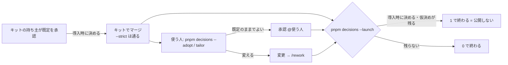

# 設計: 未確定事項の「導入時に決める」

> **AI 用の設計書。省略せずに網羅的に書く(正はこちら)。** 人はこれを開かず、PR の本文の「人向けのまとめ」を見る([guides/human-review.md](../guides/human-review.md))。
> 仕様: [docs/specs/0013-decisions-at-adoption.md](../specs/0013-decisions-at-adoption.md)
> 状態: 下書き
> 観点の順は [review-viewpoints.md](../review-viewpoints.md)。当てはまらない節も消さずに「該当なし(理由)」と書く。

## 0. 全体像

設計書の未確定事項に、5つ目の状態 `導入時に決める` を足す。キットの `--strict` では落ちず、使う人の `pnpm decisions --adopt`・`/tailor`・README の「使い始めたらやること」に載り、本番の前の `pnpm decisions --launch` で止まる。使う人が答えたら今までどおり `承認` / `変更` にする。



## 作業の前に読んだ物(ガイド)

- `CLAUDE.md` の「必ず守る」(人に聞くのは4つだけ・仮決めが残る PR はマージに回さない)。
- [guides/human-review.md](../guides/human-review.md) の 2(状態の書き方と承認の流れ)。状態は 仮決め / 承認 / 変更 / 保留 / 取り下げ の5つで、`pnpm decisions` が読む。
- `scripts/decisions.mjs`: 設計書の表の行(`| U-n | … |`・7列)を正規表現を使わずに読む(Semgrep の regex_dos を避けるため)。`--strict` は仮決め・書き方の問題で 1。保留は期限(`YYYY-MM-DD までに`)が無い・過ぎたら書き方の問題。テストが無い。
- `scripts/checkup/checks/decisions.mjs`: 点検の `w-decisions` が `decisions.mjs --strict` の終わりの番号だけを見る(中身は読まない)。
- `.claude/skills/tailor/SKILL.md`: 7つの問い → 部品ごとの残す・消すの案 → まとめて確認 → `docs/product/tailoring.md` に足すだけで記録。
- `docs/kit/catalog.yaml` の `start_steps` → `pnpm kit:readme` が README の「使い始めたらやること」を作る(手で直さない。生成し忘れは `pnpm kit:catalog` が落とす)。
- `docs/checkup/todo.yaml`: 立ち上げ(`phase: setup`)の段に「公開の前に」の項目(`pentest-before-launch`)がある。`verify: manual` は `steps` が要る。1枚(`docs/checkup/README.md`)は `pnpm checkup --write-readme` で作り直し、ずれはテストが落とす。
- `.github/workflows/deploy.yml`: main → stg は自動、prod は environment「prod」の承認のあと。ここに `--launch` を入れるかは CI(危険度「高」)なので、この PR では触らない。
- `docs/adr/0021-kit-catalog-and-tailoring.md`(カタログと `/tailor`)。
- 既存の設計書の未確定事項 30行(下の 6. の候補の洗い出し)。

## 1. 設計方針

- **状態を1つ足すだけ**にする。表の列・番号の決まり・書き方は変えない。既存の5つの状態の意味も変えない。
- 判定は今までどおり `scripts/decisions.mjs` 1本に集める(`--adopt`・`--launch` は旗)。中身を `scripts/decisions-lib.mjs`(読む・分ける・判定する純粋な関数)に移し、テストを書けるようにする(`bets-lib.mjs`・`adr-lib.mjs` と同じ形)。
- 使う人の入口は3つ(コマンド・`/tailor`・README)。正は設計書の表で、ほかは表から作る・表を読む(写しを作らない)。
- CI(`.github/**`)・点検の検査(`scripts/checkup/**`)は危険度「高」なので触らない。CI の `pnpm decisions --strict` はそのままで、`導入時に決める` を落とさなくなるだけ。
- ADR 0026 に「なぜ状態を足すか」を残す。

## 2. データモデル

該当なし(DB に触らない)。設計書の表の「状態」の列の書き方が1つ増えるだけ:

| 状態 | 意味 | 書く人 |
|---|---|---|
| `導入時に決める(キットの既定は @名前 YYYY-MM-DD に承認)` | キットの既定値としては持ち主が承認した。使う人のプロダクトでは、まだ誰も答えていない | キットの持ち主の答えを AI が写す |

- 括弧の中に **`@`(既定を承認した人)が無いと書き方の問題**にする。仮決めを、人の答えなしに `導入時に決める` へ書き換えて `--strict` をすり抜けるのを防ぐ(仮決め → 導入時に決める も、人の答えが要る)。
- 使う人が答えたら、括弧ごと `承認(@使う人 YYYY-MM-DD)` か `変更(@使う人 YYYY-MM-DD: どう変えるか)` に置き換える。キットの既定を承認した記録は、git の履歴に残る。

## 3. API

該当なし(HTTP の API を足さない)。コマンドの形:

| コマンド | 出す物 | 終わりの番号 |
|---|---|---|
| `pnpm decisions` | 仮決め・導入時に決める・保留の一覧と、書き方の問題 | 0 |
| `pnpm decisions --strict` | 同じ | 仮決めか書き方の問題があれば 1(**導入時に決めるは落とさない**) |
| `pnpm decisions --adopt` | 導入時に決める だけを、設計書ごとに「キットの既定・問い・どこ」で。最後に決め方(承認 / 変更 → /rework)と `--launch` の案内 | 0(一覧を出すだけ)。書き方の問題があれば出す |
| `pnpm decisions --launch` | 公開を止める物(仮決め・導入時に決める・書き方の問題)と、止めない物(保留) | 止める物が1件でもあれば 1 |

- 旗を2つ以上つけたら、いちばん厳しいもので判定する(`--launch` > `--strict`)。`--adopt` は出し方だけを変える。
- 点検の `w-decisions` は `--strict` の終わりの番号だけを見るので、変えなくてよい(導入時に決めるで点検が落ちない)。

## 4. 状態遷移

```
(AI)仮決め ──人: キットの既定でよい・プロダクトごとに違う──▶ 導入時に決める
(AI)仮決め ──人: 承認 / 変更 / 保留──▶ 今までどおり
導入時に決める ──使う人: 既定のままでよい──▶ 承認(@使う人)
導入時に決める ──使う人: 変える──▶ 変更(@使う人: …)──/rework──▶ 設計書から作り直す
導入時に決める ──作り直しで問いが無くなった──▶ 取り下げ(理由)
```

- `承認` → `導入時に決める` に戻すこともできる(キットの持ち主が、承認済みの行を「プロダクトごとに違う」と決めたとき。この PR の 6. の候補がこれ)。
- 使う人の側で `導入時に決める` → `保留` にはしない(公開の前に止めたい物なので、決めるまで `導入時に決める` のまま残す。後で決めるなら U-1 の答え次第)。

## 5. システム間連携

該当なし(外へ出さない。手元と CI で設計書を読むだけ)。

## 6. 業務ルール

- `導入時に決める` の行も、種類は4つのどれか(今までどおり書き方の問題で見る)。4つに当たらない物は、キットの側で決めて「決めたこと」に書く。
- **どの行を `導入時に決める` にするかは、キットの持ち主が決める**(AI が勝手に変えない)。基準: 「答えが、使う人の事業・利用者・契約や法務の確認で変わるか」。キットの作り(セキュリティの型・技術の選び方)で決まる物は `承認` のまま。
- `/tailor` は、7つの問いと部品の案のあとに、`pnpm decisions --adopt` の行を**設計書ごとに1問**で聞く(選択肢: 既定のままでよい(おすすめ)/ 変えたい物がある / 今は決めない)。「変えたい物がある」なら、その設計書の行を1つずつ聞く。「今は決めない」は状態を変えずに残す(`--launch` で止まる)。答えは `docs/product/tailoring.md` にも1行ずつ足す。
- 公開の前に止める範囲: `仮決め`・`導入時に決める`・書き方の問題(期限の過ぎた保留を含む)。期限内の `保留` は止めずに一覧に出す(U-1)。

### 候補の洗い出し(状態はこの PR では変えていない)

既存の設計書の未確定事項 30行を、上の基準で見た。**強い** = 答えがプロダクトごとにほぼ必ず違う。**弱い** = キットの既定で困る人は少ないが、事業や利用者で変わりうる。

| 設計書 | 番号 | 種類 | 問いの要旨 | 候補 | 理由 |
|---|---|---|---|---|---|
| 0009 利用規約 | U-1 | 他チームとの契約や制約 | 同意し直しにする変更の基準 | 強い | 法務の確認で決まる(手引きにも「法務の確認を経てから使う」) |
| 0009 利用規約 | U-2 | 他チームとの契約や制約 | 公開から効力まで30日 | 強い | 請求の締め・契約で変わる |
| 0009 利用規約 | U-3 | 事業判断 | 管理者は組織として・メンバーは本人として同意 | 強い | B2B か B2C か・契約の形で変わる |
| 0009 利用規約 | U-4 | 利用者の挙動 | 同意しない人はログアウトだけ | 強い | 契約と利用者の扱いで変わる |
| 0009 利用規約 | U-5 | 戻せないリスク | 同意の記録は解約で消す(別に残す期間は無し) | 強い | 争いへの備え・保存の方針で変わる |
| 0009 利用規約 | U-6 | 戻せないリスク | 予告のメールを組織の全員に送る | 強い | 誰に知らせるかは契約と利用者で変わる |
| 0007 点検 | U-6 | 他チームとの契約や制約 | 担当者と相談先はどちらも持ち主1人 | 強い | 使う人の体制そのもの |
| 0008 検索に載せない | U-1 | 事業判断 | 本番も全部のページを検索に載せない | 強い | 検索から人を呼ぶか(`/tailor` の `search`)で変わる |
| 0008 個人データ | U-1 | 他チームとの契約や制約 | 自由な文は personal・ID は internal(プライバシーポリシーの書き方と合うか) | 強い | 使う人のプライバシーポリシーの文面で変わる |
| 0006 アカウントの守り | U-3 | 事業判断 | 二段階認証の回復は運営の手作業 | 弱い | 運営の体制・問い合わせの量で変わる |
| 0006 アカウントの守り | U-4 | 事業判断 | 組織の必須は全員に効くスイッチ1つ・既定は任意 | 弱い | お客さんの業種(守りに厳しいか)で既定を変えたい人がいる |
| 0006 アカウントの守り | U-5 | 利用者の挙動 | 必須を入れたら猶予なし | 弱い | 利用者の数・慣れで変わる |
| 0007 点検 | U-1 | 利用者の挙動 | 知らせは GitHub の Issue | 弱い | 担当者が毎週見る場所で変わる |
| 0007 点検 | U-2 | 利用者の挙動 | 答える場所は `/checkup`(Claude Code) | 弱い | 担当者が Claude Code を使えるかで変わる |
| 0007 点検 | U-3 | 事業判断 | 世の中の変化の取り込みは月1回の手動(費用0) | 弱い | API の費用を払えるかで変わる |
| 0007 点検 | U-5 | 利用者の挙動 | 毎週の知らせは月曜 8:00 | 弱い | 担当者の働き方で変わる |
| 0006 アカウントの守り | U-2 | 利用者の挙動 | 変えたら他の端末は全部ログアウト | 弱い | 守りの型としては既定のままが多い |

候補にしない(キットの作りで決まる): 0006 の U-1(暗号化した Cookie)・U-6(お知らせのメール4種)・U-7(代理ログインは二段階認証の社員だけ)、0007 の U-4(「分からない」で進めない線)、0008 個人データの U-2(要配慮の順番)・U-3(ログの許可リストの初期値)、0009 の U-7(条文の確かめ。事実の確かめで、選ぶ問いではない)。

## 7. 要求との対応

> 受け入れ条件の1つずつに、設計とテストがそろっているか。**空の欄があれば次の工程へ進まない。**

| 受け入れ条件(仕様) | 設計のどこ | テスト |
|---|---|---|
| `導入時に決める(…)` が状態として使える | 2. データモデル | `scripts/decisions.test.mjs`「導入時に決める を読む」 |
| `--strict` は導入時に決めるで落ちない | 3. API | 同「--strict: 導入時に決める だけなら 0」 |
| 一覧に導入時に決めるの件数と行が出る | 3. API | 同「一覧に導入時に決める の節が出る」 |
| 導入時に決めるも種類は4つのどれか | 6. 業務ルール | 同「種類が4つでないと書き方の問題」 |
| (書き方)括弧に `@` が無いと問題 | 2. データモデル | 同「@ の無い 導入時に決める は書き方の問題」 |
| `--adopt` で導入時に決めるだけが設計書ごとに出る・決め方が出る | 3. API | 同「--adopt: 設計書ごとにまとめ、決め方を出す」 |
| `/tailor` のチェックシートに入り、設計書ごとに聞く | 6. 業務ルール | `.claude/skills/tailor/SKILL.md`(スキル。手で回して確かめる) |
| README の「使い始めたらやること」に段がある | 1. 設計方針 | `pnpm kit:catalog`(README の生成し忘れを落とす) |
| 点検の台帳に1件ある | 6. 業務ルール | `scripts/checkup/todo.test.mjs`(全項目の書式)・`run.test.mjs`(1枚とのずれ) |
| 既定のままなら承認・変えるなら変更 → /rework | 4. 状態遷移 | 同「承認・変更にした行は --adopt に出ない」 |
| `--launch` は仮決め・導入時に決める・書き方の問題で 1 | 3. API | 同「--launch: 導入時に決める が残れば 1」「仮決めで 1」「期限の過ぎた保留で 1」 |
| `--launch` は残らなければ 0 | 3. API | 同「--launch: 承認と期限内の保留だけなら 0」 |
| `--launch` をどこで流すかは人が決める | 1. 設計方針 | PR の「人に判断してほしい所」 |

## 8. 非機能

- 性能: 設計書は十数件。全部を読んでも一瞬。
- セキュリティ: `導入時に決める` で `--strict` をすり抜けられないよう、括弧の `@` を求める(2.)。公開の前は `--launch` が止める。正規表現は使わない(Semgrep の regex_dos)。
- 運用: 使う人は「使い始めたらやること」⑤・`/tailor`・点検の台帳の3か所から辿れる。
- 費用: 0(手元と CI の数秒)。

## 9. このプロダクト特有

| 観点 | この変更では |
|---|---|
| テナント分離 | 該当なし(アプリのコードに触らない) |
| 権限の表 | 該当なし |
| 監査ログ | 該当なし |
| 解約で消す一覧 | 該当なし |
| サポートの代理ログイン | 該当なし |
| ログの個人情報 | 該当なし |
| 列の分類(`personal` / `sensitive`) | 該当なし |
| 画面の部品 | 該当なし |

## 10. 観点ごとの扱い

| 観点 | 扱い | 理由 |
|---|---|---|
| 設計方針 | 採用 | 状態を1つ足す。CI と点検の検査には触らない |
| データモデル | 低優先 | DB に触らない。表の状態の書き方が1つ増えるだけ |
| API | 機械で検証 | コマンドの旗ごとの終わりの番号を `scripts/decisions.test.mjs` が確かめる |
| 状態遷移 | 最重要 | 公開の前に何を止めるか(U-1)と、どの行を導入時に決めるにするか(U-2)が人の判断 |
| システム間連携 | 低優先 | 外へ出さない |
| 業務ルール | 採用 | 候補の基準と `/tailor` での聞き方 |
| 要求との対応 | 機械で検証 | 上の表の全部の行にテストかスキルがある |
| 非機能 | 軽く確認 | すり抜けを防ぐ `@` の決まりだけ |

## 11. 決めたこと(AI が決めた。人に聞かなかった)

- 状態の名前は `導入時に決める`(依頼の言葉のまま)。括弧に `キットの既定は @名前 YYYY-MM-DD に承認` を書く — 誰が既定を承認したかを残し、`@` の有無で人の答えを経たかを機械で見るため。
- 判定は `decisions.mjs` の旗にし、別のコマンドを作らない — 読む所(表の読み方・書き方の問題)が同じで、2本にするとずれる。
- 中身を `scripts/decisions-lib.mjs` に移してテストを足す — 既存の `bets-lib.mjs`・`adr-lib.mjs` と同じ形。`test:scripts` に足せば CI(`.github/**` を触らずに)で流れる。
- 旗を重ねたら厳しいほうで判定する — `--strict --launch` のように重ねても、止めるべき物を見落とさない。
- `--adopt` は 0 で終わる — 使い始めたばかりは全部が残っているのが当たり前で、一覧を見るためのコマンドだから。止めるのは `--launch` の役目。
- `/tailor` では設計書ごとに1問 — 候補が全部入ると十数行になり、1行ずつだと答えるのが重い。変えたい設計書だけ1行ずつにする。
- README には「使い始めたらやること」の最後(⑤)に足す — 本番に出す前にやる物で、順番として最後。並んで進む点検のセッションが ④ を直すので、④ の行にぶつからないように。
- 点検の台帳には `verify: manual` で1件だけ足す(`launch-decisions`) — 自動で確かめる検査は `scripts/checkup/**`(危険度「高」)で、並んで進むセッションも触っている。手順に `pnpm decisions --launch` を書けば今は足りる。自動にするのは後で。
- 既存の設計書の状態は変えない — 依頼のとおり、候補を出して持ち主に確かめる(U-2)。
- 使う人が状態を書き換えるのは、完了した設計書でも「状態の列だけ」はよい — 状態の列は、もともと人の答えを後から写す欄(human-review.md の 2)。中身(事実・理由・問い)は書き換えない。
- `w-decisions`(点検)と CI の `--strict` は変えない — 終わりの番号だけを見ているので、導入時に決めるで落ちなくなるのは `decisions.mjs` の側だけで足りる。

## 12. 未確定事項(AI の仮決め。人の承認と分けて追う)

> 4つに当たる判断だけ。状態の書き方は [guides/human-review.md](../guides/human-review.md) の 2。`pnpm decisions` がここを読む。**`仮決め` が残る PR はマージしない。**

| 番号 | 工程 | 種類 | 仮決め(設計した事実) | なぜそうしたか | 人が判断する問い | 状態 |
|---|---|---|---|---|---|---|
| U-1 | 設計 | 戻せないリスク | `--launch` は `仮決め`・`導入時に決める`・書き方の問題(期限の過ぎた保留を含む)で止める。**期限内の `保留` は止めずに一覧に出すだけ** | 保留は人が期限つきで「後で決める」と決めた物で、期限が過ぎれば今の決まりで止まる。公開の後に決めてよい物(例: 問い合わせが増えたら画面を作るか)まで止めると、公開できなくなる | 期限内の保留があっても公開してよいか(いいえなら、保留も公開の前に止める) | 承認(@attumkwg 2026-10-24。会話で回答「期限内の保留は --launch で止めなくてよい」) |
| U-2 | 設計 | 事業判断 | 既存の設計書の状態は、この PR では変えない。6. の候補(強い 9件・弱い 8件)を出すだけ。持ち主が選んだ物を、この PR の続きのコミットで `導入時に決める` に変える | どの問いがプロダクトごとに違うかは、キットを誰に向けて出すかで決まる(事業判断)。AI が勝手に変えると、持ち主の承認を取り消すことになる | 強い候補 9件を全部 `導入時に決める` にしてよいか。弱い候補 8件のうち、入れる物はあるか | 仮決め |

## 13. 作り直しの記録

> `/rework` が書く。誤りが入った工程と、作り直した下流。

| 日付 | きっかけ | 入った工程 | 直した物 | 作り直した下流 |
|---|---|---|---|---|
