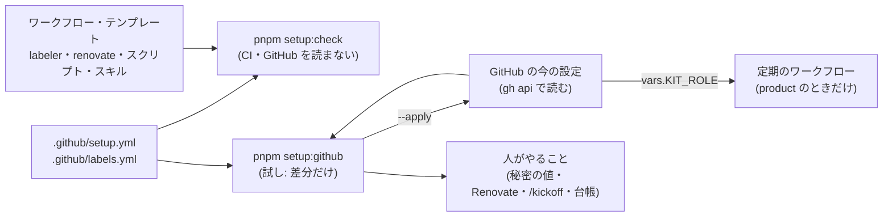

# 設計: 使い始める前の一括のセットアップ(pnpm setup:github)とラベルの一覧

> **AI 用の設計書。省略せずに網羅的に書く(正はこちら)。** 人はこれを開かず、PR の本文の「人向けのまとめ」を見る([guides/human-review.md](../guides/human-review.md))。
> 仕様: [docs/specs/0014-setup-before-use.md](../specs/0014-setup-before-use.md)・ADR: [0027](../adr/0027-setup-before-use-and-kit-role.md)
> 状態: 下書き
> 観点の順は [review-viewpoints.md](../review-viewpoints.md)。

## 0. 全体像

GitHub 側の「あるべき設定」を2つのファイル(`.github/setup.yml`・`.github/labels.yml`)に書き、`pnpm setup:github` が今の設定と比べて差分を出す(`--apply` で反映)。
同じファイルを CI の `pnpm setup:check` が読み、ラベル・必須のチェック・Environment・定期のワークフローの見分けが、コードとずれていないかを見る。
ひな形か使う側かは、リポジトリの変数 `KIT_ROLE`(セットアップが書く)で見分け、定期の運用は `product` のときだけ動く。



## 作業の前に読んだ物(ガイド)

- `README.md` の「本人が手でやる設定」の 1(ブランチ保護・ラベル・Environments・Renovate・Secret scanning・Actions の設定・Dependabot)。ここに書いてある値を `.github/setup.yml` に写した(設定の正をファイルに移す)
- `docs/getting-started.md` の ③・`docs/guides/automation.md`(どのワークフローがいつ動くか・有効にする日)
- `docs/designs/0007-checkup.md`(点検の台帳・`gh-protection`・`gh-envs`・`w-protection` の確かめ方。`scripts/checkup/checks/github-environments.mjs` は stg・prod・claude を見る)
- `scripts/checkup/gh.mjs`(gh の読み方: 落とさず `{ ok, status, message }`)・`scripts/checkup/answer.mjs`(台帳を YAML の文書のまま書き戻す)
- `scripts/check-guards.mjs`・`.claude/hooks/protected-paths.json`(危険度「高」の一覧と守りの4か所)
- `docs/kit/catalog.yaml`(start_steps と部品)・`.claude/skills/kickoff`・`.claude/skills/tailor`
- PR の本文の「マージの後に人がやる設定」: #23(ラベル `vrt:update`・必須のチェックに VRT)・#25(秘密 `CHECKUP_TOKEN`・`SLACK_WEBHOOK_URL`)・#26(最初の `/checkup-refresh`)
- 今の GitHub の設定(2026-10-24 に `gh api` で読んだ): ルールセット `main`(PR 必須・承認 0・必須のチェック 12・最新に追いついてから・直線・消せない・強制 push できない・例外なし)。Environments は stg・prod(承認 @attumkwg・自分の承認可)・claude・zap、どれも main だけ。Actions は既定が読むだけ・承認できない・外の人は毎回承認・7日・SHA の固定が必須。Secret scanning と push の保護はオン。必須のチェックに README の `取り組みと作業の種類(PR の本文)` が入っていない

## 1. 設計方針

- **設定の正はリポジトリのファイル**。GitHub の画面で直した値は、次の `pnpm setup:github` で差分として出る(人がファイルに写すか、`--apply` で戻すかを決める)
- 依存を足さない。`gh`(持ち主がもうログインしている)と、もう入っている `yaml` だけ。Terraform の GitHub プロバイダや外の App は使わない(ADR 0027)
- 読むのは落とさない(`scripts/checkup/gh.mjs` と同じ型)。読めない所は「読めなかった」にして、ほかを続ける
- 書き換えは**試しが既定**。`--apply` を付けたときだけ書く。書くのは差分のある所だけ(同じ値は書かない)。だから何度流しても同じ結果になる
- 消さない: 一覧に無いラベル・ルールセットの中の、設定ファイルが扱わない規則(人が足したコードの検査など)・ほかのルールセットは残す
- 置き場所: 設定は `.github/`(もう危険度「高」)。スクリプトは `scripts/setup/`(危険度「高」に足す。守りを弱める差分を書けるため)

## 2. データモデル

DB は触らない。ファイルの形:

### `.github/labels.yml`

```yaml
labels:
  - name: risk:high          # GitHub のラベルの名前(変えると付いている Issue の表示が変わる)
    color: ededed            # 6桁の16進(# なし。比べるときは大文字と小文字を区別しない)
    description: …           # 100文字まで(GitHub の上限)
    group: 危険度(PR)        # 手引きの見出し
    meaning: …               # 何のラベルか
    who: 自動(labeler)       # 誰が付けるか(自動 / AI / 人。自動なら何が)
    when: …                  # いつ付く
    action: …                # 付いたら何をするか(then は JS で Promise に見えるので使わない)
    used_by: .github/labeler.yml   # 何が付けるか・読むか(人が読むため。確かめない)
```

- 人が読む手引き `docs/guides/labels.md` は、この一覧から `pnpm setup:labels` で作る(手で直さない)。ラベルの説明が README・playbook・手順書・設計書に散らばっていたので、そこからはこの1枚を指す
- `description`(GitHub の画面の説明欄)は短い版。長い説明は手引きに

### `.github/setup.yml`

| 鍵 | 中身 | GitHub の API |
|---|---|---|
| `template_repository` | ひな形のリポジトリ(`owner/name`)。同じなら `KIT_ROLE=template`、違えば `product` | `GET repos/{r}` の `full_name` |
| `template_schedules` | ひな形でも定期で動いてよいワークフローのファイル名(既定は空) | — |
| `repository` | `allow_merge_commit`・`allow_squash_merge`・`allow_rebase_merge`・`allow_auto_merge`・`delete_branch_on_merge`・`allow_update_branch` | `PATCH repos/{r}` |
| `security` | `secret_scanning`・`push_protection`(公開のときだけ)・`dependabot_alerts`・`dependabot_security_updates`(直す PR は Renovate なのでオフ)・`private_vulnerability_reporting`(公開のときだけ) | `PATCH repos/{r}`(`security_and_analysis`)・`PUT/DELETE repos/{r}/vulnerability-alerts`・`PUT repos/{r}/private-vulnerability-reporting` |
| `actions` | `default_workflow_permissions`・`can_approve_pull_request_reviews`・`sha_pinning_required`・`fork_pr_approval`・`retention_days` | `PUT …/actions/permissions/workflow`・`PUT …/actions/permissions`・`PUT …/actions/permissions/fork-pr-contributor-approval`・`PUT …/actions/permissions/artifact-and-log-retention` |
| `ruleset` | 名前・承認の数・古い承認を外す・CODEOWNERS の承認・マージの方法・必須のチェック・最新に追いついてから・直線・消せない・強制 push できない | `GET/POST/PUT repos/{r}/rulesets` |
| `environments[]` | `name`・`branches`(いまは `[main]` だけ)・`reviewers`(`@me` = 打った人)・`prevent_self_review`・`secrets`(名前だけ。足りないと「人がやること」) | `PUT repos/{r}/environments/{e}`・`…/deployment-branch-policies`・`GET …/environments/{e}/secrets` |
| `secrets[]` | リポジトリの秘密(名前・使う側だけ・任意か) | `GET repos/{r}/actions/secrets` |

- 必須のチェックは GitHub Actions(App の番号 `15368`)からの物だけを通す(ほかの App が同じ名前の状態を付けても通らない)
- `reviewers: ["@me"]` は `gh api user` の人。名前を書けばその人(`gh api users/{login}` で番号を引く)
- ルールセットの「書き方」: 今のルールセットの規則を残し、設定ファイルが扱う種類(`deletion`・`non_fast_forward`・`required_linear_history`・`pull_request`・`required_status_checks`)だけを置き換える。`pull_request` と `required_status_checks` の中の、扱わない鍵(例: `require_extra_approval_for_unattributed_changes`)も今の値を残す

## 3. API

アプリの API は足さない。コマンド:

| コマンド | すること | 終わり方 |
|---|---|---|
| `pnpm setup:github` | 今の設定を読み、差分と「人がやること」を出す(書かない) | 0(読めない所があっても 0。差分があっても 0) |
| `pnpm setup:github --apply` | 差分を反映し、もう一度読んで差分が 0 かを出す | 失敗が1つでもあれば 1 |
| `pnpm setup:github --repo owner/name` | ほかのリポジトリ(既定は `gh repo view`) | — |
| `pnpm setup:check` | GitHub を読まずに、ファイルどうしのずれを見る(CI の `Biome・型・単体`) | ずれがあれば 1 |
| `pnpm checkup:adopt --by @自分 [--advisor @相談先] [--today YYYY-MM-DD]` | 台帳を自分の物にし、`docs/checkup/README.md` も作り直す | 台帳の書き方が違えば 1 |

### `pnpm setup:check` が見ること

1. `.github/labels.yml` の書き方(名前の重なり・色が6桁・説明が100文字まで)
2. 使われているラベルが一覧にあるか。読む所と形:
   - `.github/labeler.yml` の一番上の鍵
   - `.github/ISSUE_TEMPLATE/*.yml` の `labels:`
   - `renovate.json` の中の `labels`・`addLabels`(どの深さでも)
   - `.github/workflows/*.yml`・`scripts/**/*.mjs`(テストは除く)・`.claude/skills/**/SKILL.md`・`.github/scripts/*` の `--label X`・`--add-label X`・`--remove-label X`(`a,b` も)・`label.name == 'X'`・`labels.*.name, 'X'`
   - スクリプトの定数 `…LABEL = "X"`(例: `scripts/checkup/notify.mjs` の `checkup`・`checkup-urgent`)
   - 一覧にあって使われていないラベルは、落とさずに表示だけ(人が Issue に手で付ける物がある)
3. 必須のチェックが、PR で動くワークフロー(`on` に `pull_request` がある)のジョブの名前にあるか。`${{ matrix.x }}` は `strategy.matrix.x` の値で広げる
4. ワークフローの `environment:`(文字か `{ name }`)が `environments` にあるか。点検の `gh-envs` が見る Environment(`ENVIRONMENTS`)も `environments` にあるか
5. `schedule:` が生きているワークフローのうち `template_schedules` に無い物は、`needs` の無いジョブ全部の `if` に `vars.KIT_ROLE == 'product'` があるか
6. ラベルの手引き(`docs/guides/labels.md`)が一覧から作り直されているか(古ければ `pnpm setup:labels`)

## 4. 状態遷移

`KIT_ROLE`(リポジトリの変数):

| 今 | きっかけ | 次 | 定期の運用 |
|---|---|---|---|
| 無し(キットから作ったばかり・まだセットアップしていない) | `pnpm setup:github --apply`(名前がひな形と違う) | `product` | 無し → 動く |
| 無し(ひな形) | `pnpm setup:github --apply`(名前がひな形と同じ) | `template` | 動かない(手では流せる) |
| `template` / `product` | 名前が変わった・人が画面で変えた | 次の `--apply` で名前のとおりに戻す | — |

- 無しのときは、どちらでも定期の運用は動かない(**使う側は、セットアップを流すまで点検の知らせが来ない**。その間は台帳の担当者がキットの持ち主のままなので、知らせが他人に向かないように)
- 戻すとき: 変数を消すか `template` にすれば、定期の運用は次の実行から飛ぶ

## 5. システム間連携

- GitHub の REST API だけ(`gh api`)。書き込みは持ち主のログインで(リポジトリの管理者の権限が要る)。Actions からは流さない(ジョブのトークンには設定を書く権限が無い・持たせない)
- 秘密の値は読まない・書かない(GitHub も値を返さない。名前だけ)
- 点検(`docs/designs/0007-checkup.md`)とのつながり: `gh-protection`・`gh-envs`・`gh-plan`・`dep-alerts`・`w-protection` は、セットアップが整えた物が「今も効いているか」を毎週見る側。直し方として `pnpm setup:github` を出せるようにする(台帳の文は `/checkup-refresh` で直す。この PR では手順書の文だけ)

## 6. 業務ルール

### 差分の出し方(区分ごと)

| 区分 | そろっている | 差分の種類 |
|---|---|---|
| ラベル | 名前があり、色と説明が同じ | 足す / 直す(色・説明)/ 一覧に無い(表示だけ) |
| リポジトリ | 鍵ごとに同じ | 直す(鍵: 今 → あるべき) |
| 守りの機能 | 同じ。非公開で使えない物は「非公開なので飛ばす」 | 直す |
| Actions | 同じ | 直す |
| ルールセット | 扱う規則と鍵が同じ・例外なし・既定のブランチが対象・有効 | 作る / 直す(どこが違うか1行ずつ) |
| Environments | ある・main だけ・承認する人と自分の承認が同じ | 作る / 直す / 配備の決まりを足す・外す |
| 変数 | `KIT_ROLE` が役割と同じ | 作る / 直す |
| 秘密 | 名前がある | 人がやること(任意の物は「使うなら」) |

### ひな形と使う側でちがう所

| 物 | ひな形(`template`) | 使う側(`product`) |
|---|---|---|
| ラベル・リポジトリ・守り・Actions・ルールセット・Environments | 同じ(キット自身も守る) | 同じ |
| 定期のワークフロー(`schedule:`) | 飛ばす(手では流せる) | 動く |
| リポジトリの秘密(`CHECKUP_TOKEN`・`SLACK_WEBHOOK_URL`) | 聞かない | 「使うなら」で出す |
| 人がやること | 無し(Renovate の App だけ) | 下の表 |

### ワークフローの洗い出し(2026-10-24)

| ワークフロー | 定期 | ひな形で | 見分け方 |
|---|---|---|---|
| `checkup.yml` | 毎週・毎日(生きている) | **止める** | `KIT_ROLE`(この PR で足す) |
| `vuln-scan.yml` | 毎週(生きている) | **回す**(U-1。持ち主が承認) | `template_schedules` に理由つき(見分けは付けない) |
| `security-fuzz.yml` | コメントで止めてある | 止まっている | 有効にするときは `KIT_ROLE` が要る(`pnpm setup:check` が落とす) |
| `restore-drill.yml`・`cognito-contract.yml`・`zap-api-scan.yml`・`cleanup-previews.yml` | コメントで止めてある | 止まっている | AWS の変数(ひな形には置かない)。有効にするときは `KIT_ROLE` も要る |
| `deploy.yml`・`preview.yml`・`terraform-plan.yml`・`claude.yml` | 定期ではない(push・PR・コメント) | AWS の変数・秘密が無いので飛ぶ | 今のまま |
| `ci.yml`・`labeler.yml`・`pr-work.yml`・`terraform.yml`・`prototypes.yml`・`vrt.yml` | 定期ではない | 動く(キットの品質のライン) | — |
| Renovate(App)・Dependabot の通知 | GitHub の外 | 動く(キットの依存を新しく保つ) | — |

### 人がやること(使う側。済んだ物は出さない)

| 見分け方 | 出す文 |
|---|---|
| いつも | Renovate の GitHub App を入れる(README の手順) |
| `docs/product/plan.md` が無い | `/kickoff` で何を作るかを決める |
| `docs/product/tailoring.md` が無い | `/tailor` で部品を選ぶ(`pnpm decisions --adopt` もここで) |
| `.github/CODEOWNERS` にひな形の持ち主(`@<template_repository の owner>`)がいる | CODEOWNERS を自分(かチーム)にする |
| 台帳の `owners.responder` がひな形の持ち主 | `pnpm checkup:adopt --by @<打った人>` |
| 台帳に `refreshed_on` が無い | 最初の `/checkup-refresh`(台帳を自分の物にした後) |
| Environment の秘密が無い | 使うなら、秘密 `<名前>` を Environment `<名前>` に(値は人が画面で) |
| リポジトリの秘密が無い(任意) | 使うなら、秘密 `CHECKUP_TOKEN`(点検がブランチ保護を読む)・`SLACK_WEBHOOK_URL` |
| ファイルを直した | 直したファイルは1つの PR に |

### キットの古くなった所を、作り始めるときに知らせる

キットそのものは定期の運用を回さない(持ち主の方針。11.)。その代わり、使う人がキットで作り始める `pnpm setup:github`(使う側)の「人がやること」に、溜まった分をその場で出す:

| 見分け方 | 出す文 |
|---|---|
| キットの最後のコミットの日 > このリポジトリを作った日(`gh api repos/<template_repository>/commits?per_page=1`・`created_at`) | 作った後にキットが更新されている(取り込みたい直しが無いか、キットのコミットの一覧を見る) |
| 台帳の `refreshed_on` が無い・35日を過ぎた(`refreshDue`) | 最初の `/checkup-refresh`(キットの台帳が世の中の変化を取り込んだのは いつ / 一度も無い) |
| 見直す日(`review_by`)の過ぎた項目がある(`reviewDue`) | 見直す日の過ぎた項目 N件 → `/checkup-refresh` で見直す |
| いつも(Renovate の手順に添える) | Renovate を入れると、キットに溜まった依存の更新が PR で出る(最初の週は多め) |

ひな形の側では、点検の `w-ledger`(見直す日・取り込みの時期)は**落とさない**(`ctx.role === "template"` なら pass にして、残りを注記に出す)。持ち主が呼んだときに `/checkup-refresh` を1回流す。役割は `scripts/checkup/context.mjs` が `.github/setup.yml` の `template_repository` と比べて決める。

### `pnpm checkup:adopt` の書き換え

- `started_on` を今日(日本時間)に・`owners.responder` を `--by` に・`owners.advisor` を `--advisor`(無ければ `--by`)に
- `refreshed_on` を消す(まだ一度も流していない)
- 引退していない項目: `status` を `open` に・`snoozed_until` を消す・`history` に `{ on: 今日, by: 担当者, result: adopted, note: キットから使い始めた… }` を1行足す(**消さない**。台帳の記録は足すだけの決まり。`adopted` は `scripts/checkup/todo.mjs` の `RESULTS` に足す)。**引退した項目は触らない**(キットが引退させた理由の記録)
- 書いたあと `validateLedger` を通し、`docs/checkup/README.md` を作り直す。コメント・並び・書き方は崩さない(YAML の文書のまま書く)

## 7. 要求との対応

| 受け入れ条件(仕様) | 設計のどこ | テスト |
|---|---|---|
| 試しで差分だけ | 3.・6. の差分 | `scripts/setup/setup.test.mjs`(区分ごとの差分・そろっているときは 0件) |
| `--apply` で反映・二度目は 0件 | 1.・6. | `setup.test.mjs`(偽の GitHub に書いて読み直す) |
| 反映する物の一覧 | 2. の表 | `setup.test.mjs` |
| 秘密の値は入れない・名前だけ | 5. | `setup.test.mjs`(秘密を書く呼び出しが無い) |
| 一覧に無いラベルは消さない | 1.・6. | `setup.test.mjs` |
| 読めない所は続ける・失敗の件数で 1 | 1. | `setup.test.mjs` |
| 人がやること | 6. の表 | `setup.test.mjs` |
| `KIT_ROLE` を名前で決める | 4. | `setup.test.mjs` |
| 定期は product のときだけ | 6. の洗い出し | `checkup.yml` の `if`・`vuln-scan.yml` は `template_schedules`・`pnpm setup:check` の 5 |
| ラベルの一覧が1か所・使う物が無ければ落ちる | 3. の 1・2 | `setup.test.mjs`(使われ方の形ごと)・CI の `pnpm setup:check` |
| 必須のチェックがジョブにあるか | 3. の 3 | `setup.test.mjs`(matrix を広げる) |
| Environment があるか | 3. の 4 | `setup.test.mjs` |
| 定期のジョブに見分けがあるか | 3. の 5 | `setup.test.mjs` |
| 台帳を自分の物にする | 6. の adopt | `scripts/checkup/adopt.test.mjs` |
| ラベルの手引きが一覧から作られ、古ければ落ちる | 2.・3. の 6 | `check.test.mjs`(手引きの形・古いとき) |
| 作り始めるときにキットの古くなった所を知らせる | 6.「キットの古くなった所」 | `plan.test.mjs`(作った後の更新・取り込みの古さ・見直す日。ひな形では出さない) |
| ひな形では w-ledger が落ちない | 6.「キットの古くなった所」 | `scripts/checkup/checks-more.test.mjs` |
| 台帳の担当者がひな形のままなら出す | 6. の表 | `setup.test.mjs` |

## 8. 非機能

- 速さ: 読むのは API で20〜30回ほど(数秒〜十数秒)。`pnpm setup:check` は GitHub を読まないので CI で1秒ほど
- 費用: 0(Actions の分数も使わない。人の手元で流す)
- セキュリティ: 4.・5.・仕様の STRIDE。書き込みは管理者のログインが要る。`scripts/setup/**` を危険度「高」に足す(`.claude/hooks/protected-paths.json` と守りの4か所)
- 壊れたとき: GitHub が API を変えた・プランで使えない(非公開+Free のルールセットなど)→ その区分だけ「読めなかった・書けなかった」(GitHub の1行目)を出し、ほかは続く
- 運用: セットアップは一度きりではなく、設定ファイルを直した PR のマージの後にも流す(差分が出る)。点検の `w-protection` が毎週、外れていないかを見る

## 9. このプロダクト特有

| 観点 | この変更では |
|---|---|
| テナント分離 | 該当なし(アプリを触らない) |
| 権限の表 | 該当なし(API を足さない) |
| 監査ログ | 該当なし(GitHub の設定の変更は GitHub の監査ログに残る) |
| 解約で消す一覧 | 該当なし |
| サポートの代理ログイン | 該当なし |
| ログの個人情報 | 該当なし(手元のコマンドの出力だけ。秘密の値は出ない) |
| 列の分類(`personal` / `sensitive`) | 該当なし |
| 画面の部品 | 該当なし |

## 10. 観点ごとの扱い

| 観点 | 扱い | 理由 |
|---|---|---|
| 設計方針 | 最重要 | 設定の正をファイルに移す・ひな形と使う側を変数で見分ける(ADR 0027)。後から変えると全部のリポジトリで流し直し |
| データモデル | 採用 | `.github/setup.yml`・`.github/labels.yml` の形 |
| API | 低優先 | アプリの API は無い |
| 状態遷移 | 採用 | `KIT_ROLE` が無い・template・product |
| システム間連携 | 最重要 | GitHub の守り(ルールセット・Environments・Actions の権限)を書き換える。CI(危険度「高」) |
| 業務ルール | 採用 | 消さない・秘密は名前だけ・ひな形では定期を止める |
| 要求との対応 | 機械で検証 | 7. の表 |
| 非機能 | 軽く確認 | 速さ・費用は小さい |
| テナント分離・権限の表・監査ログ | 低優先 | アプリを触らない |

## 11. 決めたこと(AI が決めた。人に聞かなかった)

### 持ち主が決めたこと(2026-10-24 の会話。承認)

> 「やりたい最新化っていうところはあるんですけど、それは作っていくときに都度教えてもらったりとかしてもらえるといいかもです」
> 「このキットの運用自体は回したくないです。やんなきゃいけないこととしては、ライブラリ等々のアップデートとか、あとはよっぽど古い仕組みだからおかしいみたいなところの点検と修正ですかね。その点検は都度回していくことになると思う。その時にやっていくとかしてほしい」
> 「ラベルの使い方って、なんか説明ってどっかにあったりしますかね。いきなり一通りラベル出されても、何のことかわかんない気がしてます」

- ひな形のリポジトリでは定期の運用を回さない(毎週の点検の Issue・急ぎの知らせ・月1回の `/checkup-refresh`・戻す訓練・契約テストの定期実行)。台帳の運用の項目(`w-ledger`)もひな形では落ちない
- ひな形で動かし続けるのは**ライブラリの更新**(Renovate の PR・Dependabot の通知)と、**毎週の定期の脆弱性チェック**(`vuln-scan.yml`。落ちたら Issue → `/cve`)。点検の Issue(`checkup.yml`)は止める(U-1。持ち主が「ひな形でも毎週の脆弱性チェックは回す。点検の Issue はひな形では止める」と承認)
- 古くなった仕組みの点検と直しは、**持ち主が呼んだときに1回**(`/checkup-refresh` を手で起動して PR に)。定期では回さない
- 最新化の知らせは、使う人が**作り始めるとき**に出す(`pnpm setup:github` の「人がやること」と、`/kickoff` が先に `pnpm setup:github` を勧める流れ。6.「キットの古くなった所」)
- 使う人の側では、セットアップの後に定期の運用が始まる
- ラベルの説明は1か所(`.github/labels.yml` の 意味・誰が・いつ・付いたらどうするか)にまとめ、人が読む手引き `docs/guides/labels.md` を作る。2026-10-24 に手で作った6つ(`vrt:update`・`kind:bug`・`kind:feature`・`needs-triage`・`dependencies`・`security`)の説明は仮の物なので、`--apply` で一覧の説明にそろえ直す

### AI が決めたこと

- 設定の道具は自前のスクリプト+`gh` — 依存を足さない・試しで差分を見せられる・持ち主の `gh` のログインをそのまま使える。Terraform の GitHub プロバイダは状態の置き場とトークンが要り、外の App(Settings の App など)は権限の広い App を入れることになる(ADR 0027)
- 見分けは変数 `KIT_ROLE` を**入れたときだけ**動く形(既定は止まる) — 名前で見分けると、キットから作ったばかりのリポジトリで、台帳の担当者がキットの持ち主のまま点検の Issue が立つ。GitHub の「Template repository」の印はこのキットに付いていない(付けるかは公開の判断)
- 一覧に無いラベルは消さない — 消すと付いていた Issue・PR から外れる(戻せない)。GitHub の既定のラベル(`bug` など)は人が使うかもしれない
- ルールセットの中の、設定ファイルが扱わない規則と鍵は残す — 人が足したコードの検査などを、セットアップが黙って外さないため
- 必須のチェックに README の `取り組みと作業の種類(PR の本文)` を入れる — README の手順にあるのに、今のルールセットに入っていなかった(書いた手順と実際のずれ)。マージキューを使うなら外す(README のとおり)
- 必須のチェックに `見た目の比べ(VRT)` を入れる — README の「本人が手でやる設定」の必須のチェックの並びにもう入っている(書いた手順に合わせる)。今のルールセットには入っていないので、`--apply` で足される。外すなら `required_checks` から消して流し直す
- 必須のチェックは GitHub Actions(15368)の物だけ — 今のルールセットと同じ。ほかの App のなりすましを防ぐ
- マージの方法は Squash と Rebase だけ(ルールセットの `allowed_merge_methods`) — 直線の履歴と合わせる。今は merge も入っているが、直線の履歴があるので実際には使えない(ボタンで迷わない)
- 承認の数は 0(🧍 1人の間)を既定にし、👥 人が増えたら設定ファイルの値を変えて流し直す — README の今の手順のとおり
- prod の承認する人は `@me`(打った人)・自分の承認を許す — README の 🧍 1人の間の手順のとおり。キットから作った人のリポジトリでは、その人になる
- ひな形でも、ラベル・ルールセット・Environments・Actions の設定は同じにする — キットそのものも AI が PR を出して育てるので、守りは同じ
- 秘密は名前だけ確かめる — 値は GitHub も返さない。キットは秘密の値を扱わない(CLAUDE.md)
- 台帳を自分の物にするとき、キットの持ち主の記録は消さずに `adopted` を1行足す — 台帳の記録は足すだけ(`historyAppendOnly`)。いちばん新しい記録が `adopted` なので、定期の項目の「前の記録から間隔が過ぎたか」も使い始めた日から数え直しになる
- 台帳を自分の物にするのは `scripts/checkup/adopt.mjs`(点検の側) — 台帳の書き方の決まり(`answer.mjs`)と同じ所に置き、`validateLedger` を通す。セットアップは GitHub だけを書き、ファイルは書かない(直すファイルは1つの PR で人が見る)
- 引退した項目は adopt で触らない — 引退はキットが決めた「この項目はもう要らない」の記録で、使う側にも当てはまる
- 定期のワークフローに見分けが無いと CI が落ちる形にする — 新しい定期の物を足すたびに、ひな形で運用が回り出すのを防ぐ。ひな形でも回したい物は `template_schedules` に理由つきで足す
- AWS を使う定期の物(戻す訓練など)には、今は見分けを足さない — 定期の行がコメントで止めてあり、ひな形には AWS の変数が無いので飛ぶ。有効にするときは `pnpm setup:check` が見分けを求める
- 点検の知らせのラベル(`checkup`・`checkup-urgent`)の色は `scripts/checkup/notify-gh.mjs` と同じにする — 知らせとセットアップが色を取り合わないため

## 12. 未確定事項(AI の仮決め。人の承認と分けて追う)

> 4つに当たる判断だけ。状態の書き方は [guides/human-review.md](../guides/human-review.md) の 2。`pnpm decisions` がここを読む。**`仮決め` が残る PR はマージしない。**

| 番号 | 工程 | 種類 | 仮決め(設計した事実) | なぜそうしたか | 人が判断する問い | 状態 |
|---|---|---|---|---|---|---|
| U-1 | 設計 | 利用者の挙動 | ひな形でも、毎週の定期の脆弱性チェック(`vuln-scan.yml`。落ちたら Issue → `/cve`)は回す(`template_schedules` に足し、`KIT_ROLE` の見分けを付けない)。点検の Issue(`checkup.yml`)はひな形では止める | 最初の仮決めは「止める」だったが、持ち主の答えで回す側に。キットの依存と Action の新しい穴を、コードが動いていない間も毎週見る | ひな形でも毎週の脆弱性チェックを回すか | 承認(@attumkwg 2026-10-24。会話で回答) |

## 13. 作り直しの記録

| 日付 | きっかけ | 入った工程 | 直した物 | 作り直した下流 |
|---|---|---|---|---|
