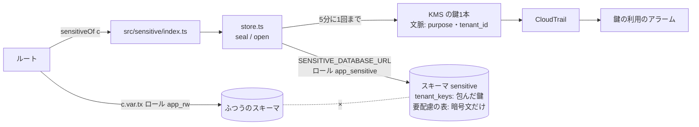

# 設計: 要配慮個人情報を分けて置く(段1)

> **AI 用の設計書。省略せずに網羅的に書く(正はこちら)。** 人はこれを開かず、PR の本文の「人向けのまとめ」を見る([guides/human-review.md](../guides/human-review.md))。
> 仕様: [docs/specs/0016-sensitive-data-tier1.md](../specs/0016-sensitive-data-tier1.md)
> 状態: 承認済み(未確定事項なし。段1を作ることは @attumkwg 2026-10-25)
> 観点の順は [review-viewpoints.md](../review-viewpoints.md)。当てはまらない節も消さずに「該当なし(理由)」と書く。

## 0. 全体像

DB にスキーマ `sensitive` と、専用のロール `app_sensitive` を足す。要配慮の値は、新しいモジュール `apps/api/src/sensitive/` が**組織ごとのデータ鍵**(KMS の鍵1本で包む)で暗号化してから、**別の接続**で書く。モジュールの外から触ると Semgrep が落とす。Terraform に鍵・接続の秘密・鍵の利用の見張りを足す(既定は作らない)。



## 作業の前に読んだ物(ガイド)

- ADR: `docs/adr/0018-sensitive-data-isolation.md`(段の分け方。段1の形はここで決まっている)・`0001`(RLS)・`0004`(領域とスキーマ)・`0015`(解約)・`0019`(ログの許可リスト)・`0023`(AES-256-GCM の使い方の前例)
- 既存のコード:
  - `apps/api/src/db/classification.ts` … `SENSITIVE_SCHEMA = "sensitive"` と、`sensitive` の列はそこにしか置けない単体テスト(段0)は既にある
  - `apps/api/src/db/client.ts`・`tenant.ts` … 接続の作り方と `withTenant`。要配慮の接続もこれを使う(時間切れ・UTC が同じになる)
  - `apps/api/db/init/001-roles.sql`・`drizzle/0001_rls.sql` … ロールの作り方(NOLOGIN のロール+ログインできるユーザー)と RLS の型
  - `apps/api/src/offboarding/delete-tenant.ts` … `TENANT_TABLES`(tenant_id のある表は全部ここに要る。結合テストが見る)
  - `apps/api/src/auth/reauth.ts` … AES-256-GCM・12バイトの nonce の前例
  - `infra/terraform/modules/aurora`・`ecs-service` … 鍵・秘密・タスクの役割。移行のタスクがアプリと同じ役割だった
  - `.semgrep/rules.yml` … `tenant-scoped-db-only` の形(読み込みの正規表現で止める)
- ほかのセッションの物: CloudTrail のトレイル(委託先の台帳と CloudTrail の PR)は、まだ main に無い。ロググループの名前を変数で受け取る形にした

## 1. 設計方針

- **置く場所**: 新しいモジュール `apps/api/src/sensitive/`(領域ではなく、共通の仕組み。`src/outbox` と同じ並び)。
  - `schema.ts` … `pgSchema("sensitive")` と `tenant_keys`。要配慮の表を足すときもここ(か、このフォルダの中のファイル)
  - `cipher.ts` … 値の暗号化(AES-256-GCM)
  - `key-wrapper.ts` … データ鍵を作る・開く(KMS と、手元の包み鍵)
  - `store.ts` … 入口の本体(接続・データ鍵のキャッシュ・`run(scope, fn)`)
  - `index.ts` … 外に出す物(`sensitiveStoreFromConfig`・`sensitiveOf(c)`・型・`SealedValueError`)。**外からはここだけ**
- **接続は別**: `SENSITIVE_DATABASE_URL`。`createDb` で作る(プール10本・時間切れ・UTC は同じ)。アプリのトランザクション(`c.var.tx`)とは別のトランザクション。
- **依存を1つ足す**: `@aws-sdk/client-kms`(3.1152.0。`packages/fake-cognito` の AWS SDK と同じ版。公開から3日以上たっている)。API は1つの JS にまとめるので、イメージは大きくならない(KMS の分だけ)。
- **既定は使わない**: 設定に `SENSITIVE_DATABASE_URL` が無ければ `c.var.sensitive` は `null`(段0のまま)。Terraform も `sensitive_data_enabled = false` が既定。

## 2. データモデル

移行 `drizzle/0013_sensitive_schema.sql`(段: ① 拡張だけ。前の版のアプリは読まないので、そのまま動く)。

| 表 | 列 | 型 | 区分 | 説明 |
|---|---|---|---|---|
| `sensitive.tenant_keys` | `tenant_id` | uuid(主キー) | internal | データ鍵の持ち主の組織 |
| | `kms_key_id` | text | internal | 包んだ KMS の鍵の ARN。手元は `local` |
| | `wrapped_key` | text | internal | KMS で包んだデータ鍵(base64) |
| | `created_at` | timestamptz | internal | 作った時刻 |

- **外部キーを張らない**(`organizations.tenants` へも)。段2で別のクラスターへ持ち出すとき、張ってあると移せない。組織を消すときは `delete-tenant` が tenant_id で消す(`TENANT_TABLES` の先頭)。
- **ロール**: `app_sensitive`(NOLOGIN。移行が無ければ作る)。ログインするのは `app_sensitive_login`(手元は `db/init/001-roles.sql`、stg・prod は README の手順で人が作る)。
- **権限**: `REVOKE ALL ON SCHEMA sensitive FROM PUBLIC`・`GRANT USAGE ON SCHEMA sensitive TO app_sensitive`・`GRANT USAGE ON SCHEMA public TO app_sensitive`(RLS のポリシーが呼ぶ `app_current_tenant()`)・`GRANT SELECT, INSERT ON sensitive.tenant_keys TO app_sensitive`。**`app_rw` には何も渡さない。** 書き換え・削除は渡さない(消すのは表の持ち主 = 解約のコマンドだけ)。
- **RLS**: `ENABLE`・`FORCE`・`tenant_isolation`(ほかの表と同じ)。結合テスト「全テーブルに RLS」がこの表も見る。
- **要配慮の表を足すとき**(この PR には無い): `sensitive` のスキーマに、`id`・`tenant_id`・暗号文の列(text)。`GRANT … TO app_sensitive`(要る操作だけ)・RLS・`TENANT_TABLES` の `sensitive.tenant_keys` より前。分類表は `sensitive`。暗号文は `seal("sensitive.<表>.<列>", 行の ID, 値)`。
- **書き出し**: 入れない(データ鍵は内部の物)。要配慮の表を書き出しに入れるかは、その機能の仕様で決める。
- **列の分類**: 4列とも `internal`。台帳(`docs/db/personal-data.md`)を作り直した。

## 3. API

該当なし(API を足さない)。ルートから使う形だけを用意する:

```ts
const store = sensitiveOf(c); // 設定が無ければ 503
const note = await store.run(scopeOf(c), async (s) => {
  const rows = await s.tx.select().from(healthNotes).where(...); // このフォルダの中に書く
  return rows.map((r) => ({ id: r.id, text: s.open("sensitive.health_notes.body", r.id, r.body) }));
});
```

- `run(scope, fn)`: `scope.support` があれば 403。データ鍵を用意(キャッシュ → 無ければ DB → 無ければ作る)してから、`withTenant` でトランザクションを開いて `fn` を呼ぶ。
- `seal(field, rowId, value)` / `open(field, rowId, sealed)`: field は `sensitive.<表>.<列>` の形だけ(違えば投げる)。
- 失敗の応答: KMS に届かない・開けない → 投げるだけ(関所の `onError` が 500 / 503)。`SealedValueError` は中身の手がかりを持たない。

## 4. 状態遷移

データ鍵の行: **無い → ある(作る)→ 無い(解約で消す)**。ある間は変わらない(書き換えの権限が無い)。消した後に同じ組織の ID で使うと新しい鍵になり、前の暗号文は開けない。

## 5. システム間連携

- **KMS**: `GenerateDataKey`(AES_256)と `Decrypt`。どちらも文脈 `{ purpose: "tenant-data-key", tenant_id }`・`KeyId` を名指し。地域は ARN から読む。つなぐのを 1秒・返事を 2秒で打ち切る・やり直しは1回。**トランザクションの外でだけ呼ぶ**(apps/api の決まり「トランザクションの中で外を待たない」。認可の関所が開いたアプリのトランザクションは開いたままだが、待つのは最長 約5秒(2秒×2回+つなぐ1秒)で、止まったトランザクションの上限 10秒より短い。呼ぶのは組織ごとに5分に1回まで)。
- **Terraform**(`infra/terraform/modules/sensitive-data`。stg・prod とも `sensitive_data_enabled` が true のときだけ):
  - KMS の鍵: 自動で回す・消す予約は30日。ポリシーは「アカウント(IAM)は管理だけ」「API のタスクの役割だけが `GenerateDataKey`・`Decrypt`、文脈の purpose が `tenant-data-key` で、文脈のキーが purpose と tenant_id だけのとき」。別名 `alias/<名前>-sensitive`。
  - 秘密 `<名前>/sensitive-database-url`(Aurora の鍵で暗号化。ECS の実行の役割が読める)。API のタスクに `SENSITIVE_DATABASE_URL`(秘密)と `SENSITIVE_KMS_KEY_ID`(鍵の ARN)を渡す。
  - plan の役割は、この秘密も比べられるように読める(ほかの秘密と同じ理由)。
  - **移行・運営のコマンドの役割を分けた**(`modules/ecs-service` の `aws_iam_role.migrate`)。前はアプリと同じ役割だったので、鍵を許すとコマンドからも使えてしまう。デプロイの役割の PassRole に足した。
  - 見張り(`cloudtrail_log_group_name` があるときだけ): メトリクスフィルター3つ → アラーム3つ(SNS → Slack)。
    - `…-sensitive-key-other-principals`: 鍵で `Decrypt`・`Encrypt`・`GenerateDataKey*`・`ReEncrypt` を、API のタスクの役割以外が呼んだ(断られた物も)。1回で鳴る
    - `…-sensitive-key-admin-changes`: `ScheduleKeyDeletion`・`DisableKey`・`PutKeyPolicy`・`CreateGrant`。1回で鳴る(Terraform で鍵のポリシーを変えたときも鳴る。それは予定どおりと確かめて閉じる)
    - `…-sensitive-key-api-decrypts`: API のタスクの `Decrypt` が5分に `decrypt_alarm_threshold`(既定 500)を超えた
  - CloudTrail のロググループは、別の PR が入れる(アカウントごとのトレイル。KMS の出来事を外さない)。入ったら `cloudtrail_log_group_name = module.audit_trail.log_group_name` にする。
- **ログ・Sentry**: モジュールはログを書かない。値・鍵は投げる失敗の文にも入れない。分類表の `sensitive` の列の名前は、ログの部品が深さを問わず伏せる(既存の単体テストが、分類表とログの一覧を突き合わせる)。
- **アウトボックス・メール**: 要配慮の値を出来事の中身に入れない(既存の単体テスト「どちらにも personal / sensitive のキーは置けない」)。

## 6. 業務ルール

- 要配慮の値は**暗号文(text)でだけ** DB に置く。分類表で `sensitive` の列は text だけ(単体テスト)。
- 暗号文の形: `s1.<nonce>.<暗号文>.<認証タグ>`(base64url)。追加の認証データは `s1|<組織の ID>|<sensitive.表.列>|<行の ID>`。形を変えるときは `s2` を足し、両方を読めるようにしてから書き直す。
- データ鍵は組織ごとに1本。同時に2つが作りに行ったら、先に入った方を使う(`ON CONFLICT DO NOTHING` → 読み直す)。
- データ鍵をメモリに置くのは5分・1000組織まで(超えたら古い物から捨てる)。
- 代理ログインの最中は使えない(403)。
- 要配慮の接続とアプリの接続が同じなら起動しない。stg・prod は KMS の鍵の ARN が要る。KMS の鍵だけ・ARN でない鍵は起動しない。
- 手元の包み鍵(`local`)で包んだ鍵は KMS では開かない、の逆も同じ(手元の鍵が本番に紛れても使えない)。

## 7. 要求との対応

| 受け入れ条件(仕様) | 設計のどこ | テスト |
|---|---|---|
| `app_rw` はスキーマ sensitive に入れない | 2. 権限 | `test/integration/sensitive.int.test.ts`「アプリの接続(app_rw)は、スキーマ sensitive に入れない」「スキーマ sensitive の表は、どれも app_rw に何も渡していない」 |
| `app_sensitive` はふつうの表を読めない・ほかのロールに入っていない | 2. 権限 | 同「要配慮の接続(app_sensitive)は、ふつうの表に入れない・ほかのロールに入っていない」 |
| sensitive の表も RLS | 2. RLS | 同「テナントの文脈が無ければ、データ鍵は1行も見えない」・`rls.int.test.ts`「全テーブル」 |
| 同じ接続を設定すると起動しない | 6. | `test/unit/config.test.ts`「アプリと同じ接続・ARN でない鍵・接続の無い鍵は通さない」 |
| DB には暗号文だけ・データ鍵は包んだ物だけ | 2.・6. | `sensitive.int.test.ts`「閉じた値は同じ組織で開ける。DB には包んだ鍵だけ」・`test/unit/sensitive.test.ts`「暗号文に元の値は入らない」 |
| 組織ごとに1本 | 6. | `sensitive.int.test.ts`「鍵は1社1本」 |
| 別の組織・列・行へ写した・書き換えた暗号文は開けない | 6. | `sensitive.test.ts`「別の組織・別の列・別の行へ写した暗号文は開けない」「鍵が違う・書き換えた・形が違う暗号文は開けない」・`sensitive.int.test.ts`「他社の組織では、写した暗号文を開けない」 |
| 解約で鍵が消え、写しは開けない | 2.・4. | `sensitive.int.test.ts`「解約で鍵の行を消すと、残った暗号文(写し)はもう開けない」・`offboarding.int.test.ts`(TENANT_TABLES の網羅) |
| stg・prod は KMS の鍵が要る・手元は無くてよい | 6. | `config.test.ts`「手元では KMS の鍵が無くてよい。stg・prod では鍵が要る」 |
| KMS に文脈を付けて呼ぶ・鍵を名指し | 5. | `sensitive.test.ts`「KMS: 組織の文脈を付けて呼び、包んだ鍵を名指しして開く」 |
| 外から触ると CI が落ちる | 1. | Semgrep の `sensitive-data-only-in-module`(`.semgrep/rules.ts` のお手本で、止まる行・止まらない行を確かめる) |
| sensitive の列は sensitive のスキーマだけ・text だけ | 6. | `test/unit/classification.test.ts`「sensitive の列は、スキーマ sensitive の表にしか無い」「sensitive の列は text」と、それぞれの「確かめ方の確かめ」 |
| 代理ログインの最中は 403 | 3. | `sensitive.int.test.ts`「社員の代理ログインの最中は使えない(403)」 |
| KMS の鍵と接続の秘密(既定は作らない) | 5. | `terraform validate`・tflint・Trivy(terraform.yml) |
| 鍵は API のタスクだけ・コマンドの役割では使えない | 5. | 鍵のポリシー(`modules/sensitive-data`)・移行のタスクの役割(`modules/ecs-service`)。`terraform validate` |
| 鍵の利用の見張り | 5. | アラームは CloudTrail が入ってからつなぐ(PR の「残り」)。形は `terraform validate` |
| ログ・AI に渡さない(文書) | 8. | `docs/runbooks/incident.md`・`personal-data-breach.md`・`CLAUDE.md`(人が読んで確かめる) |
| スキルで聞く | 8. | `.claude/skills/new-feature`・`bet`・`db-migration`(人が読んで確かめる) |
| 段2・段3の手順と目安 | 8. | `docs/runbooks/sensitive-data-tiers.md`(人が読んで確かめる) |

## 8. 非機能

- **性能**: KMS は組織ごとに5分に1回(API のタスクごと)。暗号化・復号は AES-GCM でマイクロ秒。要配慮の接続のプールは10本(アプリと別に)。prod の上限6台なら 60本増える(Aurora の上限 1,669本の 4%。監視の線 1000本は据え置き)。
- **セキュリティ**: 仕様の STRIDE のとおり。加えて:
  - 鍵のポリシーで、IAM の管理者でも復号できない(管理はできるので、ポリシーを書き換えれば使える。書き換えは鳴る)。
  - 手元の包み鍵はコードにある(秘密ではない)。stg・prod は起動しない・本番の鍵で包んだ物は手元では開かない。
  - データ鍵はタスクのメモリに最長5分。プロセスの写し(コアダンプ)は取らない(ECS の既定)。
- **運用**:
  - ログ: 足さない。値も鍵もログ・失敗の文に入らない。
  - アラーム: 3つ(5.)。鳴ったときは `docs/runbooks/alarms.md#sensitive-key`。
  - 手順書: 段を上げる `docs/runbooks/sensitive-data-tiers.md`(新)。障害対応の型 `incident.md` の「AI に任せてよい一次調査」から要配慮を外した。漏えいの手順書に、要配慮は1件でも報告、を書いた。
  - AI に渡さない: `CLAUDE.md` の「してはいけない」・`incident.md`・`/new-feature`・`/bet`・`db-migration`。
- **費用**: 使わない間は0。使うと 1環境 月 約250円(鍵 約150円・秘密 約60円・アラーム 約45円)+ KMS の呼び出し(1万回 約0.5円)。

## 9. このプロダクト特有

| 観点 | この変更では |
|---|---|
| テナント分離 | 要配慮の表も RLS。データ鍵が組織ごと・暗号文に組織の ID を結びつける(層がもう1つ増える) |
| 権限の表 | 変えない(API を足さない) |
| 監査ログ | 変えない。要配慮を書く API は、関所が自動で記録する(値は入れない)。読んだ記録は機能の仕様で決める |
| 解約で消す一覧 | `sensitive.tenant_keys` を先頭に足した(消すと暗号による消去) |
| サポートの代理ログイン | 代理の最中は要配慮を読み書きできない(403) |
| ログの個人情報 | モジュールはログを書かない。sensitive の列の名前はログの部品が伏せる(既存の突き合わせのテスト) |
| 列の分類(`personal` / `sensitive`) | 4列とも `internal`。`sensitive` の列は text だけ、の単体テストを足した |
| 画面の部品 | 該当なし(画面を変えない) |

## 10. 観点ごとの扱い

| 観点 | 扱い | 理由 |
|---|---|---|
| 設計方針 | 最重要 | 接続を分ける・入口を1つ・鍵の持ち方は、要配慮の機能が来てから変えると作り直し(ADR 0029) |
| データモデル | 最重要 | スキーマ・ロール・RLS・権限は危険度「高」。外部キーを張らない判断(段2への備え) |
| システム間連携 | 最重要 | KMS の鍵のポリシー・タスクの役割の分け方・見張り。鍵を消すと戻せない |
| 非機能 | 採用 | KMS をトランザクションの外で・短く。接続の本数。費用 |
| 業務ルール | 採用 | 暗号文の形と結びつけ・代理ログインの拒否 |
| 要求との対応 | 機械で検証 | 7. の表(単体 13件・結合 10件・Semgrep のお手本・Terraform の検査) |
| 状態遷移 | 軽く確認 | データ鍵の行は 無い → ある → 無い だけ |
| API | 低優先 | 足さない |
| テナント分離・解約で消す一覧・サポートの代理ログイン | 採用 | 9. のとおり |
| 権限の表・画面の部品 | 低優先 | 変えない |

## 11. 決めたこと(AI が決めた。人に聞かなかった)

- 接続を分ける(アプリと1つのトランザクションにしない) — ADR 0018 の「混ぜない」を接続ユーザーで守る。段2で接続先を変えるだけにできる
- 組織ごとのデータ鍵を KMS の鍵1本で包む — 持ち主の希望(暗号による消去)に沿い、KMS の鍵は1本のまま(ADR 0018 で外した「組織ごとの KMS の鍵」の費用にならない)。表に `kms_key_id` を持ち、T-5 で組織ごとの鍵に包み直せる
- バックアップの中までは暗号で消せない、と正直に書く — 包んだ鍵もバックアップに入る。保存期間で消えるのは、ふつうのデータと同じ(契約の文面 `data-retention.md` は変わらない)
- データ鍵をメモリに5分 — KMS の呼び出しの数と、消した鍵が効かなくなるまでの時間の釣り合い。解約は契約の後なので、5分の遅れは困らない
- KMS はトランザクションの外・2秒で打ち切り — apps/api の決まり(トランザクションの中で外を待たない)に、できるだけ近づけた
- 代理ログインの最中は 403 — 社員に要配慮を見せる必要は、今のところどの機能にも無い。見せるなら機能の仕様で決める(既定は閉じる)
- 外部キーを張らない — 段2(別のクラスター)への備え。孤児の行は解約のコマンドが tenant_id で消す
- データ鍵の表は「読む・足す」だけ — 鍵を書き換えられると、暗号文が全部読めなくなる。消すのは表の持ち主だけ
- 要配慮の列の型を text に限る単体テスト — 暗号文しか入らない形にしておけば、暗号化を忘れた数・日付の列を足せない
- 移行・運営のコマンドの役割を分けた — 同じ役割のままだと、`run-task` でコマンドを流せる人が鍵も使える
- Terraform は既定で作らない — 要配慮を扱わないプロダクトには費用0(ADR 0018 の「要らないうちは費用0」)
- 手元・テスト・プレビューはコードに書いた包み鍵 — KMS の代わりのコンテナを足すより軽い。stg・prod では起動しない(手元の環境の一覧 `local-environment.md` に書いた)
- カタログの部品 `sensitive-isolation` を「あり・消さない」に — 使わない間は費用0で、消すと後で作り直しになる
- `docs/security.md` の AI の決まりに番号を足さない — 本番の個人データを AI に渡さない決まりは、委託先の台帳の PR が番号を足す。ここは T-5 の行と手順書を直す

## 12. 未確定事項(AI の仮決め。人の承認と分けて追う)

> 4つに当たる判断だけ。状態の書き方は [guides/human-review.md](../guides/human-review.md) の 2。`pnpm decisions` がここを読む。**`仮決め` が残る PR はマージしない。**

| 番号 | 工程 | 種類 | 仮決め(設計した事実) | なぜそうしたか | 人が判断する問い | 状態 |
|---|---|---|---|---|---|---|
| — | — | — | なし(段を分ける方針・段1を作ることは持ち主が決めた。作りの細部は 11. に理由つき) | — | — | — |

## 13. 作り直しの記録

| 日付 | きっかけ | 入った工程 | 直した物 | 作り直した下流 |
|---|---|---|---|---|
