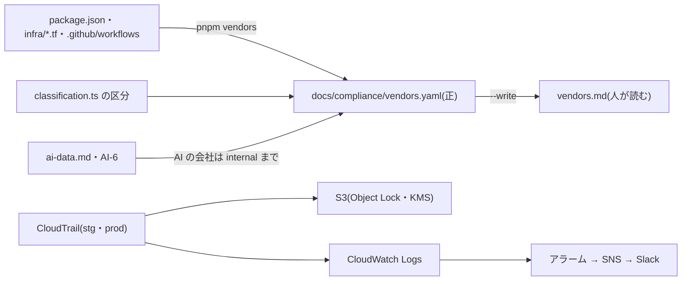

# 設計: 委託先の台帳と照らし合わせ・AI に渡すデータの決まり・管理操作の記録(CloudTrail)

> **AI 用の設計書。省略せずに網羅的に書く(正はこちら)。** 人はこれを開かず、PR の本文の「人向けのまとめ」を見る([guides/human-review.md](../guides/human-review.md))。
> 仕様: [docs/specs/0017-vendors-ai-data-audit-trail.md](../specs/0017-vendors-ai-data-audit-trail.md)・ADR: [0030](../adr/0030-vendor-ledger-ai-data-and-audit-trail.md)
> 状態: 下書き
> 観点の順は [review-viewpoints.md](../review-viewpoints.md)。当てはまらない節も消さずに「該当なし(理由)」と書く。

## 0. 全体像

認証(P マーク・ISMS)の準備の土台を3つ足す。① 外の会社に何を預けているかの台帳を正にして、コード(SDK・Terraform・Actions)と CI で照らし合わせる。② AI に渡してよいのは ID と集計まで、を決まり(AI-6)にして、台帳と手順書をそろえる。③ AWS の管理操作の記録を、消せない S3 と CloudWatch Logs に残す。

## 作業の前に読んだ物(ガイド)

- 考え方: `docs/concepts/running.md`(ログの種類と置き場所: セキュリティの記録は専用の S3 に1年〜)・`docs/security.md`(AI-1〜AI-5・OIDC の役割・見張り)
- ADR: 0011(Sentry へはログから・値を落とす)・0012(消せない保管庫。stg は governance・prod は compliance)・0018(要配慮はスキーマ `sensitive` だけ)・0019(ログの許可リスト)・0021(部品のカタログ)・0027(ひな形では運用を回さない)
- 既存のコード:
  - `apps/api/src/db/classification.ts` … 区分は `DATA_CLASSES`(public / internal / personal / sensitive)。台帳の区分はここから読む
  - `infra/terraform/envs/{stg,prod}` … アカウントごとの環境。`aws_organizations_*` はどこにも無い(Organizations は Terraform の外)。プレビューは dev のアカウント
  - `infra/terraform/modules/security-baseline` … GuardDuty・Security Hub。CloudTrail はまだ無い(GuardDuty は自分で管理の出来事を読むので、トレイルが無くても動く)
  - `infra/terraform/modules/backup` … ロックの強さを `lock_mode` で切り替える型。同じ形にそろえる
  - `infra/terraform/modules/github-oidc` … plan の役割に「中身を読む操作」の明示の拒否(`data_read_actions`)
  - `docs/runbooks/incident.md`・`sentry.md` … AI に一次調査を頼む所。何を貼ってよいかが書かれていなかった
  - `scripts/kit/catalog-lib.mjs`・`scripts/setup/check.mjs` … 正のファイルとコードを CI で突き合わせる型(生成物は作り忘れで落とす)

## 1. 設計方針

- **台帳が正、コードはそれと照らすだけ**。台帳(YAML)に人が書き、CI が「コードで使っている外の会社が台帳にあるか」を見る。逆向き(台帳にあるがコードに無い)は落とさない(Slack・Renovate のように、コードに出てこない会社もある)。
- **区分は列の分類表と同じ言葉**。台帳の `data` は `classification.ts` の `DATA_CLASSES` から読んで確かめる(言葉が二重にならない)。
- **AI の決まりは security.md の番号で引く**(AI-6)。台帳の `ai: true` に personal・sensitive を書くと落ちる、で機械でも守る。
- **CloudTrail はモジュール1つ**(`modules/audit-trail`)を stg・prod で使う。組織のトレイルにも使えるよう `organization_id` を持たせるが、いまは使わない。
- 新しい依存は足さない(`yaml` はルートにある)。スクリプトは `scripts/` の他の検査と同じ形(中身の lib・入口・`node --test`)。

## 2. データモデル

該当なし(DB は変えない)。台帳の形:

| 項目 | 中身 | 確かめること |
|---|---|---|
| `id`・`name`・`what` | 会社の名前と何に使うか | 必須。`id` は重ならない |
| `status`・`ended_on` | `active` / `ended`(使うのをやめても消さない) | `ended` なら日付が要る。照らし合わせは `active` だけ |
| `relation` | 委託 / 第三者提供 / 渡さない | どれか |
| `ai` | AI の会社なら `true` | `data` に personal・sensitive があれば落とす |
| `country` | データの置き場所(国・リージョン) | 必須 |
| `data` | 区分の一覧(渡さないなら `[]`) | `DATA_CLASSES` の言葉か。「渡さない」に personal・sensitive は書けない |
| `contract.dpa`・`link`・`note` | 結んだ(YYYY-MM-DD)/ 約款に含む / 未確認 / 不要 | 委託で「不要」は落とす。`link` は必須 |
| `certifications`・`certifications_link` | 公開の第三者の認証 | — |
| `checked_on` | 公開の約款と認証を確かめた日 | 日付の形 |
| `deletion.when_we_leave`・`when_tenant_leaves` | 使うのをやめたとき・お客さんが解約したときの消え方 | 両方必須 |
| `match.packages`・`actions`・`terraform_sources` | コードで当たる名前(`*` は何文字でも) | — |
| `services[]` | `name`・`terraform`(資源の種類)・`data`・`note` | サービスの `data` は会社の `data` の中 |
| `service_packages`(一番上) | 外のサービスの SDK らしい名前 | ここか `match.packages` に当たる依存は、どこかの会社の `match.packages` に要る |

## 3. API

該当なし(API を足さない)。コマンド:

- `pnpm vendors` … 台帳の書き方と照らし合わせ。1つでも問題があれば 1 で終わる(CI の「Biome・型・単体」)
- `pnpm vendors --write` … `docs/compliance/vendors.md` を作り直す

照らし合わせの決まり(`scripts/vendors-lib.mjs`):

| 対象 | 集め方 | 落とす条件 |
|---|---|---|
| package.json(全部のワークスペース) | `dependencies`・`devDependencies`・`optionalDependencies`・`peerDependencies` の名前 | `service_packages` か、どこかの `match.packages` に当たるのに、`active` な会社の `match.packages` に無い |
| Actions | `.github/workflows/*.yml`・`.github/actions/**/action.yml` の `uses:`。`owner/repo` に縮める(`./` は除く・`docker://` はイメージの名前) | どの `active` な会社の `match.actions` にも当たらない |
| Terraform の source | `infra/**/*.tf` の `source = "…"`(`./`・`../` は除く) | どの会社の `match.terraform_sources` にも無い |
| Terraform の資源の種類 | `resource "…"`・`data "…"` の種類 | 頭(`aws_`)の提供者が台帳に無い / その会社が `services` を持つのに、どのサービスの `terraform` にも当たらない |
| 人が読む一覧 | 台帳から作った中身と `vendors.md` を比べる | 違う |

## 4. 状態遷移

台帳の会社: `active` → `ended`(戻すなら `active` に戻して `ended_on` を消す。記録は git に残る)。消さない。

CloudTrail の記録: 書かれる → 90日で Glacier Instant Retrieval へ → 400日(保存の期間)でロックが切れる → 401日で消える指示 → 古い版が翌日に消える。ロックの間は誰も消せない(compliance)/ 特別な権限でだけ消せる(governance)。

## 5. システム間連携

- CloudTrail → S3(`AWSLogs/<アカウント>/`。バケットの方針で、このトレイルからの書き込みだけ通す: `aws:SourceArn`)
- CloudTrail → CloudWatch Logs(専用の IAM の役割。`logs:CreateLogStream`・`PutLogEvents` だけ)
- CloudWatch Logs のメトリクスフィルター → アラーム → modules/alerts の SNS → Slack
- 鍵: CloudTrail の書き込み(`kms:GenerateDataKey*`。`aws:SourceArn` と暗号化の文脈で絞る)と CloudWatch Logs(ロググループの ARN で絞る)だけに使わせる
- ほかのセッション(要配慮の分離)は、`audit_trail_log_group_name` にメトリクスフィルターを置いて、要配慮の鍵の利用のアラームを足す(KMS の出来事を外していないので、`Decrypt` なども入る)

## 6. 業務ルール

- AI に渡してよいのは internal と public まで(AI-6)。数人の集計は ID と同じ扱い。要配慮は件数も渡さない(ai-data.md の 1)。
- 委託先を足す・区分を変えるのは人の確認(危険度「高」)。使うのをやめた会社は `ended` にして残す。
- 区分の言葉は `classification.ts` が正。台帳で新しい言葉を作らない。
- 管理操作の記録の保存は400日(1年+監査の準備)。prod は compliance(U-2)。
- AWS の資源の種類は、サービスごとに区分を書く(新しいサービスを足すと、何のデータをそこに置くかを書かないと CI が通らない)。

## 7. 要求との対応

| 受け入れ条件(仕様) | 設計のどこ | テスト |
|---|---|---|
| 台帳に1社1件・各項目がある | 2. | `scripts/vendors.test.mjs`「台帳の書き方の誤り」・`pnpm vendors`(本物の台帳) |
| キットの今の会社が埋まっている・AWS はサービスごと | 2.・台帳 | `pnpm vendors`(照らし合わせが0件で通る) |
| 人が読む一覧が作られ、古ければ落ちる | 3. | 「人が読む一覧に、会社・区分・使っている所が出る」・`pnpm vendors` の作り忘れ |
| SDK・Terraform の種類と提供者・Actions が無ければ落ちる | 3. | 「台帳に無い SDK・Actions・提供者・AWS のサービスは落ちる」・「package.json の依存・uses:・Terraform を集める」 |
| 区分が classification.ts に無い・ended の物を使う → 落ちる | 2.・3. | 「区分は classification.ts から読む」・「台帳の書き方の誤り」・「使うのをやめた会社(ended)では通らない」 |
| 台帳の PR は危険度「高」 | 9. | `pnpm guards`(一覧と ask・ラベル・CODEOWNERS) |
| security.md に AI-6 | 6. | `pnpm self-contained`(引いた番号が security.md にあるか) |
| ai-data.md に出どころごとの表 | 6. | 文書(人が読む) |
| AI の会社に personal → 落ちる | 2. | 「AI の会社と『渡さない』の会社に personal・sensitive は書けない」 |
| AI にログを読ませる箇所がこの決まりを指す | 8. | 文書(incident.md・sentry.md・CLAUDE.md・report-bug) |
| 越境は未確定事項 | 12. | `pnpm decisions` |
| トレイル(全リージョン・管理の出来事・KMS・Object Lock・検証) | 5.・`modules/audit-trail` | `terraform validate`・tflint・Trivy の設定の検査(CloudTrail と S3 の決まり。CI の Terraform) |
| ロググループの名前・ARN の出力 | 5. | `terraform validate`(envs の outputs) |
| root の利用・記録を止める でアラーム | `modules/audit-trail/alarms.tf` | stg で鳴らして確かめる(手順書の 1 の 4。apply の後に人が) |
| Organizations が無いことを確かめた・手順書 | 0.・`docs/runbooks/audit-trail.md` の 4 | 文書 |
| plan の役割から記録が読めない | 8. | `terraform validate`(github-oidc)。plan の役割で `aws cloudtrail lookup-events` が AccessDenied(apply の後に人が) |
| compliance/README.md が入口 | — | `pnpm self-contained`(リンク先がキットの中) |

## 8. 非機能

- 性能: `pnpm vendors` は git の一覧と数百のファイルを読むだけ(1秒未満)。
- セキュリティ:
  - 仕様の STRIDE のとおり。台帳は危険度「高」・AI の会社に personal を書けない・記録は消せない・plan の役割に `cloudtrail:LookupEvents`・`cloudtrail:GetQueryResults` の明示の拒否を足す(ロググループの本文 `logs:*` と S3 の物はもとから拒否)。
  - 記録の中身(社員の IAM の名前・IP)も AI に渡さない(ai-data.md の表)。
- 運用: 手順書 `docs/runbooks/audit-trail.md`(入れ方・保存の決め方・アラーム・組織のトレイルへの移り方・調べ方と検証)。アラームは Slack へ。`incident.md`・`sentry.md` に AI に渡す物を書く。
- 費用(2026-10 の定価から): CloudTrail の最初の写しは無料・S3 は数百 MB で月 数十円・CloudWatch Logs は 月 数十〜数百円・KMS 鍵 月 約150円。アカウント2つで 月 1,000円 未満の見込み。組織のトレイルに移るときは、アカウントのトレイルを外さないと2本目が有料(手順書の 4)。
- 見つけられないもの: 台帳の `service_packages` に無い名前の SDK・`fetch` で直接呼ぶ外の API・CI で使うコンテナのイメージ(`docker run`)。security.md の「毎回の検査」の表に書く。

## 9. このプロダクト特有

| 観点 | この変更では |
|---|---|
| テナント分離 | 該当なし(アプリのコードを変えない) |
| 権限の表 | 該当なし(API を足さない) |
| 監査ログ | アプリの監査ログは変えない。AWS の管理操作の記録(CloudTrail)を別に足す。違いは手順書の頭に書く |
| 解約で消す一覧 | 変えない。台帳の `when_tenant_leaves` に、各社に残る物の消え方を書いた(offboarding.md と同じ中身) |
| サポートの代理ログイン | 該当なし |
| ログの個人情報 | AI に渡すログは許可リストの項目だけ(ai-data.md)。CloudTrail の記録は社員の名前・IP を含むので、AI と Issue に貼らない |
| 列の分類(`personal` / `sensitive`) | 台帳の区分は `classification.ts` から読む。要配慮を足すときは、台帳の AWS(Aurora)にも sensitive を足す(note に書いた) |
| 画面の部品 | 該当なし |

危険度「高」の場所(`.github/**`・`infra/**`・`.claude/**`)を変える。台帳 `docs/compliance/vendors.yaml` を守りの一覧に足す(4か所: protected-paths.json・settings.json の ask・labeler.yml・CODEOWNERS)。

## 10. 観点ごとの扱い

| 観点 | 扱い | 理由 |
|---|---|---|
| 設計方針 | 採用 | 正のファイル+CI の突き合わせ(既存の型)。CloudTrail はモジュール1つ |
| データモデル | 軽く確認 | DB は変えない。台帳の項目は 2. |
| API | 低優先 | 足さない |
| 状態遷移 | 軽く確認 | 台帳の ended・記録の保存の流れだけ |
| システム間連携 | 最重要 | 米国の委託先(越境)の扱いが未確定(U-1)。CloudTrail → S3・Logs の権限の絞り方 |
| 業務ルール | 最重要 | AI に渡すのは ID と集計まで(持ち主の決まり)。prod の記録を消せなくする強さ(U-2) |
| 要求との対応 | 機械で検証 | 7. の表。スクリプトのテストと Terraform の検査 |
| 非機能 | 採用 | 費用・見つけられないもの・plan の役割の拒否 |
| 列の分類 | 機械で検証 | 区分を classification.ts から読む |
| ログの個人情報 | 採用 | AI に渡すログの項目を決めた |

## 11. 決めたこと(AI が決めた。人に聞かなかった)

- **Organizations は Terraform に無いので、アカウントのトレイルにした** — `infra/` に `aws_organizations_*` が無く、管理アカウントの環境も無い。組織のトレイルは管理アカウント(か委任された管理者)でしか作れない。同じモジュールに `organization_id` を持たせ、移り方を手順書の 4 に書いた。
- **管理の出来事は全部(読みも)・全リージョン・KMS も外さない** — 読みの操作(誰が秘密を読んだ)も事故の調べ物に要る。要配慮の鍵の利用を見張るため KMS の出来事は外せない。最初の写しは無料なので費用はほぼ増えない。
- **データの出来事は取らない** — 量で費用が増える。S3 に置くのは記録と試作の画面だけで、お客さんのデータは DB にある(DB の中の読みは監査ログ)。
- **CloudWatch Logs にも流す(90日)** — アラームと最近の調べ物のため。長い保存は S3 で足りるので、Logs は短くした。
- **鍵はモジュールに1本** — 記録とロググループで共有。鍵の方針で CloudTrail と CloudWatch Logs のこのロググループだけに使わせる。アプリの鍵と分けたのは、記録を読める人を鍵でも絞れるようにするため。
- **アラームは2つ(root の利用・記録を止める/変える)** — 鳴ったら必ず人が見る物だけ(CIS の基準の中で、誤報が少ない物)。「権限の外の操作」は CI の plan などで日常的に出るので入れない。
- **台帳の照らし合わせは「コード → 台帳」の向きだけ** — Slack・Renovate のようにコードに出てこない会社もあるので、逆は落とさない。
- **SDK の見分けは名前の一覧(`service_packages`)** — 全部の依存を分類させると、外に出ない部品(zod など)にも1行要り、続かない。外のサービスの SDK の主な名前を台帳に持ち、足したときに気づけるようにした。見つけられない物は security.md に書く。
- **AWS はサービスごとに区分を書く** — AWS 1行だと、SQS・DynamoDB を足して個人データを置いても台帳が変わらない。資源の種類の頭でサービスに分け、新しいサービスで CI が落ちるようにした。
- **台帳を危険度「高」にした** — 委託先を足すのは「他チームとの契約」に当たり、AI が勝手に区分を下げると AI-6 の機械の守りが外れる。
- **契約の欄は「未確認」を既定にした** — キットが確かめられるのは公開の約款まで。実際の契約(プラン・置き場所・保存の日数)は使う人ごとに違う。AWS だけは、約款(サービス条件)に DPA が組み込まれていることを確かめたので「約款に含む」。
- **点検の台帳には項目を足さない** — 点検の項目を足すのは `/checkup-refresh` の PR の決まり。年1回の委託先の見直しは、次の refresh で足す候補(PR の本文に書く)。
- **compliance/README.md をこの PR で作る** — 認証の準備の入口。ほかの PR(証跡の自動収集・SoA)は、表に1行足す形で重ならないようにした。

## 12. 未確定事項(AI の仮決め。人の承認と分けて追う)

> 4つに当たる判断だけ。状態の書き方は [guides/human-review.md](../guides/human-review.md) の 2。`pnpm decisions` がここを読む。**`仮決め` が残る PR はマージしない。**
> 答えがプロダクトごとに違う問い(使う人の事業・利用者・契約で変わる)は、キットの持ち主が承認したあと `導入時に決める(キットの既定は @名前 YYYY-MM-DD に承認)` にする(使い始めた人が `pnpm decisions --adopt` で決める)。

| 番号 | 工程 | 種類 | 仮決め(設計した事実) | なぜそうしたか | 人が判断する問い | 状態 |
|---|---|---|---|---|---|---|
| U-1 | 要求 | 他チームとの契約や制約 | 米国の委託先(Anthropic・Sentry・GitHub・Slack)には ID と集計(internal)だけを渡し、台帳では「委託」とした。越境(個人情報保護法 28条)に当たるか・本人への情報提供や同意が要るかは決めず、**専門家に確かめる**としてキットの既定を置いた(プライバシーポリシーに委託先の国を書く前提) | ID もこちらの DB と突き合わせれば人に結びつくので、「渡さない」とは言えない。法令の当てはめは AI が決められない | キットの既定を「ID と集計まで・委託として台帳に載せ、越境の扱いは使う人が専門家に確かめる」でよいか(よければ `導入時に決める` にして、使う人ごとに専門家の答えを書く) | 仮決め |
| U-2 | 設計 | 戻せないリスク | prod の管理操作の記録は、S3 の Object Lock を **compliance・400日**にした(apply すると、400日は root でも AWS のサポートでも消せず、バケットも消せない)。stg は governance・400日 | 鍵が漏れたときに痕跡を消されないため(バックアップの保管庫の prod と同じ強さ。ADR 0012)。日数は1年+監査の準備 | prod を compliance・400日で入れてよいか(日数は使う人の契約・認証で変わるので、よければ `導入時に決める`) | 仮決め |

## 13. 作り直しの記録

> `/rework` が書く。誤りが入った工程と、作り直した下流。

| 日付 | きっかけ | 入った工程 | 直した物 | 作り直した下流 |
|---|---|---|---|---|
