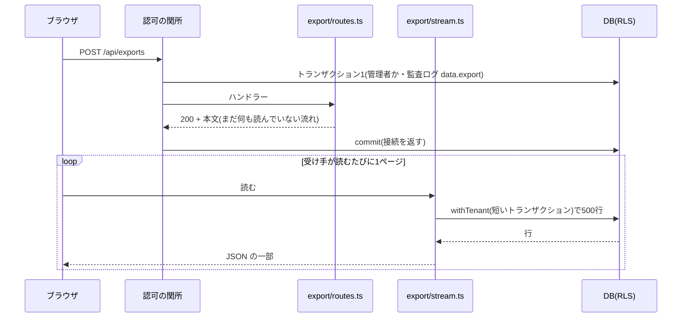

# 設計: 大きい組織のデータの書き出し(少しずつ流す)

> **AI 用の設計書。省略せずに網羅的に書く(正はこちら)。** 人はこれを開かず、PR の本文の「人向けのまとめ」を見る([guides/human-review.md](../guides/human-review.md))。
> 仕様: [docs/specs/0018-export-stream.md](../specs/0018-export-stream.md)
> 状態: 下書き(未確定事項なし。承認は PR で)
> 観点の順は [review-viewpoints.md](../review-viewpoints.md)。当てはまらない節も消さずに「該当なし(理由)」と書く。

## 0. 全体像

`POST /api/exports` が、各領域から500行ずつ読み、同じ形の JSON(export@1)を少しずつ流して返す。ページごとに短いテナントのトランザクションを開き、受け手が読みに来たときだけ次を読む。
画面は、流れてきた本文を値に戻さず Blob のまま保存し、時間切れは「応答が始まるまで」だけにする。案の比較は ADR 0031。

## 作業の前に読んだ物(ガイド)

- `apps/api/src/export/routes.ts`: 各領域の `export…(s)` を全部 await して1つの値にし、`c.json` で返していた。1社の全部が値+文字列で載る
- 各領域の `export…`: タスク・プロジェクト・利用者・許可・メールの変更・同意は全件を1回のクエリで。監査ログだけ500件ずつ読んで、最後に1つの配列にまとめていた(読み方は分かれていても、載る量は同じ)
- `apps/api/src/authz/middleware.ts`: 関所はリクエストごとに `withTenant` を開き、`await next()` の後で監査ログを同じトランザクションに書いて commit する。**本文はその後に読まれる**ので、関所のトランザクションの中では流せない
- `apps/api/src/db/client.ts`: 1つのクエリ5秒・トランザクションを開いたまま何も頼まない時間10秒・接続プール10本
- `apps/api/src/auth/account-routes.ts`: 外(Cognito)を待つ API は、ルートが `withTenant` を自分で開く(`inTenant`)。テナントはセッションから
- `.semgrep/rules.yml` の `tenant-scoped-db-only`: 止めるのは領域の中(`src/domains/`)だけ。`src/export` は共通の仕組みで、`src/auth` と同じく `withTenant` を開ける
- `apps/api/src/db/paging.ts`: 続きの印(時刻+ID)・`beyondCursor`・`toPage`。索引は `drizzle/concurrent/0008_list_indexes.sql`(プロジェクト: tenant_id, created_at, id / タスク: tenant_id, project_id, created_at, id)
- `apps/api/src/app.ts`: `compress()` が JSON を gzip で縮める(流れる本文にも効く)。`/api/*` に `cache-control: no-store`
- `apps/web/src/api.ts`・`pages/SettingsPage.tsx`: ブラウザの `fetch` は15秒で切る(本文を読み終えるまで含む)。受け取った JSON を値にして `JSON.stringify(data, null, 2)` で保存し直していた
- ADR 0006(アウトボックスは API の中・別のワーカーは無い)・ADR 0015(書き出しは画面から。見直す合図に「数十秒を超えたら非同期」)・ADR 0020(S3 は試作の置き場だけ)

## 1. 設計方針

- 置き場所は今までどおり `src/export`(共通の仕組み)と各領域の `repository.ts`(写す項目は領域が決める)。ほかの領域・共通部分からは `index.ts` だけを使う(ADR 0004)。
- 形は export@1 のまま。新しい依存・表・移行・AWS の部品を足さない。
- 流れの部品(`stream.ts`)は、「JSON の一部を順に出す」(`exportChunks`)と「それを応答の本文にする」(`exportStream`)に分ける。後者は DB 無しで単体テストできる。

## 2. データモデル

- 表・列・移行: 変えない。
- 読み方: 各領域に `export…Page(s, after, limit)` を足し、全件を読む関数を置き換えた。並びと続きの印:

| 項目 | 並び | 続きの印 | 使う索引 |
|---|---|---|---|
| users | 古い順(created_at, id) | 時刻+ID(`paging.ts`) | tenant_id の索引(1社の人数ぶん) |
| projects | 古い順(created_at, id) | 時刻+ID | projects_tenant_id_created_at_id_idx |
| tasks | プロジェクト → 古い順(project_id, created_at, id) | プロジェクト+時刻+ID(`TaskExportCursor`) | tasks_tenant_id_project_id_created_at_id_idx |
| auditEvents | 新しい順(id) | ID(一覧と同じ印) | audit_events_tenant_id_idx |
| supportGrants | 新しい順(created_at, id) | 時刻+ID | tenant_id で絞って並べる(1社の件数は少ない) |
| emailChanges | 新しい順(requested_at, id) | 時刻+ID | 同上 |
| legalConsents | 古い順(accepted_at, id) | 時刻+ID | 同上 |

- タスクの並びが「古い順」から「プロジェクト → 古い順」に変わる。全社の古い順に合う索引は無く、足すと移行(危険度「高」)になる。形の約束(ExportSchema)に並び順は入っていない。
- 解約で消す一覧: 変えない(表を足さない)。
- 書き出し: 項目は今までと同じ(Cognito の sub・番号のハッシュは入らない)。

## 3. API

- `POST /api/exports`: パス・権限・入力は変えない。応答は 200・`content-type: application/json; charset=UTF-8`・`content-disposition: attachment; filename="export-YYYY-MM-DD.json"`・`cache-control: no-store`。本文の形は OpenAPI の `ExportSchema` のまま(API の互換は変わらない)。`content-length` は無い(流す)。gzip を受け取れる相手には縮める。
- 失敗の応答: 流し始める前(401・403・関所の失敗)は今までどおり `onError` の形。流し始めた後の失敗は、本文を最後まで出さずに切る(状態コードは変えられない)。
- 権限の表: 変えない。監査ログの名前: `data.export` のまま(関所が流し始めた時点で残す)。

## 4. 状態遷移

該当なし(状態を持たない。ジョブの表を作らない)。

## 5. システム間連携

- 外との出入りは足さない(S3・メール・アウトボックスを使わない)。
- ALB: バイトが流れ続けるので、アイドルタイムアウト(60秒)に当たらない。ページの間は手元で 50ms 以下。
- Sentry: 途中の失敗は `logger.error({ err })` から届く(値は落とした形で)。

## 6. 業務ルール

- 1ページは500行(`EXPORT_PAGE_SIZE`)。監査ログの書き出しの元の値と同じで、1ページの JSON が数百 KB に収まる。
- 受け手が読みに来たときだけ次のページを読む。受け手が切れば止まる。
- 途中で変わった行は、入ることも入らないこともある。ずっとある行は欠けも重なりもしない。
- 書き出しの中には、その書き出し自身の `data.export` の行も入る(流し始める前に残るので)。

## 7. 要求との対応

| 受け入れ条件(仕様) | 設計のどこ | テスト |
|---|---|---|
| 今までと同じ形のファイル | 3. API・`stream.ts` の `exportChunks` | `offboarding.int.test.ts`(書き出し)・`export-stream.int.test.ts`(中身)・E2E `export.spec.ts` |
| メモリが中身に比例しない | 1ページずつ・`highWaterMark: 0` | `export-stream.int.test.ts`(20MB で JS の値の増えが 4MB 未満。ページを大きくすると落ちることを確かめた) |
| 最初のバイトがすぐ・止まる時間が短い | 同上 | `export-stream.int.test.ts`(最初のバイト・ページの間とも5秒未満) |
| 受け手が遅くても切れない | ページごとに短いトランザクション | `export-stream.int.test.ts`(トランザクションを開いたまま待てる時間を1秒にして、1.5秒ずつ止まる) |
| 受け手がやめたら残りを読まない | `cancel` で `chunks.return()` | `export-stream.test.ts`・`export-stream.int.test.ts`(接続が全部空く) |
| 欠けず重ならない | 続きの印(2. の表) | `export-stream.int.test.ts`(3万件・プロジェクト3つ・同じ時刻の行・DB と順まで一致) |
| 他社の物が入らない | ページごとに `withTenant`+`tenant_id` | `export-stream.int.test.ts`・`offboarding.int.test.ts` |
| 途中の失敗で切れる・中身を出さない | `exportStream` の `controller.error` | `export-stream.test.ts` |
| 監査ログに残る | 関所(変えない) | `offboarding.int.test.ts`・`export-stream.int.test.ts` |
| メンバーなどは 403 | 関所(変えない) | `offboarding.int.test.ts`・`authz-matrix.int.test.ts` |
| 画面が15秒で諦めない | `api.ts` の `send({ untilHeaders })`・`download` | E2E `export.spec.ts`(保存できる)。15秒を超える大きさは E2E では作らない |

## 8. 非機能

- 性能: 1ページ1クエリ(N+1 なし。監査ログは1ページにつき名前を1回まとめて引く)。手元で 20MB(タスク3万・監査ログ1万)を約2秒。
- メモリ: 1回の書き出しで増える JS の値は1ページ分(手元で 0.3MB ほど)。通信の受け渡し(Node の外のメモリ)は数 MB の間で上下する。
- 接続: 1回の書き出しが同時に握るのは1本まで・ページを読む間だけ。受け手が止まっても握らない。
- セキュリティ: 仕様の STRIDE。署名つき URL のような鍵を持たない入口を作らない。
- 運用: アクセスログの `durationMs` は「流し始めるまで」の時間になる(流し終えるまでではない)。途中の失敗は error のログ1行。
- 費用: 変わらない(部品を足さない)。

## 9. このプロダクト特有

| 観点 | この変更では |
|---|---|
| テナント分離 | ページごとに `withTenant(db, actor.tenantId)`。テナントは関所が決めた actor(セッション)からだけ。リポジトリも `tenant_id` で絞る。続きの印はサーバーの中だけで受け渡す |
| 権限の表 | 変えない(`POST /api/exports` は管理者だけ) |
| 監査ログ | 変えない(`data.export` を関所が流し始めた時点で残す) |
| 解約で消す一覧 | 変えない |
| サポートの代理ログイン | 変えない(代理は閲覧者なので 403) |
| ログの個人情報 | 途中の失敗は `logger.error({ err }, 固定の文)` だけ。新しいログの項目は足さない |
| 列の分類(`personal` / `sensitive`) | 写す項目は変えない(`personal` の名前・メールは今までどおり入る。お客さん自身の持ち出しなので)。`sensitive` の列はまだ無い。足したときに書き出すかは、その列を足す PR で決める(ADR 0018) |
| 画面の部品 | 変えない(文言も同じ) |

## 10. 観点ごとの扱い

| 観点 | 扱い | 理由 |
|---|---|---|
| 設計方針 | 最重要 | ストリームか非同期かの選択(ADR 0031)と、ルートが `withTenant` を開く形 |
| データモデル | 軽く確認 | 表は変えない。タスクの並び順だけ変わる |
| API | 機械で検証 | 形は同じ(API の互換の検査) |
| 状態遷移 | 低優先 | 該当なし |
| システム間連携 | 低優先 | 外との出入りを足さない |
| 業務ルール | 軽く確認 | 途中の変更が混ざりうる・監査ログは流し始めた時点 |
| 要求との対応 | 機械で検証 | 7. の表 |
| 非機能 | 採用 | メモリと時間を結合テストで測る |
| テナント分離 | 最重要 | 関所の外でトランザクションを開く |
| ログの個人情報 | 機械で検証 | `export-stream.test.ts` |

## 11. 決めたこと(AI が決めた。人に聞かなかった)

- **ストリーム(A)にした。非同期(B)は見直す合図が来たら** — PMF の前は軽く。今の困りごと(メモリ・60秒・5秒)は A で全部消え、B は S3・IAM・ジョブの状態・画面・メール・署名つき URL と足す物が多い。アウトボックスはあるが別のワーカーは無い(ADR 0006)。
- **形は export@1 のまま(JSON Lines・ZIP にしない)** — 画面・お客さんの取り込み・契約の文面を変えずに済む。JSON は項目ごとに順に書けば流せる。
- **ページごとに短いトランザクション(1本の長いトランザクションにしない)** — 長いトランザクションは、受け手が止まると10秒で DB に切られ、その間接続を握る。1つの時点の写しより、切れないことを取った。
- **ルート(`src/export`)が `withTenant` を開く** — 本文は関所の commit の後に読まれる。関所や `src/db` を変えずに済み、`src/auth/account-routes.ts` と同じ形。テナントは actor からだけ。
- **受け手が読みに来たときだけ読む(`highWaterMark: 0`)** — 関所のトランザクションが開いている間に2本目の接続を取ると、同時の書き出しが多いときに接続を取り合って止まる。
- **監査ログは流し始めた時点で残す** — 関所の仕組みのまま。途中で切れても一部は持ち出されているので、「書き出した」と残す側に倒す。
- **途中の失敗は流れを切る(最後に「失敗」の印を書き足さない)** — 壊れた JSON は読み込めないので、受け手が「完全」と取り違えない。形に項目を足さずに済む。
- **タスクは「プロジェクト → 古い順」で読む** — 今ある索引で読める。全社の古い順の索引を足すのは移行になる。
- **1ページ500行** — 元の監査ログの書き出しと同じ。1ページが数百 KB で、クエリは索引で数 ms。
- **画面は本文を値に戻さず Blob で保存し、時間切れは応答が始まるまで** — 値に戻して整形し直すと、ブラウザでも2倍載る。ファイルは整形されない1行の JSON になる(読むのは機械。中身と形は同じ)。
- **結合テストは自分だけの DB で** — 数万行を足すので、ほかのファイルの速さを変えない。
- **メモリは JS の値(heapUsed)で厳しく、通信の受け渡し(arrayBuffers)はゆるく測る** — 後者は pg のバッファで数 MB 上下し、片づけが遅れる。全部を載せれば前者が中身の大きさだけ増える(ページを大きくして 16MB 増えて落ちることを確かめた)。

## 12. 未確定事項(AI の仮決め。人の承認と分けて追う)

| 番号 | 工程 | 種類 | 仮決め(設計した事実) | なぜそうしたか | 人が判断する問い | 状態 |
|---|---|---|---|---|---|---|

なし(4つに当たる判断が無い。形・権限・監査ログ・保存の期間を変えず、外へ出す物も足さない)。

## 13. 作り直しの記録

| 日付 | きっかけ | 入った工程 | 直した物 | 作り直した下流 |
|---|---|---|---|---|
