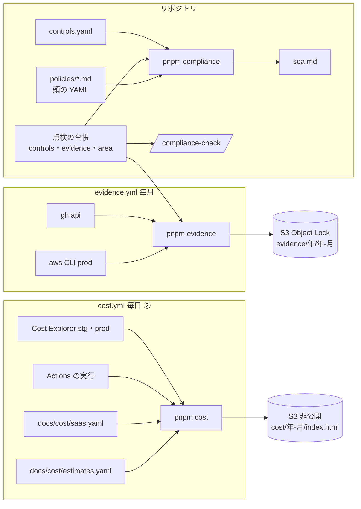

# 設計: 証跡の自動収集・適用宣言書(SoA)・規程のひな形・コストのダッシュボード

> **AI 用の設計書。省略せずに網羅的に書く(正はこちら)。** 人はこれを開かず、PR の本文の「人向けのまとめ」を見る([guides/human-review.md](../guides/human-review.md))。
> 仕様: [docs/specs/0019-evidence-soa-and-cost.md](../specs/0019-evidence-soa-and-cost.md)・ADR: [0032](../adr/0032-evidence-and-cost-outside-the-repo.md)
> 状態: 下書き
> 観点の順は [review-viewpoints.md](../review-viewpoints.md)。PR は ①(証跡・SoA・規程・`/compliance-check`)と ②(コスト。① の上に積む)に分ける。

## 0. 全体像

① 毎月、GitHub と AWS の設定・訓練の結果・点検の台帳を JSON に集め、使う側の消せない S3 に置く(`evidence.yml`)。管理策の一覧(`controls.yaml`)と点検の台帳(`controls`・`evidence` 欄)と規程の頭の YAML から、適用宣言書(`soa.md`)を作り、CI が古さとリンク切れを見る。認証の準備の項目は台帳の `area: compliance` で分け、`/compliance-check` が1問ずつ聞く。
② 毎日(有効にしたら)、AWS(Cost Explorer)・Actions の分数・SaaS と AI の席などの月額(手で書く)を1つの JSON に集め、静的な HTML の1枚にして、非公開の S3 に置く(`cost.yml`)。Terraform は全部のリソースにタグ(`Bet`・`Component` など)を付け、コスト配分タグと費用の急な変化の見張りを足す。



## 作業の前に読んだ物(ガイド)

- `docs/designs/0007-checkup.md`・`scripts/checkup/`(台帳の形・`validateLedger`・`selectItems`・確かめ方 `checks/*.mjs`・`workflowSucceeded`・`gh.mjs` の落とさない読み方・`answer.mjs` の書き戻し)。証跡の GitHub の読み方はこれを使い回す
- `docs/designs/0014-setup-before-use.md`・ADR 0027(`KIT_ROLE` の見分け・定期のワークフローの `if`・`pnpm setup:check` の `checkSchedules`・Environments は `.github/setup.yml` に)
- `.github/workflows/restore-drill.yml`(OIDC の役割・変数が無ければ飛ばす・落ちたら Issue の型)・`checkup.yml`(`CHECKUP_TOKEN` で読む)
- `infra/terraform/envs/prod/github.tf`・`modules/github-oidc`(役割の `subjects`。plan の役割は main からだけ)・`modules/backup`(compliance のロックの猶予と警告の書き方)・`modules/prototype-site`(S3 の公開を止める・TLS だけ・Trivy の除外の書き方)・`modules/alerts`(Budgets・SNS の鍵とポリシー)・`modules/security-baseline`(Security Hub は AWS の基本の決まりで採点)
- `docs/kit/catalog.yaml` の `certification-prep`(状態は「未」。`/tailor` の「認証の予定」)・`docs/concepts/stages.md` の 4.(段階ごとの月の費用の内訳。見積もりの元)
- `scripts/checkup/checks/actions-minutes.mjs`(請求の API。公開のリポジトリは枠が無い)
- 附属書 A(ISO/IEC 27001:2022)の管理策は 5 組織 37・6 人 8・7 物理 14・8 技術 34 の 93件。名前は規格の本文を写さず、このキットの言葉で言い換えた

## 1. 設計方針

- **台帳は1つ**。認証の準備の項目も点検の台帳(`docs/checkup/todo.yaml`)に置き、`area: compliance` で分ける。答えの書き方(`pnpm checkup:answer`)・足すだけの記録・毎週の確かめを、そのまま使う(`/compliance-check` は `/checkup` の一種)
- **SoA は作る物**。正は `controls.yaml`(管理策ごとの適用・理由・実施・根拠)・台帳(項目 → 管理策)・規程の頭の YAML(規程 → 管理策)。`soa.md` は `pnpm compliance --write` で作り、CI が置いてある物と比べる(点検の README・ラベルの手引きと同じ型)
- **証跡は設定と記録だけ**。データ(DB・S3 の中身)・秘密の値・脆弱性の中身は集めない(件数だけ)。人の名前(GitHub のログイン名・IAM の利用者名)は入る → 置き場は非公開で、ログには出さない
- **置き場は使う側の非公開の S3**(ADR 0032)。証跡は Object Lock、費用は上書き(古い版は400日で消す)。部品は `modules/record-store` の1つを使い回す
- 読むのは落とさない(1つ読めなくても、ほかを集めて目録に理由を残す)。ログは名前と件数だけ。アカウントの番号と ARN は伏せる(`mask`)
- 依存を足さない(`gh`・`aws`(Actions の実行環境に入っている)・`yaml`)。HTML は外の部品なしの1枚(CSS と SVG を中に)
- 置き場所: `scripts/evidence/`(集める部品。② の `scripts/cost/` も使う)・`scripts/compliance/`・`docs/compliance/`・`docs/cost/`(②)。`scripts/checkup/` の変更は危険度「高」のまま

## 2. データモデル

DB は触らない。ファイルの形:

### `docs/compliance/controls.yaml`(①)

```yaml
version: 1
standard: ISO/IEC 27001:2022 附属書 A
scope: "範囲(キットの既定): …"   # 導入時に自社の範囲へ
controls:
  - id: A.5.1          # 附属書 A の番号(93件。5:37・6:8・7:14・8:34 でないと落ちる)
    name: …            # キットの言葉での言い換え
    applies: true      # 適用 / false = 除外
    why: …             # 適用・除外の理由(必須)
    how: …             # このキットでの実施(適用なら必須)
    refs: [path, …]    # 根拠のファイル(リポジトリの根から。無いと落ちる)
    evidence: [name]   # 毎月の証跡の名前(scripts/evidence/sources.mjs に無いと落ちる)
```

### 点検の台帳に足す欄(①。`scripts/checkup/todo.mjs` が形を見る)

| 欄 | 形 | 意味 |
|---|---|---|
| `compliance`(台帳の頭) | true / false(無ければ false) | 認証の準備の項目を毎週の点検に入れるか |
| `controls`(項目) | `[A.5.1, …]`(`^A\.[5-8]\.\d{1,2}$`) | 当たる管理策。実在は `pnpm compliance` が見る |
| `evidence`(項目) | `[github-ruleset, …]`(英小文字とハイフン) | 裏づけの証跡の名前。実在は `pnpm compliance` が見る |
| `area`(項目) | `compliance` だけ | 認証の準備だけの項目 |

既存の40項目には `controls`(全部)と `evidence`(当たる物だけ)を足した。新しい項目は 6. の「認証の準備の項目」。

### 規程の頭の YAML(`docs/compliance/policies/*.md`。README は除く)

```yaml
---
title: …
version: "0.1"           # 文字列(0.10 が 0.1 にならないように)
owner: "【要記入: …】"     # 責任者
established: null        # 制定日(承認した日)。入れたら next_review も要る
last_reviewed: null
next_review: null        # 過ぎると点検の policy-review が知らせる
controls: [A.5.1, …]     # 当たる管理策(1件以上・実在)
---
```

人が埋める所は `【要記入: …】`。残っている間は点検の `policies-adopt` が「まだ」(`PLACEHOLDER`)。

### 証跡の束(①。`scripts/evidence/lib.mjs` の `makeBundle`)

- 1件1ファイル `<名前>.json`: `{ name, about, month, collected_at, repo, ok, data | reason }`
- 目録 `manifest.json`: `{ kind: "evidence", month, collected_at, repo, commit, files: [{ name, file, ok, size | reason, sha256, bytes }] }`
- 置き方: `s3://<EVIDENCE_BUCKET>/evidence/<年>/<年-月>/`(日本時間の月)。流し直すと新しい版が足される(古い版も Object Lock で残る)

| 名前 | 読む所 | 入れる物(入れない物) |
|---|---|---|
| `github-ruleset` | `rulesets`・`rulesets/<id>`・`rules/branches/main` | 名前・対象・強制・条件・規則・例外 |
| `github-environments` | `environments`・`…/deployment-branch-policies` | 名前・使えるブランチ・承認する人(ログイン名)・自分の承認の禁止・待ち時間(秘密と変数は入れない) |
| `github-collaborators` | `collaborators?affiliation=all`・`invitations` | ログイン名・種類・役割・招待中の人 |
| `github-actions` | `actions/permissions`・`…/workflow`・`…/artifact-and-log-retention` | 設定の値 |
| `github-security` | リポジトリ・`dependabot/alerts`・`secret-scanning/alerts`・`code-scanning/alerts` | 守りの機能・開いている通知の**件数と重さごとの数**(中身は入れない) |
| `drills` | `actions/workflows/<file>/runs`(前の月の1日から) | 戻す訓練・ファズ・ZAP・契約テスト・点検・脆弱性の検査・証跡の収集の実行(結果・日時・SHA・リンク) |
| `aws-iam-summary` | `iam get-account-summary` | 要約(root の二段階認証・root の鍵の有無・数) |
| `aws-iam-users` | `iam generate-credential-report`・`get-credential-report` | 利用者ごとの二段階認証・パスワードと鍵の有効と最後の利用・鍵の古さ(鍵の値・ARN は入れない) |
| `aws-iam-roles` | `iam list-roles` | 名前・パス・作った日・セッションの長さ |
| `aws-securityhub` | `securityhub get-findings`(有効・Security Hub の物) | 管理策ごとの合否から点数(%)・落ちた管理策の番号・重さごとの数(見つけ物の中身は入れない) |
| `aws-guardduty` | `guardduty list-detectors`・`get-detector` | 有効か・知らせの間隔・見ている物 |
| `aws-backup` | `backup list-backup-vaults` | 保管庫ごとのロック・ロックの日・保存の期間・戻せる点の数 |
| `aws-cloudtrail` | `cloudtrail describe-trails`・`get-trail-status` | 全リージョンか・改ざんの検知・記録中か・最後に届いた時刻 |
| `checkup-ledger` | 台帳 | 使い始めた日・担当者・`compliance`・項目ごとの状態と最後の記録 |
| `compliance-docs` | 規程・SoA | 規程の版と日付・SoA の SHA-256 |

### 費用の束(②。`scripts/cost/`)

- 同じ `makeBundle`(`kind: "cost"`)。ファイル: `aws-stg.json`・`aws-prod.json`・`aws-dev.json`(役割があるだけ)・`github-actions.json`・`saas.json`・`estimates.json`・`summary.json`(ページの元)・`index.html`(ページ)・`manifest.json`
- 置き方: `s3://<COST_BUCKET>/cost/<年-月>/`(毎日上書き。古い版は400日で消える)と `cost/latest/index.html`
- `aws-<環境>.json`: 今月の初めから昨日まで(Cost Explorer は終わりの日を含まない)と前の3か月の、`UnblendedCost` を ① AWS のサービスごと ② タグ `Environment` ③ タグ `Component` ④ タグ `Bet` ⑤ タグ `PullRequest`(dev だけ)で。月末の見込み(`get-cost-forecast`)。呼ぶのは1アカウントにつき 6回まで(1回 $0.01)
- `github-actions.json`: 今月のワークフローごとの実行の数と分数(実行の `run_started_at` から `updated_at`)。非公開のリポジトリなら、枠と使った分(`settings/billing/actions`)から金額の見込み
- `saas.json`: `docs/cost/saas.yaml` の月額(手で書く。`{ name, what, monthly_jpy, bet?, since, until? }`)
- `estimates.json`: `docs/cost/estimates.yaml`(段階 `stage` と区分ごとの見積もりの下と上。元は `docs/concepts/stages.md` の 4.)
- 金額は円とドルの両方を持つ。換算は `docs/cost/estimates.yaml` の `usd_jpy`(既定 150。stages.md と同じ)。金額の計算は小数を使わず、セント・円の整数にしてから(`packages/shared` の `money.ts` の考え方。スクリプトなので同じ考えを中で行う)

### Terraform(① と ②)

- ①: `modules/record-store`(S3・Object Lock は任意・自前の KMS 鍵・公開を止める・TLS だけ・90日で Glacier Instant Retrieval・lock なしなら古い版を400日で消す)。prod に `module.evidence`(lock = `{ mode = var.evidence_lock_mode, years = var.evidence_retention_years }`)と役割 `…-evidence`
- ②: 既定のタグに `Bet`(既定 `core` = 土台。賭けだけのリソースは自分の `tags` で `B-NNNN` に上書き)。`Component` は、モジュールごとに既定のタグの違う provider の別名を渡す(`aws.api`・`aws.web`・`aws.mail`・`aws.db`・`aws.network`。モジュールの中は変えない)。`aws_ce_cost_allocation_tag`(`Project`・`Environment`・`Component`・`Bet`・`PullRequest`。変数 `activate_cost_allocation_tags` が true のとき。タグが請求に出てから=最初の apply の翌日以降)。`modules/alerts` に Cost Anomaly Detection(このプロダクトのタグ `Project` に絞った監視+SNS へ。変数 `anomaly_threshold_usd`)。prod に費用のページの置き場 `module.cost_reports`(lock なし)と役割 `…-cost`(Cost Explorer を読む+置き場へ書く)、stg と dev(preview/base)に役割 `…-cost`(Cost Explorer を読むだけ)

## 3. API

アプリの API は足さない。コマンド:

| コマンド | すること | 終わり方 |
|---|---|---|
| `pnpm evidence --out <dir> [--only github,aws,repo]` | 証跡を集めてフォルダに書く(置き場には送らない) | 読めない物があっても 0(目録に理由)。`--out` が無ければ 1 |
| `pnpm evidence --list` | 集める物の名前と説明 | 0 |
| `pnpm compliance` | 2. の形・根拠と相対リンクの実在・台帳と規程が指す管理策と証跡の実在・SoA の古さ | 問題があれば 1 |
| `pnpm compliance --write` | SoA を作り直す(その後で上を確かめる) | 同上 |
| `pnpm checkup --area compliance [--json]` | 認証の準備の項目だけを確かめて出す(`compliance: false` でも)。Issue は書かない | 台帳の書き方が違えば 1 |
| `pnpm cost --out <dir> [--account stg] [--only github,saas]`(②) | 費用を集めてフォルダに書く | 読めない物があっても 0 |
| `pnpm cost --render <dir>`(②) | フォルダの JSON から `summary.json` と `index.html` を作る | 0 |

確かめ方(`scripts/checkup/checks/`。①): `evidence-collected`(`evidence.yml` が35日のうちに成功)・`policies-adopted`(規程が全部、制定日があり「要記入」が無い)・`policies-review`(`next_review` を過ぎた規程が無い)。

## 4. 状態遷移

- 認証の準備の項目の状態は、ほかの点検の項目と同じ(open → done / asked_advisor / snoozed。設計書 0007 の 4.)
- `compliance: false` → `true` は人が台帳を直す PR(`/compliance-check` が聞いてから)。戻すのも同じ(項目の記録は残る)
- 規程: 頭の `established` が null(ひな形)→ 日付(制定)。見直したら `version` を上げ、`last_reviewed`・`next_review` を書き換える。改訂の記録の表に1行足す
- 証跡: 1か月に1つの束。Object Lock の期間が過ぎるまで消せない(GOVERNANCE なら `s3:BypassGovernanceRetention` を持つ人だけが消せる)

## 5. システム間連携

- GitHub(読むだけ): `gh api`。`CHECKUP_TOKEN`(読むだけの細かい権限)があれば、それで読む(`readEnv`)。無ければジョブのトークン(読めない所は目録に)
- AWS(①): `aws-actions/configure-aws-credentials` で役割 `…-evidence`(prod。`ref:refs/heads/main` だけ)。`aws s3 cp --recursive` で置く(AWS CLI v2 は既定でチェックサムを付けるので、Object Lock の置き場の条件を満たす)
- AWS(②): stg・dev・prod の役割 `…-cost` を順に引き、Cost Explorer を読む。最後に prod の役割で置き場へ
- AI(②): API では取らない(U-4 の答え)。AI の席・使用料の月額は、ほかの SaaS と同じく `docs/cost/saas.yaml`(`category: ai`)に手で書く
- 知らせ: 失敗したら Issue(同じ題名が開いていればコメント)。費用の急な変化は Cost Anomaly Detection → SNS → Slack(②)

## 6. 業務ルール

### 認証の準備の項目(台帳。`area: compliance`)

| id | やること | 誰が | 段階 | 間隔 | 確かめ方 | 管理策 |
|---|---|---|---|---|---|---|
| `policies-adopt` | 規程のひな形を自社の物にし、SoA の適用・除外を決める | 人 | 立ち上げ | 一度 | 手でやる+`policies-adopted` | A.5.1・A.5.36・A.5.37 |
| `evidence-monthly` | 毎月の証跡が集まっているか | 仕組み | 1か月 | 毎月 | 自動(`evidence-collected`) | A.5.28・A.5.33 |
| `training` | 教育(入るとき・年1回) | 人 | 1か月 | 毎年 | 手でやる | A.6.3 |
| `vendor-review` | 委託先の見直し | 人 | 3か月 | 毎年 | 手でやる | A.5.19・A.5.20・A.5.22・A.5.23 |
| `internal-audit` | 内部監査 | 人 | 半年 | 毎年 | 手でやる | A.5.35・A.5.36 |
| `management-review` | マネジメントレビュー | 人 | 半年 | 毎年 | 手でやる | A.5.1・A.5.4 |
| `policy-review` | 規程と SoA の見直し | 人 | 1年 | 毎年 | 手でやる+`policies-review` | A.5.1・A.5.36・A.5.37 |

- 入れる・入れない: `selectItems(ledger, phase, today, { area })`。`area` を渡せばその区分だけ。渡さなければ、`area: compliance` は台帳の `compliance: true` のときだけ。`--area` のときは Issue を書かない(今週の点検の Issue を書き換えないため)
- 点検の README の「誰が」に「・認証」を付け、頭に `compliance` の今の値を出す

### SoA の作り方

- 管理策の順は番号のまま。主題(5〜8)ごとに表。列: 番号・管理策・適用・理由・実施(除外は —)・点検の項目(引退した項目は除く)・証跡(管理策の `evidence` と、当たる項目の `evidence` を合わせて重ねない)・規程と根拠(規程の頭の `controls` から+`refs`)。リンクは `docs/compliance/` からの相対
- 今日の日付は入れない(作った物と置いてある物を比べるため)

### 確かめ(`pnpm compliance`)

- 管理策: 番号の形・重なり・name・applies・why・(適用なら)how・refs の実在・主題ごとの件数
- 規程: 頭の YAML がある・title・version・owner・controls(1件以上・実在)・日付の形・制定したなら next_review
- 台帳と管理策: 項目の `controls` が一覧にある・項目と管理策の `evidence` が集め先にある
- リンク: `docs/compliance/` の全部の `.md` の相対リンク(`http(s)://`・`mailto:`・`#…` は見ない。`#` の後ろは外して、ファイルかフォルダの実在だけ)
- SoA: 置いてある物 = 作った物

### 証跡を集めるときの決まり

- 1つの集め先が投げても、ほかは続ける(`collectAll`)。理由は `mask` を通してから目録とログに
- 訓練の結果は「前の月の1日から」(毎月1日に流すので、前の月がまるごと入る)
- 資格情報のレポートは、`generate-credential-report` が COMPLETE になるまで2秒ずつ10回まで待つ

### 費用の決まり(②)

- 「動いている物ごと」= タグ `Component`(api・web・mail・db・network・shared)。タグの無い費用は「タグなし」として出す(隠さない)。PR ごとの環境 = タグ `PullRequest`
- 今月の合計 = AWS(全アカウント)+Actions(非公開のときの見込みの金額。公開なら 0 で分数だけ)+AI(鍵があるとき)+SaaS(月額。今月が `since` 〜 `until` の間の物)
- 見積もりと実績は区分(aws・github・ai・saas)ごとに並べ、実績が見積もりの上を超えたら赤、下を割ったら注記(使っていない?)
- ページは日本時間の今日の日付を入れる(作る物で、CI で比べない)
- Cost Explorer は1日 最大 6回 × アカウントの数。`cost.yml` は既定で手動だけ(お金のかかる物は手動のまま。有効にするのは人。docs/guides/automation.md)

## 7. 要求との対応

| 受け入れ条件(仕様) | 設計のどこ | テスト |
|---|---|---|
| 毎月、GitHub・AWS・訓練・台帳を JSON に | 2. 証跡の束・5. | `scripts/evidence/evidence.test.mjs`(集め先ごとに偽の gh・aws) |
| 消せない S3 に年ごと・目録に SHA-256 | 2. Terraform・`evidence.yml` | `evidence.test.mjs`(目録の SHA-256)・`terraform validate`・Trivy |
| 秘密を集めない・ログは名前と件数だけ | 1.・6. | `evidence.test.mjs`(ログの行・`mask`・資格情報のレポートの列) |
| ひな形・変数が無いと飛ぶ | `evidence.yml` の `if` | `pnpm setup:check`(定期の見分け) |
| 1つ読めなくても続ける | 6. | `evidence.test.mjs`(投げる集め先) |
| `pnpm evidence --out` | 3. | `evidence.test.mjs`(CLI を流す) |
| 点検の「毎月の証跡」 | 6. の表・`evidence-collected` | `scripts/checkup/compliance.test.mjs` |
| 93の管理策を1か所に | 2. controls.yaml | `scripts/compliance/compliance.test.mjs`(件数)・CI の `pnpm compliance` |
| 台帳に controls・evidence | 2. 台帳 | `scripts/checkup/compliance.test.mjs`(形)・`compliance.test.mjs`(実在) |
| SoA を作る・古ければ落ちる | 6. SoA | `compliance.test.mjs`(作り方)・CI |
| 根拠・リンク切れで落ちる | 6. 確かめ | `compliance.test.mjs` |
| 規程のひな形と頭の YAML | 2. 規程 | `compliance.test.mjs`・CI |
| 見直しの日で知らせる | `policies-review` | `scripts/checkup/compliance.test.mjs` |
| `/compliance-check` で1問ずつ・台帳に書く | `.claude/skills/compliance-check` | `scripts/checkup/compliance.test.mjs`(`--area`)・手で流す |
| `compliance: false` の間は毎週に出ない | 6. 入れる・入れない | `scripts/checkup/compliance.test.mjs` |
| (②)毎日、AWS・Actions・AI・SaaS を集める | 2. 費用の束 | `scripts/cost/cost.test.mjs` |
| (②)HTML の1枚 | 6. 費用の決まり | `cost.test.mjs`(合計・見積もり・タグなし・秘密が出ない) |
| (②)非公開の置き場だけ | `cost.yml`・ADR 0032 | `pnpm setup:check`・レビュー |
| (②)タグ・コスト配分タグ・急な変化の見張り | 2. Terraform | `terraform validate`・tflint・Trivy |
| (②)`pnpm cost --out` | 3. | `cost.test.mjs` |

## 8. 非機能

- 性能: 証跡は API を 30回ほど(1〜2分)。費用は Cost Explorer を 1アカウント 6回まで
- セキュリティ: 仕様の STRIDE のとおり。役割は main からだけ・読むだけ+足すだけ。置き場は公開を止める・TLS だけ・自前の鍵。ログは名前と件数・`mask`。ページと JSON は公開の場所に置かない(成果物は非公開のリポジトリのときだけ)
- 運用: 失敗は Issue。証跡の欠けは点検の `evidence-monthly`。手引きは `docs/compliance/README.md`・② は `docs/guides/cost-dashboard.md`
- 費用: 証跡 = Actions 1回 2〜3分+S3 月 数円+鍵 月 約150円。費用のページ = Cost Explorer 1日 最大18回(3アカウント)= 月 約$5.4(手動だけなら呼んだ分)+鍵 月 約150円。Cost Anomaly Detection は無料

## 9. このプロダクト特有

| 観点 | この変更では |
|---|---|
| テナント分離 | 該当なし(お客さまのデータを読まない) |
| 権限の表 | 該当なし(API を足さない) |
| 監査ログ | 該当なし(アプリの書き込みを足さない)。証跡は監査ログを補う |
| 解約で消す一覧 | 該当なし(`tenant_id` の表を足さない) |
| サポートの代理ログイン | 該当なし |
| ログの個人情報 | 証跡の中身(ログイン名・IAM の利用者名)をログに出さない。名前と件数だけ(テスト) |
| 列の分類(`personal` / `sensitive`) | 該当なし(列を足さない) |
| 画面の部品 | 該当なし(費用のページはアプリの外の静的な HTML) |

## 10. 観点ごとの扱い

| 観点 | 扱い | 理由 |
|---|---|---|
| 設計方針 | 採用 | 台帳を1つのまま区分で分け、SoA は作る物にした(点検・ラベルの手引きと同じ型) |
| データモデル | 軽く確認 | 台帳に任意の欄を足しただけ。形は CI が見る |
| API | 低優先 | アプリの API は無い |
| 状態遷移 | 機械で検証 | 点検の状態遷移のまま |
| システム間連携 | 最重要 | AWS の役割の権限と、置き場が公開されないこと(ADR 0032・U-1) |
| 業務ルール | 採用 | SoA の適用・除外はキットの既定(U-3) |
| 要求との対応 | 機械で検証 | 7. の表のテスト |
| 非機能 | 軽く確認 | 費用は月 数百円 |
| ログの個人情報 | 最重要 | 公開のリポジトリのログに証跡の中身を出さない |

## 11. 決めたこと(AI が決めた。人に聞かなかった)

- 認証の準備の項目は別の台帳にせず、点検の台帳の `area: compliance` で分ける — 答えの書き方と足すだけの記録を使い回せる。毎週の点検に混ぜるかは台帳の `compliance` で切り替える
- SoA は ISO/IEC 27001:2022 の附属書 A(93件)だけ。P マークには SoA が無い(個人情報の台帳とリスクの分析が中心。README の 6.)
- 管理策の名前は規格の本文を写さず、キットの言葉で言い換える — 規格の文は著作物。正式な名前は規格で確かめると SoA の頭に書く
- 証跡は prod のアカウントだけ — 審査の範囲は本番。stg と dev は費用(②)では読む
- 証跡の役割は main からだけ(`ref:refs/heads/main`)— PR の版のワークフローは書き換えられるので、偽の証跡を置かせない(plan の役割と同じ考え)
- 役割の権限は置き場に `s3:PutObject` だけ — 消す・古い版を消す・ロックを外す権限を持たせない
- `evidence.yml` の定期は有効のまま(変数が無ければ飛ぶ・費用は月 数円で、お金のかかる物の「手動だけ」に当たらない)。`cost.yml` は手動だけ(Cost Explorer が呼ぶたびに $0.01)
- 置き場の鍵は自前の KMS(Trivy の HIGH・AVD-AWS-0132)。証跡を読むのは人がコンソールから
- 90日で Glacier Instant Retrieval へ(すぐ読めて安い。審査の前に落とす)
- 規程の「要記入」の印は `【要記入: …】` — 目で見て分かり、機械でも拾える(`PLACEHOLDER`)。案内の文は「要記入」の所、と書いて印と重ねない
- 規程の版は文字列(`"0.1"`)— YAML で 0.10 が 0.1 になるのを防ぐ
- 記録(教育・内部監査・マネジメントレビュー)は人の名前が入るので、公開のリポジトリには置かず、置き場だけを `records/README.md` に書く
- `pnpm checkup --area` のときは Issue を書かない — 今週の点検の Issue を、認証の準備だけの結果で書き換えないため
- (②)CloudWatch のダッシュボードは足さない(ADR 0032)。`Component` は provider の別名で付ける — 14のモジュールの中を変えずに済む
- (②)役割 `…-cost` は Environment `cost`(main だけ)から引く(OIDC の `sub` が `environment:cost` になる)— 管理用の鍵も同じ Environment に置くので、ジョブを1つにできる
- (②)プレビュー(`envs/preview`)の Terraform には `Bet`・`Component` を足さない — PR ごとの環境は使い捨てで、タグ `PullRequest` で分かれる。dev のアカウントには役割 `preview-cost`(読むだけ)だけを足す
- (②)Actions の分数は、実行の始まりから終わりまで(ジョブごとの請求の分とは少しずれる)。金額は非公開のリポジトリの枠を超えた分だけ(請求の API)
- (②)`gh api` の読み取りの上限を 64MB に(`scripts/checkup/gh.mjs`。実行の一覧100件が既定の 1MB を超えて読めなかった)
- (②)ページの色は1系列の青と、見積もりを超えたときだけ注意の赤(⚠ と文字も付ける)。外の読み込みもスクリプトも無し(テストで確かめる)
- (②)Cost Anomaly Detection は「AWS のサービスごと」の監視ではなく、タグ `Project` に絞った監視にする — 「サービスごと」の監視はアカウントに1つまでで、AWS が既定で作っていることがあり、重ねると apply が落ちる

## 12. 未確定事項(AI の仮決め。人の承認と分けて追う)

> 4つに当たる判断だけ。状態の書き方は [guides/human-review.md](../guides/human-review.md) の 2。`pnpm decisions` がここを読む。**`仮決め` が残る PR はマージしない。**

| 番号 | 工程 | 種類 | 仮決め(設計した事実) | なぜそうしたか | 人が判断する問い | 状態 |
|---|---|---|---|---|---|---|
| U-1 | 設計 | 戻せないリスク | 証跡の置き場の Object Lock は GOVERNANCE・3年(変数 `evidence_lock_mode`・`evidence_retention_years`) | 審査は直近の3年を見ることが多い。COMPLIANCE は誤って入れた物(人の名前など)も3年は誰も消せず、期間を縮められない。GOVERNANCE なら特別な権限の人だけが消せる道が残る(バックアップの保管庫は COMPLIANCE にしている) | 証跡の置き場を GOVERNANCE(特別な権限の人なら消せる)と COMPLIANCE(期間の間は誰も消せない)のどちらにし、何年残すか | 導入時に決める(キットの既定は @attumkwg 2026-10-25 に承認。会話で回答) |
| U-2 | 要求 | 事業判断 | 台帳の `compliance` はキットの既定で false(認証の準備の項目は毎週の点検に出ず、`/compliance-check` からだけ見られる) | 認証を目指すかはプロダクトごとに違う。目指さない人に毎週の問いを増やさない | 既定は「毎週の点検に出さない(false)」でよいか(使う人は導入時に決める) | 導入時に決める(キットの既定は @attumkwg 2026-10-25 に承認。会話で回答) |
| U-3 | 要求 | 事業判断 | SoA の適用・除外はキットの既定で「事務所の設備を持たない」前提(A.7 の 14件のうち 10件と A.8.23 を除外) | 少人数・クラウドだけ・家で仕事をする始め方に合わせた。事務所を持つなら適用にする(README の 3.) | 既定の範囲(事務所なし)でよいか(使う人は導入時に決める) | 導入時に決める(キットの既定は @attumkwg 2026-10-25 に承認。会話で回答) |
| U-4 | 設計 | 戻せないリスク | (②)AI の費用は、Anthropic の管理用の鍵(`ANTHROPIC_ADMIN_KEY`)を Environment `cost`(main だけ)の秘密に入れたときだけ取る。既定は入れない | 管理用の鍵は使用量を読むだけでなく、組織の人と鍵を作り・消せる強い鍵。漏れると組織ごと取られる。入れなければページの AI の欄は「鍵が無い」になり、台帳の手書き(saas.yaml)で代える | 管理用の鍵を GitHub に置いて AI の費用を自動で取るか、置かずに月額を手で書くか | 変更(@attumkwg 2026-10-25: AI の費用を Anthropic の管理用の鍵で自動で取る仕組みは入れない。発生していない費用のために強い鍵を置かない。AI の席などの月額が要る人は saas.yaml に手で書く) |

## 13. 作り直しの記録

| 日付 | きっかけ | 入った工程 | 直した物 | 作り直した下流 |
|---|---|---|---|---|
| 2026-10-25 | U-4 が変更(AI の費用を API で自動で取らない) | 設計 | 2.・5.・未確定事項 | 仕様の受け入れ条件・② の `scripts/cost`(Anthropic の集め先を外す)・`cost.yml`(Environment `cost` と管理用の鍵を外し、役割は main からだけ)・`.github/setup.yml`・手引き |
