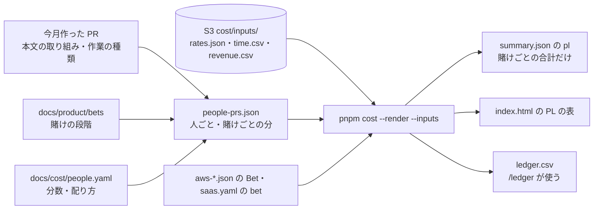

# 設計: 人の時間の見積もり・賭けごとの損益(PL)・`/ledger`

> **AI 用の設計書。省略せずに網羅的に書く(正はこちら)。** 人はこれを開かず、PR の本文の「人向けのまとめ」を見る([guides/human-review.md](../guides/human-review.md))。
> 仕様: [docs/specs/0020-people-time-and-bet-pl.md](../specs/0020-people-time-and-bet-pl.md)・ADR: [0033](../adr/0033-people-time-and-bet-pl.md)
> 状態: 下書き
> 観点の順は [review-viewpoints.md](../review-viewpoints.md)。費用のページ(設計書 0019 の ②)の上に積む。

## 0. 全体像

費用のページ(`pnpm cost`)に、人の時間と賭けごとの PL を足す。人の時間は ① PR からの自動の目安(本文の「取り組み」で賭けに分け、1件あたりの分数を掛ける)と ② 週ごとの手入力の2つを並べて幅にする。時給と売上は使う側の非公開の置き場(S3 の `cost/inputs/`)から読み、リポジトリには置かない。同じ集計から、月1回の `/ledger` の案の CSV(資産の候補・費用・除却の候補)を作る。

## 作業の前に読んだ物(ガイド)

- `docs/guides/bets-and-assets.md`(PR の色分け・案の表・リポジトリに置く物と置かない物。「月1回の集計と、AWS の費用を賭けに割り振るタグは、まだ無い」→ ここで作る)
- `scripts/bets-lib.mjs`(`checkPrBody` が取り組み・作業の種類・段階・区分の案を返す。`proposalOf` が案の表。`parseBet` が段階)。`.github/workflows/pr-work.yml`(全部の PR の本文に取り組みと作業の種類がある。ボットは保守)
- 設計書 0019(費用のページ・`scripts/evidence/lib.mjs` の束ね方・ADR 0032 の非公開の置き場)
- `docs/concepts/stages.md` の 4.(PMF の前は人と AI のほうがインフラより高い)
- 持ち主が依頼で伝えた `/ledger` の案(月1回・資産と費用の区分の案と CSV。要旨は仕様 0020 の「決めたこと」)

## 1. 設計方針

- 新しい台帳を作らない。賭けの分け方は PR の本文の「取り組み」(CI が形を保証)と AWS のタグ `Bet`(設計書 0019)と `saas.yaml` の `bet` に乗る
- 金額の元(時給・売上)と人ごとの時間の手入力は**リポジトリに置かない**(bets-and-assets.md の「置かない物」)。`cost.yml` が S3 の `cost/inputs/` から落とし、`--inputs` で渡す。手元では任意のフォルダ
- ページと `summary.json` には**賭けごとに足した後の数だけ**を出す。人ごとの時間と金額は出さない(`people-prs.json` には人ごとの分があるが、非公開の置き場だけ)
- 時間は推定。自動の目安と手入力の**幅**で見せ、判定(赤字・黒字・分からない)は幅で決める
- 案は出すが決めない(区分の確定は人と専門家)

## 2. データモデル

DB は触らない。

### `docs/cost/people.yaml`(リポジトリ。金額は無い)

| 欄 | 既定 | 意味 |
|---|---|---|
| `minutes.ai_pr_check` | 15 | AI が書いた PR を人が確かめる分 |
| `minutes.human_pr` | 120 | 人が書いた PR の分 |
| `minutes.bot_pr_check` | 5 | ボットの PR を確かめる分(人の名前は「(ボットの PR の確認)」) |
| `minutes.review` | 20 | 作った人以外のレビュー1回 |
| `minutes.comment` | 3 | コメント1件(作った人に付ける) |
| `ai_markers` | Claude Code の署名 | 本文にあれば AI の PR |
| `allocation` | `people_auto` | 共通の費用の配り方(U-1) |
| `max_prs` | 300 | 1か月に数える PR の上限 |

### 非公開の入力(`s3://<COST_BUCKET>/cost/inputs/`。見本は `docs/cost/inputs-example/`)

| ファイル | 形 | 中身 |
|---|---|---|
| `rates.json` | `{ "default": 円/時, "people": { "@名前": 円/時 } }` | 時給 = 年の給与 × 1.3〜1.5 ÷ 年の働く時間(約1,800〜2,000)。業務委託は請求の時給 |
| `time.csv` | `week_start,person,bet,percent,hours` | 週ごと・人ごとの賭けの割合と、その週に働いた時間。`week_start` の月で数える |
| `revenue.csv` | `month,bet,jpy` | 月ごとの売上。`bet` は `B-NNNN` か `全体` |

### 出す物(費用の束に足す)

- `people-prs.json`(`pnpm cost --only people`): `{ month, config, truncated, prs: [{ number, bet(B-NNNN か core), work, kind, stage, proposal, ai, minutes: { "@名前": 分 } }] }`
- `summary.json` の `pl`: `{ allocation, shared_jpy, allocated_jpy, rows: [賭けごと+core], total }`。行は `bet・stage・revenue・infra・saas・shared・hours_auto・hours_manual・people_auto_yen・people_manual_yen・people_low・people_high・cost_low・cost_high・profit_low・profit_high・verdict`
- `ledger.csv`: `月,賭け,段階,もと,区分の案,時間(自動の目安),金額(円・自動の目安),金額(円・手入力を配る),根拠`

## 3. API

アプリの API は足さない。コマンド:

| コマンド | すること |
|---|---|
| `pnpm cost --out <dir> --only people` | 今月作った PR を数えて `people-prs.json` を書く(GitHub を読む) |
| `pnpm cost --render <dir> --inputs <dir>` | 費用のページに PL の表を足し、`ledger.csv` も書く。入力のファイルは出す側(`<dir>`)に写さない |
| `/ledger`(スキル) | 前の月の `ledger.csv` を確かめ、1行ずつ案を見せ、確かめた区分を賭けのファイルの「会計区分の判定」に足す(人の OK の後) |

## 4. 状態遷移

該当なし(毎回作り直す集計)。賭けの段階は `docs/product/bets` のいまの段階を使う(月の途中で段階が変わったら、いまの段階で案を出す。`/ledger` で人が直す)。

## 5. システム間連携

- GitHub(読むだけ): `search/issues?q=repo:… is:pr created:>=月初`(100件ずつ・上限 300)と `pulls/<番号>/reviews`。`CHECKUP_TOKEN` があればそれで読む
- AWS: `cost.yml` が prod の役割 `…-cost` で `cost/inputs/` を読む(`s3:GetObject`・前の字を絞った `s3:ListBucket`・`kms:Decrypt`)。書くのは人(コンソールか CLI)

## 6. 業務ルール

### 人の時間(自動の目安)

- 今月作った PR(`created` が今月)だけを数える。PR ごとに: 作った人 = AI の PR なら `ai_pr_check`・人の PR なら `human_pr`(ボットなら「(ボットの PR の確認)」に `bot_pr_check`)+コメントの数 × `comment`。作った人とボット以外のレビュー1回ごとに、レビューした人に `review`
- 賭け = 本文の「取り組み」が `bet:B-NNNN` ならその賭け、ほか(保守・不具合・基盤・セキュリティ・ボット)は `core`(土台)
- 区分の案 = `checkPrBody` の `proposal`(案の表。賭けの段階 × 作業の種類)

### 人の時間(手入力)

- `time.csv` の `week_start` が今月の行だけ。時間 = `hours × percent / 100`

### 費用(円)

- 人: 分 ÷ 60 × 時給(`people` に無い人は `default`)。自動の目安と手入力の小さい方が下・大きい方が上。片方しか無ければ両方その値。時給が無ければ人の費用は出さず「単価なし」
- 直接: インフラ = AWS のタグ `Bet` がその賭けの分・SaaS = `saas.yaml` の `bet` がその賭けの分
- 共通 = AWS の `core` とタグなし+`saas.yaml` の `core`+Actions。`allocation` で賭けに配る(`people_auto`: 自動の目安の割合・`people_manual`: 手入力の割合。決めた方に賭けの時間が無ければもう一方・`none`: 配らない)。配れない・配らない分は土台の行に残る
- 原価 = 直接+配り分+人(下・上)。粗利 = 売上 − 原価(上・下)
- 判定: 時給が無い → 単価なし / 売上が無い → 売上なし / 粗利の上 < 0 → 赤字 / 粗利の下 ≧ 0 → 黒字 / ほか → 分からない(幅の中)
- 全体: 売上は `revenue.csv` の今月の全部(`全体` を含む)。原価は全部の直接+共通+人

### `/ledger` の案

- 人の時間: 賭けごとに、PR の区分の案ごとに時間と円(自動の目安)。手入力の円は、その賭けの自動の目安の区分の割合で配る
- インフラ・SaaS・共通の配り分: 「費用(運用)」(動いている物の運用。作っている途中の環境を資産にするかは人と専門家)
- 根拠: PR の番号

## 7. 要求との対応

| 受け入れ条件(仕様) | 設計のどこ | テスト |
|---|---|---|
| PR を賭けごとに数えて分数を掛ける | 6. 自動の目安 | `scripts/cost/pl.test.mjs`(PR 1件の分数・peoplePrs) |
| 手入力と並べて幅で見せる・推定と明記 | 6. 費用・ページの注記 | `pl.test.mjs`(PL の幅) |
| 時給は非公開の置き場から | 2. 非公開の入力・5. | `pl.test.mjs`(入力・CLI が入力を写さない) |
| 人ごとの金額を出さない | 1. | `pl.test.mjs`(ページ・summary に名前が出ない)・ログに金額を出さない |
| 賭けごとの原価と粗利を幅で・判定 | 6. 費用 | `pl.test.mjs`(黒字・赤字・単価なし・売上なし) |
| 共通の費用を配る・配る前も並べる | 6. 費用(U-1) | `pl.test.mjs`(配り分・配らない) |
| 売上は手で・全体の PL | 2.・6. | `pl.test.mjs` |
| `/ledger` の案の CSV・非公開だけ | 6. `/ledger` の案・`cost.yml` | `pl.test.mjs`(ledger.csv) |

## 8. 非機能

- 性能: PR 300件で GitHub の API を 303回ほど(1〜2分)。上限を超えたら注記
- セキュリティ: 仕様の STRIDE のとおり。入力は読むだけの役割。ページ・summary は賭けごとの合計だけ(人の時給は1人の賭けなら割り戻せる。ページは非公開の置き場だけ)
- 運用: 手引き `docs/guides/cost-dashboard.md` の 6.・`/ledger`
- 費用: 増えない(GitHub の API と S3 の読み取りだけ)

## 9. このプロダクト特有

| 観点 | この変更では |
|---|---|
| テナント分離・権限の表・監査ログ・解約で消す一覧・サポートの代理ログイン・画面の部品 | 該当なし(アプリを触らない) |
| ログの個人情報 | ログは名前と件数だけ(金額・人の名前を出さない) |
| 列の分類 | 該当なし |

## 10. 観点ごとの扱い

| 観点 | 扱い | 理由 |
|---|---|---|
| 業務ルール | 最重要 | 共通の費用の配り方と、区分の案(U-1・U-2)。数字の出し方が判断を左右する |
| 非機能(セキュリティ) | 最重要 | 給与・時給・売上を公開の場所に出さない |
| 設計方針 | 採用 | PR の色分け・タグ `Bet`・案の表に乗る(新しい台帳を作らない) |
| データモデル・要求との対応 | 機械で検証 | `pl.test.mjs` |
| API・状態遷移 | 低優先 | アプリの API は無い |

## 11. 決めたこと(AI が決めた。人に聞かなかった)

- 自動の目安は「今月作った PR」だけを数える — レビューの日付で月をまたいで数えると、1か月に PR ごとのレビューを全部読む必要があり、API の回数が増える。月の境い目の誤差は手入力との幅で見る
- 1件あたりの分数の既定(AI の PR の確認 15分・人の PR 120分・レビュー 20分・コメント 3分・ボットの PR 5分)— 依頼の「AI の PR の確認は10〜20分など」から。`people.yaml` で変えられる
- 賭けの外の PR は全部 `core`(土台)にまとめる — 保守・不具合・基盤・セキュリティは、どの賭けにも付かない共通の時間
- 時給・時間の手入力・売上の置き場は、費用のページと同じ非公開の S3 の `cost/inputs/`(書くのは人・読むのは prod の役割だけ)— 秘密や変数にすると月ごとの売上の更新が手間で、CSV を人が置き換えるだけにできる
- ページは賭けごとの合計だけ。人ごとの時間と金額は出さない — 人の評価に使わない(仕様のやらないこと)
- インフラ・SaaS は `/ledger` の案で「費用(運用)」に置く — 作っている途中の環境を資産に入れるかは会社の方針(U-2 と一緒に専門家に)
- `isBetId` を `scripts/bets-lib.mjs` から書き出して使う(正規表現の重複を避ける)

## 12. 未確定事項(AI の仮決め。人の承認と分けて追う)

> 4つに当たる判断だけ。状態の書き方は [guides/human-review.md](../guides/human-review.md) の 2。`pnpm decisions` がここを読む。**`仮決め` が残る PR はマージしない。**

| 番号 | 工程 | 種類 | 仮決め(設計した事実) | なぜそうしたか | 人が判断する問い | 状態 |
|---|---|---|---|---|---|---|
| U-1 | 設計 | 事業判断 | 共通の費用(土台・タグなしの AWS・共通の SaaS・Actions)は、既定で**人の時間(PR からの目安)の割合で賭けに配る**(`allocation: people_auto`)。配る前の直接の原価も並べる | 「PL で採算が合わない」に後から気づくのを防ぐには、共通の費用も賭けに載せた重い方の数字を見るほうがよい。時間の割合は、賭けに使った力の目安として手に入る中でいちばん素直 | 共通の費用を賭けに配るか。配るなら人の時間の割合でよいか(ほかに: 売上の割合・均等・配らない) | 仮決め |
| U-2 | 設計 | 他チームとの契約や制約 | `/ledger` の区分の案は、キットの案の表のまま(賭けの段階 × 作業の種類。`rollout`・`adopted` の作り込みだけ資産の候補・ほかは費用・撤去は除却の候補)。インフラ・SaaS は費用(運用)。会計・税の当てはめは専門家(税理士・監査法人)が確かめる、と CSV と `/ledger` で毎回添える | 案の表は日本の「自社利用のソフトウェア」の一般的な整理(bets-and-assets.md)。会社の方針(小さい会社は全部費用など)と税務で変わる | 案の出し方はこのままでよいか(導入時に、使う人が自分の税理士と決める物にしてよいか) | 仮決め |

## 13. 作り直しの記録

| 日付 | きっかけ | 入った工程 | 直した物 | 作り直した下流 |
|---|---|---|---|---|
