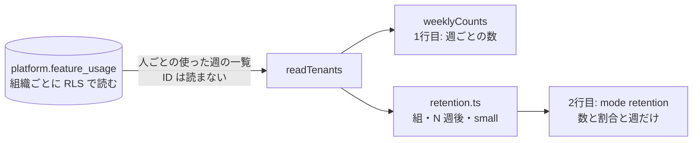

# 設計: 継続率(同じ組織が使い続けたか)

> **AI 用の設計書。省略せずに網羅的に書く(正はこちら)。** 人はこれを開かず、PR の本文の「人向けのまとめ」を見る([guides/human-review.md](../guides/human-review.md))。
> 仕様: [docs/specs/0022-usage-retention.md](../specs/0022-usage-retention.md)
> 状態: 下書き
> 観点の順は [review-viewpoints.md](../review-viewpoints.md)。設計書 0012 の利用の記録(PR ②)の上に積む。

## 0. 全体像

運営のコマンド `usage-report` に、始めた週ごとの継続率(コホート)の行を足す。組織ごとに組織の文脈で「人ごとの使った週の一覧」だけを読み(人の ID は読み出さない)、DB を使わない計算(`apps/api/src/usage/retention.ts`)で、組織と人の組ごとに N 週後の数と割合を出す。表・移行・API は変えない。



## 作業の前に読んだ物(ガイド)

- 仕様と設計書 0012(利用の記録の表・`usage-report`・U-2 人の ID を持つ・U-3 400日)・ADR 0025(機能フラグと利用の記録。A/B は数が足りる段階で)
- `apps/api/src/usage/command.ts`(組織ごとに `withTenant` で読み、数だけを足す。`operator_tenant_ids()` で組織の一覧。運営の組織は除く)
- `docs/guides/bets-and-assets.md` の rollout の確かめ方(線の形「入れた組織の 70% 以上が4週続けて使う」)・`docs/guides/before-pmf.md`(使い続ける人の割合が下がり止まる = PMF の兆し)
- `docs/security.md` の AI-6(AI に渡すのは ID と集計まで)・`docs/compliance/ai-data.md`
- `apps/api/test/integration/usage-records.int.test.ts`(2社+運営の組織・`insertDay`・ID が出ないことの確かめ方)

## 1. 設計方針

- 置き場は今の `apps/api/src/usage/`(共通の仕組み)。計算は DB を使わない純粋な関数に分け(`retention.ts`)、単体テストで境界を確かめる。DB を読むのは `command.ts` だけ。
- 新しいコマンドは足さず、`usage-report` の出力に**2行目**として足す。1行目(`mode: "report"`)の形は変えない(読んでいる人・道具を壊さない)。
- 1組織につき1回だけ読む。今まで週ごとの数に使っていた問い合わせを、人ごとの使った週の一覧(`array_agg`)に置き換え、週ごとの数もそこから出す(読む回数を増やさない)。
- 新しい依存・部品・表・移行は無い。

## 2. データモデル

表は変えない(`platform.feature_usage` を読むだけ)。

読み方(組織ごとに `withTenant`。表の持ち主の接続で、表は FORCE RLS):

```sql
select array_agg(distinct to_char(date_trunc('week', day), 'YYYY-MM-DD')) as weeks
from platform.feature_usage
where tenant_id = $1 and feature = $2 and day <= $until
group by user_id
```

- `user_id` は `group by` にだけ使い、**列として読み出さない**。アプリに来るのは「人ごとの、使った週(月曜)の一覧」の配列だけ。
- `day >= since` で絞らない。始めた週(初めて使った週)は数える週より前かもしれないので、保存期間の中に残る全部を読む。1組織の行は「人の数 × 週の数(最大 58 ほど)」で上限がある。
- `date_trunc('week', …)` は月曜始まり(ISO の週)。日は組織の時間帯での日付(設計書 0012)。

## 3. API

API は足さない。運営のコマンドの出力だけ。

`node dist/cli.js usage-report <機能> [--weeks <週の数>]`(引数は今のまま)の出力:

1. 1行目: 今までの `{"mode":"report", feature, since, until, tenantsTotal, tenantsEnabled, weeks}`(変えない)
2. 2行目(足す):

```json
{"mode":"retention","feature":"morning-digest",
 "cohortsFrom":"2026-09-07","lastFullWeek":"2026-10-19","smallBelow":5,"enabledNeverUsed":1,
 "tenants":{
   "overall":[{"after":1,"size":7,"small":false,"active":6,"activePct":86,"continued":6,"continuedPct":86}, …],
   "cohorts":[{"start":"2026-09-07","size":4,"small":true,"after":[{"after":1,"active":3,"activePct":75,"continued":3,"continuedPct":75}, …]}, …]},
 "users":{ …同じ形… }}
```

| 項目 | 意味 |
|---|---|
| `cohortsFrom` | この週(月曜)から後に始めた組だけ。`since`(`--weeks` から)と、保存期間の端(400日前の日を含む週の次の月曜)の遅い方 |
| `lastFullWeek` | 数え終わった最後の週(先週の月曜)。N 週後はこの週まで |
| `smallBelow` | 大きさがこれより小さい組・足し合わせに `small: true`(6 の S-2) |
| `enabledNeverUsed` | いま入っているのに、保存期間の中で一度も使っていない組織の数(どの組にも入らない) |
| `tenants` / `users` | 組織の単位 / 人の単位。形は同じ |
| `cohorts[].start` / `size` | 始めた週(月曜)と、その週に初めて使った数 |
| `after` | 始めた週から何週後か(1 から)。0 週後(始めた週)はいつも 100% なので出さない |
| `active` / `activePct` | その週に使った数 / 組の大きさに対する割合(整数の %・四捨五入) |
| `continued` / `continuedPct` | 1週後からその週まで毎週使った数 / 割合 |
| `overall[]` | N 週後ごとに、N 週後まで届いた組(`start + N ≤ lastFullWeek`)だけを足した数と割合。`size` は足した組の大きさの合計 |

- 組織の ID・名前・人の ID は出さない(数・割合・週の日付・機能の名前だけ)。
- コマンドの名前・引数・1行目は変えないので、運営の手順の互換は保たれる。`--weeks` の上限(60)も今のまま。

## 4. 状態遷移

該当なし(状態を持たない。読むだけの集計)。

## 5. システム間連携

該当なし(外へ出す物は無い。標準出力に JSON を2行)。

## 6. 業務ルール

- **R-1 組の決め方**: 組織の「使った週」は、組織の中の誰かがその機能を使った週。組織の組は、その中で最も早い週(保存期間の中で初めて使った週)。人の組は、その人が初めて使った週。人の組は組織の組と別に決める(組織が前から使っていても、新しく使い始めた人はその週の組)。
- **R-2 数える範囲**: 始めた週が `cohortsFrom` より前の組織・人は数えない。始めた週はその記録が消えると後ろにずれるので、保存期間の端より前は信用しない。今週に始めた組は大きさだけ出し、`after` は空。
- **R-3 N 週後**: `after = N` は始めた週の N 週後の週。`start + N ≤ lastFullWeek` の物だけ出す(今週は途中なので入れない)。`active` はその週に1回でも使った数。`continued` は 1週後からその週まで毎週使った数(N 週続けて)。`continued ≤ active`。
- **R-4 足し合わせ**: `overall` の N 週後は、N 週後まで届いた組だけを足す(まだ届いていない組を 0 として足すと、新しい組が多いほど低く見える)。
- **S-1 割合**: 整数の %(四捨五入)。分母は組の大きさ(足し合わせは届いた組の大きさの合計)。分母が 0 の行は作らない。
- **S-2 小さい組**: 大きさが `RETENTION_SMALL_BELOW`(5)より小さい組・足し合わせには `small: true` を付け、**数と割合はそのまま出す**。手順書では「`small` の行の割合だけで線を判定しない。足し合わせの行で読み、`small` なら数(何組織中いくつ)と話を聞いた結果を一緒に見る」とする。小石には足し合わせの割合で書き、組ごとの行は書かない(小さい組の割合は、どの組織がいつ始めたかを知っている人には個社の振る舞いになる)。
- **R-5 使っていない組織**: 機能が入っていて記録が一度も無い組織は `enabledNeverUsed` に数え、組に入れない。「入れた組織のうち N 週続けた割合」は `continued ÷ (組の大きさ + enabledNeverUsed)` で読める(手順書)。今入っているかで数えるので、切った組織はここに入らない。
- **R-6 除く物**: 運営の組織(`SUPPORT_TENANT_ID`)は数えない。代理ログインの社員と運営の組織の人の操作は、記録の時点で入っていない(設計書 0012)。
- 境界: 記録が1件も無い機能 → 1行目は今までどおり、2行目の `cohorts`・`overall` は空。`--weeks 1` → 今週の組だけで `after` は空。組の大きさ 1 → `small: true` で 0% か 100%。

## 7. 要求との対応

| 受け入れ条件(仕様) | 設計のどこ | テスト |
|---|---|---|
| 1行目に続けて継続率の行が出る。1行目の形は変えない | 3. API | `test/integration/usage-records.int.test.ts` の「コマンドの入口」・「集計は週ごとの…」(1行目の数が今までと同じ) |
| 初めて使った週で組にし、N 週後の `active` と `continued` が出る | 6. R-1・R-3 | `test/unit/usage-retention.test.ts` の「組織は初めて使った週でまとめ…」・結合の「継続率: …」 |
| 足し合わせの行(届いた組だけ) | 6. R-4 | 単体の「組織は初めて使った週でまとめ…」(3週後は1組だけ)・結合の `users.overall` |
| 人の単位でも出る(組織の組とは別) | 6. R-1 | 単体の「人は人ごとに…」・結合の `users.cohorts` |
| 数え終わった週だけ | 6. R-3 | 結合(今週 10-20 の記録が `after` に入らない)・単体(今週に始めた組は `after` が空) |
| 数える週より前・保存期間の端より前に始めた物は入れない | 6. R-2・3. の `cohortsFrom` | 単体の「from より前に始めた物は数えない…」・結合(b の閲覧者が 09-15 に始めて、b が組に入らない) |
| 入っているのに使っていない組織の数 | 6. R-5 | 結合の `enabledNeverUsed: 1` |
| 小さい組に `small` | 6. S-2 | 単体の「大きさが 5 以上の組は small ではない…」 |
| 組織と人の ID を出さない・運営の組織を数えない | 2.(ID を読まない)・6. R-6 | 結合の「継続率: …」(4つの組織と全部の人の ID が出力に無い・運営の組織の記録が入らない)・単体の「使っていない組織は…出す物に週と数のほかは無い」 |
| 集計は組織ごとに文脈を付けて読む | 2. | 結合(`withTenant` で読む今までの形のまま。RLS は「アプリの接続は読む・足すだけ…」が確かめる) |

## 8. 非機能

- 性能: 組織ごとに1回の問い合わせ(今と同じ回数)。行は `feature_usage_feature_day_idx`(tenant_id, feature, day)で絞る。今までより `day >= since` の絞りが無くなるぶん読む行が増えるが、1組織あたり「人の数 × 保存期間の週の数」が上限。計算は組 × N 週後 × 組の中の数で、運営が手で流す頻度(週1回ほど)では問題にならない。組織が数千になったら、組織ごとのトランザクションを流す時間が先に効く(今の `usage-report` と同じ)。
- セキュリティ: 仕様の STRIDE のとおり。人の ID はアプリに読み出さない。出力は数と割合と週の日付だけ。
- 運用: 手順書 `docs/runbooks/usage-records.md` の「数える」に2行目の読み方と、小石への書き方を足す。ログは出さない(標準出力の JSON だけ)。
- 費用: 増えない(読むだけ・新しい資源は無い)。

## 9. このプロダクト特有

| 観点 | この変更では |
|---|---|
| テナント分離 | 組織ごとに `withTenant` で読み、組織の ID は数を足すときにも使わない(出力にも入らない)。表は FORCE RLS のまま |
| 権限の表 | 該当なし(API を足さない) |
| 監査ログ | 該当なし(書き込みが無い・お客さんの組織の操作ではない) |
| 解約で消す一覧 | 該当なし(表を足さない。`platform.feature_usage` は既に `TENANT_TABLES` にある) |
| サポートの代理ログイン | 代理ログインの社員の操作は記録に入らない(今までどおり)。集計は運営のコマンドで、代理ログインとは関係しない |
| ログの個人情報 | ログに出さない。標準出力は数・割合・週・機能の名前だけ |
| 列の分類(`personal` / `sensitive`) | 列を足さない。`user_id`(internal)は `group by` にだけ使う |
| 画面の部品 | 該当なし |

## 10. 観点ごとの扱い

| 観点 | 扱い | 理由 |
|---|---|---|
| 設計方針 | 軽く確認 | 今の `usage-report` の2行目に足すだけ。表・API・依存は無い |
| データモデル | 低優先 | 表を変えない。読み方が `array_agg` に変わるだけ |
| API | 軽く確認 | コマンドの1行目は変えない。2行目は足すだけ |
| 状態遷移 | 低優先 | 状態が無い |
| システム間連携 | 低優先 | 外に出さない |
| 業務ルール | **最重要** | 継続率の数え方(組・N 週後・`active` と `continued`・足し合わせ・小さい組)で、賭けの進む・やめるの読み方が変わる |
| 要求との対応 | 機械で検証 | 単体と結合のテスト |
| 非機能 | 軽く確認 | 読む回数は同じ。読む行は保存期間ぶんに増える |
| ログの個人情報・テナント分離 | 採用 | ID を出さないこと・人の ID を読み出さないことを結合テストで確かめる |

## 11. 決めたこと(AI が決めた。人に聞かなかった)

- `active`(N 週後に使った)と `continued`(N 週続けた)の**両方**を出す — 賭けの線の書き方(「4週後も使う」と「4週続けて使う」)のどちらにも当てられる。片方に決めると、線の意味を AI が決めることになる。どちらで読むかは賭けの線に書く(手順書)
- 新しいコマンドにせず `usage-report` の2行目に足す — 運営が打つコマンドを増やさない。1行目を変えないので、今の手順と読む道具は壊れない
- 組は「初めて使った週」(入れた週ではない) — 依頼のとおり。入れた日は `on` の機能には無く、`feature_flags` の行の日付は運営が入れ直すと変わる。入れた組織のうちの割合は `enabledNeverUsed` と組み合わせて読める(R-5)
- 小さい組は**隠さず**、`small: true` を付けて数と割合を出す(S-2)。境い目は 5 — PMF の前の rollout は数組織で、隠すと線をまったく測れなくなる(運営は数を手で割れば同じ割合を出せるので、隠しても守りにならない)。数と割合は集計で、AI-6 の「ID と集計まで」に入る。5 は「1組織の違いで割合が 20 ポイント以上動く」境い目で、手順書で「`small` の行の割合だけで判定しない」と添えれば十分。境い目はコードの定数で、戻せる
- 足し合わせは届いた組だけを足す(R-4) — まだ N 週たっていない組を 0 として足すと、新しい組が多いほど低く見える
- 今週は N 週後に入れない(R-3) — 途中の週を「使わなかった」と数えると、水曜に流すと金曜に流すより低く出る
- 始めた週は保存期間の中の記録から決め、保存期間の端より前に始めた物は数えない(R-2) — 400日を過ぎた記録は消えるので、それより前に始めた組織が「後から始めた」に見える
- 割合は整数の %(四捨五入) — 小石には % で書く。小数を出しても、PMF の前の数では意味のある桁にならない
- 人の ID は SQL で `group by` にだけ使い、読み出さない — 出力に入らないことに加えて、アプリのメモリにも載せない(層を重ねる)
- 週ごとの数(1行目)も同じ読み方から出す — 組織ごとの問い合わせを1回のままにする。結合テストの1行目の数が今までと同じことで確かめる
- ADR は書かない — 表・依存・境い目を越える決めごとが無く、数え方の決まりはこの設計書の 6 で足りる

## 12. 未確定事項(AI の仮決め。人の承認と分けて追う)

> 4つに当たる判断だけ。状態の書き方は [guides/human-review.md](../guides/human-review.md) の 2。`pnpm decisions` がここを読む。**`仮決め` が残る PR はマージしない。**

該当なし(数え方と小さい組の扱いは、事業判断・利用者の挙動・他チームとの契約・戻せないリスクのどれにも当たらない。理由は 11)。

## 13. 作り直しの記録

| 日付 | きっかけ | 入った工程 | 直した物 | 作り直した下流 |
|---|---|---|---|---|
