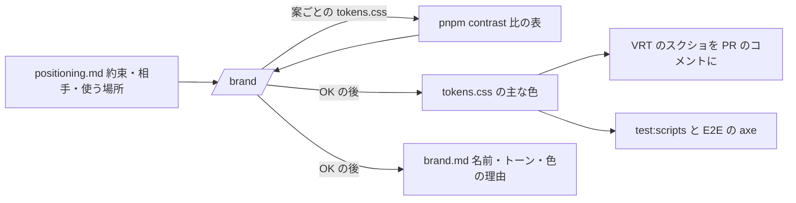

# 設計: ブランド(名前・トーン・色)を決める段取り(`/brand`・`pnpm contrast`)

> **AI 用の設計書。省略せずに網羅的に書く(正はこちら)。** 人はこれを開かず、PR の本文の「人向けのまとめ」を見る([guides/human-review.md](../guides/human-review.md))。
> 仕様: [docs/specs/0024-brand.md](../specs/0024-brand.md)・ADR: [0037](../adr/0037-promise-before-lp-and-brand.md)
> 状態: 下書き
> 観点の順は [review-viewpoints.md](../review-viewpoints.md)。当てはまらない節も消さずに「該当なし(理由)」と書く。

## 0. 全体像

約束(`positioning.md`)と相手から、名前(仮)・話し方のトーン・色の案を出して選んでもらうスキル `/brand` と、置き場 `docs/product/brand.md`、色の案のコントラストの比を計算する `pnpm contrast` を足す。色は `packages/ui/src/tokens.css` の主な色を置き換えた PR にし、VRT のスクショで人が決める。

## 作業の前に読んだ物(ガイド)

- `docs/design-system.md`: トークンを決めるのは人・AI は案と比の計算。生の色コードは Semgrep(`apps/web/src/` だけ)。axe(E2E。WCAG 2.2 AA)。VRT(部品の一覧と主な画面)。
- `packages/ui/src/tokens.css`: `:root`(明るい)と `@media (prefers-color-scheme: dark)` の中の `:root`(暗い。色だけを上書き)。`--color-overlay` は `rgb()`、QR の色は暗いテーマで上書きしない。
- `packages/ui/src/styles.css`: どの前景がどの背景に乗るか(本文・面・主と危険のボタン・リンク・エラー・札・お知らせ・フォーカスの枠・チェックボックス・トーストは文字と背景の反転)。
- `docs/guides/vrt.md`・`apps/web/playwright.vrt.config.ts`: 明るいテーマだけを撮る(パソコン 1280px・スマホ 390px)。結果は `vrt.yml` が PR のコメントに。撮り直しは `pnpm vrt:update` か、人が付けるラベル `vrt:update`。
- `docs/guides/labels.md`: `vrt:update` を付けるのは人。
- `scripts/bets-lib.mjs`・`scripts/adr.test.mjs`: 中身(`-lib.mjs`)・入口・`node --test` の型。正規表現を使わずに読む(Semgrep の regex_dos)。
- `.claude/skills/positioning/SKILL.md`(仕様 0023): 約束・誰への約束か・使う場所・言わないこと。

## 1. 設計方針

- スキル `/brand` と資料 `brand.md`(型は `docs/product/_template-brand.md`)は、`/positioning` と同じ型(1問ずつ・OK の前に書かない・足すだけの節)。
- **比は道具で出す**(`scripts/contrast-lib.mjs`・入口 `scripts/contrast.mjs`・`pnpm contrast`)。AI が頭で計算した比は誤る。依存は足さない(式は WCAG の相対輝度。数十行)。
- CI のワークフローは触らない。いまの `tokens.css` の比を確かめるテストを `scripts/contrast.test.mjs` に置き、既にある `pnpm test:scripts`(ci.yml の fast)で回す。
- 色の正は `tokens.css`。`brand.md` は理由と比の写し。

## 2. データモデル

該当なし(DB を変えない)。

`pnpm contrast` が見る組(`PAIRS`):

| 前景 | 背景 | 区分 | 要る比 | どこ |
|---|---|---|---|---|
| text | bg / surface | 文字 | 4.5 | 本文・面の上 |
| text-muted | bg / surface | 文字 | 4.5 | 補足 |
| on-primary | primary / primary-hover | 文字 | 4.5 | 主のボタン |
| on-danger | danger / danger-hover | 文字 | 4.5 | 危険のボタン |
| primary | bg / surface | 文字 | 4.5 | リンク・文字だけのボタン |
| danger | bg / surface | 文字 | 4.5 | エラーの文 |
| info | bg / surface | 文字 | 4.5 | お知らせ |
| success・warning | bg | 文字 | 4.5 | 札 |
| focus | bg / surface | 文字でない物 | 3 | フォーカスの枠(WCAG 2.2 の 1.4.11) |
| primary | bg | 文字でない物 | 3 | 選んだチェックボックス |
| border | bg | 参考 | 3 | 枠の線(落とさない) |

`brand.md` の節: 状態・元にした約束・見直す時 / 相手と使う場所から来る条件 / 名前と確かめること / トーン(一言・する・しない・例文)/ 色(トークンごと・比)/ 文字 / ロゴ / 選ばなかった案(足すだけ)/ これまでの判断(足すだけ)。

## 3. API

該当なし(アプリの API は無い)。コマンド:

- `pnpm contrast` … `packages/ui/src/tokens.css` を読む。
- `pnpm contrast <a.css> [<b.css> …]` … 案ごとのファイルを並べて読む。
- 出力: ファイルごと・テーマごとの Markdown の表。届かない組(参考を除く)が1つでもあれば 1 で終わる。

## 4. 状態遷移

`brand.md` の状態: 無い → `仮`(約束が仮・名前の商標をまだ確かめていない)→ `決めた`。約束を変えた・正式な名前を決めたら見直し(判断に1行)。

## 5. システム間連携

- 読む: `docs/product/positioning.md`・`plan.md`・(あれば)`brand.md`・`tokens.css`・`docs/design-system.md`。
- 書く: `brand.md`・`tokens.css`・VRT の基準の画像(`pnpm vrt:update`)・PR。
- 外: Web で同じ名前のサービスを下調べ(出典つき)。商標(J-PlatPat)は人が確かめる。外のサービスの SDK は足さない(委託先の台帳は変えない)。Web フォントを外から読むことはしない。

## 6. 業務ルール

- 約束が無ければ始めない(`/positioning` へ。仮の約束でよい)。
- 案は2〜3つずつ。理由(約束の言葉・相手の条件)を付ける。
- 置き換えるのは主な色の5つ(primary・primary-hover・on-primary・focus・info)。明るいテーマと暗いテーマの両方。ほかの色は理由なしに変えない。主な色を危険・注意の色と紛れる色にしない。
- 届かない組がある案は出さない(明るさを変えて届かせ、そう書く)。屋外のスマホなどでは 7:1 を目安として、届くかを書く。
- 比は切り捨てで小数2桁。
- 名前は商標・ドメイン・同じ名前のサービスを確かめるまで `仮`。
- 文字は既定で端末の文字。Web フォントは `packages/ui` に置いて自分で配り、許諾を確かめる。
- PR の危険度は「中」。比の表を本文に、VRT のスクショは `vrt.yml` がコメントに。暗いテーマは VRT で撮らないので手元で1回見る。キーボードでフォーカスの枠を人が1回確かめる。

## 7. 要求との対応

| 受け入れ条件(仕様) | 設計のどこ | テスト |
|---|---|---|
| 約束が無ければ `/positioning` へ・何も書かない | 6. | 手で1回(スキル) |
| トーン・名前・色の案を2〜3つ、理由つき | 6. | 手で1回 |
| 色は主な色を両方のテーマで・比の表・届かない案は出さない | 2.・3.・6. | `contrast.test.mjs`(比の式・読み方・落とす組) |
| 意味の色は変えない | 6. | 手で1回・VRT の差 |
| 名前は確かめるまで仮 | 4.・6. | 手で1回 |
| OK の前に書かない | スキル | 手で1回 |
| OK の後に brand.md・tokens.css・contrast・VRT・PR(中) | 5.・6. | `contrast.test.mjs`(いまの tokens.css が届く)・VRT |
| 下書きの PR を並べて見比べられる | スキルの 5 | 手で1回 |
| 足すだけの節 | 2. | 手で1回 |
| `pnpm contrast` が組ごとに比・表 | 3. | `contrast.test.mjs` |
| 届かない組で 1・参考は落とさない | 3. | `contrast.test.mjs` |
| 切り捨て | 2. | `contrast.test.mjs`(#777777 と白で 4.47) |
| ファイルを並べて比べる | 3. | 手で1回(`pnpm contrast a.css b.css`) |
| いまの tokens.css が届く(CI) | 1. | `contrast.test.mjs` |
| before-pmf・design-system・カタログ | 資料 | `pnpm kit:catalog`・`pnpm self-contained` |

## 8. 非機能

- 性能: 該当なし(CSS を1つ読むだけ。ms)。
- セキュリティ: 仕様の STRIDE のとおり。
- 運用: `pnpm contrast` は手元で打つ。CI はテスト(`pnpm test:scripts`)で、いまの `tokens.css` を確かめる。
- 費用: 0円。
- 分かっていること(今回は直さない): 枠の線(`--color-border` と背景)は明るいテーマで 1.45:1・暗いテーマで 1.92:1。入力欄は見える名前(label)があるので参考にした。WCAG 2.2 の 1.4.11 をどこまで当てるかは、デザインシステムの判断として人に回す(PR の本文に書く)。

## 9. このプロダクト特有

| 観点 | この変更では |
|---|---|
| テナント分離 | 該当なし |
| 権限の表 | 該当なし |
| 監査ログ | 該当なし |
| 解約で消す一覧 | 該当なし |
| サポートの代理ログイン | 該当なし |
| ログの個人情報 | 該当なし |
| 列の分類(`personal` / `sensitive`) | 該当なし |
| 画面の部品 | この PR では `tokens.css` を変えない。`/brand` の PR がトークンを変える(部品は変えない) |

## 10. 観点ごとの扱い

| 観点 | 扱い | 理由 |
|---|---|---|
| 設計方針 | 採用 | 比は道具で出す。CI は触らずテストで確かめる |
| 業務ルール | 最重要 | 約束が先・意味の色を変えない・届かない案を出さない・名前は仮 |
| 要求との対応 | 機械で検証 | `contrast.test.mjs` |
| 非機能 | 軽く確認 | 枠の線の比(8.)を人に回す |
| 画面の部品 | 軽く確認 | トークンを変えるのは使う人の PR |
| データモデル・API・状態遷移・システム間連携 | 低優先 | アプリを変えない |

## 11. 決めたこと(AI が決めた。人に聞かなかった)

- **比はスクリプトで出す(依存を足さない)** — WCAG の式は短く、外のパッケージ(色のライブラリ)を足すほどではない。AI の頭の計算や外のサイトより、同じ答えが出る。
- **CI のワークフローは触らず、`pnpm test:scripts` のテストで、いまの `tokens.css` を確かめる** — `.github/` は危険度「高」。テストは既に CI(fast)で回っている。色を変えた PR は axe より早く落ちる。
- **組は `styles.css` で実際に重なる物だけ** — 全部の組み合わせを出すと、使わない組の「届かない」が混ざって読めない。
- **フォーカスの枠と選んだ印は 3:1、枠の線は参考** — 文字でない物は 1.4.11 の 3:1。枠の線はいまの既定(1.45:1)が届かず、入力欄には見える名前があるので、落とさずに出す(8. で人に回す)。
- **切り捨てで小数2桁** — 4.499 を 4.5 と出すと、届かない色を通してしまう。
- **置き換えるのは主な色の5つ** — 危険・成功・注意は意味の色で、ブランドで変えると「赤 = 危ない」が崩れる。文字・背景は比の土台。
- **暗いテーマも同じ5つを置き換える** — `tokens.css` に暗いテーマがあり、`prefers-color-scheme` で利用者に出る。明るいテーマだけ変えると、暗いテーマだけ元の青が残る。
- **名前は商標を確かめるまで `仮`** — 名前は後から変えるのが高い(ドメイン・チラシ・登記)。確かめるのは人と弁理士。キットは確かめることを並べるだけ。
- **文字は既定で端末の文字** — 外の配信から読むと利用者の情報が外へ出る(委託先の台帳・外部送信の公表)。日本語の Web フォントは重い。
- **ロゴは作らない** — 絵はキットの外(人・デザイナー)。brand.md に置き場の行だけ。

## 12. 未確定事項(AI の仮決め。人の承認と分けて追う)

> 4つに当たる判断だけ。状態の書き方は [guides/human-review.md](../guides/human-review.md) の 2。`pnpm decisions` がここを読む。**`仮決め` が残る PR はマージしない。**

| 番号 | 工程 | 種類 | 仮決め(設計した事実) | なぜそうしたか | 人が判断する問い | 状態 |
|---|---|---|---|---|---|---|

なし(4つに当たる判断が無い。名前・トーン・色は、使う人が `/brand` の中で毎回決め、PR で人が承認する。キットの `tokens.css` は変えない)。枠の線の比(8.)は、この変更の判断ではなく、いまのデザインシステムについて分かったことなので、PR の本文で人に知らせる。

## 13. 作り直しの記録

| 日付 | きっかけ | 入った工程 | 直した物 | 作り直した下流 |
|---|---|---|---|---|
