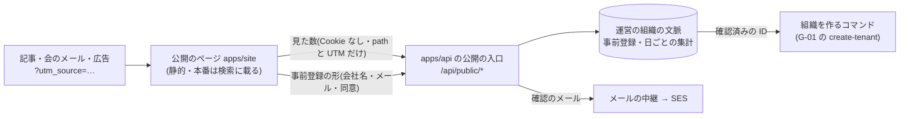

# 設計: 公開してよい LP の型(検索に載る・どこから来たかを測る・事前登録を本物の組織につなぐ)

> **AI 用の設計書。省略せずに網羅的に書く(正はこちら)。** 人はこれを開かず、PR の本文の「人向けのまとめ」を見る([guides/human-review.md](../guides/human-review.md))。
> 仕様: [docs/specs/0025-public-landing-page.md](../specs/0025-public-landing-page.md)・設計判断: [ADR 0038](../adr/0038-public-landing-page.md)
> 状態: 承認済み(未確定事項 U-1〜U-4 は全部答え済み。@attumkwg 2026-10-25 会話で「全部おすすめどおり」)。実装: 事前登録の受け口(① の PR)・公開のページ(② の PR)
> 観点の順は [review-viewpoints.md](../review-viewpoints.md)。当てはまらない節も消さずに「該当なし(理由)」と書く。

## 0. 全体像

人を呼ぶ公開のページ(LP)の型と、そこで集める事前登録の扱いを決める。おすすめ(U-1 の仮決め)は **キットの中に静的な公開のページ `apps/site` を持ち(S3+CloudFront・本番は検索に載る)、事前登録は自前の API と DB で受け、計測は Cookie を使わず外へ送らずに自前で数える**。外の CMS で作る道も手引きで残し、そのときキットが持つのは「言葉と色を写す段取り」と「事前登録を本物の組織につなぐ所」だけ。
この PR で入れるのは、どの置き場所でも要る物(手引き・同意の文の型・計測の同意の考え方)と、この設計書・ADR まで。`apps/site`・API・表は U-1 の答えのあと。



## 作業の前に読んだ物(ガイド)

- 試作: `docs/guides/prototypes.md`・ADR 0020・`prototypes/B-0002-morning-digest/src/screens/SignUp.tsx`。申し込みのページは「利用目的の一文・同意のチェック・どこにも送らない」。守りは `index.html` の noindex と CloudFront の `X-Robots-Tag`、`pnpm prototypes` が本物の API・`.env`・`VITE_*` を読むと落とす。**だから LP には使えない**(試作の守りを緩めない。混ぜると試作の偽のデータの約束が崩れる)
- 画面の表側: 仕様と設計書 0015。`apps/web` は本番でも全部 noindex(`INDEXABLE_PATHS` は空。U-1 は導入時に決める)。LP を `apps/web` に入れると、ログインの後ろと同じサーバー・同じ守りのヘッダーに公開の宣伝が乗る
- 規約と同意: `docs/guides/legal-documents.md`・ADR 0022・設計書 0009。同意は「確認欄へのチェック・ボタンを押す」で取ってよい。プライバシーポリシーの版は `packages/shared/src/legal.ts` の `LEGAL_VERSIONS`。同意の記録は `legal.consents`(組織の利用者のための表。ログインしていない人は入らない)
- 委託先の台帳: `docs/compliance/vendors.yaml`(外のサービスの SDK・新しい種類の AWS の資源・Actions を足したら1件か1行。CI)。メールは AWS(SES)が既に台帳にある
- ログ: `packages/logging` の許可リスト(ADR 0019)。AI に渡すのは ID と集計まで(`docs/security.md` の AI-6・`docs/compliance/ai-data.md`)
- データの保存と削除: `docs/guides/data-retention.md`(置き場所ごとの期間の表。表を足したら行を足す)
- 運営の組織: `SUPPORT_TENANT_ID`(ADR 0014)。社員は運営の組織の管理者・メンバー。運営のコマンドは `apps/api/src/cli.ts`
- 列の分類: `apps/api/src/db/classification.ts`(列を足したら1行。CI)
- 想定の場面: 売る場面の 8-3(LP)・8-6(申込から開通)、決める順番(言葉 → LP → 色)

## 1. 設計方針

- **試作と LP は分ける**。試作は「偽のデータ・検索に載らない・外へ送らない・捨てる」。LP は「本物の人の個人情報を集める・検索に載る・測る・残す」。守りの向きが逆なので、同じ型に寄せない。
- **置き場所(U-1)のおすすめは案 a**(キットの中に `apps/site`)。理由は ADR 0038:
  1. 約束と売り文句・トークン(`packages/ui/src/tokens.css`)の**正が1つ**のまま LP に出る(AI が PR で直し、axe と VRT が見る)。外の CMS だと写し忘れでずれる。
  2. 事前登録が**自前の DB に同意の版つきで残り**、本物の組織を作るコマンドの入力にそのまま使える。外のフォームだと、個人情報を CSV で人が運ぶことになり、委託先も1社増える。
  3. 費用は試作と同じ形(S3+CloudFront)で 月 0〜数十円。
  弱い所: 文を変えるのに PR とデプロイが要る(AI が案を出し、人が OK するだけにする)・見たまま編集が無い・記事やブログは向かない(外の CMS に任せる)。
- **計測(U-2)の既定は「外へ送らずに自前で数える」**。Cookie も端末の ID も使わない。数えるのは日ごと・ページごと・来た所(UTM)ごとの「見た数・登録の数・確認の数」だけ。外の解析・広告のタグは、入れると決めたら同意の帯・公表・委託先の台帳が要る(手引きの「計測」)。
- **事前登録は運営の組織の持ち物**として、運営の組織の `tenant_id` で持つ。新しい表の決まり(`tenant_id` と RLS)をそのまま守れ、解約の削除・代理ログインの外に置ける。公開の入口は、テナントをリクエストから決めず、**サーバーの設定(`SUPPORT_TENANT_ID`)に固定**する。
- 外の CMS で作る道(案 b)も手引きで残す。そのときキットが持つのは、言葉と色を写す段取りと、事前登録を受ける所(CMS の形から自前の入口へ送るか、運営のコマンドで取り込む)だけ。

## 2. データモデル

> U-1 が案 a・c のときの実装の PR で入れる(`.claude/skills/db-migration`)。案 b でも「事前登録を本物の組織につなぐ所」は要るので、表 `growth.pre_registrations` はどの案でも入れる見込み(案 b のときは公開の入口の代わりに取り込みのコマンド)。

新しい領域 `growth`(集客)。スキーマ `growth`。

### `growth.pre_registrations`(事前登録)

| 列 | 型 | 分類 | 目的 |
|---|---|---|---|
| `id` | uuid | internal | 組織を作るコマンドに渡す ID |
| `tenant_id` | uuid | internal | 運営の組織(`SUPPORT_TENANT_ID`)。RLS のため |
| `email` | text(254 まで・小文字に寄せる) | personal | 確認のメールと、提供開始の案内・試しの利用の招待。組織を作るときの最初の管理者 |
| `organization_name` | text(100 まで) | personal | 組織を作るときの名前の案(個人事業だと人の名前が入りうるので personal) |
| `company_size` | text(`1-9` / `10-49` / `50-299` / `300+` / 空) | internal | 誰が来ているかの集計 |
| `utm_source`・`utm_medium`・`utm_campaign` | text(各 100 まで・英数と `-_.` だけ。外れたら空) | internal | どこから来たか |
| `landing_path` | text(200 まで。クエリを落とした path だけ) | public | どのページで登録したか |
| `consent_text_version` | integer | internal | 同意の文の版(手引きの型。文を変えたら版を上げる) |
| `privacy_version` | integer | internal | そのとき出したプライバシーポリシーの版(`LEGAL_VERSIONS`) |
| `consented_at` | timestamptz | internal | 同意のチェックを付けて送った時刻 |
| `confirm_sent_at` | timestamptz | internal | 確認のメールを最後に積んだ時刻(24時間に1通。確認のリンクの署名はこの時刻から作る) |
| `confirmed_at` | timestamptz(空あり) | internal | リンクを開いた時刻 |
| `status` | text(`pending` / `confirmed` / `converted`) | internal | 4. の状態 |
| `converted_tenant_id` | uuid(空あり) | internal | 組織を作ったら、その組織の ID |
| `converted_at` | timestamptz(空あり) | internal | 組織を作った時刻 |
| `delete_after` | date | internal | この日を過ぎたら消す(6. の保存期間) |
| `created_at` | timestamptz | internal | |

- 一意: `(tenant_id, email)`。同じアドレスで2回登録したら、新しい行を作らずに確認のメールを送り直す(24時間に1通まで)。
- 索引: `(tenant_id, delete_after)`(消す仕事)・`(tenant_id, status, created_at)`。
- 取り消し(`withdrawn`)は状態にしない: **行を消す**。「取り消した人に二度と送らない」ための記録も残さない(残すと消したことにならない。また登録すれば、また同意を取り直すだけ)。
- RLS: `tenant_id = 現在のテナント`。公開の入口とコマンドは運営の組織の文脈だけで開く。
- 確認・取り消しのリンクの token は DB に持たない。「登録の ID.署名」で、署名は `SESSION_SECRET` から作った鍵で「用途・ID・時刻(確認は `confirm_sent_at`・取り消しは `created_at`)」を HMAC-SHA256 した物(`links.ts`)。アウトボックスが同じ出来事を2回届けても同じリンクになり、送り直すと前の確認のリンクは使えなくなる。
- 解約で消す一覧(`TENANT_TABLES`)には**入れる**(運営の組織は解約しないが、「tenant_id の表は全部載っている」の検査をそのまま守るため)。書き出しには入れない。
- 監査ログ: 運営のコマンドで消した・組織にした、を運営の組織の監査ログに残す(ID と件数だけ)。公開の入口からの登録は監査ログに入れない(社員の操作ではない。行そのものが記録)。

### `growth.lp_daily_counts`(日ごとの集計。個人の行は持たない)

| 列 | 型 | 分類 | 目的 |
|---|---|---|---|
| `tenant_id` | uuid | internal | 運営の組織 |
| `day` | date(日本時間) | internal | |
| `path` | text(200 まで) | public | |
| `utm_source`・`utm_medium`・`utm_campaign` | text(空は `''`) | internal | |
| `views`・`registrations`・`confirmations` | integer | internal | 見た数・登録の数・確認の数 |

- 主キー: `(tenant_id, day, path, utm_source, utm_medium, utm_campaign)`。来るたびに `+1` するだけ(行は日ごと・組み合わせごとにしか増えない)。
- 保存期間: 3年(個人に結びつかない集計。届け方の比べに使う)。U-3 と一緒に確かめる。

## 3. API

> U-1 が案 a・c のときの実装の PR で入れる(`.claude/skills/add-api-endpoint`)。どれも `/api/public/` の下・ログインを見ない・セッションの Cookie を読まない・運営の組織の文脈に固定。

| メソッドとパス | 入力 | 応答 |
|---|---|---|
| `POST /api/public/pre-registrations` | JSON: `email`・`organizationName`・`companySize`・`consent`(true でなければ 400)・`consentTextVersion`(いまの版でなければ 400)・`utmSource`/`utmMedium`/`utmCampaign`・`landingPath`・罠の欄 `website`(人には見えない。値があれば何もせずに同じ答え) | 204(登録の有無に関わらず同じ) |
| `POST /api/public/pre-registrations/confirm` | JSON: `token`(公開のページの `/confirm` が URL の `#t=` の後ろを読んで送る) | 204。期限切れ・署名の合わない token は 400(どちらかは言わない) |
| `POST /api/public/pre-registrations/withdraw` | JSON: `token`(`/withdraw` のページのボタンが送る。GET で消さない: メールの道具がリンクを先読みして消してしまうため) | 204。無い token も同じ |
| `POST /api/public/lp-views` | JSON: `path`・`utmSource`/`utmMedium`/`utmCampaign` | 204 |

- 公開のページ(`www.<ドメイン>`)から API のホスト(`app.<ドメイン>`)へ **JSON の fetch** で送る。CORS は公開のページの origin(`PUBLIC_SITE_URL`)だけに開き、資格情報(Cookie)は送らせない(`app.ts` の `/api/public/*`)。下見(OPTIONS)は CORS の部品が関所の前で答える。本文は 8KB まで。
- 権限は `policy.ts` の `public`(関所はログインを見ずに通す)。ハンドラーが運営の組織の文脈(`withTenant`)を自分で開く。`PUBLIC_SITE_URL` か `SUPPORT_TENANT_ID` が無ければ全部 404。
- 入力のスキーマは `packages/shared/src/pre-registration.ts` の Zod(足すだけ)。
- 監査ログ: 公開の入口は `public` なので、関所の自動の記録(`actions.ts`)の外。運営のコマンドが運営の組織の監査ログに `pre_registration.purged`(件数)・`pre_registration.deleted`(登録の ID)・`pre_registration.converted`(作った組織の ID)を残す。
- 権限の表: 仕様の「権限の表に足す行」。

## 4. 状態遷移

```
(送った) → pending ──リンクを開く──→ confirmed ──組織を作るコマンド──→ converted
             │                           │                              │
             └─7日で消す                  └─保存期間で消す・取り消しで消す  └─30日で消す(組織に引き継いだ)
```

- 戻る向きは無い。`pending` のまま同じアドレスで送り直したら、token を作り直して確認のメールを送り直す(24時間に1通)。
- 取り消し(本人のリンク・運営のコマンド)は、どの状態からでも行を消す。

## 5. システム間連携

- **メール**: 確認のメールは、いまのメールの中継(Postfix → SES。ADR 0008・`docs/guides/mail.md`)からアウトボックス経由で送る。新しい委託先は増えない。本文には確認のリンクと取り消しのリンク・送る人の名前・問い合わせ先を入れる。
- **提供開始の案内・試しの利用の招待**(広告・宣伝のメールに当たりうる): 運営のコマンドで、`confirmed` の人にだけ送る。外のメールの道具(配信のサービス)を使うなら、委託先の台帳に1件(預け方は委託・データは personal)と、プライバシーポリシーの委託先の書き方を直す。
- **組織を作るコマンド(G-01 の `create-tenant`)へのつなぎ**: G-01 のファイルは触らない。つなぐ形だけ決める。
  - `growth` 領域が読むための関数を1つ出す: `loadPreRegistrationForTenant(tx, id)` → `{ preRegistrationId, organizationName, adminEmail }`。`status` が `confirmed` でなければ失敗(`pending` は本人の確認が無い・`converted` は二重)。
  - G-01 のコマンドに `--from-pre-registration <id>` を足してもらう(G-01 の側の PR)。組織の名前と最初の管理者のメールアドレスを、この関数の値で埋める(コマンドの試しの表示に出し、人が確かめてから実行)。
  - 組織を作ったら `markPreRegistrationConverted(tx, operatorTenantId, id, tenantId)` を呼び、`converted` にする。組織を作るのは新しい組織の文脈・事前登録は運営の組織の文脈なので、**別のトランザクション**になる。作った後に失敗しても流し直せるよう、同じ組織で2回呼んでも true(別の組織なら false)。
  - 事前登録の同意は「案内と招待」まで。**利用規約への同意は、招待された最初の管理者が登録の画面で取る**(`legal.consents`。いまの流れのまま)。
- **公開のページの置き場所**: 試作と同じ形の S3(非公開)+CloudFront(OAC)。違いは、合言葉の関数を付けない・本番では `X-Robots-Tag` を付けない・独自のドメイン(`www.<ドメイン>`)。Terraform は新しいモジュール(例 `modules/public-site`)。種類は試作で台帳に載っている CloudFront・S3 と同じなので、台帳は行の確認だけ。
- **Sentry・ログ**: 公開の入口の失敗は `logger.error({ err }, "…")`。メールアドレス・会社名・token・UTM はログに出さない(許可リストに足さない)。

## 6. 業務ルール

- **集める項目は最小**: 会社名・メールアドレス・会社の規模の幅だけ。名前・電話・役職・自由記述は集めない(要配慮が入りうる・組織を作るのに要らない)。足すなら仕様から。
- **同意**: 送るボタンの近くに同意の文(手引きの型)とチェック。チェックが無いと送れない(画面でも API でも)。文の版とプライバシーポリシーの版を残す。
- **確認(ダブルオプトイン)**: 確認のリンクを開くまで案内を送らない・組織にできない(U-4)。
- **保存期間**(U-3): `pending` は登録から7日・`confirmed` は登録から1年(過ぎる前に案内を送り、続けたい人は確認し直す、は次の一歩)・`converted` は組織を作ってから30日。`delete_after` を過ぎた行は、運営のコマンド `pre-registrations-purge` で消す(週1回、人が打つ。キットに定期の仕事の仕組みがまだ無い。確認待ちのリンクは7日で使えなくなるので、消すまでの間も案内は送らない)。
- **消し方**: ①本人がメールの取り消しのリンクから ②本人が問い合わせ → 運営がコマンド `pre-registrations-delete`(アドレスは標準入力から。運営が打つ。AI は打たない・アドレスを受け取らない)③保存期間を過ぎたら `pre-registrations-purge`。
- **UTM の扱い**: 英数と `-_.` だけ・100 文字まで。外れた値は空にする(自由な文や個人のメールアドレスが UTM に入れられても残さない)。
- **見た数**: ページが開いて1秒たってから1回だけ送る(機械の先読みを減らす)。Cookie・端末の ID・IP・User-Agent・Referrer の全部は残さない。数は目安(広告の管理画面の数と合わない)。
- **率**: 登録の率 = 登録 ÷ 見た数、確認の率 = 確認 ÷ 登録。来た所ごと。運営のコマンド `pre-registrations-report --from --to` が出す(個人の行は出さない)。
- **本番以外**: 公開のページは全部 noindex・`robots.txt` で全部お断り。確認のメールは Mailpit へ。

## 7. 要求との対応

> 「② の PR」とある行は、公開のページ `apps/site` の PR で埋める。

| 受け入れ条件(仕様) | 設計のどこ | テスト |
|---|---|---|
| LP に要る物の一覧 | 手引き「LP に要る物」 | 手引き(人が読む)・`apps/site/src/site.test.tsx`「LP の中身」 |
| 事前登録の同意の文の型と版 | 手引き「同意の文の型」・6. 業務ルール | `packages/shared/src/pre-registration.test.ts`・`growth-public.int.test.ts`「同意のチェックが無ければ 400…」「登録すると…」 |
| 計測の同意の考え方 | 手引き「計測」・1. 設計方針 | 手引き(人が読む) |
| 事前登録の目的・保存期間・消し方・委託先・組織へのつなぎ | 2. データモデル・5. 連携・6. 業務ルール | `growth-public.int.test.ts`「purge は…」「取り消しのリンクで…」「確認済みの登録だけを組織を作る入力にでき…」 |
| プライバシーポリシーに足すことが辿れる | `docs/guides/legal-documents.md` の「プライバシーポリシーに書くこと」に1行 | `pnpm self-contained`(リンク切れ) |
| 試作から LP の手引きへ辿れる | `docs/guides/prototypes.md`・`/prototype` に1行 | `pnpm self-contained` |
| 本番は検索に載る・本番以外は noindex | 5. 連携・6. 業務ルール | `apps/site/src/site.test.tsx`「検索に載せるか」(meta・robots.txt・sitemap)。CloudFront の応答ヘッダーは ③ の PR |
| 同じトークンと部品 | 1. 設計方針 | `apps/site` は `@app/ui` の部品とトークンだけ(Biome・型)。VRT・axe は ③ の PR で E2E とまとめて(CI の変更が要る) |
| 登録 → 確認のメール → 確認済み・チェックが無いと 400 | 3. API・4. 状態遷移 | `growth-public.int.test.ts`「確認のメールのリンクを開くと confirmed…」「署名の合わない token・期限の切れたリンクは 400」 |
| 確認しなければ7日で消える | 6. 業務ルール | `growth-public.int.test.ts`「登録すると…」(消す日)・「purge は…」・「期限の切れたリンクは 400」 |
| 本人のリンク・運営のコマンドで消せる | 3. API・6. 業務ルール | `growth-public.int.test.ts`「取り消しのリンクで…」「delete は…」 |
| UTM が記録と集計に残る・Cookie なし・外へ送らない | 2. データモデル・6. 業務ルール | `pre-registration.test.ts`(UTM の整え)・`growth-public.int.test.ts`「見た数」・`apps/site/src/site.test.tsx`「外のサイトの読み込みが無い」「URL から読む物」 |
| 運営のコマンドで率を見る | 6. 業務ルール | `growth-public.int.test.ts`「report は…」 |
| 確認済みの ID を組織を作る入力に・開通済みにする | 5. 連携 | `growth-public.int.test.ts`「確認済みの登録だけを…」(G-01 のコマンドとつなぐのは G-01 の側) |
| 同じアドレスへは24時間に1通 | 2. データモデル・6. 業務ルール | `growth-public.int.test.ts`「同じアドレスは行を作らず…」 |

## 8. 非機能

- 性能: 公開のページは静的(CloudFront の配り)。API に来るのは登録と見た数だけ。見た数は `INSERT … ON CONFLICT DO UPDATE` の1回で、行は増えない。
- セキュリティ: 仕様の STRIDE。公開の入口は WAF の数の上限(IP ごと)に入れる。token は推測できない乱数・DB にはハッシュ・使い切り・期限つき(確認は7日・取り消しは記録が消えるまで)。入れた値を URL に載せない(誤りの種類だけ)。
- 運用: 事前登録の数・率は運営のコマンド。AI に渡すのは件数と率だけ(AI-6)。メールアドレスの一覧を書き出すコマンドは作らない(組織を作るのは ID 1つずつ)。`docs/guides/data-retention.md` に2行(事前登録・日ごとの集計)。
- 費用: S3+CloudFront で 月 0〜数十円(試作と同じ)。独自のドメインの証明書(ACM)は無料。メールは SES の従量(1,000通あたり 約15円)。

## 9. このプロダクト特有

| 観点 | この変更では |
|---|---|
| テナント分離 | 事前登録は運営の組織の `tenant_id`・RLS。公開の入口はテナントをリクエストから決めず、`SUPPORT_TENANT_ID` に固定(実装の PR で結合テスト: 他の組織の表に触れない) |
| 権限の表 | 公開の4行(仕様)。組織の中の API は足さない |
| 監査ログ | 運営のコマンドの削除・組織にした、を運営の組織の監査ログに(ID と件数だけ)。公開の入口は関所の外として明示 |
| 解約で消す一覧 | 入れる(運営の組織は解約しないが、tenant_id の表の網羅の検査を守る) |
| サポートの代理ログイン | 関係しない(画面を作らない) |
| ログの個人情報 | メールアドレス・会社名・token・UTM を出さない(許可リストに足さない) |
| 列の分類(`personal` / `sensitive`) | `email`・`organization_name` は personal。sensitive は無し(自由記述を置かない) |
| 画面の部品 | `apps/site` は `@app/ui` の部品とトークンだけ(実装の PR) |

## 10. 観点ごとの扱い

| 観点 | 扱い | 理由 |
|---|---|---|
| 設計方針 | 最重要 | 置き場所(U-1)は事業判断で、後から動かすと事前登録の記録と URL が動く |
| データモデル | 採用 | 個人情報の新しい入口。保存期間(U-3)は法務の確認が要る |
| API | 採用 | キットで初めてのログインの無い書き込み。妨害と他人のアドレスへの対策 |
| 状態遷移 | 軽く確認 | 3つの状態・戻らない |
| システム間連携 | 採用 | 組織を作るコマンド(G-01)とのつなぎ・メール |
| 業務ルール | 最重要 | 計測(U-2)と確認のメール(U-4)は事業判断・利用者の挙動 |
| 要求との対応 | 機械で検証 | 実装の PR の結合テスト・E2E |
| 非機能 | 軽く確認 | 費用はほぼ0 |
| テナント分離・ログの個人情報 | 採用 | 公開の入口から運営の組織の文脈を開く形が新しい |

## 11. 決めたこと(AI が決めた。人に聞かなかった)

- **試作の申し込みのページを LP に広げない** — 試作の守り(noindex・外へ送らない・本物を読まない)は CI が強制しており、緩めると試作の「偽のデータだけ」の約束が崩れる。向きが逆の物は分ける。
- **LP を `apps/web` に入れない**(案 a でも別の `apps/site`) — `apps/web` は本番でも全部 noindex・ログインの後ろのサーバー(設計書 0015)。宣伝のページを同じサーバーに載せると、守りのヘッダーと検索の決まりが混ざる。静的にすれば配りは CloudFront だけで、API が落ちてもページは出る。
- **事前登録は運営の組織の `tenant_id` で持つ** — 新しい表の決まり(`tenant_id`・RLS)を例外なしで守れる。解約の削除・代理ログインの外に自然に置ける。
- **公開の入口のテナントはサーバーの設定に固定** — 「テナントはリクエストから決めない」をそのまま守る。
- **JSON の fetch と、公開のページの origin だけの CORS**(ふつうの形の POST と 303 にしない) — いまの関所の CSRF の守り(形の POST は同じ origin だけ)と権限の表のテスト(JSON の本文)をそのまま使える。入れた値を URL に載せない。JS が無いと送れないが、公開のページは静的な React で JS が前提。
- **確認・取り消しのリンクは HMAC の署名**(token を DB にハッシュで持たない) — 出来事の中身は ID だけ・宛先は送る直前に読む、の決まりのまま、送る直前にリンクを作れる。2回届いても同じリンク。漏れて使える物が DB に無い。
- **期限で消すのは人が打つコマンド**(定期の仕事にしない) — キットに定期で動く ECS の仕事の仕組みがまだ無い(`usage-purge` と同じ形)。確認待ちは7日でリンクが切れるので、消すまでの間も使えない。
- **取り消しは GET で消さない** — メールの道具・ウイルス検査がリンクを先読みして、本人が押す前に消えてしまう。
- **取り消した人の記録(止める一覧)を残さない** — 残すと「消した」と言えない。また登録すれば同意を取り直すだけ。
- **自由記述の欄を置かない** — 要配慮個人情報が入りうる。組織を作るのに要らない。
- **見た数は日ごとの集計の行だけ**(一回ずつの行を持たない) — 個人に結びつく物を持たない。行も増えない。
- **UTM は英数と `-_.` だけ** — UTM に個人のメールアドレスなどを入れたリンクを配られても残さない。
- **メールアドレスの一覧を書き出すコマンドを作らない** — 組織を作るのは ID 1つずつで足りる。一覧があると、人の手で外へ持ち出される道になる。
- **仕様と設計の PR では手引きと設計まで**(コードを足さない) — 表・API・`apps/site` は U-1 の答えで形が変わる。どの案でも要る物(同意の文の型・計測の考え方・LP に要る物)だけ先に入れた。
- **実装は3つの PR に分ける**: ① 事前登録の受け口(表・公開の API・運営のコマンド・組織へのつなぎ)② 公開のページ `apps/site` ③ 置き場所(Terraform の S3+CloudFront・stg と prod へのつなぎ・WAF の数の上限・配る仕組み・E2E と VRT)。①だけでも外の CMS のフォームから送れる。③ は手元で Terraform を確かめられないので分けた。
- **公開のページは Vite+React で、ビルドのときにページごとの HTML を作る**(TanStack Start にしない) — サーバーが要らず S3 に置ける。検索に載る HTML に中身が入る。部品とトークンは `@app/ui` のまま。設定はビルドのときの環境変数を焼き込む(秘密は無い)。

## 12. 未確定事項(AI の仮決め。人の承認と分けて追う)

| 番号 | 工程 | 種類 | 仮決め(設計した事実) | なぜそうしたか | 人が判断する問い | 状態 |
|---|---|---|---|---|---|---|
| U-1 | 設計 | 事業判断 | LP の置き場所は**案 a: キットの中に静的な公開のページ `apps/site`**(S3+CloudFront・本番は検索に載る)を既定にする。外の CMS で作る道(案 b)は手引きの段取りだけ残す | 約束・売り文句・色の正が1つのまま出せる(AI が PR で直し、axe と VRT が見る)。事前登録が同意の版つきで自前の DB に残り、組織を作るコマンドにそのまま渡せる(個人情報を CSV で運ばない・委託先が増えない)。費用は月 0〜数十円。弱い所は、文の変更に PR とデプロイが要ること・記事やブログに向かないこと | キットの型を (a) キットの中の `apps/site` / (b) 外の CMS で作り、キットは写す段取りと事前登録を受ける所だけ / (c) 両方(型を持ちつつ CMS の道も支える)のどれにするか | 承認(@attumkwg 2026-10-25。会話で回答「全部おすすめどおり」) |
| U-2 | 設計 | 事業判断 | 計測の既定は**外へ送らずに自前で数える**(Cookie・端末の ID を使わない。日ごと・ページごと・UTM ごとの見た数・登録・確認の数だけ)。外の解析・広告のタグは既定で入れない。入れるなら同意の帯・公表・委託先の台帳(手引き) | 外へ送らなければ、Cookie の同意の帯も外部送信の公表も要らない見込みで、事前登録の率と来た所の比べには足りる。広告の最適化(誰が見たか)まではできない。法令の当てはめは専門家に確かめる | 計測を自前だけにするか、外の解析(と同意の帯)や広告のタグまで型に入れるか | 承認(@attumkwg 2026-10-25。会話で回答「全部おすすめどおり」) |
| U-3 | 設計 | 他チームとの契約や制約 | 事前登録の保存期間は、確認待ち7日・確認済み1年・組織にしてから30日。日ごとの集計は3年。同意の文の型は手引きのとおり | 案内と招待に要る間だけ持つ。1年は「提供開始まで待つ」の目安。法務(プライバシーポリシー)と合わせる必要がある | 保存期間と同意の文の型を、法務(か責任者)が見てこれでよいか | 承認(@attumkwg 2026-10-25。会話で回答「全部おすすめどおり」) |
| U-4 | 設計 | 利用者の挙動 | 確認のメール(ダブルオプトイン)を**必須**にする。確認するまで案内を送らず、組織にもできない | 他人のアドレスの登録・打ち間違いを防ぎ、案内のメールの前もっての同意を本人のものと示せる。代わりに、確認しない人の分だけ登録の数が減る | 確認のメールで登録が減ってもよいか(必須にするか) | 承認(@attumkwg 2026-10-25。会話で回答「全部おすすめどおり」) |

## 13. 作り直しの記録

| 日付 | きっかけ | 入った工程 | 直した物 | 作り直した下流 |
|---|---|---|---|---|
| 2026-10-25 | 実装で、いまの関所が形の POST を同じ origin しか通さない(CSRF)・権限の表のテストが JSON の本文で叩く・出来事に token を入れられない、と分かった | 設計 | 3. API を「形の POST と 303」から「JSON の fetch と公開のページの origin だけの CORS」に。2. の token のハッシュの列をやめ、HMAC の署名のリンクに。5. の組織へのつなぎを別のトランザクションに。6. の期限で消す仕事を週1回のコマンドに。9. の解約の一覧に入れる | 仕様の権限の表(303 → 204 / 400)・`apps/api/src/domains/growth`・結合テスト `growth-public.int.test.ts` |
