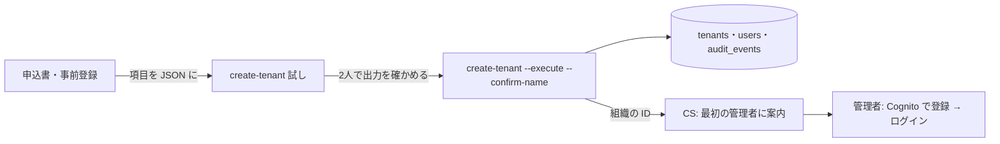

# 設計: 組織の開通(運営のコマンド `create-tenant`)

> **AI 用の設計書。省略せずに網羅的に書く(正はこちら)。** 人はこれを開かず、PR の本文の「人向けのまとめ」を見る([guides/human-review.md](../guides/human-review.md))。
> 仕様: [docs/specs/0026-tenant-provisioning.md](../specs/0026-tenant-provisioning.md)
> 状態: 下書き
> 観点の順は [review-viewpoints.md](../review-viewpoints.md)。当てはまらない節も消さずに「該当なし(理由)」と書く。

## 0. 全体像

申し込みを受けた会社を、運営が CLI `create-tenant` で組織にする(試し → 名前の確認 → 実行)。組織と最初の管理者の users の行を1つのトランザクションで作り、作った組織と運営の組織の監査ログに残す。解約の `delete-tenant` と対になる形。

## 作業の前に読んだ物(ガイド)

- 用語集: `docs/domain/glossary.md`(組織・利用者・解約)
- ADR: 0001(共有の表と RLS)・0007(Cognito の登録とログイン。users にいる人だけ入れる)・0013(監査ログ)・0015(解約はコマンド)
- 既存のコード:
  - `apps/api/src/offboarding/delete-tenant.ts` … お手本。表の持ち主の接続で `withTenant` を付けて書く。運営の組織の監査ログに `tenant.delete`
  - `apps/api/src/feature-flags/command.ts` … 運営のコマンドの監査ログ(`actor.kind = system`)
  - `apps/api/src/auth/lookup.ts`・`drizzle/0005_login_link.sql` … 初めてのログインで、確認済みのメールが `users.email`(小文字)と一致し `external_id` が空の行に sub を結びつける。**メールは小文字で入れる**
  - `apps/api/db/init/001-roles.sql` … 表の持ち主(app_owner)は app_rw ではないので、ログインの関数(`auth_find_user_by_email`)を呼べない。FORCE RLS なので、文脈の無い組織の行は見えない
  - `docs/runbooks/support-access.md` の 1・`docs/runbooks/cognito-login.md` … いまは SQL で行を足している

## 1. 設計方針

- 置き場は `apps/api/src/onboarding/create-tenant.ts`(`offboarding/` と対。領域ではない運営の仕組み)。CLI の入口は `src/cli.ts` に1つ足す。
- 書くのは `db/schema.ts` の `tenants`・`users`(組織の領域の表)。運営のコマンドは `delete-tenant` と同じく、領域の `index.ts` を通さずに表を直接書く(領域の関数は `TenantScope` = リクエストの文脈が前提で、組織を作る関数を領域に置くと、API から呼べる形になってしまう)。
- 新しい依存は無い(zod・uuid は既にある)。

## 2. データモデル

- 表・列は足さない(移行なし)。
- 書く行: `organizations.tenants`(name・time_zone・mfa_required)・`organizations.users`(id・tenant_id・email(小文字)・name・role = admin・external_id = NULL)・`platform.audit_events` を2行(作った組織・運営の組織)。
- 監査ログの `details` に `adminUserId` のキーを足す(列の分類表 `platform.audit_events.details.keys` に1行。internal)。
- 解約で消す一覧・書き出し: 変わらない(既にある表だけ)。

## 3. API

- 該当なし(API は作らない。ADR 0039)。
- CLI: `node dist/cli.js create-tenant '<申し込みの JSON>' [--execute --confirm-name <組織の名前>]`
  - 入力の形(`TenantApplicationSchema`): `{ name: string(1〜100・前後の空白を落とす), timeZone?: IANA の名前(既定 Asia/Tokyo), mfaRequired?: boolean(既定 false), admin: { email: メール(254 まで・小文字にそろえる), name: string(1〜100) } }`。知らない項目は読み飛ばし、名前を `ignoredKeys` で返す(`z.looseObject`)。
  - 出力(JSON 1行): 試し `{"mode":"plan","timeZone","mfaRequired","ignoredKeys"}`・本番 `{"mode":"created","tenantId","adminUserId","timeZone","mfaRequired","ignoredKeys"}`。
  - 失敗: JSON でない・項目の誤り(項目の名前だけ)・`--execute` に `--confirm-name` が無い・名前が違う・メールがもう使われている。どれも何も作らない。

## 4. 状態遷移

- 組織: 無い → ある(この設計)→ 消した(`delete-tenant`)。戻す(消した組織を作り直す)は無い。
- 最初の管理者: 行がある・Cognito と結びついていない → 初めてのログインで結びつく(既にある仕組み)。

## 5. システム間連携

- Cognito: 触らない(本人が登録する。運営が Cognito に人を作ると、パスワードを人づてに渡すことになる)。
- メール: 送らない。最初の管理者への案内は、手順書の文の型を CS が送る(仕様 0027 で仕組みにする)。
- ECS: 移行と同じ1回きりのタスク(`<名前>-migrate` のタスク定義の command を差し替える)。

## 6. 業務ルール

- 1人 = 1組織(`users_email_key` が全体で一意)。最初の管理者のメールが使われていれば止まる → 同じ申し込みを2回流しても2つ目は作らない(冪等の代わり)。
- 組織の名前の重なりは止めない(同じ名前の会社はありうる。取り違えは `--confirm-name` と2人の確かめで防ぐ)。
- 運営の組織(`SUPPORT_TENANT_ID`)の監査ログに残すのは、環境変数があるときだけ。無ければ作った組織にだけ残す。
- 運営の組織そのものもこのコマンドで作れる(`mfaRequired: true`)。そのときは `SUPPORT_TENANT_ID` はまだ無いので、作った組織にだけ残る。

## 7. 要求との対応

| 受け入れ条件(仕様) | 設計のどこ | テスト |
|---|---|---|
| 試しは流してから取り消し、何も残らない | 3. CLI・`createTenant` の `DryRun` | `tenant-provisioning.int.test.ts`「流してから取り消す」 |
| 本番で落ちる理由は試しでも落ちる | 同上 | 「試しでも落ちる」 |
| `--confirm-name` が違えば作らない | 3. CLI | 「名前が違えば何も作らない」 |
| 申し込みの項目・既定・知らない項目は名前だけ | 3. 入力の形 | `test/unit/create-tenant.test.ts` |
| 項目の誤りは項目の名前だけ | 同上 | 同上「値は出さない」 |
| 1つのトランザクションで組織と管理者 | 2. データモデル | 「組織と最初の管理者を作る」 |
| 2回流しても2つ目は作らない | 6. 業務ルール | 「2回流しても」 |
| 両方の監査ログに、名前・メール無しで | 2・6 | 「両方の監査ログに」「運営の組織が無い環境」 |
| 出力に名前・メールを出さない | 3. 出力 | `cli.ts`(出す項目を決めて組み立てる)・単体テストの「値は出さない」 |
| 最初の管理者はその組織に入れ、ほかは見えない | 4・5 | 「最初の管理者はその組織に入れ」 |
| 案内は手順書の型で | 5 | `docs/runbooks/tenant-provisioning.md` の 4 |

## 8. 非機能

- 性能: 1回に4〜5行を書くだけ。
- セキュリティ: 仕様の STRIDE のとおり。表の持ち主の接続でも FORCE RLS が効くので、新しい組織の文脈(`withTenant`)で書き、運営の組織への記録は同じトランザクションの中で文脈を付け替えて書く(片方だけ残らない)。
- 運用: 手順書 `docs/runbooks/tenant-provisioning.md`。ECS のタスクのログに出力が1行。
- 費用: なし(移行のタスクと同じ)。

## 9. このプロダクト特有

| 観点 | この変更では |
|---|---|
| テナント分離 | 新しい組織の文脈で書く。結合テストで、作った組織の管理者からほかの組織の物が 404 |
| 権限の表 | 変わらない(API なし) |
| 監査ログ | `tenant.create`(手で記録する名前 `MANUAL_AUDIT_ACTIONS.tenantCreate`)。details は `adminUserId` だけ。画面の文 `apps/web/src/audit-labels.ts` |
| 解約で消す一覧 | 変わらない |
| サポートの代理ログイン | 運営の組織の監査ログに残る(誰がいつ作ったかを社内で追える) |
| ログの個人情報 | 出力は ID・時間帯・必須・項目の名前だけ。誤りの文も項目の名前だけ |
| 列の分類(`personal` / `sensitive`) | 列は足さない。`details.adminUserId` を internal で足す |
| 画面の部品 | 該当なし(画面なし) |

## 10. 観点ごとの扱い

| 観点 | 扱い | 理由 |
|---|---|---|
| 設計方針 | 採用 | `delete-tenant` と同じ形(コマンド・試し・名前の確認) |
| データモデル | 軽く確認 | 表は足さない |
| API | 低優先 | API は無い |
| 状態遷移 | 軽く確認 | 無い → ある、だけ |
| システム間連携 | 軽く確認 | Cognito・メールに触らない |
| 業務ルール | 採用 | 1人 = 1組織のメールの重なりで2回目を止める |
| 要求との対応 | 機械で検証 | 結合テストと単体テスト |
| 非機能 | 最重要 | 本番の DB に書くコマンド。試しが本番と同じ処理か・ログに個人情報が出ないか |
| テナント分離 | 機械で検証 | 結合テスト |
| 監査ログ | 採用 | 2か所に残す |

## 11. 決めたこと(AI が決めた。人に聞かなかった)

- 試しは「同じ処理を流して最後に取り消す」 — 数えるだけの試しでは、メールの重なりがほかの組織の行(RLS で見えない)にあるかを前もって確かめられない。表の持ち主はログインの関数も呼べない(app_rw ではない)。取り消しなら本番と同じ理由で落ちる。
- 入力は JSON 1つ(引数) — ECS の1回きりのタスクにはファイルを渡せない(command の差し替えだけ)。申込書・事前登録の書き出しをそのまま貼れるよう、知らない項目は読み飛ばす(止めない)。読み飛ばした項目の名前は出すので、書き間違い(`timezone` など)に気づける。
- 組織の名前の重なりは止めない — 同じ名前の会社はありうる。取り違えは `--confirm-name` と2人で防ぐ(`delete-tenant` と同じ)。
- 運営の組織への記録は同じトランザクションで — `delete-tenant` は消した組織の記録が消えるので別に残すが、作るときは両方そろって残るか、両方残らないかにしたい。
- 最初の管理者の行は、Cognito と結びつけずに作る — 既にある「初めてのログインで、確認済みのメールが一致したら結びつく」を使う。運営が Cognito に人を作ると、初めのパスワードを人づてに渡すことになる。
- 監査ログの target は `organization`・`details.adminUserId` — 名前・メールを残さない決まり(ADR 0013)。誰が管理者になったかは ID で追える。

## 12. 未確定事項(AI の仮決め。人の承認と分けて追う)

> 4つに当たる判断だけ。状態の書き方は [guides/human-review.md](../guides/human-review.md) の 2。`pnpm decisions` がここを読む。**`仮決め` が残る PR はマージしない。**

| 番号 | 工程 | 種類 | 仮決め(設計した事実) | なぜそうしたか | 人が判断する問い | 状態 |
|---|---|---|---|---|---|---|
| U-1 | 設計 | 戻せないリスク | 申し込み(組織の名前・管理者の名前とメール)を、ECS の `run-task` の command の引数で渡す。引数は CloudTrail の RunTask の記録(監査証跡の S3。消せない)に残る | ECS の1回きりのタスクに渡せるのは command と環境変数だけ。`delete-tenant` も組織の名前を引数で渡している。S3 に置いて読ませる形は、置き場と消し方がもう1つ増える | 申し込みの個人情報(管理者の名前・メール)が監査証跡に残ってよいか(だめなら、S3 の決まった場所に置いて読む形にする) | 仮決め |
| U-2 | 設計 | 他チームとの契約や制約 | 流すのは本番の AWS に入れる人(開発の人)。CS は申込書を JSON にして渡し、出力を一緒に確かめる(2人) | CS に本番の AWS の権限を渡さない(いまの手順書の決まり)。`delete-tenant` と同じ分担 | 開通を誰が流すか(CS に ECS のタスクを流す権限だけ渡すか) | 仮決め |

## 13. 作り直しの記録

| 日付 | きっかけ | 入った工程 | 直した物 | 作り直した下流 |
|---|---|---|---|---|
