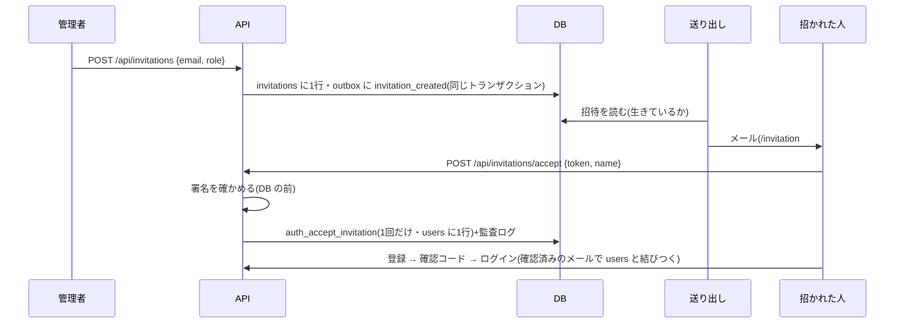

# 設計: 招待(管理者が画面から人を招く)

> **AI 用の設計書。省略せずに網羅的に書く(正はこちら)。** 人はこれを開かず、PR の本文の「人向けのまとめ」を見る([guides/human-review.md](../guides/human-review.md))。
> 仕様: [docs/specs/0027-invitations.md](../specs/0027-invitations.md)
> 状態: 下書き
> 観点の順は [review-viewpoints.md](../review-viewpoints.md)。当てはまらない節も消さずに「該当なし(理由)」と書く。

## 0. 全体像

管理者が画面で招く → 招待の行と出来事を積む → 送り出しが署名つきのリンクをメールで送る → 招かれた人がリンクで名前を入れて受ける(DB の関数が1回だけ users に行を足す)→ 招待のメールで Cognito に登録・ログインすると、その組織に入る。開通のコマンドは、最初の管理者に案内のメールを積む。



## 作業の前に読んだ物(ガイド)

- 用語集・領域の説明: `docs/domain/glossary.md`・`docs/domain/organizations/README.md`(1人 = 1組織・組織はセッションからだけ・ログインの前だけ特別な関数)
- ADR: 0001(RLS)・0006(アウトボックス)・0007(Cognito。users にいる人だけ入れる)・0008(メール)・0013(監査ログ)・0014(サポートの番号はハッシュだけ)・0019(ログの許可リスト)・0039(開通)
- 既存のコード:
  - `apps/api/src/auth/lookup.ts`・`drizzle/0005_login_link.sql` … 初めてのログインで、確認済みのメールが一致し `external_id` が空の users の行に sub を結びつける。**招待で行を作っておけば、ログインの仕組みはそのまま使える**
  - `drizzle/0001_rls.sql`・`0005`・`0007` … 組織が決まる前の読み書きは、NOLOGIN のロール(app_auth / app_support)が持ち主の SECURITY DEFINER 関数に閉じ込める型
  - `drizzle/0001_rls.sql` の GRANT … **app_rw は users に INSERT できない**(SELECT と一部の列の UPDATE だけ)
  - `apps/api/src/domains/organizations/support.ts` … 期限・取り消し・状態の出し方(active / expired / revoked)
  - `apps/api/src/outbox/handlers.ts`・`domains/organizations/notifications.ts` … 宛先は送る直前に DB から読む・Message-ID は出来事ごとに固定
  - `apps/web/src/pages/SupportGrantsPage.tsx`・`SignUpPage.tsx` … 管理者の表と、ログインの前の画面(`useSubmit`)の型

## 1. 設計方針

- 置き場: 招待は領域「組織」(`domains/organizations/invitations.ts`・`invitation-routes.ts`)。受ける API はログインの前なので認証の側(`auth/invitation-routes.ts`。ログインと同じく、資格から組織が決まる入口)。
- **リンクの札は DB に持たない**: 札 = `<招待の ID>.<HMAC-SHA256(鍵, 招待の ID)>`(base64url)。鍵は `SESSION_SECRET` から用途の名前(`invitation-link/v1`)で HMAC して作る。メールは送る直前(アウトボックスの受け手)に札を作る(出来事の中身に秘密を入れない決まり。ADR 0006)。期限・1回きり・取り消しは招待の行で決まる(ADR 0040)。
- **人を足すのは DB の関数だけ**: `auth_accept_invitation(招待の ID, 新しい人の ID, 名前)`(app_auth が持ち主の SECURITY DEFINER)。生きている招待を1回だけ「受けた」にし、同じ招待のメール・ロール・組織で users に1行足す。app_rw には users の INSERT を渡さない。
- 新しい依存は無い(node:crypto の HMAC)。

## 2. データモデル

表 `organizations.invitations`(移行 `0014_invitations.sql`。段 ① 拡張):

| 列 | 型 | 区分 | 中身 |
|---|---|---|---|
| id | uuid(v7) | internal | 招待の ID(札の署名の元) |
| tenant_id | uuid | internal | 招いた組織(`tenants` へ外部キー) |
| email | text | personal | 招いた人のメール(小文字。API の入力でそろえる) |
| role | organizations.role | public | 招いたロール |
| invited_by | uuid | internal | 招いた管理者(`(tenant_id, invited_by)` → users) |
| created_at | timestamptz | internal | 招いた時刻 |
| expires_at | timestamptz | internal | 期限(作ってから7日。`INVITATION_DAYS`) |
| accepted_at / accepted_user_id | timestamptz / uuid | internal | 受けた時刻と、できた人(1回きりの印) |
| revoked_at / revoked_by | timestamptz / uuid | internal | 取り消した時刻と管理者 |

- 索引: `(tenant_id, created_at desc, id desc)`(一覧のページング)・`(tenant_id, email)`(同じメールの生きている招待)。新しい表なので移行の中で張る。
- RLS: ENABLE・FORCE・`tenant_isolation`。app_rw に SELECT・INSERT・UPDATE (revoked_at, revoked_by)。消せない。
- app_auth(関数の持ち主)に: invitations の一部の列の SELECT(全社分。`invitation_lookup`)・UPDATE (accepted_at, accepted_user_id)(ポリシー `invitation_accept`: 生きている行だけ・受けた印つきにだけ)・users の INSERT (id, tenant_id, email, name, role)(ポリシー `invitation_accept`: その人の ID で受けた招待と、組織・メール・ロールがそろう行だけ)。
- 解約で消す一覧 `TENANT_TABLES` に `organizations.invitations`(users より前)。
- 書き出し(`POST /api/exports`)には入れない — 招待は一時の物で、受けた人は users として出る。
- 列の分類表に11行・`platform.outbox.payload.invitationId`・`platform.audit_events.details.invitationId`。
- 戻し方: 移行の先頭に SQL。前の版のアプリは表も関数も使わないので、戻さなくても動く。

## 3. API

| API | 権限 | 入力 | 出力 | 失敗 | 監査ログ |
|---|---|---|---|---|---|
| `GET /api/invitations` | invitation:manage(admin) | `?cursor&limit` | `InvitationPage`(新しい順) | 400・401・403 | — |
| `POST /api/invitations` | invitation:manage | `CreateInvitation { email(小文字に), role }` | 201 `Invitation` | 400・401・403・409 `already_member` / `already_invited` / `too_many_invitations` | `invitation.create`(対象 = 招待) |
| `DELETE /api/invitations/{invitationId}` | invitation:manage | — | 204 | 400・401・403・404・409 `invitation_not_pending` | `invitation.revoke` |
| `POST /api/invitations/accept` | 公開 | `AcceptInvitation { token, name(1〜100・前後の空白を落とす) }` | 200 `AcceptedInvitation { tenantName, email }` | 400 `invalid_invitation`(署名・形・期限・使用済み・取り消しをまとめて)・409 `invitation_email_in_use` | `invitation.accept`(手で。行為者 = できた人・対象 = 招待) |

- `Invitation { id, email, role, status: pending|accepted|expired|revoked, createdAt, expiresAt }`。
- 契約は `packages/shared/src/schemas.ts` に足すだけ(`INVITATION_DAYS`・失敗の code 6つ)。
- 受ける API は CSRF(Origin)の守りはそのまま。セッションがあっても使わない(組織は札で決まる)。受けてもログインの Cookie は出さない。

## 4. 状態遷移

```
pending ──受ける(1回)──▶ accepted
   │ └──期限(7日)──▶ expired ──取り消す──▶ revoked
   └──取り消す──▶ revoked
```

- 戻らない。expired は時刻で決まる(行は変わらない)ので、取り消しもできる(一覧で「取り消し済み」にしたいとき)。
- accepted・revoked は取り消せない(409)。

## 5. システム間連携

- アウトボックス: `organizations.invitation_created { invitationId }`(招いたとき)・`organizations.tenant_opened { userId }`(開通のコマンド)。中身は ID だけ。
- メール(受け手 `outbox/handlers.ts` → `invitationMail` / `tenantOpenedMail`): 宛先は送る直前に読む。招待が生きていなければ送らない(`skip: invitation_revoked` など)。札は送る直前に作る。Message-ID は出来事ごとに固定(2回届いても同じ)。本文に組織の名前・招いた人の名前・ロール・期限(組織の時間帯)・リンク。
- `HandlerDeps.linkSecret` を足した(`SESSION_SECRET`)。
- Cognito: 触らない。受けた人が自分で登録する。初めてのログインで、確認済みのメールが users の行と一致して結びつく(既にある仕組み)。

## 6. 業務ルール

- 招けるのは管理者だけ。ロールは admin / member / viewer のどれでも。
- 同じ組織に、同じメールの「受けていない」招待は1つまで(取り消せば招き直せる)。同じ組織にもういる人は招けない。
- 受けていない招待は1組織 50件まで(`MAX_PENDING_INVITATIONS`)。
- **ほかの組織にいる人かは、招く時点では確かめない**(管理者に他社の利用者の有無を教えない)。受けるときに `users_email_key` で止まり、何も変わらない(招待は生きたまま。管理者は取り消せる)。
- ドメインは確かめない(T-8 の SSO の部分は別)。
- 名前は受ける人が入れる(1〜100文字)。メール・ロールは招待から写す(受ける人は変えられない)。
- 期限は作ってから7日。延ばさない(取り消して招き直す)。

## 7. 要求との対応

| 受け入れ条件(仕様) | 設計のどこ | テスト |
|---|---|---|
| 管理者が招くとメールが届く | 3・5 | `invitations.int.test.ts`「招くと…出来事」・`invitation-mail.int.test.ts`「招いたアドレスへ」・E2E `invitations.spec.ts` |
| 7日・1回きり・取り消し | 2・4 | 「リンクは1回きり」「取り消した・期限が過ぎた」・E2E 2本 |
| 一覧に自社の招待と状態 | 3 | 「一覧は自社の招待だけ」「受けると…一覧では参加した」 |
| もういる・招待がある人は 409、取り消せば招き直せる | 6 | 「もうこの組織にいる人・生きている招待」 |
| 50件まで | 6 | 単体の定数(`MAX_PENDING_INVITATIONS`)。結合テストは作らない(50件のメールを積むだけになる) |
| 招いた・取り消したが監査ログに(メール・ロールなし) | 3 | 「出来事と監査ログ」(details が空) |
| メンバー・閲覧者・代理は 403 | 3・権限の表 | `authz-matrix.int.test.ts`(表から自動)。代理は閲覧者なので同じ |
| 他社の招待は見えない・取り消せない | 3 | 「一覧は自社の招待だけ」・権限の表の other_tenant 404 |
| 名前を入れて参加すると、招いたロールで入る | 1・3 | 「受けると、札が指す組織に」 |
| 招待のメールで登録・ログインすると使える | 5 | 「受けた人は、そのメールでログインすると」・E2E |
| 正しくない・期限切れ・使用済み・取り消しは同じ文 | 3 | 「取り消した・期限が過ぎた」「署名が違う」(code が同じ) |
| 組織は札で決まる | 1 | 「組織はセッションではなく札で決まる」「付け替えられない」 |
| 他社の人を招けない(受けるときに断る) | 6 | 「ほかの組織で使われているメールの招待は 409」「ほかの組織にいる人も、招くことはできる」 |
| ドメインは確かめない | 6 | 受けるテストのメールはどれも組織と違うドメイン |
| 受けたことが本人として監査ログに | 3 | 「受けると…本人として残る」 |
| 開通で最初の管理者に案内のメール | 5 | `invitation-mail.int.test.ts`「運営のコマンドが組織を作ると」・`tenant-provisioning.int.test.ts`(試しで何も残らない = 出来事も) |
| アプリの接続は users に行を足せない | 1・2 | 「アプリの接続は users に行を足せない」 |

## 8. 非機能

- 性能: 招く = 3つの小さな SELECT(索引あり)と2つの INSERT。受ける = 関数1回+2つの小さな SELECT+監査ログ。一覧はページング(索引 `invitations_list_idx`)。
- セキュリティ: 仕様の STRIDE。札の比較は `timingSafeEqual`。署名を確かめてから DB に聞く(当てずっぽうで DB を叩かせない)。受ける API のログは `invitationId`・`reason` だけ(メール・名前・札は出さない)。
- 運用: 手順書 `docs/runbooks/cognito-login.md`(新しい人を入れる・招待を受けられないと言われたら)・`tenant-provisioning.md` の 6(開通の案内)。秘密の入れ替え(`secret-leak.md`)で、受けていない招待のリンクが全部切れることを書いた。
- 費用: メール1通ぶん(SES 1,000通 約15円)。

## 9. このプロダクト特有

| 観点 | この変更では |
|---|---|
| テナント分離 | 管理者の API は関所の文脈(RLS)+ `tenantId` で絞る。受ける API の組織は札が指す招待で決まり、DB の関数が招待から組織を写す。結合テスト3本(他社の一覧・取り消し・札の付け替え・セッションに依らない) |
| 権限の表 | 4行(`invitation:manage` = admin・受けるのは公開) |
| 監査ログ | `invitation.create`・`invitation.revoke`(関所が自動)・`invitation.accept`(手で)。画面の文 `audit-labels.ts` |
| 解約で消す一覧 | `organizations.invitations` を users より前に |
| サポートの代理ログイン | 代理は閲覧者なので招けない・見られない(403) |
| ログの個人情報 | ログは `invitationId`・`userId`・`loginTenantId`・`reason` だけ。出来事の中身は ID だけ |
| 列の分類(`personal` / `sensitive`) | `invitations.email` が personal。ほかは internal / public。sensitive なし |
| 画面の部品 | `@app/ui` の TextField・Select・Table・Badge・ConfirmDialog・Alert だけ。狭い画面の E2E に2画面 |

## 10. 観点ごとの扱い

| 観点 | 扱い | 理由 |
|---|---|---|
| 設計方針 | 最重要 | 札を DB に持たない・人を足すのは DB の関数だけ(ADR 0040) |
| データモデル | 最重要 | RLS と app_auth のポリシー(users に行が増える唯一の道) |
| API | 採用 | 公開の API が1本増える(受ける) |
| 状態遷移 | 採用 | 1回きり・取り消し・期限 |
| システム間連携 | 採用 | アウトボックスとメール。札は送る直前に作る |
| 業務ルール | 採用 | 他社にいる人は招く時点では分からない(受けるときに止まる) |
| 要求との対応 | 機械で検証 | 結合テスト・権限の表・E2E |
| 非機能 | 採用 | 札が残る所(URL の # の後ろ・メール) |
| テナント分離・権限の表 | 機械で検証 | 結合テストと表の自動の答え合わせ |
| ログの個人情報 | 軽く確認 | 許可リストの項目だけ |

## 11. 決めたこと(AI が決めた。人に聞かなかった)

- 札は DB に持たない(署名で作る) — メールは送る直前に組み立てる決まり(出来事に秘密を入れない)なので、送るときに札が要る。ハッシュだけを持つ形(サポートの番号)では、送る側が札を知れない。署名なら DB に秘密が残らず、DB が漏れても札は作れない。
- 受けるのはログインの前の公開の API で、受けたら users の行ができる — 既にある「確認済みのメールで結びつく」ログインをそのまま使える(ログインの仕組みに手を入れない)。リンクを他人が先に押しても、その人はメールを確かめられないのでログインできない。
- 受けても自動でログインさせない — 本人の確認(メールの持ち主か)は Cognito の確認コードでしかできない。
- 人を足すのは DB の関数だけ(app_rw に users の INSERT を渡さない) — アプリのどこかに穴があっても、人を勝手に増やせない。0001・0005 の型。
- 他社にいる人かを招く時点で確かめない — 管理者に他社の利用者の有無を教えないため(アカウントの列挙)。受けるときに断るのは、招待のメールを受け取った本人にだけ見える。
- リンクの札は URL の `#` の後ろ — 画面のサーバー・ALB のアクセスログと Referer に残さない。画面は押したときに読み、受けたら URL から消す。
- 同じ文で断る(署名・期限・使用済み・取り消し) — サポートの番号と同じ。理由はログの `reason` で運営が見る。
- 一覧は受けた・期限切れ・取り消しも出す — 管理者が「届いた?入った?」を自分で確かめられる(CS への問い合わせを減らす)。
- 監査ログに招いたメール・ロールを入れない — 決まり(ADR 0013)。招待の行を ID で引ける。

## 12. 未確定事項(AI の仮決め。人の承認と分けて追う)

> 4つに当たる判断だけ。状態の書き方は [guides/human-review.md](../guides/human-review.md) の 2。`pnpm decisions` がここを読む。**`仮決め` が残る PR はマージしない。**

| 番号 | 工程 | 種類 | 仮決め(設計した事実) | なぜそうしたか | 人が判断する問い | 状態 |
|---|---|---|---|---|---|---|
| U-1 | 設計 | 戻せないリスク | 開通の最初の管理者は、招待のリンク(期限・1回きり)ではなく、users の行を先に作り、案内のメールを送る(行に期限は無い) | 最初の管理者の招待が切れると、その組織に招き直せる人がいない(運営の SQL に戻る)。行はメールを Cognito で確かめた本人しか使えないので、T-8 の狙い(他人が入れない)は保てる | 最初の管理者だけ「期限の無い行」でよいか(だめなら、運営のコマンドに招待の出し直しを足して、最初の管理者も招待にする) | 仮決め |
| U-2 | 設計 | 利用者の挙動 | リンクの期限は7日・受けていない招待は1組織50件まで | 7日は週をまたいでも受けられる長さ。50件は10〜100人の会社の入社の山でも足りて、メールの大量送信の歯止めになる | 7日・50件でよいか(お客さんの使い方で変える) | 仮決め |
| U-3 | 設計 | 戻せないリスク | 札の署名の鍵は `SESSION_SECRET` から作る(新しい秘密を足さない)。秘密を入れ替えると、受けていない招待のリンクは全部使えなくなる | 秘密を増やすと Terraform・Secrets Manager・手順書が増える。入れ替えるのは漏れたときで、そのときはリンクも切れてよい | 別の秘密(`INVITATION_SECRET`)に分けるか | 仮決め |

## 13. 作り直しの記録

| 日付 | きっかけ | 入った工程 | 直した物 | 作り直した下流 |
|---|---|---|---|---|
