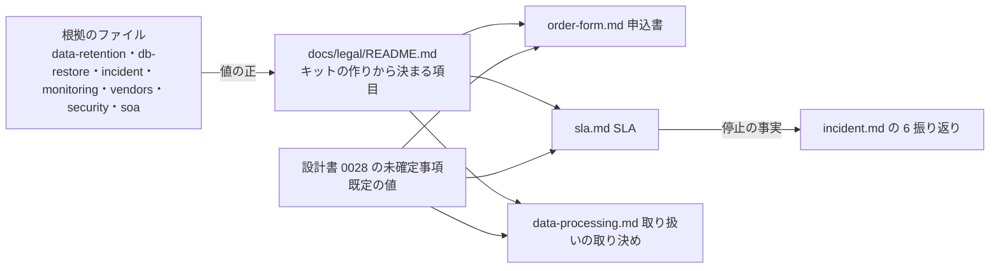

# 設計: 申込書・SLA・個人データの取り扱いの取り決めの型

> **AI 用の設計書。省略せずに網羅的に書く(正はこちら)。** 人はこれを開かず、PR の本文の「人向けのまとめ」を見る([guides/human-review.md](../guides/human-review.md))。
> 仕様: [docs/specs/0028-contract-templates.md](../specs/0028-contract-templates.md)・ADR: [0041](../adr/0041-contract-templates-fixed-and-negotiable.md)
> 状態: 下書き
> 観点の順は [review-viewpoints.md](../review-viewpoints.md)。当てはまらない節も消さずに「該当なし(理由)」と書く。

## 0. 全体像

営業がお客さんに出す3つの取り決め(申込書・SLA・個人データの取り扱い)の**型**を `docs/legal/` に置く。文面は書かず、項目ごとに「キットの既定・根拠のファイル・使う人が決めること」を並べ、条件を「変えない / 仕組みを変えれば変えられる / 契約だけで変えられる」に分ける。コードと DB は触らない。

## 作業の前に読んだ物(ガイド)

- 想定の場面: `docs/scenarios/02-legal-launch.md` の 2-3・2-4(申込書・SLA・取り扱いの取り決めが無い)、`05-run.md` の 5-11(SLA を割った・補償と例外を決める人が無い)、`gaps.md` の G-04。
- バックアップ: `docs/runbooks/db-restore.md`(時点復元 prod 14日・秒単位・最新は5分ほど前、保管庫 毎日 35日・毎月 365日、1社分だけ戻せる、一時の DB まで 15〜30分の目安)・ADR 0012(prod の保管庫は compliance のロック。3日を過ぎると誰にも縮められない)。
- 解約: `docs/runbooks/offboarding.md`(書面を確かめる・2人で・終わったらお客さんに残る物と消える日を知らせる)・`docs/guides/data-retention.md`(置き場所ごとの期間。「○日以内に削除」の○は運営が決める・例 30日。漏えいのときの分担は 4)。
- 障害: `docs/runbooks/incident.md`(S1 30分・以後1時間ごと / S2 1時間 / S3 知らせない。振り返り 5営業日以内。指揮が決める)。
- 見張り: `docs/guides/monitoring.md`・`infra/terraform/modules/uptime/main.tf`(Route 53 のヘルスチェック。東京・シンガポール・オレゴンから30秒ごと。画面 `/readyz`・API `/api/auth/options`。**DB を使わない**ので DB の停止は見えない。数字はバージニアだけ)。当番は有料の顧客が付いてから。
- 個人データの事故: `docs/runbooks/personal-data-breach.md` の 4(委託先はお客さんに知ってから 3〜5日のうちに。代理ログインがあるので委託先として扱う前提。専門家に確認)。
- 再委託先: `docs/compliance/vendors.md`(個人データを預けるのは AWS 東京だけ。米国の会社は ID と集計だけ)・`ai-data.md`・`docs/security.md` の AI-6。
- 安全管理措置: `docs/security.md`(T-1〜T-9・AZ-1〜AZ-6)・`docs/compliance/soa.md`・`policies/`。
- 規約: `docs/guides/legal-documents.md`・設計書 0009(規約は全員に同じ・版と同意の記録。会社としての同意は管理者の記録)。
- 組織: `docs/domain/organizations/README.md`(組織を作る流れは未実装。招待も未。穴 G-01・G-02)。プランと請求は無い(`docs/kit/catalog.yaml` の `billing` は未・穴 G-03)。
- 未確定事項の状態: 設計書 0013(`導入時に決める` はキットの持ち主の答えが要る。AI が仮決めから書き換えない)。

## 1. 設計方針

- 置き場所は `docs/legal/`(新しく作る)。README(共通の項目と3つの分け)+型ごとに1ファイル。`docs/compliance/` は認証の準備(社内の規程と証跡)、`docs/guides/legal-documents.md` は全員に同じ規約の仕組み、と分ける。ここは「お客さん(会社)ごとに取り交わす物」。
- **値の正は根拠のファイル**。型は値を並べるが、横に必ず根拠を置く。仕組みの数字を新しく作らない(既にある値を集めるだけ)。
- 文面(法律の文)は書かない。型の頭に「専門家に確かめる」、最後に「専門家に確かめること」の節。
- 既定の値のうち、答えがプロダクトごとに変わる物は 12. の未確定事項に置く。キットの持ち主が答えたら `導入時に決める` にする候補(設計書 0013 の 6. の基準)。
- ファイル名に「privacy」で始まる名前を使わない(`pnpm self-contained` が外の資料の名前として止める)。取り扱いの取り決めは `data-processing.md`。
- 新しい依存・部品・コードは足さない。危険度「高」の場所(infra・.github・hooks)は触らない。

## 2. データモデル

該当なし(DB に触らない)。

## 3. API

該当なし(HTTP の API を足さない)。月の稼働率の出し方は、人が打つ読むだけの AWS CLI(`sla.md` の 7)。

## 4. 状態遷移

該当なし(状態を持たない)。取り決めの流れ(申込書 → 確かめのメール → 組織を作る → 運用 → 解約の書面 → 削除)は `order-form.md` の 3 と `offboarding.md` に書き、状態としては持たない。

## 5. システム間連携

該当なし(外へ何も出さない)。型はリポジトリの中の文書。会社ごとに変えた条件は、リポジトリの外(契約の管理の置き場)に残す。

## 6. 業務ルール

### 共通(README)

- キットの作りから決まる項目 17行(置き場所・再委託先・分け方・社員の触り方・操作の記録・暗号化・バックアップ・戻せる時点・解約・書き出し・ログ・見張り・障害の連絡・個人データの事故・止めずに出す・安全管理措置・AI に渡すデータ)。
- 3つの分け:
  - **変えない**: バックアップの期間(保管庫のロック)・バックアップから消える日(最長 365日)・置き場所(東京)・社員の道は代理ログインだけ・AI に個人データを渡さない。
  - **仕組みを変えれば変えられる**: 専用の DB・会社ごとの鍵(T-5)・別リージョンのバックアップ(ADR 0012 の見直す合図)・夜間の当番。
  - **契約だけで変えられる**: 稼働率の線・補償の段・連絡の時間・期間・自動更新・申し出の期限・支払い・削除までの日数(長くする方)。
- 連絡の時間を縮めるのは、当番の体制が要るので「仕組みを変える」に当たる、と注記。
- 迷ったら「変えない」に倒す。

### 申込書

- 欄: 会社・プラン・人数・始まりの日・支払い・期間・自動更新・解約の申し出の期限・解約したときのデータ・最初の管理者・申し込む権限・規約への同意・SLA と取り決めを付けるか。
- キットに無い物(プランの表・人数の上限・請求)は「欄だけ。キットは止めない」。
- 申し込む権限: 申し込む人と承認した人を別の欄に。承認した人の会社のメールに確かめのメール → 組織を作る(U-7)。
- 解約の申し出は書面(電子でも)で受ける(offboarding.md の 1 の前提なので「変えない」)。

### SLA

- 測る物 = 外形監視(画面・API)∪ 振り返りの S1 の時間帯。外形監視は DB を見ないので、S1 で補う。
- 一部だけの停止(S2)は数えない。
- 原因の区分: 自社(数える)・外のサービス(数える)・外のサービスの大規模な障害(数えない・不可抗力)・お客さんの側(数えない)・計画メンテナンス(7日前に知らせた・月4時間まで数えない)・緊急の保守(数える)。
- 補償: 99.5% / 10%・99.0% / 25%・95.0% / 50%。次の請求から引く・上限 50%・唯一の救済(U-2)。
- 義務と努力目標を項目ごとに: 稼働率の線とバックアップから消える日は義務、連絡の時間と戻す早さは努力目標。
- 連絡は営業時間の中で数える(U-4)。
- 事実を確定 = 障害の指揮(振り返り)。例外 = 責任者。補償はお客さんの申し出で、翌月末まで(U-3)。
- 測り方: `HealthCheckStatus` の5分ごとの平均から `(1 − 平均) × 5` を足す。5分の数字は 63日で消えるので、月が明けて最初の週に出す。欠けた区間は数えない(指揮が振り返りで決める)。

### 取り扱いの取り決め

- 立場: 委託先として扱う(U-1)。自社が自分で集めた物はプライバシーポリシーの側。
- 安全管理措置は新しく書かず、soa.md・security.md・policies を指す。
- 事故の第1報: 知ってから 3日以内(法の目安 3〜5日の早い方。U-4)。他社の名前を書かない。報告と本人への通知はお客さん(連名でもよい)。
- 再委託先: vendors.md を指す。個人データを預ける会社を足すときは前もって知らせる(日数は使う人)。
- 終わったとき: 書き出しは管理者が画面で(運営は中身を取り出さない)・30日以内に削除(U-5)・バックアップ 365日は縮められない・戻さない。
- 監査: 書類で答える。届く・直していない穴の中身は出さない(`docs/guides/vulnerabilities.md` の決まり)。

### つながり

- `docs/runbooks/incident.md` の 6 の振り返りの型に「SLA」の行(停止の時間・停止の分・原因の区分)を足す。指揮が書き、これが SLA の事実の正になる。
- `docs/guides/data-retention.md` の頭に「期間を変えたら docs/legal/ も」を足す。
- `docs/README.md`(いまの正の表)・`docs/reference.md`(ファイルの地図)に1行ずつ。
- `docs/kit/catalog.yaml` に部品 `contract-templates`(group: rules・status: あり・removable: true・default: 残す)。

## 7. 要求との対応

| 受け入れ条件(仕様) | 設計のどこ | テスト |
|---|---|---|
| 共通: 決まる項目の一覧(既定と根拠つき) | 6. 共通・`docs/legal/README.md` の 2 | `pnpm self-contained`(リンク先がキットの中)・人の確認 |
| 共通: 3つの分け | 6. 共通・README の 3 | 人の確認 |
| 共通: 頭に専門家・法律の文を含まない | 1.・各型の頭と最後の節 | 人の確認 |
| 共通: 項目ごとに既定・根拠・使う人 | 各型の表 | 人の確認 |
| 共通: お客さんの名前・金額を書かない | README の 4・5 | 人の確認 |
| 申込書の欄 | 6. 申込書・`order-form.md` の 2 | 人の確認 |
| 申し込む権限の確かめ | `order-form.md` の 3 | 人の確認 |
| 無い物は欄だけ・穴を指す | `order-form.md` の 2 | 人の確認 |
| SLA の 1〜7 | 6. SLA・`sla.md` | 人の確認 |
| 月の稼働率の出し方 | `sla.md` の 7 | コマンドの形を AWS CLI の説明で確かめた(本番では打っていない) |
| 振り返りに SLA の欄 | `incident.md` の 6 | 人の確認 |
| 取り扱いの取り決めの 0〜6 | 6. 取り扱いの取り決め・`data-processing.md` | 人の確認 |
| 地図と reference に1行 | 6. つながり | 人の確認 |
| data-retention.md から指す | 6. つながり | 人の確認 |
| カタログに1件 | 6. つながり | `pnpm kit:catalog` |
| 既定の値が未確定事項に | 12. | `pnpm decisions` |

## 8. 非機能

- 性能: 該当なし(文書)。
- セキュリティ: 型にお客さんの名前・金額・契約書・事故の中身を書かない(README の 5)。測り方のコマンドは読むだけ(`get-metric-data`・`list-health-checks`)で、人が打つ。AI は本番に入らない(AI-1)。
- 運用: 仕組みの数字が変わったときの食い違い。値の正は根拠のファイル、型は横に根拠を置き、data-retention.md の頭で「一緒に直す」を求める。自動の照らし合わせは足さない(11. の理由)。
- 費用: 0円(文書だけ)。

## 9. このプロダクト特有

| 観点 | この変更では |
|---|---|
| テナント分離 | 型が T-1〜T-9 を指すだけ。変えない |
| 権限の表 | 該当なし |
| 監査ログ | 該当なし(取り決めの型が監査ログの見られ方を指すだけ) |
| 解約で消す一覧 | 該当なし(取り決めが削除の手順を指すだけ。日数の既定は U-5) |
| サポートの代理ログイン | 委託先として扱う理由として指す。変えない |
| ログの個人情報 | 該当なし |
| 列の分類(`personal` / `sensitive`) | 取り決めの「預かる項目」が `docs/db/personal-data.md` を指す |
| 画面の部品 | 該当なし |

## 10. 観点ごとの扱い

| 観点 | 扱い | 理由 |
|---|---|---|
| 設計方針 | 採用 | 文書だけ。置き場所と「値の正は根拠のファイル」を決めた |
| データモデル | 低優先 | 触らない |
| API | 低優先 | 触らない |
| 状態遷移 | 低優先 | 持たない |
| システム間連携 | 低優先 | 外へ出さない |
| 業務ルール | **最重要** | SLA の測り方・数える停止・補償・例外を決める人と、変えない条件。お客さんとの約束になる |
| 要求との対応 | 軽く確認 | 受け入れ条件はほぼ人の確認 |
| 非機能 | 軽く確認 | 型にお客さんの物を書かない決まり |
| サポートの代理ログイン | 軽く確認 | 委託先として扱う理由 |

## 11. 決めたこと(AI が決めた。人に聞かなかった)

- 置き場所を `docs/legal/` にした — `docs/compliance/` は社内の規程と証跡(認証の準備)、`docs/guides/legal-documents.md` は全員に同じ規約の仕組みで、お客さんごとに取り交わす物の置き場が無かった。
- 取り扱いの取り決めのファイル名を `data-processing.md` にした — 「privacy」の名前のファイルは `pnpm self-contained` が外の資料の名前として止める。
- 値を型に並べるが、正は根拠のファイルにした — 営業が1枚で見られることと、仕組みと約束の食い違いを防ぐことの両方。値だけを写すと、Terraform を変えたときに型が古くなる。
- 型の値と Terraform を照らす検査は足さなかった — 型の値は人が読む文で、照らすには型を機械の読める形にする必要がある。いまは data-retention.md の頭の「一緒に直す」で足りる。食い違いが起きたら足す(ADR 0041 の見直す合図)。
- SLA の測る物を「外形監視 ∪ 振り返りの S1」にした — 外形監視は DB を使わない道を見ている(`modules/uptime` の説明)ので、5-11 の DB の入れ替えのような停止が数字に出ない。外形監視を DB まで届かせるのは infra の変更(危険度「高」)なので、この PR ではしない。
- 稼働率は「5分ごとの平均」から出す — 1分ごとの数字は 15日・5分ごとは 63日で消える(CloudWatch の決まり)。月の数字を月が明けてから出せるのは5分ごと。平均を使えば、5分の中の止まった分だけを数えられる。
- 一部だけの停止(S2)を稼働率に入れない — 測り方(外形監視)が全体しか見ていない。1社だけの扱いは「使う人が決めること」に置いた。
- 安全管理措置の中身を取り決めの型に書き写さない — soa.md と security.md が正で、質問票にも同じ物で答える(穴 G-20 とつながる)。
- 振り返りの型(incident.md の 6)に SLA の行を足した — 事実を確定する人(指揮)が書く場所が無いと、割ったときに誰の数字が正か揉める。
- 想定の場面(`docs/scenarios/`)の判定と穴の一覧はこの PR で直さない — 並行の作業の持ち主が直す(CLAUDE.md の「穴を埋めた PR では直す」は、その持ち主がまとめて行う)。

## 12. 未確定事項(AI の仮決め。人の承認と分けて追う)

> 4つに当たる判断だけ。状態の書き方は [guides/human-review.md](../guides/human-review.md) の 2。`pnpm decisions` がここを読む。**`仮決め` が残る PR はマージしない。**
> どれも答えがプロダクトごとに違う(使う人の事業・契約・専門家の確認で変わる)ので、キットの持ち主が既定を承認したら `導入時に決める(キットの既定は @名前 YYYY-MM-DD に承認)` にする候補。

| 番号 | 工程 | 種類 | 仮決め(設計した事実) | なぜそうしたか | 人が判断する問い | 状態 |
|---|---|---|---|---|---|---|
| U-1 | 要求 | 他チームとの契約や制約 | お客さんの業務のデータについて、**自社を委託先として扱う**前提で取り決めの型を作った。委託先に当たらないとされたら型を使わない | サポートの代理ログインで社員が中身を見られる。漏えいの手順書(personal-data-breach.md の 4)も同じ前提で書いてある | 委託先として扱う前提でよいか(キットの既定として。使う人は専門家に確かめる) | 仮決め |
| U-2 | 設計 | 事業判断 | SLA の線は月 **99.5%**。補償は 99.5% 未満 10%・99.0% 未満 25%・95.0% 未満 50%(その月の利用料に対して)。次の請求から引く・上限 50%・**唯一の救済**。稼働率の線は義務、連絡の時間と戻す早さは努力目標 | キットは1つのリージョンで、DB の入れ替え1回(5-11 の例で40分)で 99.9%(月 約43分)を割る。99.5%(月 約3時間36分)なら、一時の DB の目安(15〜30分)と止血を足しても余裕がある。救済を書かないと割ったときに揉める | この線と段・上限をキットの既定にしてよいか | 仮決め |
| U-3 | 設計 | 他チームとの契約や制約 | 停止の事実は**障害の指揮**が振り返り(5営業日以内)で確定し、区分の争いと例外は**責任者**が決める。補償は**お客さんの申し出**で始め、期限は翌月末。計画メンテナンスは 7日前に知らせた物・月4時間まで数えない。AWS が公表したリージョン全体の障害は数えない | 指揮は incident.md で時系列を書く人。請求が手作業(穴 G-03)の間は、自動で当てられない。メンテナンスと不可抗力の線が無いと、DB の版上げのたびに割る | 事実と例外を決める人・申し出制・メンテナンスの線・不可抗力の扱いをこれでよいか | 仮決め |
| U-4 | 設計 | 他チームとの契約や制約 | 障害の連絡の時間(S1 30分・S2 1時間)は**営業時間の中で数え**、外は努力。個人データの事故は、お客さんに**知ってから 3日以内**に第1報 | 夜間の当番は有料の顧客が付いてから(monitoring.md)。夜中も約束すると守れない。事故の期限は法の目安(3〜5日)の早い方にそろえた | 営業時間の中で数える既定でよいか。事故の第1報を 3日にしてよいか(もっと短くするか) | 仮決め |
| U-5 | 設計 | 戻せないリスク | 解約したら、契約の終わりから **30日以内**に削除のコマンドで消す。書き出しは契約の終わりまでに管理者が画面で(運営は中身を取り出して渡さない) | data-retention.md の 2 の例(30日)にそろえた。運営が中身を取り出すと、社員がデータに触れる道が増える(T-7 は見るだけ) | 30日でよいか。終わった後に「書き出しを忘れた」と言われたら、どうするか(組織を一時的に戻すか・断るか) | 仮決め |
| U-6 | 設計 | 事業判断 | 申込書の既定: 期間 **1年**・**自動更新する**・解約の申し出は**満了の1か月前まで・書面(電子でも)で** | 会社向けでよくある形。書面は削除の手順の前提(offboarding.md の 1) | この期間と期限をキットの既定にしてよいか | 仮決め |
| U-7 | 設計 | 他チームとの契約や制約 | 申し込む権限は、申込書で**申し込む人と承認した人(決裁の権限がある人)を分け**、承認した人の会社のメールに確かめのメールを1通送ってから組織を作る | 社員が権限なく申し込むのを防ぐ(会社向けでは申込書を求めるのが世の中の流れ)。印鑑を求めると電子の申し込みで止まる | この確かめ方でよいか(印鑑・電子の署名を求めるか) | 仮決め |

## 13. 作り直しの記録

| 日付 | きっかけ | 入った工程 | 直した物 | 作り直した下流 |
|---|---|---|---|---|
