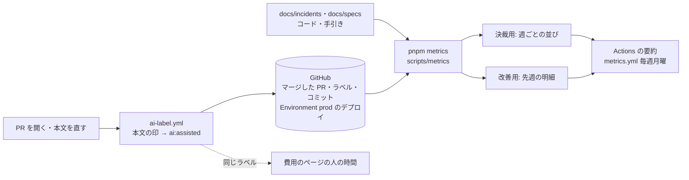

# 設計: 週の数字(DORA の4つ・AI が手伝った PR・人の介在率・仕様の在庫)

> **AI 用の設計書。省略せずに網羅的に書く(正はこちら)。** 人はこれを開かず、PR の本文の「人向けのまとめ」を見る([guides/human-review.md](../guides/human-review.md))。
> 仕様: [docs/specs/0035-delivery-metrics.md](../specs/0035-delivery-metrics.md)・ADR: [0046](../adr/0046-metrics-from-labels-and-repo-records.md)
> 状態: 下書き
> 観点の順は [review-viewpoints.md](../review-viewpoints.md)。

## 0. 全体像

PR を開くとラベル `ai:assisted` を付けるワークフロー(`ai-label.yml`)と、毎週、GitHub(マージした PR・本番のデプロイ)とリポジトリのファイル(障害の振り返り・仕様)から週の数字を作るスクリプト(`scripts/metrics/`・`pnpm metrics`・`metrics.yml`)を足す。出すのは決裁用(週ごとの並び)と改善用(先週の PR ごとの明細)の2つで、人の名前と PR の中身は出さない。



## 作業の前に読んだ物(ガイド)

- `docs/concepts/line.md` の 8(測るもの: DORA・AI が書いた PR の割合・人の介在率)・`docs/concepts/people-and-ai.md` の 5(任せる範囲を広げる合図)・`docs/guides/human-review.md` の 5(人の介在率 = 人が答えた問いの数・人が手で直した回数)・`docs/playbook.md` の「毎週やること」の「数字」
- 場面 `docs/scenarios/03-roadmap-build.md` の 3-7・3-9、`07-grow.md` の 7-2(決裁用と改善用を分ける・ラベルで数える・数字は決裁の材料にとどめる)
- `scripts/cost/source-people.mjs`(費用のページの人の時間。AI の PR を本文の印 `ai_markers` で見分ける・「人の評価には使わない」)・`docs/cost/people.yaml`
- `scripts/checkup/context.mjs`・`gh.mjs`(読むだけの gh・`CHECKUP_READ_TOKEN`)・`scripts/setup/usage.mjs`・`check-lib.mjs`(ラベルと定期の見分けの確かめ)
- `.github/workflows/vrt.yml`(書く権限のジョブは PR のコードを checkout しない)・`pr-work.yml`(本文を env で渡す)・`labeler.yml`(フォークを飛ばす)・`deploy.yml`(Environment `prod`)
- `docs/runbooks/incident.md` の 6(振り返りの形)・`docs/incidents/README.md`

## 1. 設計方針

- 置き場は `scripts/metrics/`(点検・費用と同じく node のスクリプト)。計算(`lib.mjs`)・集め方(`collect.mjs`)・Markdown(`render.mjs`)・入口(`run.mjs`)・ラベルの見分け(`ai-assisted.mjs`)に分け、計算は GitHub もファイルも読まない純粋な関数にしてテストする。
- GitHub は gh の GraphQL で読むだけ(PR は検索で 50件ずつ・コミットとラベルを一緒に。デプロイは Environment ごとに新しい順)。REST で PR ごとにコミットを読むと、週に数百の PR で API を使い切る。
- AI が手伝った PR は**ラベルで数える**(ADR 0046)。ラベルを付けるのは本文の印と作った人を見るワークフロー。費用のページの人の時間も同じラベルで見分ける(見分け方を1つにする)。
- 障害は新しいラベルや Issue にせず、今ある振り返りのファイルに2行足す(ADR 0046)。
- 出す先は Actions の要約と手元の画面(と `--out` の JSON・Markdown)。費用のページの非公開の S3 には置かない(お金が無い・リポジトリに見える情報だけで、置き場の役割は `cost.yml` だけに引けるため)。
- 新しい依存は無い(`yaml` は使わず、ラベルのジョブは node の標準だけ)。

## 2. データモデル

DB は触らない。リポジトリの形を2つ足す。

- `.github/labels.yml` に `ai:assisted`(色 `5319e7`・付けるのは `ai-label.yml`・人も手で付けてよい)。
- 障害の振り返り(`docs/runbooks/incident.md` の 6 の形)に2行:
  - `- 戻るまで: 何分(…)` … `^-\s*戻るまで:\s*(\d+)\s*分` で読む
  - `- 変更が原因: はい / いいえ(…)` … `^-\s*変更が原因:\s*(はい|いいえ)` で読む

読む GitHub の項目(これ以外は読まない):

| 物 | 項目 |
|---|---|
| マージした PR | 番号・開いた日時・マージした日時・本文(問いを数えるためだけ。出さない)・作った人(ボットかを見るためだけ。出さない)・ラベル・コミット(メッセージ・親の数・作者の名前とメール。ボットと AI の印を見るためだけ。出さない) |
| 本番のデプロイ | 作った日時・最後の状態 |

## 3. API

API は足さない。コマンドとワークフロー:

`pnpm metrics [--weeks 1〜26(既定 8)] [--environment prod] [--today YYYY-MM-DD] [--out <dir>]`

- 画面に Markdown を出す。`--out` なら `<dir>/metrics.json` と `<dir>/metrics.md`。
- `metrics.json` の形:

```json
{
  "today": "2026-10-26",
  "weeks": { "from": "2026-08-31", "to": "2026-10-19" },
  "decision": {
    "weeks": [{ "week": "2026-10-19", "deploys": 4, "leadTimeHours": 5.5, "changeFailurePct": 20, "restoreMinutes": 26,
                "merged": 31, "botMerged": 6, "aiPct": 87, "aiUntouchedPct": 41 }],
    "specsReady": 3, "specsDraft": 2
  },
  "improvement": {
    "week": "2026-10-19",
    "prs": [{ "number": 56, "bot": false, "ai": true, "risk": "medium", "questions": 1, "humanCommits": 0, "openToMergeHours": 0.4, "leadTimeHours": 3.2 }],
    "kinds": [{ "kind": "事業判断", "count": 2 }],
    "incidents": [{ "file": "docs/incidents/2026-10-21-x.md", "date": "2026-10-21", "week": "2026-10-19", "minutes": 26, "change": true }],
    "specs": { "ready": [{ "number": "0031", "title": "…", "days": 3 }], "drafts": [] }
  },
  "notes": ["振り返り 1件に「戻るまで」か「変更が原因」の行が無い(…)"]
}
```

ワークフロー:

| ファイル | いつ | 権限 | すること |
|---|---|---|---|
| `ai-label.yml` | PR を開いた・本文を直した・開き直した(フォークは飛ばす) | 見分ける: `contents: read` / 付ける: `pull-requests: write`(checkout しない) | `scripts/metrics/ai-assisted.mjs` で見分け、当たって未だ付いていなければ `gh pr edit --add-label ai:assisted`。ラベルが無ければ warning で止めない |
| `metrics.yml` | 毎週月曜 8:30(日本時間。`KIT_ROLE == 'product'` のときだけ)・手動(週の数) | `contents`・`pull-requests`・`deployments` の read | `pnpm metrics --out` → 要約に Markdown。非公開のリポジトリなら成果物(7日) |

## 4. 状態遷移

- ラベル `ai:assisted`: 無い → 付く(ワークフローか人)。外すのは人だけ(本文の印が残っていれば、次に本文を直したときにまた付く)。
- 仕様の状態(下書き → 承認済み → 完了)は今のまま。週の数字は読むだけ。

## 5. システム間連携

- GitHub の GraphQL(読むだけ)と、ラベルを付ける `gh pr edit`(`ai-label.yml` だけ)。
- 手元では `gh` のログイン、Actions では `github.token`(あれば `CHECKUP_READ_TOKEN` で読む。点検と同じ)。
- 外のサービスは増えない(委託先の台帳に足す物は無い)。

## 6. 業務ルール

AI の手伝い:

- **A-1**: 本文に `docs/cost/people.yaml` の `ai_markers` のどれかがある、か、作った人が AI のボット(`claude[bot]`)なら、AI が手伝った PR。ラベル `ai:assisted` を付ける。数えるのはラベル(本文の印もコミットも見ない)。
- **A-2**: 印の無い AI の PR は人が手で付ける。費用のページの人の時間も、ラベルか本文の印のどちらかで AI の PR と見る。

週:

- **W-1**: 週は日本時間の月曜から日曜。数えるのは数え終わった週だけ(今週は途中なので入れない)。`--weeks N` は先週から数えて N 週。`--today` でその日の時点にする。
- **W-2**: GitHub の検索は UTC の日付なので、最初の週の月曜の1日前から読み、週で絞る。

決裁用(週ごと):

- **D-1 本番のデプロイ**: Environment(既定 `prod`)のデプロイのうち、最後の状態が `SUCCESS` か `INACTIVE`(次のデプロイに替わった成功)の数。`FAILURE`・`ERROR` は失敗。待ち・途中は数えない。週はデプロイを作った日時。
- **D-2 リードタイム**: PR を開いた日時から、マージの日時より後の最初の成功したデプロイまで(時間・小数1桁)の中央値。マージした週で数える。まだ出ていない PR は入れない(時刻で決めるので、承認待ちの古いデプロイが後から通ると短く出ることがある。設計の限り)。
- **D-3 変更の失敗率**: (失敗したデプロイ+その週の振り返りのうち「変更が原因: はい」)÷ 試したデプロイ(成功+失敗)。デプロイが0の週は null。
- **D-4 復旧の時間**: その週の日付の振り返りの「戻るまで」の中央値(分)。
- **D-5 PR**: その週にマージした PR のうち、ボット(作った人がボット)でない物の数。ボットは別に数える。AI が手伝った割合 = ラベルの付いた PR ÷ その数。
- **D-6 人の介入なし**: AI が手伝った PR のうち、人が答えた問いが0で、人の手直しが0の割合。
- **D-7 仕様の在庫(いまの数)**: 作る待ちと承認待ちの数(週ごとの並びにはしない。過去の状態は数え直せない)。

PR ごと(改善用):

- **P-1 人が答えた問い**: 本文の見出し「人に判断してほしい所」から次の見出しまでの表の行(見出しの行・区切りの行・全部の欄が空の行を除く)。種類は2つ目の列(空なら「(種類なし)」)。マージした PR の問いは答えた物とみなす(仮決めの残る PR はマージしない決まり)。
- **P-2 人の手直し**: AI が手伝った PR のコミットのうち、親が1つ以下(マージのコミットでない)・作者の名前とメールに `[bot]` が無い・メッセージに AI の印が無い物の数。AI でない PR は数えない(全部が人の手なので意味が無い)。
- **P-3 開いてからマージまで**: 時間(小数1桁)。

仕様の在庫:

- **S-1**: 仕様は `docs/specs/NNNN-*.md`。状態は `> 状態:` の行の書き出し(完了 / 承認済み / 下書き / その他)。日数は同じ行の最初の `YYYY-MM-DD` から今日まで(無ければ null)。
- **S-2 作る待ち**: 承認済みで、`docs/specs`・`docs/designs`・`docs/adr`・`docs/scenarios`・`docs/product` の外の、git が持っている文書とコード(`.md`・`.yml`・`.ts` など)から、`specs/NNNN-`・`designs/NNNN-`・「仕様 NNNN」・「設計書 NNNN」で指されていない物。作った物は仕様か設計書を指すので、指されていれば作ったとみなす(当てずっぽうなので一覧で出し、人が状態を「完了」に直す。手引きの 4)。
- **S-3 承認待ち**: 下書き。

出さない物:

- **O-1**: 人の名前(PR を作った人・コミットの作者)・PR の題名と本文・コミットのメッセージは出さない。人ごとの数も出さない。出すのは数・割合・時間・PR の番号・仕様の番号と題・振り返りのファイルの名前。
- **O-2**: 読めなかった物(GitHub・行の無い振り返り・1000件を超えた PR)は `notes` に書き、止まらない。

境界: PR もデプロイも無い週は数が 0 と —。`--weeks` は 1〜26 の整数(ほかは止まる)。`--today` は `YYYY-MM-DD`。

## 7. 要求との対応

| 受け入れ条件(仕様) | 設計のどこ | テスト |
|---|---|---|
| 本文の印・AI のボットでラベルが付く。付けるだけ | 3. の `ai-label.yml`・6. A-1 | `scripts/metrics/collect.test.mjs` の「AI の手伝いの見分け」・ワークフローは actionlint と zizmor(`ci.yml`) |
| 人が手で付けたラベルも数える(週の数字・費用のページ) | 6. A-2・D-5 | `metrics.test.mjs` の「PR の事実: AI はラベルで見分ける」・`scripts/cost/pl.test.mjs` の「PR 1件の分数」 |
| 毎週 Actions の要約に出る。手でも流せる | 3. の `metrics.yml` | `pnpm setup:check`(定期の見分け `KIT_ROLE`・ラベルの一覧) |
| `pnpm metrics` で N 週 | 3.・6. W-1 | `metrics.test.mjs` の「週は日本時間の月曜から」・`collect.test.mjs` の「集めた結果に…」 |
| 決裁用の数 | 6. D-1〜D-7 | `metrics.test.mjs` の「決裁用は週ごとにチームで1つの数…」・「デプロイ: …」 |
| 改善用の明細・問いの種類・障害・在庫 | 6. P-1〜P-3・S-1〜S-3 | `metrics.test.mjs` の「決裁用は…」(改善用の PR・種類・Markdown)・「仕様の在庫」 |
| 人が答えた問いは表の行 | 6. P-1 | `metrics.test.mjs` の「人が答えた問い」 |
| 人の手直しはコミット | 6. P-2 | `metrics.test.mjs` の「人の手直し」 |
| 失敗率と復旧は振り返りの行から。行が無ければ書く | 2.・6. D-3・D-4・O-2 | `metrics.test.mjs` の「振り返り」・`collect.test.mjs` の「集めた結果に…」 |
| 仕様の在庫(作る待ち・承認待ち・日数) | 6. S-1〜S-3 | `metrics.test.mjs` の「仕様の在庫」 |
| 人の名前・本文を出さない・人ごとの数を出さない | 6. O-1 | `collect.test.mjs` の「集めた結果に人の名前・本文を出さない」・`metrics.test.mjs` の「PR の事実」 |
| GitHub が読めなくても止まらない | 6. O-2 | `collect.test.mjs` の「…GitHub が読めなくても、読めた物で作る」 |
| PR は頁ごと・上限で切る・デプロイは古くなったら止める | 1.・8. | `collect.test.mjs` の「PR を頁ごとに読み…」 |

## 8. 非機能

- 性能と API: PR は検索の GraphQL で 50件ずつ(コミット 100件・ラベル 30件を一緒に)。1000件で切る(GitHub の検索の上限)。8週で 400件なら 8回。デプロイは 100件ずつ、古くなったら止める。点の消費は1回あたり 50 ほどで、`github.token` の上限(1時間 1000 点以上)に十分。
- セキュリティ: 仕様の STRIDE のとおり。書く権限のジョブは PR のコードを動かさない。本文は env で渡す。SHA で固定した Action だけ。フォークは飛ばす。
- 運用: 週1回・1〜2分。ラベルが無いときは warning(`pnpm setup:github --apply` で作る)。手引き `docs/guides/metrics.md`。
- 費用: Actions の分だけ(公開のリポジトリは無料。非公開でも月に 10分ほど)。

## 9. このプロダクト特有

| 観点 | この変更では |
|---|---|
| テナント分離 | 該当なし(プロダクトのデータを読まない) |
| 権限の表 | 該当なし(API を足さない) |
| 監査ログ | 該当なし |
| 解約で消す一覧 | 該当なし |
| サポートの代理ログイン | 該当なし |
| ログの個人情報 | 出力に人の名前・本文を出さない(O-1)。ワークフローのログにも本文を出さない(見分けるスクリプトは `assisted=true|false` だけ出す) |
| 列の分類(`personal` / `sensitive`) | 該当なし |
| 画面の部品 | 該当なし |

## 10. 観点ごとの扱い

| 観点 | 扱い | 理由 |
|---|---|---|
| 設計方針 | 採用 | ラベルで数える・振り返りに2行・費用のページと見分け方を1つに(ADR 0046) |
| データモデル | 軽く確認 | ラベル1つと振り返りの2行だけ |
| API | 低優先 | 足さない |
| 状態遷移 | 低優先 | ラベルは付けるだけ |
| システム間連携 | 採用 | GitHub の権限(書くジョブは checkout しない・フォークを飛ばす) |
| 業務ルール | **最重要** | 数え方(失敗率・介入なし・在庫)で、任せる範囲を広げる判断が変わる |
| 要求との対応 | 機械で検証 | node のテスト・`pnpm setup:check`・actionlint・zizmor |
| 非機能 | 軽く確認 | API の点・週1回 |
| ログの個人情報 | 採用 | 人の名前と本文を出さない(テスト) |

## 11. 決めたこと(AI が決めた。人に聞かなかった)

- AI の手伝いはラベルで数え、ラベルは本文の印から自動で付ける — 依頼のとおり(コミットから見分けない)。印は費用のページと同じ `ai_markers` を正にして、2つの見分け方がずれないようにした
- ラベルは付けるだけで外さない — 人が手で付けた物(印の無い AI の PR)を、本文を直したときに外してしまわないため
- 費用のページの人の時間も、ラベルでも AI の PR と見る — 同じ PR が片方で AI・もう片方で人になるのを防ぐ。今までの本文の印でも見るので、今の数は変わらない
- 人ごとの数は出さない — 費用のページの「人の評価には使わない」(仕様 0020)と同じ決まり。場面 3-9 の「誰が伸びているか」は、数ではなく推進役と1対1で見る(場面の「ダッシュボードを整えても差は開くだけ」)
- 障害はラベルや Issue ではなく、今ある振り返りのファイルに「戻るまで」「変更が原因」の2行 — 振り返りは S1・S2 で必ず書く記録で、指揮が書いた物が正(SLA と同じ)。新しい置き場を作ると二重になる
- 変更の失敗率に、失敗したデプロイ(blue/green が戻した・スモークテストが落ちた)も入れる — 本番に出して戻した変更は、障害の宣言が無くても失敗
- リードタイムは PR を開いた時から — コミットの時刻は手元で書き換えられる・AI の PR は開く直前にコミットする。マージから本番までだけだと、レビュー待ちが見えない
- 「人が答えた問い」は本文の表の行 — 人に聞くのは4つだけで、全部この表に写す決まり(PR テンプレート)。設計書の未確定事項は表に写されるので二重に数えない
- 「人の手直し」は AI の印の無いコミット — 依頼の「コミットから見分けない」は AI の PR の見分け方のこと。手直しは PR の中で人が足したコミットを数えるしかない(AI の PR のコミットには必ず署名が付く)
- 仕様の作る待ちは「仕様・設計書・ADR・場面・賭けの外から番号が指されていない承認済み」 — このキットでは仕様と実装を同じ PR で出すことが多く、承認済みのまま完了にしない仕様がある。作った物(コード・手引き)は仕様か設計書を指す。当てずっぽうなので一覧で出して、人が完了に直せるようにした
- 仕様の在庫は週ごとの並びにしない — 過去の状態は git の歴史を読まないと分からない。毎週の要約が残るので、並びはそれで見る
- 出す先は Actions の要約と手元 — 中身はリポジトリに書ける人が見られる情報だけ。費用のページの非公開の S3 は、置き場の役割が `cost.yml` からだけ引ける(infra を変えずに済ませる)。成果物は非公開のリポジトリのときだけ(費用のページと同じ)
- 定期は月曜 8:30 — 点検(8:00)の後、毎週の振り返りの前
- GraphQL で読む — REST で PR ごとにコミットとラベルを読むと、週に数百の PR で 1時間の上限に近づく
- ラベルの色 `5319e7` — 危険度(灰)・種類(赤・青)・点検(緑・赤)と分けた

## 12. 未確定事項(AI の仮決め。人の承認と分けて追う)

> 4つに当たる判断だけ。状態の書き方は [guides/human-review.md](../guides/human-review.md) の 2。`pnpm decisions` がここを読む。**`仮決め` が残る PR はマージしない。**

該当なし(数え方・出す先・ラベルは、事業判断・利用者の挙動・他チームとの契約や制約・戻せないリスクのどれにも当たらない。人ごとの数を出さないのは仕様 0020 の決まりに合わせた。理由は 11)。

## 13. 作り直しの記録

| 日付 | きっかけ | 入った工程 | 直した物 | 作り直した下流 |
|---|---|---|---|---|
