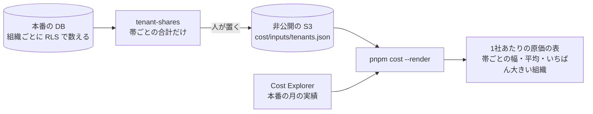

# 設計: 1社あたりの原価(組織の大きさの帯ごとの按分)

> **AI 用の設計書。省略せずに網羅的に書く(正はこちら)。** 人はこれを開かず、PR の本文の「人向けのまとめ」を見る([guides/human-review.md](../guides/human-review.md))。
> 仕様: [docs/specs/0042-tenant-cost.md](../specs/0042-tenant-cost.md)・ADR: [0053](../adr/0053-tenant-cost-by-size-bands.md)
> 状態: 承認済み(@attumkwg 2026-10-25。会話で回答。U-1 は「既定として承認」= 導入時に決める)
> 観点の順は [review-viewpoints.md](../review-viewpoints.md)。

## 0. 全体像

API の運営のコマンド `tenant-shares`(`apps/api/src/usage/shares.ts`)が、組織ごとの人数・行の数・書き込みの数を数えて**帯ごとの合計**にし、人がその1行を費用のページの非公開の入力(`cost/inputs/tenants.json`)に置く。費用のページ(`scripts/cost/tenants.mjs`)は、元の月の本番の AWS を帯ごとに3つの元で按分し、1社あたりの幅を出す。組織の ID は DB の外に出ない。



## 作業の前に読んだ物(ガイド)

- 費用のページ: `scripts/cost/summary.mjs`(`aws-prod` の `months` は月ごとの本番の実績)・`render.mjs`(表と幅の書き方)・`source-people.mjs` の `readInputs`(非公開の入力)・`docs/guides/cost-dashboard.md`・ADR 0032(ページと入力は非公開の S3 だけ)・仕様 0020(幅で見せる・人の評価に使わない)
- 利用の記録: `apps/api/src/usage/command.ts`(組織ごとに `withTenant` で数え、数だけを出す。`operator_tenant_ids()`)・`retention.ts` の `RETENTION_SMALL_BELOW`(小さい組の印。設計書 0022 の S-2)
- 解約: `apps/api/src/offboarding/delete-tenant.ts` の `TENANT_TABLES`(組織の行のある表の一覧。`sensitive.` で始まる物は要配慮)
- 監査ログ: `apps/api/src/audit/schema.ts`(`actor_kind`・`outcome`・`occurred_at`)
- `docs/security.md` の AI-6(要配慮は件数も渡さない)・場面 4-5・7-5

## 1. 設計方針

- 数えるのは API の運営のコマンド(`usage-report` と同じ置き場・同じ接続・同じ流し方)。費用のページ(Actions)は本番の DB に入れないので、人が出力を置き場に置く(時給・売上と同じ非公開の入力)。
- 帯ごとに足した数だけを DB の外に出す。組織ごとの数はコマンドの中のメモリだけ。
- 按分の元は1つに決めず、**人数・データの行の数・書き込みの数**の3つで按分した幅を出す(費用のページの人の時間と同じ「幅で見せる」。ADR 0053)。
- 按分する費用は本番の AWS だけ(未確定事項 U-1)。
- 新しい依存・表・移行・API は無い。

## 2. データモデル

DB は変えない。読む物:

| 元 | 数え方 |
|---|---|
| 人数 | `organizations.users` の行の数(組織ごと) |
| データの行の数 | `TENANT_TABLES` のうち `sensitive.` で始まらない表の、その組織の行の数の合計(組織・人・計画・タスク・監査ログ・送信待ち・利用の記録・同意など) |
| 書き込みの数 | `platform.audit_events` のうち、`actor_kind <> 'system'`・`outcome = 'allowed'`・`occurred_at` がその月(UTC) |

非公開の入力 `cost/inputs/tenants.json`(`tenant-shares` の1行目そのまま):

```json
{"mode":"tenant-shares","month":"2026-09","tenantsTotal":12,"smallBelow":5,
 "totals":{"users":160,"rows":48000,"writes":9000},
 "bands":[{"band":"1〜5人","tenants":7,"small":false,"users":25,"rows":9000,"writes":1500}, …],
 "largestPct":{"users":50,"rows":50,"writes":50}}
```

`summary.json` に `tenant_cost` を足す(足すだけ):

```json
{"month":"2026-09","target_jpy":150000,"target_how":"実績","tenants_total":12,"small_below":5,
 "bases":["人数","データの行の数","書き込みの数"],"average":{"low":12500,"high":12500},
 "bands":[{"band":"1〜5人","tenants":7,"small":false,"low":3348,"high":4018}, …],
 "largest":{"low":75000,"high":75000}}
```

## 3. API

API は足さない。コマンド:

`node dist/cli.js tenant-shares [--month YYYY-MM]`(既定は前の月・UTC)

- 出す行: ① JSON 1行(上の形)② 置き場への案内。
- `--month` が `YYYY-MM` でなければ止まる。

費用のページ: `pnpm cost --render <dir> --inputs <dir>` が `tenants.json` を読む(無ければ表を出さず、足りない物に書く)。

## 4. 状態遷移

該当なし(読むだけの集計)。

## 5. システム間連携

- 本番の DB(運営のコマンド。表の持ち主の接続)と、非公開の S3(人が置く・`cost.yml` が落とす。今の `cost/inputs/` と同じ)。
- 外のサービスは増えない。

## 6. 業務ルール

- **T-1 帯**: 人数で `1〜5人`・`6〜20人`・`21〜100人`・`101人〜`(`SIZE_BANDS`)。組織の無い帯は出さない。人数 0 の組織は最初の帯。
- **T-2 小さい帯**: 組織の数が `RETENTION_SMALL_BELOW`(5)より少ない帯に `small: true`。数と金額は出す(隠すと PMF の前はほとんど出せない。設計書 0022 の S-2 と同じ)。ページに「(5組織未満。割合が大きく揺れる)」と添える。
- **T-3 いちばん大きい組織**: 元ごとに、いちばん大きい組織の数 ÷ 全体(整数の %)。元ごとに別の組織のことがある。
- **T-4 按分する金額**: 元の月が今月なら、本番の今月の分を日割りで月末まで伸ばした見込み。過ぎた月なら `aws-prod` の `months` のその月の実績。どちらも無ければ表を出さない。
- **T-5 1社あたり**: 元 k ごとに `金額 × 帯の k ÷ 全体の k ÷ 帯の組織の数`。全体が 0 の元は使わない。帯の1社あたりは、使えた元の値の最小と最大(円の整数・四捨五入)。全体の平均は `金額 ÷ 組織の数`。いちばん大きい組織は `金額 × T-3 の % ÷ 100` の最小と最大。
- **T-6 除く物**: 運営の組織(`SUPPORT_TENANT_ID`)。要配慮の表。監査ログの仕組みの記録と断られた操作。
- **T-7 出さない物**: 組織の ID・名前・人の ID。組織ごとの数・金額。

## 7. 要求との対応

| 受け入れ条件(仕様) | 設計のどこ | テスト |
|---|---|---|
| 帯ごとの合計といちばん大きい組織の % を出す。月の既定は前の月 | 3.・6. T-1・T-3 | `apps/api/test/unit/tenant-shares.test.ts`・`test/integration/tenant-shares.int.test.ts` |
| ID を出さない・運営の組織と要配慮の表を数えない | 2.・6. T-6・T-7 | 結合の「コマンドの入口」(ID が無い)・「人数・行の数…」(運営の組織を数えない)・`COUNTED` は `sensitive.` を除く |
| 書き込みは人の許された操作だけ(その月) | 2.・6. T-6 | 結合の「人数・行の数…」(次の月・仕組み・断った操作を入れない) |
| 小さい帯に印 | 6. T-2 | 単体の「組織を人数の帯に分け…」「帯の境い目…」 |
| 置き場に置くとページに表 | 2.・3. | `scripts/cost/tenants.test.mjs` の「まとめとページ」 |
| 本番の実績か見込みで、3つの元の幅 | 6. T-4・T-5 | `tenants.test.mjs` の「帯ごとの1社あたりは…」「按分する金額…」 |
| 元が無い・月の AWS が無いときは足りない物に書く | 3. | `tenants.test.mjs` の「まとめとページ」・`pl.test.mjs` の「入力」 |
| ページに組織の名前・ID が出ない | 6. T-7 | 元に ID が無い(結合)・ページは元の帯だけを出す |

## 8. 非機能

- 性能: 組織ごとに、表ごとの `count(*)`(12表)と人数と監査ログの件数。表の多くは `tenant_id` で始まる索引か RLS の絞りで読む。監査ログは `(tenant_id, id desc)` の索引(月の絞りは行を読む)。組織が数千・監査ログが数千万になって時間がかかるようになったら、表の統計(`pg_class`)からの見積もりに替える。月1回・人が流す。
- セキュリティ: 仕様の STRIDE のとおり。
- 運用: 手引き `docs/guides/cost-dashboard.md` の 7。
- 費用: 増えない。

## 9. このプロダクト特有

| 観点 | この変更では |
|---|---|
| テナント分離 | 組織ごとに `withTenant` で数え、組織の ID は出さない |
| 権限の表 | 該当なし |
| 監査ログ | 読むだけ(件数) |
| 解約で消す一覧 | 該当なし(表を足さない。数える表は `TENANT_TABLES` から作るので、表を足せば自動で数える) |
| サポートの代理ログイン | 代理ログインの社員の書き込みは数える(お客さんのために使った費用なので) |
| ログの個人情報 | ログに出さない(標準出力の JSON だけ) |
| 列の分類(`personal` / `sensitive`) | 列を足さない。要配慮の表は数えない |
| 画面の部品 | 該当なし(費用のページの表を1つ) |

## 10. 観点ごとの扱い

| 観点 | 扱い | 理由 |
|---|---|---|
| 設計方針 | 採用 | 運営のコマンドで帯ごとの合計にして、非公開の入力として渡す(ADR 0053) |
| データモデル | 軽く確認 | 表は変えない。`summary.json` に足すだけ |
| API | 低優先 | 足さない |
| 状態遷移 | 低優先 | 無い |
| システム間連携 | 軽く確認 | 今ある非公開の入力の置き場 |
| 業務ルール | **最重要** | 何を按分するか・元・帯で、値段と DB を分ける判断が変わる(U-1) |
| 要求との対応 | 機械で検証 | 単体・結合・費用のページのテスト |
| 非機能 | 軽く確認 | 月1回の数え上げ |
| テナント分離・ログの個人情報 | 採用 | 組織の ID を出さないことを結合テストで確かめる |

## 11. 決めたこと(AI が決めた。人に聞かなかった)

- 数えるのは API の運営のコマンドで、費用のページへは人が非公開の入力として置く — 費用のページ(Actions)は本番の DB に入れない(入れるには infra と秘密が増える)。時給・売上と同じ置き場・同じ流れ
- DB の外に出すのは帯ごとの合計といちばん大きい組織の % だけ — 組織ごとの行(ID が無くても)は、大きさで個社が分かる。値決めと DB を分ける判断には帯といちばん大きい組織で足りる
- 小さい帯は隠さず `small` を付ける(5組織未満) — 継続率(設計書 0022 の S-2)と同じ。隠すと PMF の前は表が空になる
- 書き込みの数は監査ログから — 書き込みの API は認可の関所が必ず監査ログに残す(書き込みの数の正)。読む API の数は残っていない(ALB やログを読むには別の権限が要る)
- 代理ログインの社員の書き込みも数える — お客さんのために使った費用
- 月は UTC で区切る — 組織ごとに時間帯が違い、Cost Explorer の月も UTC
- 今月の元なら日割りで伸ばした見込み・過ぎた月なら実績 — ふつうは月の初めに前の月を数えるので実績になる
- 名前は `tenant-shares`・置き場は `apps/api/src/usage/` — 運営の数え上げのコマンド(`usage-report`)と同じ所に置き、カタログの部品「利用の記録」と一緒に残す・消す
- ADR を1つ書く — 按分の元と、DB の外に出す形(帯ごとの合計)は、後から変えにくい決めごと

## 12. 未確定事項(AI の仮決め。人の承認と分けて追う)

> 4つに当たる判断だけ。状態の書き方は [guides/human-review.md](../guides/human-review.md) の 2。`pnpm decisions` がここを読む。**`仮決め` が残る PR はマージしない。**

| 番号 | 工程 | 種類 | 仮決め(設計した事実) | なぜそうしたか | 人が判断する問い | 状態 |
|---|---|---|---|---|---|---|
| U-1 | 設計 | 事業判断 | 1社あたりの原価に入れるのは**本番の AWS だけ**。按分の元は**人数・データの行の数・書き込みの数**の3つの幅。組織の大きさの帯は人数で **1〜5人・6〜20人・21〜100人・101人〜** | 値段を決めるときの「1社を支えるのにかかるインフラ」に近い物だけにした。人の時間(サポート・導入)・SaaS は組織ごとの元が無く、入れると数字の根拠が弱くなる。元を1つに決めると、何を重く見るかを AI が決めることになるので幅にした。帯は場面の「小さい工務店」「大きな病院」が分かれる区切り | 原価に入れる物は本番の AWS だけでよいか(人の時間・Sentry などの SaaS・stg も配るか)。按分の元は3つの幅でよいか(どれか1つに決めるか)。帯の区切りは料金のプランに合わせて変えるか(導入時に、使う人が自分のプランに合わせて決める物にしてよいか) | 導入時に決める(キットの既定は @attumkwg 2026-10-25 に承認。会話で回答) |

## 13. 作り直しの記録

| 日付 | きっかけ | 入った工程 | 直した物 | 作り直した下流 |
|---|---|---|---|---|
