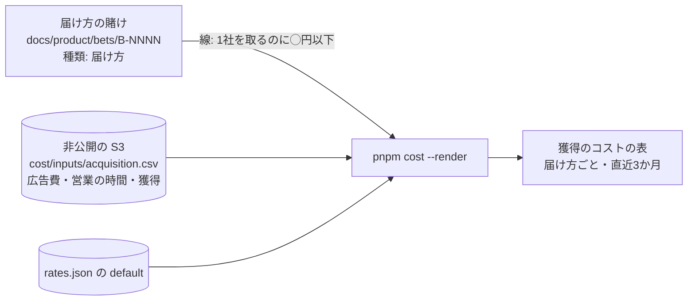

# 設計: 獲得のコストと、届け方の賭け

> **AI 用の設計書。省略せずに網羅的に書く(正はこちら)。** 人はこれを開かず、PR の本文の「人向けのまとめ」を見る([guides/human-review.md](../guides/human-review.md))。
> 仕様: [docs/specs/0043-acquisition-cost.md](../specs/0043-acquisition-cost.md)・ADR: [0054](../adr/0054-acquisition-cost-from-manual-inputs.md)
> 状態: 下書き
> 観点の順は [review-viewpoints.md](../review-viewpoints.md)。

## 0. 全体像

届け方を機能と同じ「賭け」で確かめるためのひな形(`_template-channel.md`)と、費用のページの「獲得のコスト」の表を足す。数は人が非公開の置き場の `acquisition.csv` に月ごとに書き、費用のページ(`scripts/cost/acquisition.mjs`)が直近3か月を届け方ごとに足して「1社を取るのにいくら」を出す。賭けの検査(`scripts/bets*`)は変えない。



## 作業の前に読んだ物(ガイド)

- `docs/guides/bets-and-assets.md`(段階・線・小石・会計区分の案)・`docs/product/bets/_template.md`・`scripts/bets-lib.mjs` の `parseBet`(「いまの状態」は `段階:` と `親:` だけを読み、ほかの行は見ない)
- 費用のページ: `scripts/cost/source-people.mjs` の `readInputs`・`parseCsv`(非公開の入力)・`summary.mjs`・`render.mjs`・`docs/guides/cost-dashboard.md`・ADR 0032・0033
- 場面 8-7(獲得のコストを1年以内に回収・生涯の売上が獲得のコストの3倍以上、という目安)
- 設計書 0022 の S-2・0042 の T-2(小さい組の印)

## 1. 設計方針

- 届け方の賭けは**機能の賭けと同じファイル・同じ検査**にする(新しい段階・新しい置き場・新しい検査を作らない)。違いは「いまの状態」の `種類: 届け方` と、ひな形の段階の読み替えだけ。`pnpm bets` は `種類` を読まないので変えない。
- 獲得のコストは**手入力**(広告の画面の鍵を持たない・営業の時間は記録の仕組みが無い)。費用のページの他の手入力(時給・時間・売上)と同じ非公開の置き場。
- 届け方ごとに足した数だけを持つ(個社・人ごとは持たない)。
- 新しい依存は無い。

## 2. データモデル

DB は触らない。

非公開の入力 `cost/inputs/acquisition.csv`:

| 列 | 意味 |
|---|---|
| `month` | `YYYY-MM` |
| `channel` | 届け方の賭けの ID(`B-NNNN`)か名前(紹介・展示会など) |
| `ad_jpy` | 外に払った額(広告・出展・チラシ・紹介の謝礼。円・税抜き・整数に丸める) |
| `sales_hours` | 営業・説明・デモ・見積もりの時間の合計 |
| `won` | その月に有料になった組織の数 |

`#` で始まる行は注。月が `YYYY-MM` でない・届け方が空・数が負か数でない行は落とす。

`summary.json` に `acquisition` を足す(足すだけ):

```json
{"from":"2026-08","to":"2026-10","rate_known":true,
 "channels":[{"channel":"B-0003","ad_jpy":180000,"sales_hours":20,"won":6,"sales_jpy":80000,"total_jpy":260000,"per_won_jpy":43333,"small":false}],
 "total":{"ad_jpy":180000,"total_jpy":292000,"won":8,"per_won_jpy":36500}}
```

ひな形 `docs/product/bets/_template-channel.md`: `_template.md` と同じ節で、「いまの状態」に `- 種類: 届け方`、段階の注・仮説・線の例・会計区分の例を届け方に読み替える。

## 3. API

API は足さない。`pnpm cost --render <dir> --inputs <dir>` が `acquisition.csv` を読む。

## 4. 状態遷移

届け方の賭けの段階は機能と同じ(`idea → cpf → psf → rollout → adopted / retired`・`dropped`)。読み替え:

| 段階 | 届け方では |
|---|---|
| `cpf` | この届け方で、困っている相手に会えるか |
| `psf` | 会えた相手が申し込むか(少額・短い期間で) |
| `rollout` | 費用を増やしても、1社を取る額が線の中か |
| `adopted` | 続ける届け方 |
| `retired` | やめた届け方の片付け(契約・定期の支払いを止める) |

## 5. システム間連携

非公開の S3(人が置く・`cost.yml` が落とす。今の `cost/inputs/` と同じ)。外のサービスは増えない。

## 6. 業務ルール

- **C-1 期間**: 今月を含む直近3か月(`ACQUISITION_MONTHS`)。1か月だけだと、展示会の月と成約の月がずれて読めない。
- **C-2 合計**: 届け方ごとに広告費・営業の時間・獲得を足す。営業の費用 = 営業の時間 × `rates.json` の `default`(円・四捨五入)。時給が無ければ null(合計は広告費だけ)。
- **C-3 1社を取るのに**: 合計 ÷ 獲得(円・四捨五入)。獲得が0なら null。全体の行も同じ。
- **C-4 少ない届け方**: 獲得が `ACQUISITION_SMALL_BELOW`(5)未満なら `small: true`。ページに「(N組織。少ない)」。
- **C-5 並び**: 合計の多い順。
- **C-6 会計区分**: 届け方の賭けの会計区分の案は、どの段階でも `費用`(ひな形の例・手引き)。`/ledger` の案の表は変えない(PR の作業の種類から決まる。届け方の賭けにはふつう PR が無い)。
- **C-7 持たない物**: 個社の名前・どの組織がどこから来たか・人ごとの営業の時間。

## 7. 要求との対応

| 受け入れ条件(仕様) | 設計のどこ | テスト |
|---|---|---|
| ひな形で書け、`pnpm bets` がそのまま確かめる | 1.・2.・4. | `pnpm bets`(ひな形は `_` で始まるので読まない。書いた賭けは機能と同じ検査)・`scripts/bets.test.mjs`(変えていない) |
| 会計区分の案はいつも費用 | 6. C-6 | ひな形と手引き(人が確かめる) |
| 入力を置くと表が出る | 2.・3. | `scripts/cost/acquisition.test.mjs` の「まとめとページ」 |
| 直近3か月・届け方ごと・1社を取るのに | 6. C-1〜C-3・C-5 | `acquisition.test.mjs` の「届け方ごとに直近3か月を足し…」 |
| 時給が無い・獲得が0 | 6. C-2・C-3 | 同上 |
| 少ない届け方の印 | 6. C-4 | 同上・「まとめとページ」 |
| 入力が無ければ足りない物に書く・形の合わない行は数えない | 2. | `acquisition.test.mjs` の「acquisition.csv: 形の合う行だけ」・「まとめとページ」・`pl.test.mjs` の「入力」 |
| 個社・人ごとが無い | 6. C-7 | 入力の列に無い(見本 `docs/cost/inputs-example/acquisition.csv` を読むテスト) |

## 8. 非機能

- 性能・費用: 手入力の小さな表。変わらない。
- セキュリティ: 非公開の S3 だけ(今の入力と同じ)。
- 運用: 手引き `docs/guides/cost-dashboard.md` の 8・`bets-and-assets.md` の「届け方の賭け」・`/bet` に数行。

## 9. このプロダクト特有

| 観点 | この変更では |
|---|---|
| テナント分離 | 該当なし(組織のデータを持たない) |
| 権限の表 | 該当なし |
| 監査ログ | 該当なし |
| 解約で消す一覧 | 該当なし |
| サポートの代理ログイン | 該当なし |
| ログの個人情報 | 該当なし(ログに金額も出さない。今の費用のページと同じ) |
| 列の分類(`personal` / `sensitive`) | 該当なし |
| 画面の部品 | 該当なし(費用のページの表を1つ) |

## 10. 観点ごとの扱い

| 観点 | 扱い | 理由 |
|---|---|---|
| 設計方針 | 採用 | 届け方を機能と同じ賭けにする・手入力(ADR 0054) |
| データモデル | 軽く確認 | 入力の CSV 1つ |
| API | 低優先 | 足さない |
| 状態遷移 | 軽く確認 | 段階の読み替えだけ |
| システム間連携 | 低優先 | 今の置き場 |
| 業務ルール | **最重要** | 期間・時給の既定・少ない印で、届け方を続けるか・やめるかの読み方が変わる |
| 要求との対応 | 機械で検証 | `acquisition.test.mjs`(4本) |
| 非機能 | 低優先 | 小さな表 |

## 11. 決めたこと(AI が決めた。人に聞かなかった)

- 届け方の賭けは、機能の賭けと同じ段階・同じファイル・同じ検査 — `scripts/bets*` を変えずに済む(依頼: 触るなら最小に)。新しい段階を足すと、ロードマップ・機能フラグ・会計区分の案の検査がみな変わる
- 段階の読み替え(cpf = 会えるか・psf = 申し込むか・rollout = 費用を増やしても線の中か) — 「困りごと → 解決策 → 一部に広げる」の形が、届け方の「相手に会う → 申し込む → 広げる」に重なる
- 獲得のコストは手入力 — 広告の画面の鍵を GitHub に置かない(AI の請求と同じ考え。ADR 0032)。営業の時間は記録の仕組みが無い
- 直近3か月を足す — 展示会の月と成約の月がずれる。PMF の前は1か月の獲得が数社で、1か月だけでは読めない
- 営業の時間は時給の既定(`default`)で円にする — 営業の時間を人ごとに書かない(人ごとの時給は使えない)
- 少ない印は5組織未満 — 継続率・1社あたりの原価と同じ
- 届け方とお客さんの組織を結びつけない — どの組織がどこから来たかを費用のページ(と AI)に持ち込まない。届け方ごとの継続は話を聞くか、始めた週の組で見る(手引き)
- 回収の月数や LTV は自動で出さない — 1社の月の粗利は、売上の入力(賭けか全体)と1社あたりの原価(G-10)がそろわないと出ない。手引きに見方を書く
- 会計区分の案はいつも費用 — 広告・営業は将来の収益の確実さに関わらず資産にしない、が一般的な整理。確定は専門家
- ADR を1つ書く — 届け方を機能と同じ賭けにすることと、手入力にすることは、後から変えにくい

## 12. 未確定事項(AI の仮決め。人の承認と分けて追う)

> 4つに当たる判断だけ。状態の書き方は [guides/human-review.md](../guides/human-review.md) の 2。`pnpm decisions` がここを読む。**`仮決め` が残る PR はマージしない。**

該当なし(数え方・期間・入力の形は、事業判断・利用者の挙動・他チームとの契約や制約・戻せないリスクのどれにも当たらない。線の数字は賭けごとに人が決める。理由は 11)。

## 13. 作り直しの記録

| 日付 | きっかけ | 入った工程 | 直した物 | 作り直した下流 |
|---|---|---|---|---|
