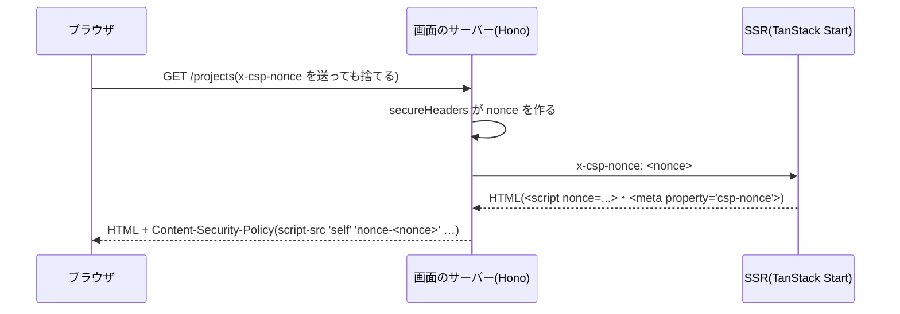

# 設計: 画面の CSP(Content-Security-Policy)

> **AI 用の設計書。省略せずに網羅的に書く(正はこちら)。** 人はこれを開かず、PR の本文の「人向けのまとめ」を見る([guides/human-review.md](../guides/human-review.md))。
> 仕様: [docs/specs/0045-web-csp.md](../specs/0045-web-csp.md)・ADR: [0056](../adr/0056-web-csp-with-nonce.md)
> 状態: 下書き
> 観点の順は [review-viewpoints.md](../review-viewpoints.md)。当てはまらない節も消さずに「該当なし(理由)」と書く。

## 0. 全体像

画面のサーバー(`apps/web/server/app.ts`)が1リクエストごとに nonce を作って CSP のヘッダーに入れ、同じ値を `x-csp-nonce` で SSR に渡す。SSR(`src/router.tsx`)は TanStack の `ssr.nonce` に渡し、TanStack が埋め込むスクリプトと `<meta property="csp-nonce">` に付ける。

## 作業の前に読んだ物(ガイド)

- `apps/web/server/app.ts`: Hono の `secureHeaders`(HSTS・Permissions-Policy)。SSR へは request ID を足した `Request` を作って渡す。
- `apps/web/CLAUDE.md`・`docs/security.md` のログインの表: CSP は「nonce が要る」ので見送りだった。
- `@tanstack/router-core` 1.171 の `RouterOptions.ssr.nonce`: `Scripts`・`ScriptOnce`・`HeadContent`・水和のスクリプトに付け、`<meta property="csp-nonce">` を出す。TanStack は描き終えると埋め込みのスクリプトを消す。
- `hono/secure-headers` 4.13 の `NONCE`: 16バイトの乱数を base64 にし、`c.get("secureHeadersNonce")` に置く。ヘッダーの値は `next()` の前に決まる。
- Zod 4.6: object の schema を**作るとき**に `Function("")` を試して速い検証を使うか決める(`z.config({ jitless: true })` で止まる)。試すだけで CSP の違反になる。
- `packages/ui`: React Aria の部品(チェックボックスの隠した入力など)が `style` 属性を描く。`<style>` の要素は描かない。
- `src/report-error.ts`: DSN があるとき、ブラウザから Sentry に送る。

## 1. 設計方針

- Hono の `secureHeaders` の CSP と `NONCE` を使う(新しい依存なし)。
- nonce の受け渡しは要求のヘッダー `x-csp-nonce`(画面のサーバーの中だけ。ブラウザから来た値は消して付け直す)。
- SSR は `getRequest()` から読み、ブラウザでは `<meta property="csp-nonce">` から読む(後から足す head の要素にも付けるため)。
- Zod の試しは `@app/shared` の最初に読む `zod-config.ts` で、ブラウザのときだけ止める(サーバーは速い方のまま)。

## 2. データモデル

該当なし。CSP の中身:

| 指示 | 値 | なぜ |
|---|---|---|
| `default-src` | `'self'` | 書いていない種類は自分の origin だけ |
| `script-src` | `'self' 'nonce-…'` | ビルドした JS(`/assets`)と、SSR の埋め込み。`'unsafe-inline'`・`'unsafe-eval'` は無し |
| `style-src` | `'self' 'nonce-…'` | `styles.css` と、TanStack が nonce を付けて描く `<style>` |
| `style-src-attr` | `'unsafe-inline'` | React Aria が描く `style` 属性(隠した入力など)。属性の style ではスクリプトは動かない |
| `img-src` | `'self' data:` | favicon・アイコン |
| `font-src` | `'self'` | 端末の文字だけ(Web フォントを外から読まない) |
| `connect-src` | `'self'`(+ Sentry の origin) | API は同じ origin。DSN があるときだけ足す |
| `object-src` | `'none'` | 使わない |
| `base-uri` | `'none'` | `<base>` で読み込み先を変えさせない |
| `form-action` | `'self'` | フォームは自分にだけ |
| `frame-ancestors` | `'none'` | 枠に埋め込ませない(クリックジャッキング) |

## 3. API

該当なし(画面のサーバーのヘッダーだけ)。`createWebApp` に `sentryDsn` を足す(`server/index.ts` が `SENTRY_DSN` を渡す)。

## 4. 状態遷移

該当なし。

## 5. システム間連携

- Sentry: ブラウザからの送り先の origin だけを `connect-src` に足す(DSN が無ければ足さない)。委託先の台帳は変わらない(すでにある Sentry)。

## 6. 業務ルール

- nonce は応答ごとに新しく作り、使い回さない。ブラウザから来た `x-csp-nonce` は使わない。
- CSP は画面のサーバーの全部の応答に付く(HTML 以外にも付くが、害は無い)。
- 外の物を足すときは CSP にも足す(`apps/web/CLAUDE.md`)。

## 7. 要求との対応

| 受け入れ条件(仕様) | 設計のどこ | テスト |
|---|---|---|
| 全部の応答に CSP・自分と nonce だけ | 2. | `server/app.test.ts`「読み込むのは…」「転送・失敗・JS にも付く」 |
| nonce は毎回変わる・ブラウザの値を使わない | 1.・6. | `server/app.test.ts`「nonce は1リクエストごとに…」 |
| SSR の埋め込みに nonce | 1. | E2E `csp.spec.ts`「ログイン前の画面」(届いた HTML の埋め込みが全部その nonce) |
| eval・object・base・枠を止める | 2. | `server/app.test.ts` |
| 外へは Sentry だけ | 2.・5. | `server/app.test.ts`「Sentry の DSN があれば…」 |
| 主な画面で違反が無い | — | E2E `csp.spec.ts`(securitypolicyviolation と console を拾う) |
| nonce の無い埋め込みは止まる | — | E2E `csp.spec.ts`「nonce の無い…」 |
| 見た目は変わらない | 2.(style 属性) | VRT(基準のまま 18件一致) |

## 8. 非機能

- 性能: 乱数16バイトとヘッダー1行。
- セキュリティ: 仕様の STRIDE のとおり。`style-src-attr 'unsafe-inline'` は残る(下の 11.)。
- 運用: 違反の知らせの受け口は無い(`docs/reference.md` の「わざとやっていないこと」)。
- 手元の開発(`pnpm dev`)は画面のサーバーを通らないので CSP が無い。CSP の確かめは `docker compose up --build` の画面と E2E で。

## 9. このプロダクト特有

| 観点 | この変更では |
|---|---|
| テナント分離・権限の表・監査ログ・解約で消す一覧・サポートの代理ログイン・列の分類 | 該当なし |
| ログの個人情報 | 該当なし(nonce はログに出さない) |
| 画面の部品 | 変えない。`style` 属性は許す |

## 10. 観点ごとの扱い

| 観点 | 扱い | 理由 |
|---|---|---|
| 非機能(セキュリティ) | 最重要 | 外部の診断で見られる所 |
| 設計方針 | 採用 | Hono と TanStack の仕組みだけで、依存を足さない |
| 要求との対応 | 機械で検証 | 単体と E2E |
| システム間連携 | 軽く確認 | Sentry の origin |
| ほか | 低優先 | ヘッダーだけ |

## 11. 決めたこと(AI が決めた。人に聞かなかった)

- **`'strict-dynamic'` を使わず `'self'` と nonce** — JS は全部同じ origin の `/assets` から来るので `'self'` で足りる。`'strict-dynamic'` は古いブラウザとの組み合わせが分かりにくい。
- **`style-src-attr 'unsafe-inline'`** — React Aria が SSR で `style` 属性を描く(隠した入力など)。止めると見た目と操作が壊れる。属性の style ではスクリプトは動かず、`<style>` の要素は nonce が要るまま。
- **違反の知らせの受け口(report-to)を作らない** — 受け口は API に足す物で、数える物が決まってから。いまは E2E で止めた物を見つける。
- **Zod の試しはブラウザだけで止める** — サーバーには CSP が無く、止めると検証が遅くなる。`@app/shared` の最初に読む(schema を作る前に効かせる)。
- **CSP を全部の応答に付ける** — HTML だけに絞る分けは要らず、付けても害が無い。
- **`frame-ancestors 'none'`** — これまでの `X-Frame-Options: SAMEORIGIN`(Hono の既定)より強い。自分の画面を自分の枠に入れる所も無い。

## 12. 未確定事項(AI の仮決め。人の承認と分けて追う)

> 4つに当たる判断だけ。状態の書き方は [guides/human-review.md](../guides/human-review.md) の 2。`pnpm decisions` がここを読む。**`仮決め` が残る PR はマージしない。**

| 番号 | 工程 | 種類 | 仮決め(設計した事実) | なぜそうしたか | 人が判断する問い | 状態 |
|---|---|---|---|---|---|---|

なし(4つに当たる判断が無い。利用者に見える振る舞い・見た目は変わらない。枠への埋め込みは、これまでも同じ origin だけだった)。

## 13. 作り直しの記録

| 日付 | きっかけ | 入った工程 | 直した物 | 作り直した下流 |
|---|---|---|---|---|
