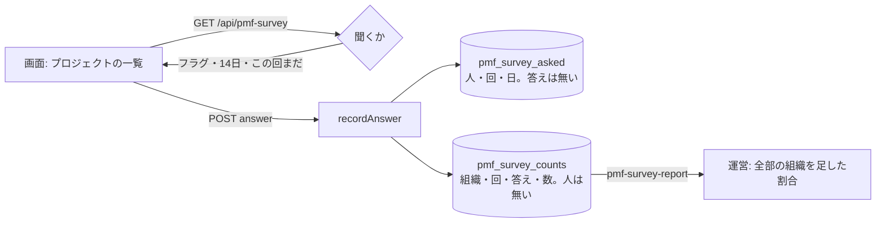

# 設計: 「無くなったら困るか」を画面の中で聞く(PMF の兆し)

> **AI 用の設計書。省略せずに網羅的に書く(正はこちら)。** 人はこれを開かず、PR の本文の「人向けのまとめ」を見る([guides/human-review.md](../guides/human-review.md))。
> 仕様: [docs/specs/0046-pmf-survey.md](../specs/0046-pmf-survey.md)・ADR: [0057](../adr/0057-pmf-survey-counts-only.md)
> 状態: 下書き
> 観点の順は [review-viewpoints.md](../review-viewpoints.md)。当てはまらない節も消さずに「該当なし(理由)」と書く。

## 0. 全体像

キットの機能フラグ `pmf-survey`(`bet: "kit"`)を入れた組織の人に、プロジェクトの一覧で「このサービスが使えなくなったら、どう感じますか」を四半期に1回まで聞く。答えは「この回は答え終えた」の印(答えを持たない)と、組織・回・答えごとの数(人を持たない)に分けて書く。運営のコマンドが全部の組織を足した割合を出す。

## 作業の前に読んだ物(ガイド)

- `docs/guides/before-pmf.md` の「PMF の兆し」: 「とても困る」が40%以上(Sean Ellis のテスト)。
- `apps/api/src/usage`: 共通の仕組みを platform に置く形・`recordUsage`(代理・運営の組織を除く・組織の時間帯の日)・コマンド(`allTenantIds` で組織ごとに `withTenant`・数だけを出す)・保存期間400日。
- `apps/api/src/feature-flags`・`packages/shared/src/feature-flags.ts`: フラグは賭け(B-NNNN)に結びつく。`isFeatureEnabled`。
- `apps/api/drizzle/0012_usage_records.sql`: 新しい表の RLS・GRANT の形。
- `apps/api/src/authz/policy.ts`・`docs/authz/matrix.yaml`・`apps/api/src/audit/actions.ts`: 権限・表・監査ログの名前。
- `apps/web/src/pages/LegalNotices.tsx`・`ProjectsPage.tsx`: 画面の帯の出し方・`useAction`。

## 1. 設計方針

- 共通の仕組みとして `apps/api/src/pmf-survey/`(`schema`・`repository`・`routes`・`command`・`index`)。領域ではない(usage と同じ)。
- 出す相手は既存の機能フラグで絞る。フラグの決まり(賭けに結びつく)に「キットの仕組みは `bet: "kit"`」を足し、`pmf-survey` を1つ足す(下の 11.)。
- **だれが何と答えたかを結びつけない**ことを、表の形で守る(ADR 0057)。
- 画面はプロジェクトの一覧(ログインして最初に開く画面)に1枚の枠。`hasFeature` のときだけ聞くかを読む。

## 2. データモデル

移行 `0016_pmf_survey.sql`(段: ① 拡張。0015 は並んで進む別の PR が使う)。スキーマ `platform`。

| 表 | 列 | 型 | 分類 | 備考 |
|---|---|---|---|---|
| `pmf_survey_asked` | id | uuid(v7) | internal | |
| | tenant_id | uuid | internal | → tenants |
| | user_id | uuid | internal | (tenant_id, user_id) → users |
| | round | text | public | 「2026-Q4」 |
| | day | date | internal | 組織の時間帯の日。保存期間の削除 |
| | 一意 | (tenant_id, user_id, round) | | 1人1回 |
| `pmf_survey_counts` | id | uuid(v7) | internal | |
| | tenant_id | uuid | internal | → tenants |
| | round | text | public | |
| | answer | text | public | `PMF_SURVEY_ANSWERS` |
| | count | bigint | internal | |
| | 一意 | (tenant_id, round, answer) | | 足すときは数を増やす |

- RLS: 両方 ENABLE・FORCE・`tenant_isolation`。
- 権限: `app_rw` は asked に SELECT・INSERT、counts に SELECT・INSERT・UPDATE(count だけ)。消すのは表の持ち主(コマンド)。
- 解約: `TENANT_TABLES` に counts・asked を足す(feature_usage の前)。
- 書き出し: 入れない(お客さんのデータではなく、運営が改善のために数える物。数には人も無い)。
- 保存期間: asked は400日(`pmf-survey-purge`)。counts は人を持たないので残す(解約で消える)。

## 3. API

| メソッドとパス | 入力 | 出力 | 失敗 | 権限 | 監査ログ |
|---|---|---|---|---|---|
| `GET /api/pmf-survey` | — | `PmfSurveyStatus { ask, round }` | 401 | `me:read` | — |
| `POST /api/pmf-survey` | `{ answer: PmfSurveyAnswer }` | 204 | 400・401・403(代理)・404(聞けない)・409(この回は答えた) | `pmf_survey:answer`(代理の最中は使えない) | `pmf_survey.respond`(target user・ID なし。答えは入れない) |

- GET は、聞かないときも 200 で `ask: false`(フラグの有無を知らせない)。
- 契約は `packages/shared/src/pmf-survey.ts`(足すだけ)。

## 4. 状態遷移

人ごと・回ごと: 聞く前 → 答え終えた(答えた・答えない のどちらも)。戻れない(次の回に、また聞く前になる)。

## 5. システム間連携

該当なし(外へ送らない。アウトボックスも使わない)。

## 6. 業務ルール

- 聞く: フラグが入っている(`isFeatureEnabled`)・代理でない・運営の組織でない・入ってから14日以上(`PMF_SURVEY_MIN_DAYS`)・この回の印が無い。
- 回: 組織の時間帯の日付の四半期(`pmfSurveyRound`)。
- 答える: 聞けない人は 404(機能が無いのと同じ形)。この回の印があれば 409。印を足して(衝突したら 409)、数に1つ足す(同じトランザクション)。
- 集計(`pmf-survey-report`): 全部の組織(運営の組織を除く)を足す。分母 = とても困る+少し困る+困らない。割合は小数1桁。線 40・30件より少なければ `small`。

## 7. 要求との対応

| 受け入れ条件(仕様) | 設計のどこ | テスト |
|---|---|---|
| 入れた組織だけ | 6. | `pmf-survey.int.test.ts`「入れていない組織では聞かない」 |
| 14日・代理・運営 | 6. | 同「14日より前」「代理の社員は 403。運営の組織には聞かない」 |
| 四半期に1回・409 | 2.・6. | 同「答えると数に1つ足し…2回目は 409」・`pmf-survey.test.ts`(回) |
| 5つの答え・400 | 3. | 同「答えの形が違えば 400」 |
| 数だけ・結びつけない | 2.・ADR 0057 | 同「だれが何と答えたかは残らない」(列と監査ログ) |
| 画面の問いと注記 | 1. | 手で1回(手元の Docker で Globex に入れて、出る・axe・答えると消える・読み直しても出ない を確かめた) |
| 集計 | 6. | 同「集計は全部の組織を足した数と割合だけ」 |
| 印の保存期間・解約 | 2. | 同「保存期間を過ぎた印だけを消す」・`offboarding.int.test.ts` |
| 他社 | 2. | 同「他社の数は増えない」・`rls.int.test.ts` |
| 権限の表 | 3. | `authz-matrix.int.test.ts` |

## 8. 非機能

- 性能: GET は組織の時間帯・フラグ・入った日・印の4つの小さい読み(主キーか一意の索引)。プロジェクトの一覧を開くときだけ。
- セキュリティ: 仕様の STRIDE のとおり。
- 運用: 手順書 `docs/runbooks/pmf-survey.md`(入れる・数える・古い印を消す)。
- 画面の JS: 286.4 KB / 上限 290 KB(gzip)。この枠で増えたのは小さいが、上限に近い。

## 9. このプロダクト特有

| 観点 | この変更では |
|---|---|
| テナント分離 | 2つの表とも tenant_id+RLS。リポジトリも tenantId で絞る |
| 権限の表 | 2行足す(matrix の人は作ったばかりなので POST は 404) |
| 監査ログ | `pmf_survey.respond`(答えは入れない) |
| 解約で消す一覧 | 2つ足す |
| サポートの代理ログイン | 答えられない(NOT_DURING_SUPPORT)・聞かない |
| ログの個人情報 | ログに答えを出さない(書いていない) |
| 列の分類 | 10列(user_id は internal。feature_usage と同じ) |
| 画面の部品 | Card・Heading・Muted・Button だけ(新しい部品なし) |

## 10. 観点ごとの扱い

| 観点 | 扱い | 理由 |
|---|---|---|
| データモデル | 最重要 | 「結びつけない」を表の形で守る |
| 業務ルール | 最重要 | だれに・いつ・何度聞くか(U-1) |
| API | 採用 | 2つ。権限・監査ログ |
| 状態遷移 | 軽く確認 | 回ごとに1回 |
| システム間連携 | 低優先 | 無い |
| 要求との対応 | 機械で検証 | 結合テスト8件・単体 |
| 非機能 | 軽く確認 | 画面の JS の上限に近い |

## 11. 決めたこと(AI が決めた。人に聞かなかった)

- **機能フラグに「キットの仕組み」(`bet: "kit"`)を足した** — 出す相手を選ぶのは機能フラグの役目で、運営のコマンドも監査ログもそのまま使える。PMF の兆しはプロダクト全体を測る物で、どの賭けにも属さない。賭けの段階の確かめ(単体テスト)は `kit` を飛ばす。
- **印と数の2つの表に分けた** — 1つの表に人と答えを持てば、運営や管理者が「だれが困らないと言ったか」を読める。数には時刻も持たせない(印の時刻と突き合わせられないように)。
- **GET は聞かないときも 200(ask: false)** — 画面はフラグのある組織でだけ読むが、ほかの組織に機能の有無を知らせない。
- **matrix の POST は 404** — 表の人は作ったばかり(14日より前)なので、権限は通るが答えられない。答えられる流れは専用の結合テスト。
- **書き出しに入れない** — お客さんが持ち出すべき業務のデータではなく、数には人も無い。
- **同時に2回押したら、先の1回だけ数える** — 印の一意の制約に当たったら 409 にして、数は足さない。

## 12. 未確定事項(AI の仮決め。人の承認と分けて追う)

> 4つに当たる判断だけ。状態の書き方は [guides/human-review.md](../guides/human-review.md) の 2。`pnpm decisions` がここを読む。**`仮決め` が残る PR はマージしない。**

| 番号 | 工程 | 種類 | 仮決め(設計した事実) | なぜそうしたか | 人が判断する問い | 状態 |
|---|---|---|---|---|---|---|
| U-1 | 設計 | 利用者の挙動 | 聞くのは**使い始めて14日たった人に、四半期に1回まで**。場所は**プロジェクトの一覧の上**の枠。「答えない」を押してもその回は終わり(閉じるだけ・後で、は無い) | 使う前の人の「困らない」を数えない・何度も聞いて嫌われない。四半期は PMF の兆しを追う間隔として長すぎず短すぎない | 14日・四半期に1回・一覧の上・「答えない」で終わり、でよいか(導入時に、使う人が自分のプロダクトに合わせて決める物にしてよいか) | 仮決め |
| U-2 | 設計 | 利用者の挙動 | 答えると、監査ログに「『無くなったら困るか』に答えた」が残り(**何と答えたかは残らない**)、組織の管理者が監査ログの画面で見られる | 書き込みの API は全部監査ログに残す決まり(記録は足すだけ)。答えは数の表にだけある | 「だれが答えたか(中身ではない)」が組織の管理者に見えてよいか | 仮決め |
| U-3 | 設計 | 事業判断 | 割合の分母は**とても困る・少し困る・困らない**(もう使っていない・答えないは入れない)。答えが**30件**より少ないうちは `small` と出し、割合だけで決めないと手順書に書く | Sean Ellis のテストの数え方(使っていない人を除く)。30件は割合が1件で大きく動かない目安 | 分母と30件の目安でよいか | 仮決め |

## 13. 作り直しの記録

| 日付 | きっかけ | 入った工程 | 直した物 | 作り直した下流 |
|---|---|---|---|---|
