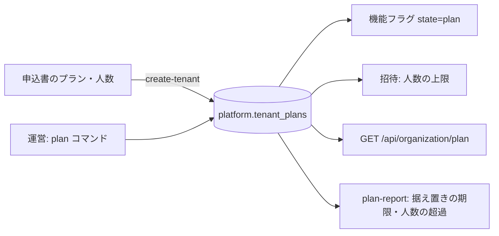

# 設計: 契約のプランの表(人数の上限・機能とのつなぎ・価格表と据え置き)

> **AI 用の設計書。省略せずに網羅的に書く(正はこちら)。** 人はこれを開かず、PR の本文の「人向けのまとめ」を見る([guides/human-review.md](../guides/human-review.md))。
> 仕様: [docs/specs/0047-plans.md](../specs/0047-plans.md)
> 状態: 下書き
> 観点の順は [review-viewpoints.md](../review-viewpoints.md)。当てはまらない節も消さずに「該当なし(理由)」と書く。

## 0. 全体像

プランと価格表の定義はコード(`@app/shared` の `PLANS`・`PRICE_LISTS`)、組織ごとの契約は足すだけの表 `platform.tenant_plans`(いつから・どのプラン・どの価格表・何人まで・据え置きはいつまで)。運営のコマンド `plan` が足し、アプリは読むだけ。機能フラグに状態 `plan` を足して「プランに入っている組織だけ」に出し、招待は人数の上限で止める。

## 作業の前に読んだ物(ガイド)

- 用語集・領域の説明: `docs/domain/glossary.md`・`docs/domain/organizations/README.md`
- ADR: 0005(お金と時刻。日付は組織の時間帯)・0013(監査ログ)・0025(機能フラグと利用の記録)・0039(開通)・0040(招待)・0041(契約の型)
- 既存のコード:
  - `packages/shared/src/feature-flags.ts`・`apps/api/src/feature-flags/` … 定義はコード・組織ごとの行は DB・切り替えは運営のコマンドだけ・アプリは読むだけ。プランも同じ形にした
  - `apps/api/src/usage/command.ts` … 全部の組織を回すのは `operator_tenant_ids()`(移行 0012)と組織ごとの `withTenant`
  - `apps/api/src/domains/organizations/invitations.ts` … 招く時点の 409 の並び。人数の上限もここで止める
  - `apps/api/src/onboarding/create-tenant.ts` … 申し込みの JSON。申込書の「プラン」「人数」をここで受ける
  - `docs/legal/order-form.md` … プラン・人数の欄(「キットにプランの表は無い」を直した)

## 1. 設計方針

- 置き場は `apps/api/src/plans/`(機能フラグと同じく、領域ではない共通の仕組み。表はスキーマ `platform`)。組織の領域からは `plans/index.ts` の `ensureSeatAvailable` だけを使う。plans は組織の領域の入口を読まない(組織 → 招待 → プラン → 組織の輪になる。人と招待は SQL で数える)。
- 定義はコード(`packages/shared/src/plans.ts`): 変えるのは PR で、画面・API・コマンドが同じ一覧を見る。プランの名前・価格表の名前は使い回さない。
- 契約は足すだけ: 「いつから」を持つので、値上げの予約(先の日付)・過去の契約の確かめ(誰がいつどのプランだったか)ができる。直さない(誤りは新しい行で上書き)。
- 金額は持たない(U-1)。
- 新しい依存は無い。

## 2. データモデル

表 `platform.tenant_plans`(移行 `0015_tenant_plans.sql`。段 ① 拡張):

| 列 | 型 | 区分 | 中身 |
|---|---|---|---|
| id | uuid(v7) | internal | 行の ID |
| tenant_id | uuid | internal | 組織(`tenants` へ外部キー) |
| plan | text | public | `PLANS` の id(enum にしない。足すたびに移行が要らないように) |
| price_list | text | public | `PRICE_LISTS` の id(どの版の価格表で契約しているか) |
| seats | int(NULL 可。CHECK > 0) | internal | 人数の上限。NULL は上限なし |
| price_locked_until | date(NULL 可) | internal | 据え置き(この価格表のまま)の期限 |
| effective_on | date | internal | 効き始めの日(組織の時間帯の日付) |
| created_at | timestamptz | internal | 足した時刻(同じ日の行の後先) |

- 索引: `(tenant_id, effective_on desc, created_at desc)`(いまの行を1行で引く)。新しい表なので移行の中で張る。
- RLS: ENABLE・FORCE・`tenant_isolation`。app_rw は SELECT だけ。書くのは表の持ち主(運営のコマンド)。
- 解約で消す一覧 `TENANT_TABLES` に `platform.tenant_plans`。
- 書き出し: 入れない(契約は申込書と会計ソフトが正。お客さんは画面「招待」で見られる)。
- 列の分類表に8行。監査ログの details に `plan`・`priceList` のキー。
- 戻し方: `DROP TABLE platform.tenant_plans;`(前の版のアプリは読まない)。

## 3. API

| API | 権限 | 出力 | 失敗 |
|---|---|---|---|
| `GET /api/organization/plan` | plan:read(admin) | `OrganizationPlan { plan: {id, label, priceList, seats, seatPolicy, priceLockedUntil, effectiveOn} \| null, members, pendingInvitations }` | 401・403 |

- 招く API(`POST /api/invitations`)に 409 `seat_limit_reached` が増える。
- 契約は `packages/shared/src/plans.ts` に足すだけ。失敗の code 1つ。
- 変える API は作らない(仕様の「権限の表に足す行」)。

CLI:

- `plan <組織の ID>` → `{"mode":"show","tenantId","current","history"}`(新しい順に10件)
- `plan <組織の ID> --plan <プラン> [--seats <数>|none] [--price-list <版>] [--locked-until <日>|none] [--effective-on <日>] [--execute]` → `{"mode":"plan"|"changed"|"unchanged","tenantId","current","next","changed"}`
- `plan-report [--within-days <日数>(既定60)]` → `{"mode":"report","today","currentPriceList","counts","withoutPlan","priceLockEnding","overSeats"}`(組織の ID と数だけ。運営の組織は数えない)

## 4. 状態遷移

- 契約: (無い)→ 行を足す → 行を足す …(戻らない。いまの行は日付で決まる)。
- 据え置き: 価格表が旧版で期限がある → 期限が来たら運営が新しい版を渡して移す(自動では移さない。U-2)。プランを変えたら消える。

## 5. システム間連携

- 該当なし(外へ送らない)。請求・会計ソフトとはつながない(運営が申込書と会計ソフトを見て、コマンドで合わせる)。

## 6. 業務ルール

- 省いた項目の埋め方(`planChange`):
  - 価格表: 同じプランならいまのまま。プランを変えたら(初めても)、効き始めの日の価格表(`currentPriceList`)。
  - 据え置き: 同じプラン・同じ価格表ならいまのまま。それ以外は無し。
  - 人数: いまのまま(初めてなら上限なし)。`none` で上限なし。
  - 効き始めの日: 組織の時間帯の今日。
- いまと同じ中身(プラン・価格表・人数・据え置き)なら足さない。
- 人数の上限(`ensureSeatAvailable`): プランの `seatPolicy` が block で、上限があり、いる人+受けていない(期限内の)招待 ≥ 上限なら 409。招待を受けるときは見ない(招く時点で数えている)。
- 機能(`isEnabled`): 状態 `plan` は「いまのプランの features にある」か「組織ごとの行がある」。`rollout` はプランを見ない。賭けとの決まり: `plan` は賭けが adopted のときだけ(`apps/api/test/unit/feature-flags.test.ts`)。
- plan-report の「旧価格表」: いまの価格表(今日の版)と違い、据え置きの期限が無い・N 日以内・過ぎた組織。

## 7. 要求との対応

| 受け入れ条件(仕様) | 設計のどこ | テスト |
|---|---|---|
| 定義は shared・誤りは単体テスト | 1 | `packages/shared/src/plans.test.ts` |
| 価格表は金額を持たない・版を足す | 1・U-1 | 同上(並びの決まり) |
| plan の見る・試し・本番 | 3 | `plans.int.test.ts`「試しは何も足さない」 |
| 足すだけ・先の日付は効かない | 2・6 | 「先の日付の契約は」 |
| 人数だけ / プランを変える / 据え置き | 6 | `test/unit/plans.test.ts` |
| 監査ログ・同じ中身なら足さない | 3・6 | 「試しは何も足さない」 |
| plan-report | 3・6 | 「旧価格表の組織と、人数を超えた組織」 |
| 開通の申し込みのプラン | 1 | 「申し込みにプランと人数があれば」「定義に無いプランなら試しでも止まり」・`test/unit/create-tenant.test.ts` |
| 人数の上限 block / count / 無し | 6 | 「block のプランは」「count のプランは止めない」 |
| 機能の状態 plan | 6 | 「plan の機能は」・`plans.test.ts`(shared) |
| 管理者が見る・403・他社 | 3 | 「自社のプランと」・`authz-matrix.int.test.ts` |

## 8. 非機能

- 性能: いまの行は索引で1行。招く・`GET /api/me`(plan の機能があるときだけ)で1〜3クエリ増える。plan-report は組織ごとに数クエリ(数百社なら数秒。運営が月に数回)。
- セキュリティ: 仕様の STRIDE。コマンドの出力は組織の ID と数だけ。
- 運用: 手順書 `docs/runbooks/plans.md`(契約を入れる・人数を変える・値上げと据え置き・月ごとの見直し)。
- 費用: なし。

## 9. このプロダクト特有

| 観点 | この変更では |
|---|---|
| テナント分離 | RLS+組織の ID で絞る。結合テストで他社のプランが見えない・他社の機能が出ない |
| 権限の表 | 1行(`plan:read` = admin) |
| 監査ログ | `plan.change`(手で記録する名前)。details はプランと価格表の名前だけ。画面の文 `audit-labels.ts` |
| 解約で消す一覧 | `platform.tenant_plans` |
| サポートの代理ログイン | 代理は閲覧者なので見られない(403) |
| ログの個人情報 | 出さない(ID・数・名前の定義だけ) |
| 列の分類(`personal` / `sensitive`) | 無し(public と internal だけ) |
| 画面の部品 | 画面「招待」に1行(`Muted`)。VRT の撮る画面ではない |

## 10. 観点ごとの扱い

| 観点 | 扱い | 理由 |
|---|---|---|
| 設計方針 | 最重要 | 定義はコード・契約は足すだけの表・変えるのはコマンドだけ(ADR 0058) |
| データモデル | 採用 | 「いつから」と「どの価格表か」「据え置きの期限」を持つ形 |
| 業務ルール | 最重要 | プランを変えたら据え置きが消える・人数の上限の数え方(U-2・U-3) |
| API | 軽く確認 | 読むだけの1本 |
| 状態遷移 | 軽く確認 | 足すだけ |
| システム間連携 | 低優先 | 外とつながない |
| 要求との対応 | 機械で検証 | 単体と結合のテスト |
| 非機能 | 軽く確認 | 小さなクエリが少し増えるだけ |
| テナント分離・権限の表 | 機械で検証 | 結合テストと表の自動の答え合わせ |

## 11. 決めたこと(AI が決めた。人に聞かなかった)

- 置き場は `src/plans`(platform) — 機能フラグと同じ「共通の仕組み」で、組織の領域の入口を読まない形にしないと輪になる。
- 行は足すだけ・`effective_on` を持つ — 値上げの予約・過去の確かめ・据え置きの期限を1つの形で持てる。直す操作を作らない。
- 機能フラグに状態 `plan` を足す(rollout にプランの意味を混ぜない) — 賭けの段階(rollout は試し)と、契約で出し分ける機能(adopted の後)は別の物。`plan` は adopted のときだけにした。
- 組織ごとの行は `plan` でも効く — プランの外の組織に試しに出す道を残す(営業の試用)。
- 人数は「いる人+受けていない招待」で数える — 招待を積んでから上限を超えて受けられる抜け道を塞ぐ。招待を受けるときは見ない(DB の関数 `auth_accept_invitation` を変えない)。
- 招く API が 409 を返すだけで、画面は「招待」に人数の行を出す — 管理者が上限を知ってから招ける。
- plan-report は「据え置きの無い旧価格表の組織」も出す — 値上げのときに移し忘れる組織。
- 開通の申し込みに `plan`・`seats`・`priceList`・`priceLockedUntil` を読む — 申込書の欄と同じ名前(`docs/legal/order-form.md` と `docs/runbooks/tenant-provisioning.md`)。

## 12. 未確定事項(AI の仮決め。人の承認と分けて追う)

> 4つに当たる判断だけ。状態の書き方は [guides/human-review.md](../guides/human-review.md) の 2。`pnpm decisions` がここを読む。**`仮決め` が残る PR はマージしない。**

| 番号 | 工程 | 種類 | 仮決め(設計した事実) | なぜそうしたか | 人が判断する問い | 状態 |
|---|---|---|---|---|---|---|
| U-1 | 設計 | 事業判断 | 価格表は版の名前と「いつから」だけを持ち、**金額を持たない**(金額は申込書と会計ソフト) | 請求は外の会計ソフトで手で(キットは持たない)。金額を2か所に持つと食い違う。据え置きに要るのは「どの版か」と「いつまでか」 | 金額をキットに持たなくてよいか(ARR などを画面で出したくなったら、価格表に金額を足す別の仕様) | 仮決め |
| U-2 | 設計 | 利用者の挙動 | **プランを変えたら据え置きは消える**(その日の価格表に移る)。人数だけ変えたら据え置きのまま(席を足しても旧価格)。期限が来ても自動では移さない(plan-report で見て運営が移す) | 世の中でよくある形(上のプランに変えたら新価格)。自動で移すと、お客さんへの知らせより先に価格が変わる | 席を足したら新価格にするか・期限で自動で移すか | 仮決め |
| U-3 | 設計 | 利用者の挙動 | キットの既定のプラン `standard` は人数の上限を超えたら**招待を止める**(block)。数えるのは「いる人+受けていない招待」 | 申込書の「人数」を守れる一番軽い形。止めない(count)はプランごとに選べる | 上限で止めるか・超えても使わせて翌月から請求するか | 仮決め |
| U-4 | 設計 | 事業判断 | キットの既定は、プラン `standard`(機能なし)1つと、価格表 `2026-10` 1つ | 使い始めた人がすぐ申込書と合わせられる最小の形。名前は使い始めた人が PR で直す | この既定でよいか(導入時に決める物にしてよいか) | 仮決め |

## 13. 作り直しの記録

| 日付 | きっかけ | 入った工程 | 直した物 | 作り直した下流 |
|---|---|---|---|---|
